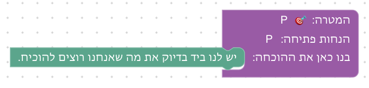

# יחידה 0 — היכרות עם הסביבה

**מטרה:** הסטודנט מכיר את חלקי המסך ואת מחזור העבודה: פותחים את הארגז, גוררים מהלך אל בלוק המטרה, קוראים את מצב ההוכחה ובודקים. בלוגיקה הוא לומד דבר אחד בלבד: כשאחת ההנחות שבידינו אומרת בדיוק את מה שצריך להוכיח, ההוכחה הושלמה.

היחידה קצרה (כמה דקות) ויש בה שלב אחד. היא נלמדת דרך עשייה ולא דרך סיור מודרך: כל חלק במסך מוצג בשמו בטקסט הפתיחה של השלב שבו משתמשים בו לראשונה, גם אם השלב הזה נמצא ביחידה מאוחרת יותר.

כל מהלך בקורס נקרא כמו משפט בהוכחה שכותבים ביד ([עיקרון 1](design/principles.md)). להנחות אין שמות: הנחה מופיעה רק לפי מה שהיא אומרת, במצב ההוכחה, בבלוקים, בטקסטים וברמזים.

## חלקי המסך

| חלק | תפקיד | מוצג לראשונה |
|---|---|---|
| טקסט הפתיחה, וכרטיס ההנחות והמטרה | מה צריך להוכיח בשלב, ומה נתון | שלב 0.1 |
| ארגז "מהלכי הוכחה" | המהלכים של השלב | שלב 0.1 |
| בלוק המטרה | המטרה, הנחות הפתיחה, והמקום "בנו כאן את ההוכחה" שאליו גוררים את המהלכים | שלב 0.1 |
| מצב ההוכחה: "מה יש לנו ביד" ו"מה נשאר להוכיח" | ההנחות והמטרה בנקודה מסוימת בהוכחה | שלב 0.1 |
| כפתור "בדוק הוכחה" והודעת ההצלחה | בדיקת ההוכחה כולה, ומעבר לשלב הבא | שלב 0.1 |
| "לפני המהלך" / "אחרי המהלך" והסימון הכחול של המהלך שנבחר | מצב ההוכחה סביב מהלך מסוים | מוזכר בסיום שלב 0.1; מוסבר בשלב 2.1 |
| שדה בחירה בתוך בלוק, מסומן `?` | בחירת ההנחה שהמהלך משתמש בה, מרשימת ההנחות שבידינו באותו מקום בהוכחה, או "✎ כתיבה ידנית" | שלב 2.2 |
| סימון שגיאה: בלוק אדום, סמל ! והסבר בעברית | איפה ההוכחה נתקעה ולמה | שלב 2.2 (טעות מתוכננת) |
| כפתור "הצג רמז" | רמזים הדרגתיים, אחד בכל פעם | שלב 2.2 |
| בלוק שמפצל את ההוכחה לחלקים, עם כותרת לכל חלק | הוכחה של כל חלק במקום משלו | שלב 3.2 |
| גרירת בלוק לפח | הוצאת מהלך מההוכחה | שלב 3.6 |

טקסט הסיום של שלב 0.1 מזכיר את "לפני המהלך" ו"אחרי המהלך" על המהלך היחיד שבו (לפניו נשאר להוכיח את P, ואחריו לא נשאר דבר), כי הבחירה כבר מופיעה במסך. ההסבר המלא נדחה לשלב 2.1: שם יש לראשונה שני מהלכים, והמהלך הראשון ("נניח") משנה את מצב ההוכחה כך שיש מה להשוות.

## המהלכים

| מהלך | Lean | לפני → אחרי |
|---|---|---|
| **סיום:** יש לנו ביד בדיוק את מה שאנחנו רוצים להוכיח. | `assumption` | `P ⊢ P` ⟶ סגור |

הסטודנט לא מצביע על ההנחה שסוגרת את המטרה: Lean מחפש בכל מה שבידינו הנחה שאומרת בדיוק את המטרה (`assumption`). כך גם כותבים ביד: "וזה מה שהיה צריך להוכיח", בלי לציין מאיזו שורה. אם אין הנחה כזאת, הבלוק נצבע באדום וההסבר אומר "אין בידינו הנחה שאומרת Q. במצב ההוכחה רואים מה יש לנו ביד."

## שלבים

לכל שלב: מה לומדים בו, למה הוא בנוי כך, איך אנחנו רוצים שסטודנטים יפתרו אותו, ושיקולים ושאלות שעוד צריך להכריע. השורה שמתחת לכותרת מציגה את המטרה בכתיב של רצף (ההנחות משמאל ל־⊢, המטרה מימינו) ואת המהלכים שבארגז.

הפתרונות של כל השלבים כתובים בקובץ `frontend/e2e/solutions.js`, לפי הסדר, ובדיקה אוטומטית מוודאת שכל אחד מהם מתקבל ב־Lean. הצילומים נוצרים מהפתרונות (`npm run docs:screenshots` בתיקייה `frontend`): הצילום של הפתרון הראשון של שלב L ביחידה U הוא `images/unitU-levelL-a.png`, של השני `…-b.png`, וכן הלאה.

**מה יש בארגז.** בארגז של כל שלב יש רק המהלכים שאחד הפתרונות שלו משתמש בהם, וכל מהלך שהפתרונות משתמשים בו נמצא בארגז (`frontend/src/game/moves.test.js` בודק זאת). כך אין בארגז מהלכים שלא יכולים לעזור. בשלב שמציג מהלך חדש, בדרך כלל יש בארגז רק המהלך הזה והסיום, כדי שאי אפשר יהיה לפתור את השלב בלעדיו. בשלבי תרגול, כשיש שתי דרכים שמשתמשות במהלכים מוכרים (למשל אחורה וקדימה), בארגז יש את המהלכים של שתיהן, והרמזים מתארים דרך אחת ומזכירים את השנייה. מי שמוסיף דרך פתרון לשלב מוסיף אותה גם לקובץ הפתרונות.

### שלב 0.1: המטרה כבר בידינו

`P ⊢ P` · בארגז: סיום

**מה לומדים.** את מחזור העבודה כולו: פותחים את הארגז, גוררים בלוק אל בלוק המטרה, למקום שכתוב בו "בנו כאן את ההוכחה", קוראים את מצב ההוכחה ולוחצים על "בדוק הוכחה". ובלוגיקה: הנחה שאומרת בדיוק את המטרה מסיימת את ההוכחה.

**למה כך.** הצעד הלוגי הוא הפשוט ביותר, כדי שכל תשומת הלב תופנה לממשק. בארגז יש מהלך אחד, ואין בו שדה למלא, כך שאי אפשר לטעות בבחירה. טקסט הפתיחה מסביר שכל בלוק הוא משפט בהוכחה, "כמו בהוכחה שכותבים ביד", כדי שכבר מהצעד הראשון הבלוקים ייקראו כטקסט מתמטי ולא כפקודות. טקסט הסיום מנסח את ההוכחה כמו שכותבים אותה ביד ("P, וזה מה שהיה צריך להוכיח"), ומזכיר את "לפני המהלך" ו"אחרי המהלך", כי הבחירה כבר מופיעה במסך.

ביחידה אין טעות מתוכננת. טעות שמתקנים בבחירת הנחה אחרת לא מתאימה למהלך הסיום, כי בסיום לא בוחרים הנחה. הטעות המתוכננת הראשונה נמצאת בשלב 2.2, שם היא נובעת באופן טבעי מהחומר: מסיימים מוקדם מדי, והתיקון הוא בדיוק המהלך שהשלב מלמד.

**פתרון.** גוררים את הסיום אל בלוק המטרה: ההנחה P אומרת בדיוק את המטרה.

**שיקולים ושאלות להכרעה.**
- הסטודנט לא בוחר כאן דבר: יש בלוק אחד, בלי שדה, וההבחנה בין הנחה למטרה עוד לא נבחנת. היא נבחנת לראשונה בשלב 2.2, כשהסיום נכשל כי אף הנחה לא אומרת את המטרה. האם זה מספיק, או שכדאי להוסיף כבר כאן הנחה מסיחה (למשל `Q, P ⊢ P`), כדי שהסטודנט יראה שהסיום מחפש בעצמו את ההנחה המתאימה?
- הכפתור "הצג רמז" כבר פעיל כאן (יש שני רמזים), אבל הטקסט מזכיר אותו רק בשלב 1.2. האם להזכיר אותו כבר בטקסט הפתיחה?
- האם להשאיר את ההזכרה של "לפני המהלך" ו"אחרי המהלך" כבר כאן, כשיש רק מהלך אחד, או לדחות אותה לגמרי לשלב 2.1?

בסוף השלב הכפתור "ליחידה 2" מעביר ישר לשלב הראשון של יחידה 2.

## שאלות שנוגעות ליחידה כולה

- **דילוג:** האם סטודנט שכבר מכיר את הסביבה יכול לדלג ישר ליחידה 2? היחידה קצרה, ולכן אולי אין בכך צורך.
- **סיווג הנחות ומטרות:** ההבחנה בין הנחה למטרה נלמדת בתוך ההוכחה עצמה, במצב ההוכחה ("מה יש לנו ביד" מול "מה נשאר להוכיח") ובטעות המתוכננת של שלב 1.2. האם כדאי להוסיף תרגיל נפרד של סיווג כרטיסים להנחה או מטרה? הוא ידרוש ממשק משלו.

