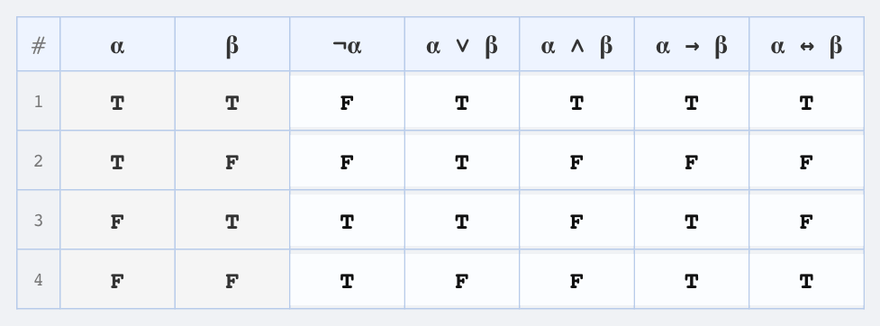
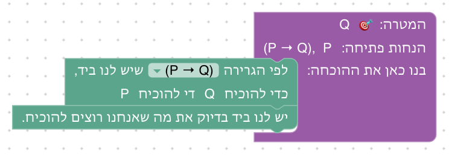
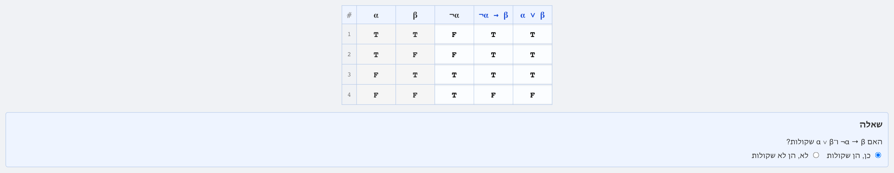
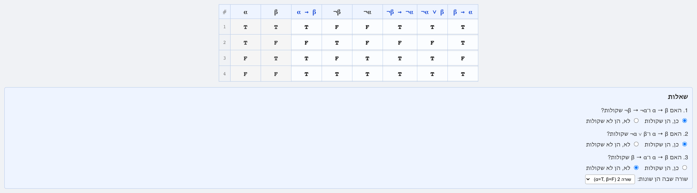
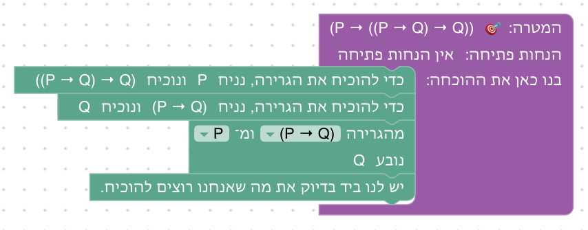
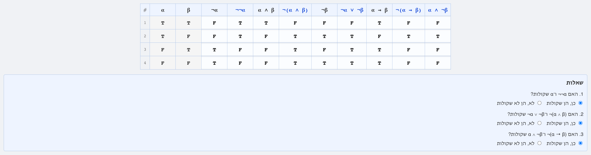
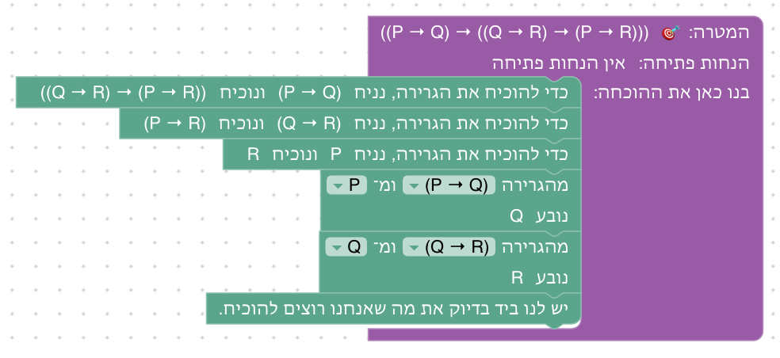

# יחידה 1 — מהנחה למסקנה

**מטרה:** הוכחה ישירה של גרירות. הסטודנט מוכיח את P → Q בהנחת P והוכחת Q, ומשתמש בגרירה P → Q שבידיו בשתי דרכים: אחורה, כשהמסקנה שלה Q היא המטרה ולכן די להוכיח את התנאי P, וקדימה, כשהתנאי P בידיו ולכן נובעת המסקנה Q, שמצטרפת להנחות. בדרך הוא פוגש לראשונה בחירת הנחה מרשימה, סימון שגיאה ורמזים.

## המהלכים

| מהלך | Lean | לפני → אחרי |
|---|---|---|
| **נניח:** כדי להוכיח את הגרירה, נניח P ונוכיח Q | `easylean_assume` (בדיקה שהמטרה אינה שלילה, ואז `refine easylean_imp_intro (fun _ => ?_)`) | `⊢ P → Q` ⟶ `P ⊢ Q` |
| **מעבר לתנאי:** לפי הגרירה [P → Q] שיש לנו ביד, כדי להוכיח Q די להוכיח P | `refine easylean_mp ‹P → Q› ?_` | `P → Q ⊢ Q` ⟶ `P → Q ⊢ P` |
| **הסקה קדימה:** מהגרירה [P → Q] ומ־[P] נובע Q | `have := easylean_mp ‹P → Q› ‹P›` | `P → Q, P ⊢ R` ⟶ `P → Q, P, Q ⊢ R` |
| **סיום** (מיחידה 0): יש לנו ביד בדיוק את מה שאנחנו רוצים להוכיח. | `assumption` | `P ⊢ P` ⟶ סגור |

בסוגריים המרובעים: שדות שהסטודנט בוחר. כל השאר נכתב בבלוק לבד, לפי מצב ההוכחה ולפי מה שנבחר.

**הבלוק משלים את המשפט.** בארגז הבלוקים כתובים באופן כללי ("כדי להוכיח את הגרירה, נניח את התנאי שלה ונוכיח את המסקנה שלה"). כשבלוק במקומו בהוכחה, הנוסחאות מושלמות בו: "נניח" כותב את התנאי והמסקנה לפי המטרה שלפניו, "מעבר לתנאי" כותב מה די להוכיח לפי הגרירה שנבחרה, ו"הסקה קדימה" כותב מה נובע. את מה שנובע לא בוחרים: הוא נקבע לפי הגרירה, כמו בהוכחה כתובה.

**בחירת הנחה לפי מה שהיא אומרת.** להנחות אין שמות. שדה `?` בבלוק נפתח לרשימה של ההנחות שבידינו באותו מקום בהוכחה (מצב ההוכחה לפני המהלך מחושב ב־Lean), ובסופה "✎ כתיבה ידנית", שבה מקלידים את הטענה (אפשר `->` במקום `→`). מאחורי הקלעים Lean מוצא את ההנחה לפי הטענה שלה (`‹P → Q›`), ולכן אין צורך בשמות; ההנחות החדשות שנוצרות במהלכים נשארות בלי שם (`fun _`, `have :=`). אם הטענה שנבחרה לא מתאימה, ההסבר מדבר על טענות, למשל: "ההנחה Q היא לא התנאי של הגרירה: התנאי שלה הוא P", או "המסקנה של P → Q היא Q, אבל צריך להוכיח R. אפשר לעבור לתנאי של גרירה רק כשהמסקנה שלה היא בדיוק מה שצריך להוכיח."

`easylean_imp_intro` ו־`easylean_mp` הם הכללים →I ו־→E של דדוקציה טבעית, כמשפטים של הקורס. ב־Lean ‏¬P היא P → ⊥, ולכן `easylean_assume` בודק קודם שהמטרה אינה שלילה: לשלילה יש מהלך משלה (יחידה 3), ו"נניח" על שלילה נכשל עם הסבר שמפנה אליו. הם מאפשרים לנסח את השגיאות במונחי גרירה, תנאי ומסקנה.

## שלבים

לכל שלב: מה לומדים בו, למה הוא בנוי כך, איך אנחנו רוצים שסטודנטים יפתרו אותו, ושיקולים ושאלות שעוד צריך להכריע. על הפתרונות, הצילומים ומה שיש בארגז, ראו [יחידה 0](00-getting-started.md#שלבים).

**קדימה ואחורה.** ביחידה הזאת משתמשים בגרירה בשתי דרכים, ושתיהן נלמדות במפורש. *אחורה* (שלב 1.2): המסקנה של הגרירה היא המטרה, ולכן עוברים להוכיח את התנאי שלה. *קדימה* (שלב 1.3, modus ponens, ‎→E בדדוקציה טבעית): התנאי בידינו, ולכן המסקנה מצטרפת להנחות, והמטרה לא משתנה. Logic and Proof ממליץ להתחיל אחורה מהמטרה ואז להתקדם קדימה מההנחות; בהוכחה כתובה שתי הדרכים נפוצות. בשלבי התרגול (1.4, 1.5) בארגז יש את שתי הדרכים, ולכל שלב יש שני פתרונות, אחורה וקדימה.

### שלב 1.1: אותה טענה משני הצדדים

`⊢ P → P` · בארגז: נניח, סיום

**מה לומדים.** להוכיח גרירה: מניחים את התנאי, ונשאר להוכיח את המסקנה. וגם "לפני המהלך" ו"אחרי המהלך": לחיצה על מהלך מסמנת אותו בכחול, ובמצב ההוכחה רואים איך הוא שינה את ההנחות ואת המטרה.

**למה כך.** P → P היא הטענה הפשוטה ביותר שיש בה גרירה, כך שהרעיון החדש היחיד הוא הנחת התנאי; הסיום כבר מוכר מיחידה 0. כשהבלוק במקומו כתוב בו "כדי להוכיח את הגרירה, נניח P ונוכיח P", כך שהבלוק עצמו מראה מה מניחים ומה נשאר להוכיח. זה גם השלב הראשון עם שני מהלכים, ולכן המקום הטבעי להסביר את "לפני המהלך" ו"אחרי המהלך": לפני "נניח" המטרה היא P → P, ואחריו P בידינו והמטרה היא P.

**פתרון.** מניחים את התנאי, וההנחה P אומרת בדיוק את המטרה.

**שיקולים ושאלות להכרעה.**
- P → P נראית טריוויאלית. Massot מדווח שסטודנטים מאבדים עניין בהוכחת טאוטולוגיות ריקות. האם להציג כבר כאן דוגמה מילולית (למשל "אם יורד גשם, אז יורד גשם") כדי לעגן את המשמעות?
- הבלוק כותב לבד את מה שמניחים. האם הסטודנט צריך לכתוב או לבחור בעצמו את מה שהוא מניח ("נניח [P]"), כדי שיחשוב על התנאי, או שהשלמה אוטומטית עדיפה, כי אין כאן החלטה אמיתית?
- בארגז הבלוק כתוב באופן כללי ("נניח את התנאי שלה ונוכיח את המסקנה שלה"), ובמקומו הוא משנה את הנוסח. האם השינוי ברור לסטודנטים, או שהוא מפתיע בפעם הראשונה?

### שלב 1.2: שימוש בגרירה: מחליפים את המטרה

`P → Q, P ⊢ Q` · בארגז: מעבר לתנאי, סיום · השלב נפתח עם סיום מוקדם מדי (טעות מתוכננת)

**מה לומדים.** שימוש בגרירה אחורה: אם המסקנה של גרירה שבידינו היא בדיוק המטרה, די להוכיח את התנאי שלה. בממשק: בחירת הנחה מרשימה, סימון שגיאה (בלוק אדום, סמל ! והסבר) וכפתור הרמזים.

**למה כך.** כאן נמצאת הטעות המתוכננת הראשונה בקורס. בבלוק המטרה כבר יש "יש לנו ביד בדיוק את מה שאנחנו רוצים להוכיח", אבל אף הנחה לא אומרת Q, ולכן הבלוק אדום וההסבר אומר "אין בידינו הנחה שאומרת Q". זו בדיוק הטעות שהשלב בא למנוע: לבלבל בין מה שיש ביד לבין מה שרוצים להוכיח. התיקון הוא המהלך החדש: גוררים את "מעבר לתנאי" מעל הבלוק האדום ובוחרים בו את P → Q; המטרה הופכת ל־P, והבלוק האדום, שנשאר במקומו, מסיים את ההוכחה. כך הסטודנט לומד שטעות לא מוחקת התקדמות ([עיקרון 7](design/principles.md)), ושמהלך נכשל או מצליח לפי מצב ההוכחה שלפניו.

ההנחות נתונות מראש, בלי "נניח", כדי שהשלב יתמקד ברעיון אחד: החלפת המטרה. זה גם השדה הראשון בקורס, ולכן טקסט הפתיחה מסביר את הרשימה ואת "כתיבה ידנית". אחרי הבחירה כתוב בבלוק "לפי הגרירה P → Q שיש לנו ביד, כדי להוכיח Q די להוכיח P", כך שהבלוק עצמו מנסח מתי מותר להשתמש בו.

**פתרון.** אחורה: לפי P → Q, די להוכיח P, והבלוק שהיה אדום מסיים.

**שיקולים ושאלות להכרעה.**
- השגיאה מסומנת על הסיום, אבל את הסיום לא צריך לשנות: צריך להוסיף מהלך לפניו. טקסט הפתיחה אומר זאת במפורש ("מעל הבלוק האדום"). סטודנט שימחק את הבלוק האדום יצטרך להחזיר אותו. האם זה מבלבל, או דווקא מלמד שהבלוק עצמו לא היה שגוי אלא מוקדם?
- ברשימה של השדה מופיעות כל ההנחות שבידינו, גם P, שהיא לא גרירה. בחירה בה מסבירה "ההנחה P היא לא גרירה, ולכן אין לה תנאי ומסקנה". האם להשאיר זאת כהזדמנות ללמוד, או לסנן מהרשימה טענות שאינן גרירות?
- הבלוק ארוך (שתי שורות) ותופס רוחב בהוכחות מקוננות. האם לקצר את הנוסח, למשל "לפי P → Q, די להוכיח P"?

### שלב 1.3: מסיקים קדימה

`P → Q, Q → R, P ⊢ R` · בארגז: הסקה קדימה, סיום

**מה לומדים.** שימוש בגרירה קדימה: מהגרירה ומהתנאי שלה נובעת המסקנה, והיא מצטרפת להנחות. ההנחות הקודמות נשארות, והמטרה לא משתנה.

**למה כך.** שרשרת של שתי גרירות, כך שקדימה הוא הכיוון הטבעי: מתחילים ממה שיש ביד. זה השלב שמציג את ההסקה קדימה, ולכן בארגז יש רק אותה והסיום, אף שאפשר היה לפתור אותו גם אחורה, כדי שהסטודנט יתרגל את הצעד החדש ולא יחזור לדרך המוכרת משלב 1.2. ההנחה שנוצרת (Q) מופיעה מיד ברשימות של הבלוק הבא, וכך רואים שהיא באמת "בידינו". טקסט הפתיחה והסיום משווים במפורש בין שתי הדרכים.

**פתרון.** קדימה: מ־P → Q ומ־P נובע Q, ומ־Q → R ומ־Q נובע R, וזו המטרה.

**שיקולים ושאלות להכרעה.**
- טקסט הסיום אומר שאת אותה הוכחה "אפשר לבנות גם אחורה, כמו בשלב 2", אבל בארגז של השלב אין "מעבר לתנאי", ולכן אי אפשר לנסות זאת כאן. האם להשאיר את ההשוואה לשלב 1.4, או לנסח אותה כהבטחה לשלב הבא?
- בשדה השני (התנאי) מוצעות כל ההנחות, ובחירה לא נכונה מסבירה "ההנחה Q היא לא התנאי של הגרירה: התנאי שלה הוא P". האם להציע בו רק את התנאי של הגרירה שנבחרה, או שהבחירה בין ההנחות היא חלק מהתרגול?
- סדר: אחורה (1.2) לפני קדימה (1.3). ספרים רבים מתחילים דווקא ב־modus ponens קדימה, שהוא הכלל המוכר יותר. הסדר הנוכחי נובע גם מהטעות המתוכננת: התיקון של סיום מוקדם מדי הוא טבעי יותר אחורה. מה עדיף לקהל שלנו?

### שלב 1.4: קוראים את המטרה לפי הסדר

`⊢ P → ((P → Q) → Q)` · בארגז: נניח, מעבר לתנאי, הסקה קדימה, סיום

**מה לומדים.** לקרוא מטרה מקוננת: גרירה שהמסקנה שלה היא שוב גרירה. מניחים את התנאים לפי הסדר, ואז משתמשים בגרירה שהונחה, באחת משתי הדרכים.

**למה כך.** ההנחות לא נתונות מראש: הסטודנט מייצר אותן בעצמו, ושני בלוקי "נניח" כותבים את מה שמניחים בכל פעם ("נניח P ונוכיח (P → Q) → Q", ואחר כך "נניח P → Q ונוכיח Q"). זה שלב תרגול, ושתי הדרכים משתמשות במהלכים מוכרים, ולכן בארגז יש את שתיהן, וטקסט הפתיחה והרמזים מציעים את שתיהן.

**פתרון א: אחורה.** אחרי שתי ההנחות, לפי P → Q די להוכיח P, וזו אחת ההנחות.

**פתרון ב: קדימה.** אחרי שתי ההנחות, מ־P → Q ומ־P נובע Q, וזו המטרה.

**שיקולים ושאלות להכרעה.**
- טקסט הסיום מנסח רק את ההוכחה אחורה, אף שהרמזים מציעים את שתי הדרכים. האם לנסח בו את שתיהן, או לבחור את הנוסח לפי ההוכחה שהסטודנט בנה בפועל?
- המטרה מוצגת עם סוגריים מלאים, כדי שלא יהיה צורך לדעת שהחץ מתקבץ לימין. האם בהמשך הקורס כדאי ללמד את מוסכמת הקיבוץ ולהוריד סוגריים?

### שלב 1.5: שרשרת של שלוש הנחות

`⊢ (P → Q) → ((Q → R) → (P → R))` · בארגז: נניח, מעבר לתנאי, הסקה קדימה, סיום

**מה לומדים.** תרגיל מסכם: שלוש הנחות, ושימוש בשתי גרירות ברצף (טרנזיטיביות של הגרירה).

**למה כך.** אותה שרשרת כמו בשלב 1.3, אבל הפעם הסטודנט מניח הכול בעצמו ובוחר דרך. ההשוואה לשלב 1.3 מראה שהמבנה הלוגי זהה, ורק מקור ההנחות שונה. אחורה, הסדר שבו משתמשים בגרירות הפוך לסדר שבו הן הונחו (קודם Q → R ואחר כך P → Q), וזה מה שהופך את השלב לתרגיל בקריאת המטרה.

**פתרון א: אחורה.** אחרי שלוש ההנחות: לפי Q → R די להוכיח Q, ולפי P → Q די להוכיח P, וזו אחת ההנחות.

**פתרון ב: קדימה.** אחרי שלוש ההנחות: מ־P → Q ומ־P נובע Q, ומ־Q → R ומ־Q נובע R, וזו המטרה.

**שיקולים ושאלות להכרעה.**
- גם הוכחה שמשלבת את הדרכים מתקבלת (למשל: מ־P → Q ומ־P נובע Q, ואז לפי Q → R די להוכיח Q). האם להוסיף אותה כפתרון שלישי ולהזכיר אותה ברמזים, כדי להראות שאפשר לשלב, או ששתי דרכים "טהורות" ברורות יותר?
- האם השלב מוסיף מספיק מעבר לשלבים 1.3 ו־1.4, או שכדאי להחליף אותו בתרגיל שמחייב לשלב בין הדרכים (למשל גרירה שהתנאי שלה הוא בעצמו גרירה)?
- האם להוסיף שלב בונוס, כמו ביחידות 2 ו־3?

## שאלות שנוגעות ליחידה כולה

- **אותה טענה פעמיים:** כשאותה טענה מופיעה פעמיים בהנחות (למשל אחרי "נניח P" כש־P כבר בידינו), היא מופיעה ברשימה פעם אחת. זה לא משנה את ההוכחה, כי Lean מוצא את ההנחה לפי הטענה. האם צריך להסביר זאת לסטודנטים?
- **כתיבה ידנית:** "✎ כתיבה ידנית" מאפשרת להקליד טענה שלא מופיעה ברשימה, למשל לפני שמצב ההוכחה התעדכן. אם הטענה לא בידינו, ההסבר אומר "אין בידינו הנחה שאומרת ...". האם להשאיר את האפשרות כבר ביחידה הראשונה, או לחשוף אותה רק כשיש בה צורך?

