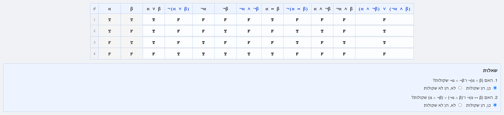
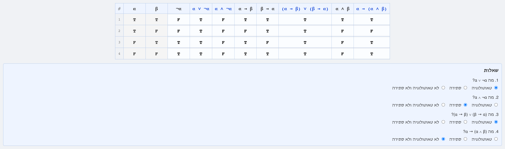
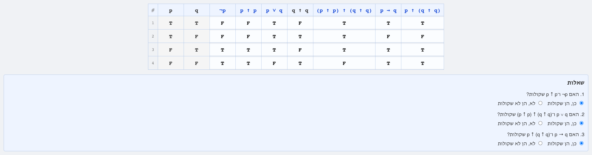

# יחידה 1 — טבלאות אמת

**מטרה:** הסטודנט מכיר את הקשרים הלוגיים דרך טבלאות האמת שלהם, ומחשב בטבלה את הערך של טענה מורכבת לפי המילה הראשית שלה ולפי הערכים של חלקיה. הוא בודק בטבלה ששתי טענות *שקולות לוגית* (אותה עמודה בכל השמה), מוצא שורה שבה שתי טענות שונות כשהן לא שקולות, ומסווג טענות לטאוטולוגיה, סתירה, או אף אחת מהן.

היחידה הולכת לפי ההרצאה הראשונה בקורס, שמתחילה בטבלאות אמת לפני כל הוכחה: כל שלב הוא שקף של ההרצאה (ראו הטבלה למטה). השקילויות שהוכחו כאן בטבלאות הן השקילויות שהמהלך "לפי השקילות" מציע ביחידה 6: הוכחה בטבלת אמת היא הוכחה, ולכן אין צורך להוכיח אותן שוב במהלכים. את השקילויות של הכמתים אי אפשר לבדוק בטבלה, ולכן הן מוכחות במהלכים ביחידות 5 ו־6.

## איך זה עובד

שלבי היחידה הם טבלאות שממלאים, ולא הוכחות מבלוקים (`frontend/src/game/TruthTableWorkspace.jsx`). המסגרת זהה לשלבי ההוכחה: הכותרת ותפריט השלבים למעלה, ובצד טקסט הפתיחה, הרמזים, כפתור הבדיקה ("בדוק טבלה") והסיום עם המעבר לשלב הבא.

- **השלב נותן טענות, והטבלה נבנית מהן.** לכל טענה של השלב, ולכל חלק שלה, יש עמודה, מהחלקים הפנימיים אל הטענה כולה, כל חלק פעם אחת (`tableColumns` ב־`frontend/src/game/truthTable.js`). שתי העמודות הראשונות הן טענות היסוד, α ו־β, מלאות מראש, בסדר של ההרצאה: TT, TF, FT, FF.
- **ממלאים T או F בכל תא.** לחיצה על תא כותבת בו T, ולחיצה נוספת מחליפה ל־F.
- **השאלות.** מתחת לטבלה יש שאלות משלושה סוגים: "האם X ו־Y שקולות?" (ואם לא: "שורה שבה הן שונות", דוגמה נגדית לשקילות), "באיזו שורה X שקרית?", ו"מה X?" (טאוטולוגיה, סתירה, או לא טאוטולוגיה ולא סתירה). הכותרות של העמודות שהשאלות שואלות עליהן כחולות, כמו העמודות הצבעוניות בשקפים.
- **הבדיקה.** תאים שגויים מסומנים באדום, וההסבר מנמק את הראשון שבהם לפי המילה הראשית, למשל: "המילה הראשית של ¬α → β היא →, וגרירה שקרית רק כשהתנאי נכון והמסקנה שקרית: רק אז ההבטחה מופרת. כאן ¬α היא F ו־β היא F, ולכן ¬α → β היא T." כשהטבלה נכונה, ההסבר עובר לשאלה הראשונה שלא נענתה נכון, בלי לגלות את התשובה ("השוו שוב את העמודות של ...").
- **בלי Lean.** טבלת אמת היא חישוב ולא הוכחה, ולכן הבדיקה נעשית בקוד האתר עצמו (`checkTable`). זה החלק היחיד באתר ש־Lean לא בודק.
- **כתיב.** כמו בהרצאה: שלילה נצמדת למה שאחריה (¬α → β), וחלק עם קשר דו־מקומי תמיד בסוגריים ((α ∧ ¬β) ∨ (¬α ∧ β)).

הבדיקות: `frontend/src/game/truthTable.test.js` בודק את החישוב, את ההסברים, ושכל שלב נפתר בטבלה שלו ובתשובות הנכונות; `frontend/e2e/truthTables.spec.js` ממלא כל טבלה בלחיצות, כמו סטודנט, עונה על השאלות ובודק. הצילומים נוצרים באותה פקודה כמו בשאר היחידות (`npm run docs:screenshots`).

## שלבים

| שלב | שקף בהרצאה | טענות בטבלה | שאלות |
|---|---|---|---|
| 1.1 | הקשרים הלוגיים מוגדרים באמצעות טבלת האמת שלהם | ¬α, α ∨ β, α ∧ β, α → β, α ↔ β | — |
| 1.2 | גרירה: אינטואיציה | α → β, β → α, (α → β) ∧ (β → α), α ↔ β | השורה שבה α → β שקרית; α ↔ β ≡ (α → β) ∧ (β → α) |
| 1.3 | שקילות לוגית (דיאלוג המטריה) | ¬α → β, α ∨ β | ¬α → β ≡ α ∨ β |
| 1.4 | שלוש צורות של אותה גרירה | α → β, ¬β → ¬α, ¬α ∨ β, β → α | שתי שקילויות, וההפוכה שאינה שקולה |
| 1.5 | שלילת טענות; בדיקה בטבלת אמת | ¬¬α, ¬(α ∧ β), ¬α ∨ ¬β, ¬(α → β), α ∧ ¬β | שלילה כפולה, דה־מורגן (1), שלילת גרירה |
| 1.6 | התרגיל בשקף "בדיקה בטבלת אמת" | ¬(α ∨ β), ¬α ∧ ¬β, ¬(α ↔ β), (α ∧ ¬β) ∨ (¬α ∧ β) | דה־מורגן (2), שלילת אם־ורק־אם |
| 1.7 | סיכום ביניים: טאוטולוגיה וסתירה | α ∨ ¬α, α ∧ ¬α, (α → β) ∨ (β → α), α → (α ∧ β) | סיווג של כל אחת |
| 1.8 (בונוס) | קשר אחד מספיק: NAND | ¬p, p ↑ p, p ∨ q, (p ↑ p) ↑ (q ↑ q), p → q, p ↑ (q ↑ q) | שלוש שקילויות |

### שלב 1.1: הקשרים מוגדרים בטבלאות אמת

**מה לומדים.** את ההגדרה של חמשת הקשרים, וכל המסך של היחידה: למלא תאים, לבדוק, ולקרוא הסבר.

**למה כך.** כמו בהרצאה, הקשרים *מוגדרים* בטבלאות שלהם, וטקסט הפתיחה מנסח כל הגדרה במילים ("α ∨ β שקרית רק כששתיהן שקריות"). הסטודנט ממלא את הטבלה מההגדרות, ולא מעתיק אותה. הטעות הצפויה היא "או" מוציא בשורה הראשונה, ולכן טקסט הפתיחה והרמז השני מדגישים ש"או" הוא כולל.

### שלב 1.2: גרירה היא הבטחה

**מה לומדים.** שגרירה שקרית רק בשורה אחת, ש"אם ורק אם" היא גרירה בשני הכיוונים, ואת ההגדרה של שקילות לוגית.

**למה כך.** ההבטחה מההרצאה ("אם תקבל 100 במבחן, אקנה לך אופניים") מסבירה את השורה היחידה שבה הגרירה מופרת, והשאלה הראשונה מבקשת למצוא אותה. השקילות α ↔ β ≡ (α → β) ∧ (β → α) היא הבסיס להוכחת "אם ורק אם" ביחידה 3, ולכן טקסט הסיום מפנה אליה. העמודה של ההפוכה β → α כבר מופיעה כאן, אבל השאלה עליה נדחית לשלב 1.4.

### שלב 1.3: או שתביא מטריה

**מה לומדים.** לבדוק שקילות בטבלה, וההבדל בין ↔ (פסוק) לבין ≡ (טענה שלנו, במטא־שפה).

**למה כך.** הדיאלוג מההרצאה, בשלוש שורות. השקילות ¬α → β ≡ α ∨ β היא טכניקת הוכחה: כדי להוכיח "או", נניח את השלילה של צד אחד ונוכיח את הצד השני. טקסט הסיום מנסח אותה כך.

### שלב 1.4: שלוש צורות של אותה גרירה

**מה לומדים.** קונטרפוזיציה וגרירה כ"או", ושההפוכה אינה שקולה: דוגמה נגדית לשקילות היא שורה שבה העמודות שונות.

**למה כך.** כמו השקף, עם השאלה על ההפוכה. כשהסטודנט עונה "לא שקולות", הוא בוחר שורה שבה הן שונות, כדי שהתשובה תהיה מנומקת ולא ניחוש.

### שלב 1.5: שלילת טענות

**מה לומדים.** שלילה כפולה, דה־מורגן (1) ושלילת גרירה, עם ההסבר האינטואיטיבי של כל כלל.

### שלב 1.6: דה־מורגן (2) ושלילת אם־ורק־אם

**מה לומדים.** התרגיל של השקף: שני כללי השלילה הנותרים. בטבלה של (α ∧ ¬β) ∨ (¬α ∧ β) יש שתי רמות של חלקים, והרמז מפנה למילה הראשית.

**למה כך.** טקסט הסיום אומר במפורש שאת כללי השלילה של הכמתים אי אפשר לבדוק בטבלה, ושהם יוכחו במהלכים ביחידות 5 ו־6.

### שלב 1.7: טאוטולוגיה וסתירה

**מה לומדים.** את שני המושגים של סיכום הביניים, ושרוב הטענות אינן זו ואינן זו.

**למה כך.** (α → β) ∨ (β → α) היא טאוטולוגיה שאף אחד מהצדדים שלה אינו טאוטולוגיה, כך שהסיווג דורש את העמודה כולה. טקסט הסיום קושר בין המושגים: α ≡ β פירושו ש־α ↔ β טאוטולוגיה.

### שלב 1.8 (בונוס): קשר אחד מספיק

**מה לומדים.** את NAND, ושלושה מ־16 המקרים של המשפט: ¬p, p ∨ q ו־p → q בעזרת ↑ בלבד. ההרצאה משתמשת כאן ב־p ו־q, ולכן גם השלב.

## שאלות שנוגעות ליחידה כולה

- **העמודות נתונות.** השלב בונה את העמודות לבד, לפי החלקים של הטענות. האם הסטודנט צריך לבחור בעצמו את העמודות (כלומר, לפרק את הטענה לפי המילה הראשית), למשל בשלב נוסף בתחילת היחידה?
- **הסדר בטבלה.** הטבלה כתובה משמאל לימין, כמו נוסחה, וטענות היסוד בצד שמאל. בשקפים, שכתובים מימין לשמאל, הטבלה נראית אחרת?
- **16 הטענות.** השקף "כמה טענות יש על α ו־β?" לא מופיע כשלב. האם להוסיף שלב שבו מזהים, לכל אחת מכמה עמודות, טענה שזו העמודה שלה?
- **יחידה 0 קודם.** יחידה 0 (היכרות עם מסך ההוכחות) נשארה לפני היחידה הזאת, אף שההרצאה מתחילה בטבלאות. אפשר להעביר אותה אל לפני יחידה 2, שבה מתחילות ההוכחות.

