# יחידה 3 — וגם, או, אם ורק אם

**מטרה:** שימוש בכל אחד מהקשרים "וגם", "או" ו"אם ורק אם" והוכחה שלו. הסטודנט מבדיל בין שימוש בקשר (בהנחה) לבין הוכחה שלו (במטרה), מוכיח טענה בכמה חלקים, ומוכיח בחלוקה למקרים.

## המהלכים

מהלך אחד לכל כלל: הוכחה ושימוש לכל קשר, ועוד מהלך שמוכיח "וגם" קדימה. בסוגריים המרובעים: שדות שהסטודנט בוחר. כל השאר נכתב בבלוק לבד, לפי מצב ההוכחה ולפי מה שנבחר.

| מהלך | Lean | לפני → אחרי |
|---|---|---|
| **שימוש ב"וגם":** מ־ [P ∧ Q] נקבל P וגם Q. | `have := And.left ‹P ∧ Q›` ו־`have := And.right ‹P ∧ Q›` | `P ∧ Q ⊢ R` ⟶ `P ∧ Q, P, Q ⊢ R` |
| **הוכחת "וגם":** נוכיח את שני החלקים של P ∧ Q. בחלקים: "החלק הראשון: P", "החלק השני: Q"; בסוף: "הוכחנו את שני החלקים, ולכן P ∧ Q." | `apply And.intro`, וכל חלק אחרי `·` | `⊢ P ∧ Q` ⟶ שני חלקים: `⊢ P`, `⊢ Q` |
| **צירוף ל"וגם":** מ־ [P] ומ־ [Q] נקבל P ∧ Q. | `have := And.intro ‹P› ‹Q›` | `P, Q ⊢ R` ⟶ `P, Q, P ∧ Q ⊢ R` |
| **הוכחת "או"** (עוטף): כדי להוכיח P ∨ Q נוכיח את [P] (או [Q]); בסוף: "לכן P ∨ Q." | `apply Or.inl` / `apply Or.inr`, והמשך ההוכחה (מה שבתוכו) אחרי `·` | `⊢ P ∨ Q` ⟶ `⊢ P` (או `⊢ Q`) |
| **חלוקה למקרים:** נחלק למקרים לפי [P ∨ Q]; בחלקים: "מקרה 1: P", "מקרה 2: Q"; בסוף: "המקרים מכסים את כל האפשרויות, ובשניהם R." | `cases ‹P ∨ Q› with \| inl _ => … \| inr _ => …` | `P ∨ Q ⊢ R` ⟶ שני חלקים: `P ⊢ R`, `Q ⊢ R` |
| **שימוש ב"אם ורק אם":** מ־ [P ↔ Q] נקבל P → Q וגם Q → P. | `have := Iff.mp ‹P ↔ Q›` ו־`have := Iff.mpr ‹P ↔ Q›` | `P ↔ Q ⊢ R` ⟶ `P ↔ Q, P → Q, Q → P ⊢ R` |
| **הוכחת "אם ורק אם":** נוכיח את שני הכיוונים של P ↔ Q. בחלקים: "הכיוון הראשון: P → Q", "הכיוון השני: Q → P"; בסוף: "הוכחנו את שני הכיוונים, ולכן P ↔ Q." | `apply Iff.intro`, וכל חלק אחרי `·` | `⊢ P ↔ Q` ⟶ שני חלקים: `⊢ P → Q`, `⊢ Q → P` |

מיחידות קודמות: **נניח**, **מעבר לתנאי** ו**הסקה קדימה** (יחידה 2), ו**סיום** (שלב 2.1). ההנחות החדשות שמהלכי היחידה מוסיפים מופיעות ברשימות של הבלוקים הבאים, ומשתמשים בהן במהלכים של יחידה 2 כמו בכל הנחה. כך, למשל, משתמשים בגרירות שנובעות מ"אם ורק אם".

**חלקים כתתי־בלוקים.** לבלוק שמפצל את ההוכחה יש מקום נפרד לכל חלק, ובו בונים את ההוכחה של אותו חלק. בראש כל חלק כתוב מה מוכיחים או מה מניחים בו, לפי מצב ההוכחה ("החלק הראשון: P", "מקרה 1: P", "הכיוון הראשון: P → Q"), כמו בהוכחה כתובה שבה כל חלק נפתח בהכרזה על המטרה שלו, ובתחתית הבלוק שורת סיום שאומרת מה הוכח ("הוכחנו את שני החלקים, ולכן P ∧ Q.", "המקרים מכסים את כל האפשרויות, ובשניהם R."). אחרי בלוק כזה לא בא מהלך נוסף. לחיצה על מהלך בתוך חלק מציגה את מצב ההוכחה של אותו חלק בלבד.

**מהלכים עוטפים.** הוכחת "או", כמו "נניח" (יחידה 2), מחזיקה את המשך ההוכחה בתוכה, בין שורת פתיחה ("כדי להוכיח Q ∨ P נוכיח את P") לשורת סיום ("לכן Q ∨ P."), כמו בהרצאה. המהלך הבא נגרר לתוך הבלוק, ולא אחריו.

**מסיקים בלי לבחור את המסקנה.** במהלכים שמסיקים קדימה ("מ־ P ∧ Q נקבל P וגם Q.", "מ־ P ומ־ Q נקבל P ∧ Q.", "מ־ P ↔ Q נקבל P → Q וגם Q → P.") בוחרים רק ממה מסיקים; מה שמקבלים נכתב בבלוק לבד. ההנחה המקורית נשארת ביד, כמו בהוכחה כתובה.

**בחירת צד לפי הטענה.** בהוכחת "או" בוחרים את הצד מרשימה של שני הצדדים של המטרה, כפי שהם כתובים: "כדי להוכיח Q ∨ P נוכיח את [P]". הסטודנט לא צריך לדעת איזה צד הוא "שמאל" ואיזה "ימין".

**כלל ספציפי לכל קשר.** כל מהלך מייצר את כלל ההוכחה או השימוש של הקשר שלו, ולא טקטיקה כללית. טקטיקות כלליות מקבלות מהלכים שגויים מבחינה לוגית: למשל `constructor` על מטרה `P ∨ Q` בוחר בשקט את צד שמאל, ו־`obtain` מפרק גם הנחת "או" וגם הנחת "אם ורק אם". עם הכלל הספציפי, מהלך על הקשר הלא נכון נכשל, וההסבר מנוסח במונחי הקשר ובמונחי הטענה שנבחרה, למשל: "ההנחה P ∨ Q היא לא טענת "וגם", ולכן אין לה שני צדדים."

## שלבים

לכל שלב: מה לומדים בו, למה הוא בנוי כך, איך אנחנו רוצים שסטודנטים יפתרו אותו, ושיקולים ושאלות שעוד צריך להכריע. על הפתרונות, הצילומים ומה שיש בארגז, ראו [יחידה 2](02-implications.md#שלבים).

**סדר היחידה.** לכל קשר מלמדים קודם שימוש ואחר כך הוכחה: "וגם" (3.1–3.3), "או" (3.4–3.6), "אם ורק אם" (3.7–3.8), ובונוס שמשלב הכול (3.9). רוב המקורות מלמדים "וגם", "אם ורק אם" ו"או" בסדר הזה; כאן "או" בא לפני "אם ורק אם", כדי שהוכחת "אם ורק אם" תסכם את היחידה (ראו [רקע](#רקע-מה-עושים-מדריכים-אחרים)).

**אחורה וקדימה גם כאן.** בשלבים שבהם יש שני פתרונות, הם נקראים "אחורה" ו"קדימה" לפי הדרך שבה מוכיחים את הטענה העיקרית: "וגם" בשני חלקים מול צירוף ל"וגם", או גרירה אחורה מול הסקה קדימה. שאר המהלכים (למשל הפירוק של "וגם" שבהנחה) משותפים לשני הפתרונות.

### שלב 3.1: משתמשים בהנחה מסוג "וגם"

`P ∧ Q ⊢ Q` · בארגז: שימוש ב"וגם", סיום

**מה לומדים.** מ"P וגם Q" נובע כל אחד מהצדדים, וכל צד הוא הנחה בפני עצמה.

**למה כך.** מתחילים בשימוש ב"וגם", כמו רוב המקורות, כי הוא הכלל האינטואיטיבי ביותר. המטרה היא צד ימין, Q, ולא צד שמאל, כדי שלא אפשר יהיה לנחש לפי הסדר. אחרי שבוחרים את P ∧ Q כתוב בבלוק "מ־ P ∧ Q נקבל P וגם Q.", ושני הצדדים מופיעים במצב ההוכחה, לצד ההנחה המקורית.

**פתרון.** מ־ P ∧ Q נקבל P וגם Q. Q בידינו, וזה מה שעלינו להראות.

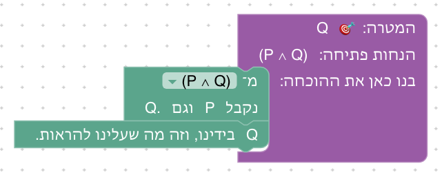

**שיקולים ושאלות להכרעה.**
- המהלך מסיק תמיד את שני הצדדים, גם כשצריך רק אחד. האם כדאי שני מהלכים נפרדים ("נקבל P", "נקבל Q"), כמו שני כללי ∧E בדדוקציה טבעית? מצד שני, בהוכחה כתובה נוהגים לכתוב את שניהם יחד.
- בשלב יש הנחה אחת בלבד, ולכן הבחירה בשדה כמעט מובנת מאליה. האם להוסיף הנחה מסיחה, כדי שהסטודנט יבחין בין הנחה מסוג "וגם" לבין הנחה אחרת?

### שלב 3.2: מוכיחים טענה מסוג "וגם"

`P, Q ⊢ P ∧ Q` · בארגז: הוכחת "וגם", סיום

**מה לומדים.** כדי להוכיח "P וגם Q" מוכיחים את שני הצדדים לחוד. זה המהלך הראשון שמפצל את ההוכחה לחלקים, וכל חלק נבנה במקום משלו בבלוק, תחת הכותרת "החלק הראשון: P" או "החלק השני: Q".

**למה כך.** ההנחות נתונות, כדי שהרעיון החדש היחיד יהיה הפיצול. זה גם המקום להראות שלחיצה על מהלך בתוך חלק מציגה את מצב ההוכחה של אותו חלק בלבד. הכותרות שבבלוק מראות מה המטרה בכל חלק עוד לפני שמסתכלים במצב ההוכחה.

**פתרון.** נוכיח את שני החלקים של P ∧ Q. החלק הראשון: P בידינו, וזה מה שעלינו להראות. החלק השני: Q בידינו, וזה מה שעלינו להראות. הוכחנו את שני החלקים, ולכן P ∧ Q.

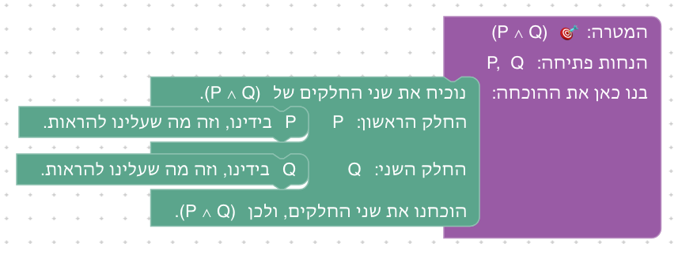

**שיקולים ושאלות להכרעה.**
- הצירוף ל"וגם" (הוכחת "וגם" קדימה) לא נמצא בארגז של השלב הזה: הוא היה מאפשר לעקוף את הפיצול, שהוא בדיוק מה שהשלב מלמד. הוא מוצג בשלב 2.4.
- הסטודנטים פוגשים כאן לראשונה בלוק עם מקומות פנימיים. האם צריך הדגמה (למשל אנימציה קצרה של גרירה לתוך חלק), או שהטקסט והכותרות מספיקים?

### שלב 3.3: מחליפים את הצדדים

`⊢ (P ∧ Q) → (Q ∧ P)` · בארגז: נניח, שימוש ב"וגם", הוכחת "וגם", צירוף ל"וגם", סיום

**מה לומדים.** להשתמש ב"וגם" ולהוכיח "וגם" באותה הוכחה, ולהבחין בין השניים: את ההנחה מפרקים, ואת המטרה מפצלים. ומהלך חדש: צירוף שתי הנחות ל"וגם" אחד, כלומר הוכחת "וגם" קדימה.

**למה כך.** טענת החילוף היא דוגמה קלאסית (D∃∀duction, Logic Game), שבה שני הכללים נחוצים יחד. היא גם הבסיס לשלב 3.8, שבו כל כיוון זהה להוכחה הזאת. הצירוף ל"וגם" מוצג כאן, ולא בשלב 3.2, כי שם הוא היה עוקף את הלקח; כאן הפיצול כבר מוכר, ולכן שתי הדרכים בארגז, והרמזים מזכירים את שתיהן.

**פתרון א: אחורה.** נניח P ∧ Q. עלינו להראות Q ∧ P. בתוכו: מ־ P ∧ Q נקבל P וגם Q. נוכיח את שני החלקים של Q ∧ P. החלק הראשון: Q בידינו, וזה מה שעלינו להראות. החלק השני: P בידינו, וזה מה שעלינו להראות. הוכחנו את שני החלקים, ולכן Q ∧ P. לכן (P ∧ Q) → (Q ∧ P).

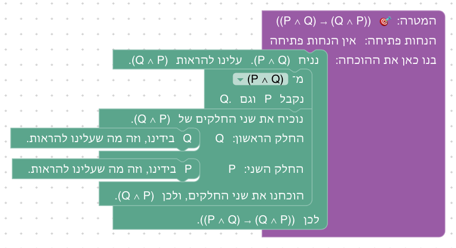

**פתרון ב: קדימה.** נניח P ∧ Q. עלינו להראות Q ∧ P. בתוכו: מ־ P ∧ Q נקבל P וגם Q. מ־ Q ומ־ P נקבל Q ∧ P. Q ∧ P בידינו, וזה מה שעלינו להראות. לכן (P ∧ Q) → (Q ∧ P).

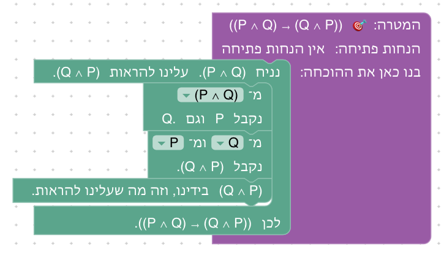

**שיקולים ושאלות להכרעה.**
- זה שלב שמציג מהלך חדש (צירוף ל"וגם"), אבל אפשר לפתור אותו גם בלעדיו, בדרך המוכרת. זה חורג מהכלל שבשלב שמציג מהלך חדש הארגז מחייב להשתמש בו. האם להוסיף שלב קצר שבו הצירוף הוא הדרך היחידה (למשל `P, Q, (P ∧ Q) → R ⊢ R`), או שמספיק שהרמזים והסיום מזכירים אותו?
- טקסט הפתיחה מציג את הצירוף רק במשפט שהוא כותב ("מ־Q ומ־P נקבל Q ∧ P"), ולא בנוסח שבארגז ("מ־ ? ומ־ ? נקבל את ה"וגם" של שתיהן."). האם הסטודנט יזהה את הבלוק בארגז?
- סדר המהלכים: אפשר גם לפצל את המטרה קודם, ולפרק את ההנחה בתוך כל חלק. האם להראות גם את הדרך הזאת, כדי להמחיש שסדר המהלכים לא תמיד חשוב?

### שלב 3.4: מוכיחים טענה מסוג "או"

`P ⊢ Q ∨ P` · בארגז: הוכחת "או", סיום

**מה לומדים.** כדי להוכיח "או" די להוכיח צד אחד, אבל צריך לבחור את הצד שאפשר להוכיח ממה שבידינו.

**למה כך.** הצד הנכון הוא צד ימין, P, כדי שלא אפשר יהיה לבחור לפי הסדר. כשהבלוק במקומו, הרשימה בו מציעה את שני הצדדים של המטרה לפי מה שהם אומרים (Q ו־P), כך שהבחירה היא בין טענות ולא בין "שמאל" ו"ימין". טקסט הפתיחה מסביר למה בוחרים ב־P, והסיום מסביר מה היה קורה אילו בחרו ב־Q. זו ההכנה לשלב 2.7.

**פתרון.** כדי להוכיח Q ∨ P נוכיח את P. בתוכו: P בידינו, וזה מה שעלינו להראות. לכן Q ∨ P.

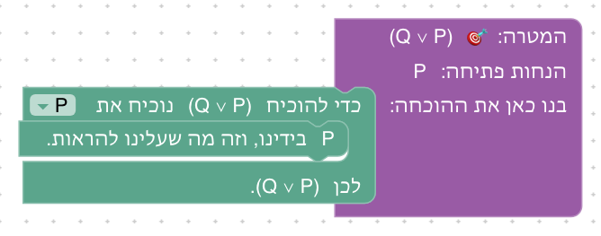

**שיקולים ושאלות להכרעה.**
- השלב מציג את הדרך של ההרצאה כדרך הראשית להוכיח "או": "נניח ¬Q. עלינו להראות P." (`or_by_negation`, שבו בוחרים איזה צד לשלול), ואת בחירת הצד כקיצור, כשצד אחד ניתן להוכחה בלי הנחה. כאן ההנחה ¬Q לא נחוצה; היא חיונית ב־4.10–4.11. השלילה מוכרת כבר מטבלאות האמת (יחידה 1), וכאן לא צריך שום כלל שלה. הוחלט (2026-10-24) עם מחבר הקורס: בחירת צד חלשה יותר (כל מה שמוכיחים בה מוכיחים גם בדרך של ההרצאה, ולא להפך), ולכן הדרך של ההרצאה מוצגת ראשונה ומוצעת בכל שלב שמוכיחים בו "או", בשיעור 1 ובשיעור 2. כדי לעמוד בכלל "רק המהלכים של הפתרון", לכל שלב כזה יש גם פתרון "כמו בהרצאה", שנגזר מהפתרון שבוחר צד: במקום לבחור צד, מניחים את השלילה של הצד השני (`asLecture` ב־`frontend/e2e/solutions.js`), ו־Lean בודק גם אותו.
- בחירה ב־Q לא מסומנת כשגיאה (המהלך תקף), אבל אחריה הסיום נצבע באדום: "אין בידינו הנחה שאומרת Q". השגיאה מופיעה על הסיום ולא על הבחירה שגרמה לה. האם ההסבר צריך לרמוז שהבעיה בבחירת הצד?
- בארגז הבלוק כתוב באופן כללי ("כדי להוכיח את ה"או" נוכיח את ?"), והרשימה בו מציעה "צד שמאל" ו"צד ימין"; רק כשהוא במקומו היא מציעה את הטענות עצמן. האם המעבר ברור, או שעדיף שהשדה ייפתח רק אחרי שהבלוק מחובר?

### שלב 3.5: חלוקה למקרים

`P → R, Q → R, P ∨ Q ⊢ R` · בארגז: חלוקה למקרים, מעבר לתנאי, הסקה קדימה, סיום

**מה לומדים.** הוכחה בחלוקה למקרים: מ"P או Q" לא יודעים איזה צד נכון, ולכן מוכיחים את המטרה בכל אחד מהמקרים.

**למה כך.** אותה מטרה R בשני המקרים, ובכל מקרה ההנחה החדשה היא התנאי של אחת הגרירות. כך המבנה של חלוקה למקרים בולט, ושאר ההוכחה מוכרת מיחידה 2. כותרות החלקים ("מקרה 1: P", "מקרה 2: Q") מנסחות את מה שמניחים בכל מקרה, כמו בהוכחה כתובה. בתוך כל מקרה שתי הדרכים משתמשות במהלכים מוכרים, ולכן שתיהן בארגז והרמזים מזכירים את שתיהן.

**פתרון א: אחורה.** נחלק למקרים לפי P ∨ Q. מקרה 1: P. לפי P → R כדי להוכיח R די להוכיח P. P בידינו, וזה מה שעלינו להראות. מקרה 2: Q. באותו אופן, עם Q → R. המקרים מכסים את כל האפשרויות, ובשניהם R.

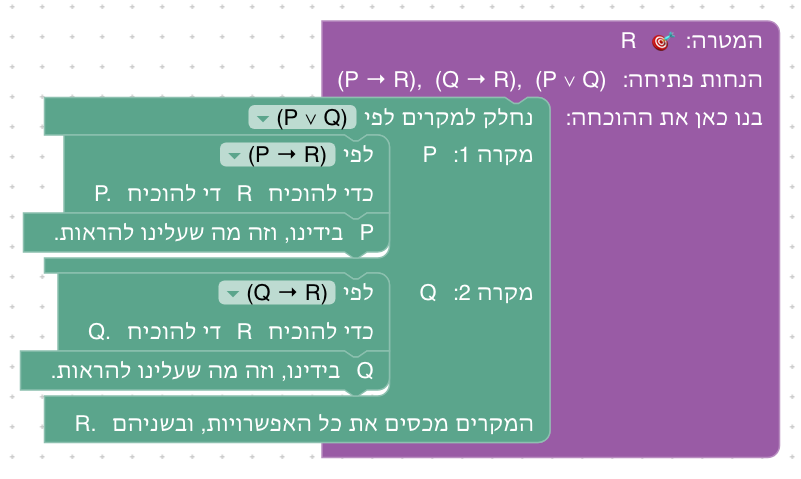

**פתרון ב: קדימה.** נחלק למקרים לפי P ∨ Q. מקרה 1: P. מ־ P → R ומ־ P נקבל R. R בידינו, וזה מה שעלינו להראות. מקרה 2: Q. באותו אופן, עם Q → R. המקרים מכסים את כל האפשרויות, ובשניהם R.

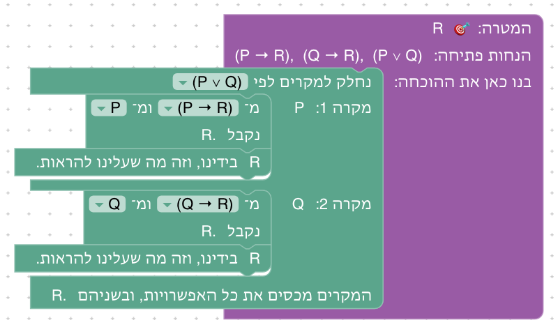

**שיקולים ושאלות להכרעה.**
- זה שלב שמציג מהלך חדש, ובכל זאת יש בו שתי דרכים. הדרכים שונות רק בתוך המקרים, והחלוקה למקרים נחוצה בשתיהן, ולכן הלקח לא נעקף. האם שתי הדרכים לא מסיטות את תשומת הלב מהרעיון החדש?
- Set Theory Game מלמד את אותו כלל דרך קבוצות (A ⊆ C, B ⊆ C ⊢ A ∪ B ⊆ C). האם להוסיף תרגיל כזה ביחידה 7 ולהפנות אליה מכאן?

### שלב 3.6: קודם מקרים, אחר כך צד

`⊢ (P ∨ Q) → (Q ∨ P)` · בארגז: נניח, חלוקה למקרים, הוכחת "או", סיום · השלב נפתח עם "נניח" ובתוכו "כדי להוכיח Q ∨ P נוכיח את Q" כבר במקומם (טעות מתוכננת)

**מה לומדים.** כשמשתמשים ב"או" כדי להוכיח "או", קודם מחלקים למקרים, ורק בתוך כל מקרה בוחרים צד.

**למה כך.** זו הטעות הנפוצה ביותר ב"או" לפי HTPI, forall x ו־Set Theory Game: בחירת צד מוקדמת מדי. השלב נפתח עם הטעות הזאת כבר במקומה. המהלך לא שגוי, ולכן אין סימון אדום, אבל "אחרי המהלך" רואים שנשאר להוכיח Q, ו־P ∨ Q לא אומרת ש־Q נכונה. הסטודנט גורר את הבלוק השני לפח, משאיר את "נניח", ובונה מחדש בתוכו ([עיקרון 7](design/principles.md), כמו בשלב 2.3). בתוך כל מקרה הרשימה של הוכחת "או" מציעה שוב את Q ואת P, ועכשיו ברור איזה מהם בידינו.

**פתרון.** נניח P ∨ Q. עלינו להראות Q ∨ P. בתוכו: נחלק למקרים לפי P ∨ Q. מקרה 1: P. כדי להוכיח Q ∨ P נוכיח את P. P בידינו, וזה מה שעלינו להראות. לכן Q ∨ P. מקרה 2: Q. כדי להוכיח Q ∨ P נוכיח את Q. Q בידינו, וזה מה שעלינו להראות. לכן Q ∨ P. בכל המקרים Q ∨ P. לכן (P ∨ Q) → (Q ∨ P).

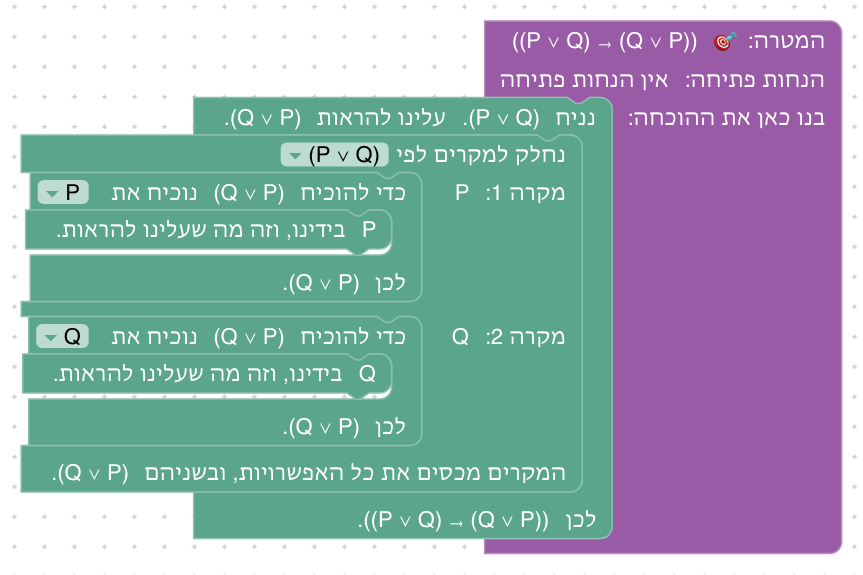

**שיקולים ושאלות להכרעה.**
- המהלך התקוע לא מסומן, כי הוא לא שגוי; רק "בדוק הוכחה" יגלה שההוכחה לא הושלמה. האם הסטודנט יבין לבד שהוא תקוע, או שצריך סימון עדין ("אין דרך להוכיח את Q מההנחות")? זיהוי אוטומטי של מצב תקוע אינו פשוט באופן כללי.
- הסטודנט צריך לגרור בלוק לפח, פעולה שלא נלמדה קודם (בשלב 2.3 התיקון היה הוספה של מהלך, לא הוצאה). האם להציג אותה כבר בשלב 2.1?
- הפתרון בקובץ הפתרונות נבנה מהתחלה, בעוד שהסטודנט משאיר את "נניח" ומוציא רק את הבלוק השני. התוצאה זהה, אבל אף בדיקה לא עוברת על הדרך של הסטודנט: המעבר בעכבר לפי הרמזים (`frontend/e2e/walk.spec.js`) מכסה רק את יחידות 4 עד 9. האם להוסיף לו את יחידות 2 ו־3, ובהן את שני השלבים שנפתחים בטעות מתוכננת (2.3 ו־3.6)?

### שלב 3.7: משתמשים בהנחה מסוג "אם ורק אם"

`P ↔ Q, Q ⊢ P` · בארגז: שימוש ב"אם ורק אם", מעבר לתנאי, הסקה קדימה, סיום

**מה לומדים.** "P אם ורק אם Q" הוא שתי גרירות. מהנחה כזאת מקבלים את שתיהן, ומשתמשים בכל אחת כמו בכל גרירה.

**למה כך.** כל המקורות מלמדים "אם ורק אם" כשתי גרירות. הכיוון הנחוץ כאן הוא Q → P, השני, כדי שלא אפשר יהיה להשתמש באופן אוטומטי בכיוון הראשון. אחרי שמקבלים את הגרירות הן מופיעות ברשימות של מהלכי יחידה 2, ולכן שתי הדרכים של יחידה 2 בארגז, והרמזים מזכירים את שתיהן.

**פתרון א: אחורה.** מ־ P ↔ Q נקבל P → Q וגם Q → P. לפי Q → P כדי להוכיח P די להוכיח Q. Q בידינו, וזה מה שעלינו להראות.

**פתרון ב: קדימה.** מ־ P ↔ Q נקבל P → Q וגם Q → P. מ־ Q → P ומ־ Q נקבל P. P בידינו, וזה מה שעלינו להראות.

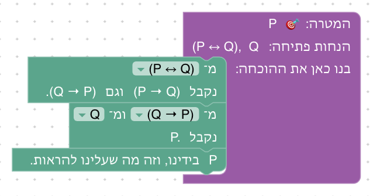

**שיקולים ושאלות להכרעה.**
- D∃∀duction מבקש מהסטודנט לבחור כיוון אחד בלבד ("To use this equivalence, you first have to prove one of both properties"). כאן מסיקים תמיד את שני הכיוונים, כמו בשימוש ב"וגם". האם עדיף לבחור כיוון?
- אפשר היה לאפשר להשתמש ב־P ↔ Q ישירות במהלכי יחידה 2 (לבחור אותה בשדה של "מעבר לתנאי"). זה מקצר את ההוכחה, אבל מטשטש את הרעיון ש"אם ורק אם" הוא שתי גרירות. האם להשאיר את השלב הנפרד?

### שלב 3.8: מוכיחים טענה מסוג "אם ורק אם"

`⊢ (P ∧ Q) ↔ (Q ∧ P)` · בארגז: הוכחת "אם ורק אם", נניח, שימוש ב"וגם", הוכחת "וגם", צירוף ל"וגם", סיום

**מה לומדים.** כדי להוכיח "אם ורק אם" מוכיחים את שני הכיוונים לחוד; כל כיוון הוא גרירה.

**למה כך.** כל כיוון זהה להוכחה משלב 3.3, כך שהרעיון החדש היחיד הוא הפיצול לשני כיוונים. כותרות החלקים ("הכיוון הראשון: (P ∧ Q) → (Q ∧ P)" ו"הכיוון השני: (Q ∧ P) → (P ∧ Q)") מראות מה מוכיחים בכל כיוון, ו"נניח" בתחילת כל חלק כותב את התנאי שלו, ושאר ההוכחה של הכיוון נבנית בתוכו. D∃∀duction משתמש באותה טענה, ומציע להשתמש שוב בתרגיל הקודם.

**פתרון א: אחורה.** נוכיח את שני הכיוונים של (P ∧ Q) ↔ (Q ∧ P). בכל כיוון, ההוכחה משלב 3.3 (אחורה): "נניח ...", ובתוכו מפרקים את ה"וגם" שבתנאי ומוכיחים את ה"וגם" שבמטרה בשני חלקים, עד "לכן ...". הוכחנו את שני הכיוונים, ולכן (P ∧ Q) ↔ (Q ∧ P).

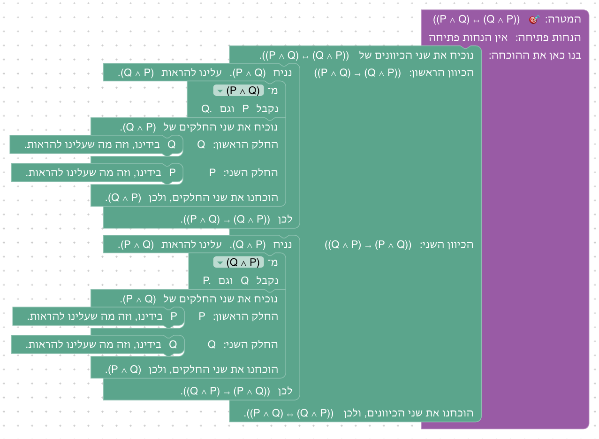

**פתרון ב: קדימה.** אותו מבנה, אבל בכל כיוון, בתוך "נניח", מפרקים את התנאי ומצרפים את שני הצדדים בסדר ההפוך, כמו בשלב 3.3 (קדימה).

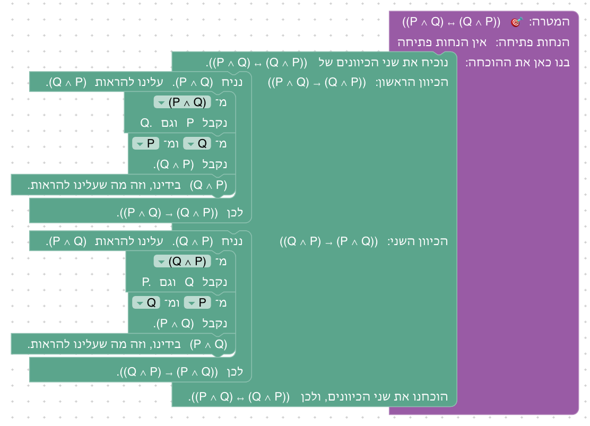

**שיקולים ושאלות להכרעה.**
- הסטודנט בונה פעמיים את אותה הוכחה. אפשר לאפשר שימוש בטענה שכבר הוכחה בשלב קודם (כמו ב־D∃∀duction). זה דורש מנגנון של "טענות שהוכחו" שעוד אין לנו. האם הוא שווה את המאמץ?
- ההוכחה רחבה מאזור העבודה בגודל הרגיל, בעיקר בגלל המשפט של "נניח", שכותב את התנאי ואת המסקנה במלואם. האם לקצר את הנוסח כשהנוסחאות ארוכות, למשל "נניח את התנאי (P ∧ Q). עלינו להראות את המסקנה"?

### שלב 3.9: שלב בונוס: פילוג

`⊢ (P ∧ (Q ∨ R)) → ((P ∧ Q) ∨ (P ∧ R))` · בארגז: נניח, שימוש ב"וגם", הוכחת "וגם", צירוף ל"וגם", חלוקה למקרים, הוכחת "או", סיום

**מה לומדים.** לשלב את כל כללי היחידה בהוכחה מקוננת אחת.

**למה כך.** "וגם" מתפלג על "או" הוא אתגר מוכר (Logic Game, D∃∀duction). השלב גם מתרגל שוב את הלקח של 3.6: בוחרים צד רק בתוך כל מקרה. אין צורך לתת שמות להנחות המקרים: בכל מקרה ההנחה החדשה (Q או R) מופיעה ברשימות לפי מה שהיא אומרת.

**פתרון א: אחורה.** נניח P ∧ (Q ∨ R). עלינו להראות (P ∧ Q) ∨ (P ∧ R). בתוכו: מ־ P ∧ (Q ∨ R) נקבל P וגם Q ∨ R. נחלק למקרים לפי Q ∨ R. מקרה 1: Q. כדי להוכיח (P ∧ Q) ∨ (P ∧ R) נוכיח את P ∧ Q, ובתוכו: נוכיח את שני החלקים של P ∧ Q, ובכל חלק מה שמוכיחים בידינו; הוכחנו את שני החלקים, ולכן P ∧ Q. לכן (P ∧ Q) ∨ (P ∧ R). מקרה 2: R. באותו אופן, עם P ∧ R. בכל המקרים (P ∧ Q) ∨ (P ∧ R). לכן (P ∧ (Q ∨ R)) → ((P ∧ Q) ∨ (P ∧ R)).

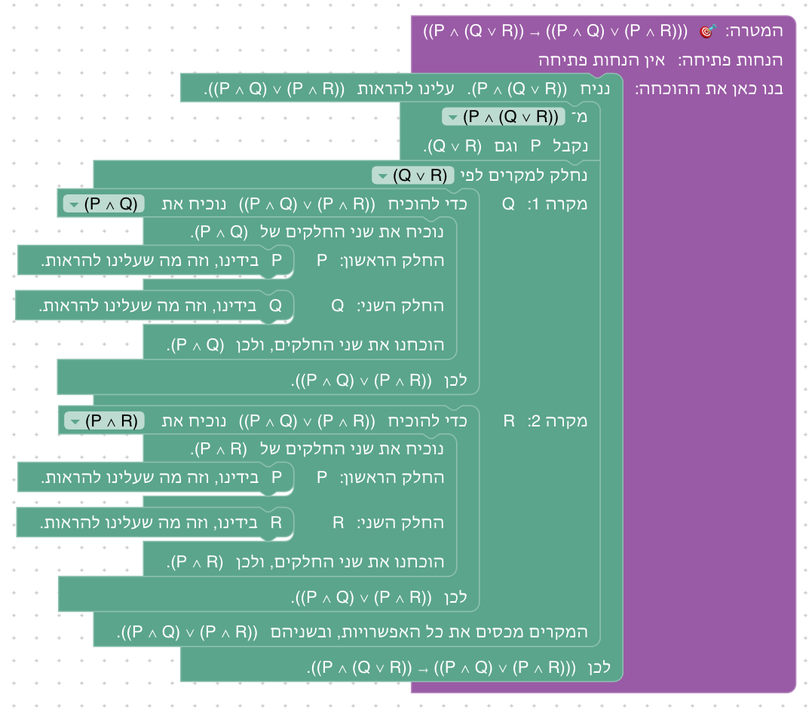

**פתרון ב: קדימה.** אותו מבנה, אבל בכל מקרה, בתוך הבלוק של בחירת הצד, מצרפים: מ־ P ומ־ Q נקבל P ∧ Q (ובמקרה השני מ־ P ומ־ R נקבל P ∧ R), ואז P ∧ Q בידינו, וזה מה שעלינו להראות.

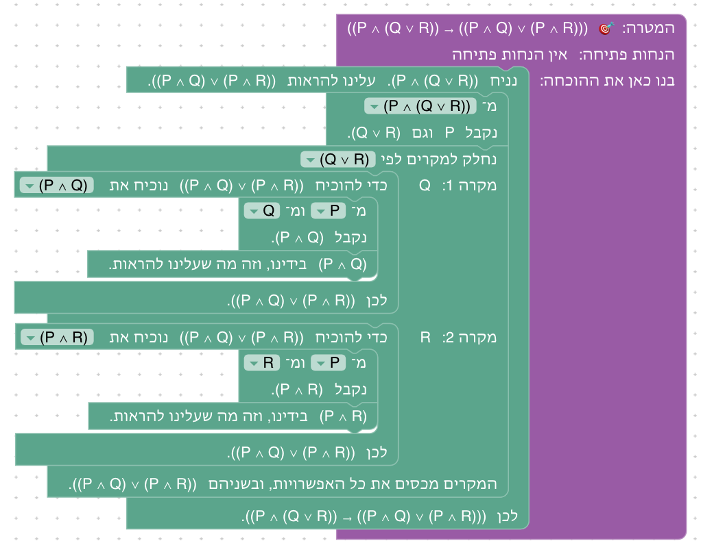

**שיקולים ושאלות להכרעה.**
- טקסט הפתיחה מונה את המהלכים שישמשו בהוכחה, אבל לא את הצירוף ל"וגם", אף שהוא בארגז והרמזים מזכירים אותו. האם להוסיף אותו לרשימה?
- האם להוסיף גם את הכיוון ההפוך של הפילוג, שהוא קשה יותר (שתי חלוקות למקרים)?

## רקע: מה עושים מדריכים אחרים

סקירה (2026-10-02) של מדריכים שמלמדים לוגיקה בעזרת עוזר הוכחה, ושל ספרי לוגיקה:
- [Verbose Lean](https://github.com/PatrickMassot/verbose-lean4) ([מאמר](https://drops.dagstuhl.de/entities/document/10.4230/LIPIcs.ITP.2024.27))
- [Waterproof](https://arxiv.org/abs/2211.13513)
- [D∃∀duction](https://github.com/dEAduction/dEAduction)
- [Logic Game](https://github.com/Trequetrum/lean4game-logic)
- [Set Theory Game](https://github.com/djvelleman/STG4)
- [How To Prove It with Lean](https://djvelleman.github.io/HTPIwL/Chap3.html)
- [Mathematics in Lean](https://leanprover-community.github.io/mathematics_in_lean/C03_Logic.html)
- [The Mechanics of Proof](https://hrmacbeth.github.io/math2001/02_Proofs_with_Structure.html)
- [Logic and Proof](https://leanprover-community.github.io/logic_and_proof/natural_deduction_for_propositional_logic.html)
- [forall x](https://forallx.openlogicproject.org/html/Ch17.html)

מה לקחנו מהן:
- **סדר:** רוב המקורות מלמדים "וגם", אחר כך "אם ורק אם", ואחר כך "או". כולם מלמדים את "אם ורק אם" כשתי גרירות, ורבים מתחילים בשימוש ב"וגם" (P ∧ Q → P). כאן "או" בא לפני "אם ורק אם", כדי ששלב "אם ורק אם" יסכם את היחידה.
- **שימוש מול הוכחה:** כל המקורות מפרידים בין שימוש בקשר להוכחה שלו, כמהלכים נפרדים.
- **בחירת צד מוקדמת מדי:** זו הטעות הנפוצה ביותר ב"או" (HTPI, forall x, Set Theory Game): קודם מחלקים למקרים, ורק אחר כך בוחרים צד. ממנה נולד שלב 2.7.
- **ניסוח:** המשפטים שבבלוקים מבוססים על Verbose Lean ועל Waterproof ("we show both statements", "we show both directions", "we discuss using h"), ועל האופן שבו כותבים הוכחה ביד, כמו בהרצאה: "נוכיח את שני החלקים", "נחלק למקרים", "נוכיח את שני הכיוונים".
- **כל חלק מוכרז:** ב־Waterproof ובמאמר של Verbose Lean, כל חלק של ההוכחה מתחיל בהכרזה על המטרה שלו. כאן הבלוק כותב את ההכרזה בראש כל חלק, לפי מצב ההוכחה ("החלק הראשון: P", "מקרה 1: P").
- **פתוח:** אזהרת Massot, שסטודנטים מאבדים עניין בהוכחת טאוטולוגיות ריקות. Set Theory Game מלמד את אותם כללים דרך שייכות לקבוצות (x ∈ A ∩ B).

## שאלות שנוגעות ליחידה כולה

- **טאוטולוגיות מול קבוצות:** האם להוסיף לכל כלל גם תרגיל עם קבוצות (A ∩ B ⊆ B ∩ A), או להשאיר את זה ליחידה 7?
- **רוחב ההוכחות:** המשפטים בבלוקים כותבים נוסחאות מלאות, ולכן הוכחות מקוננות (3.8, 3.9) רחבות. האם לקצר נוסחים ארוכים, או לאפשר לסטודנט לכווץ חלק שהושלם?

