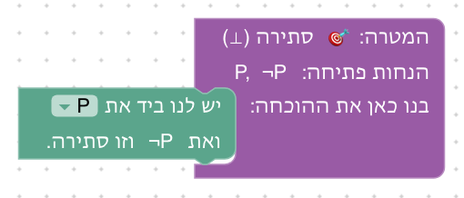
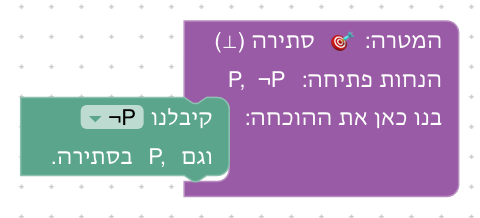
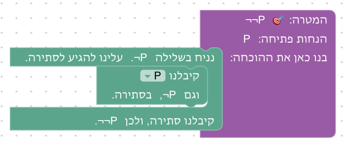
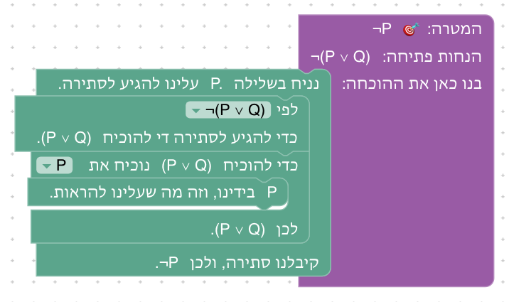
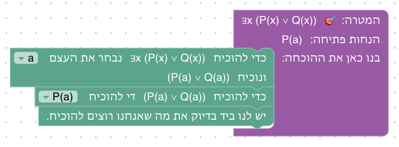
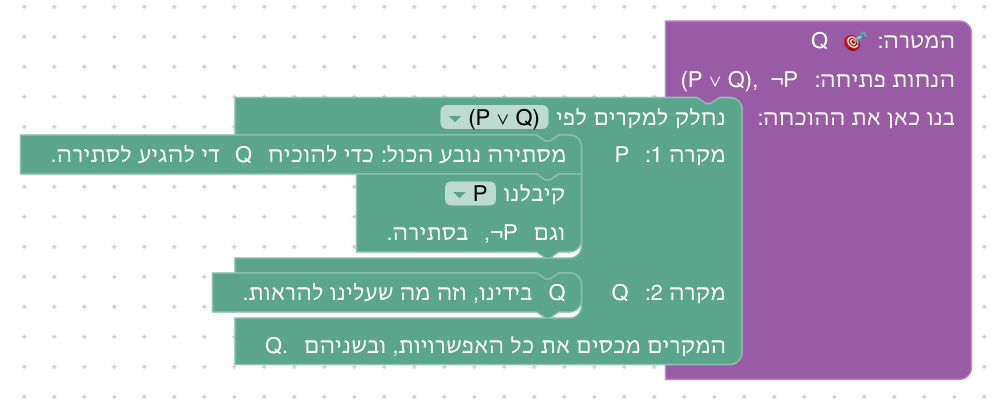
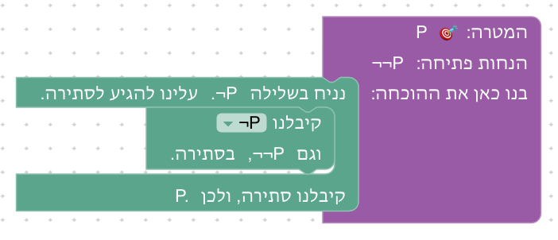
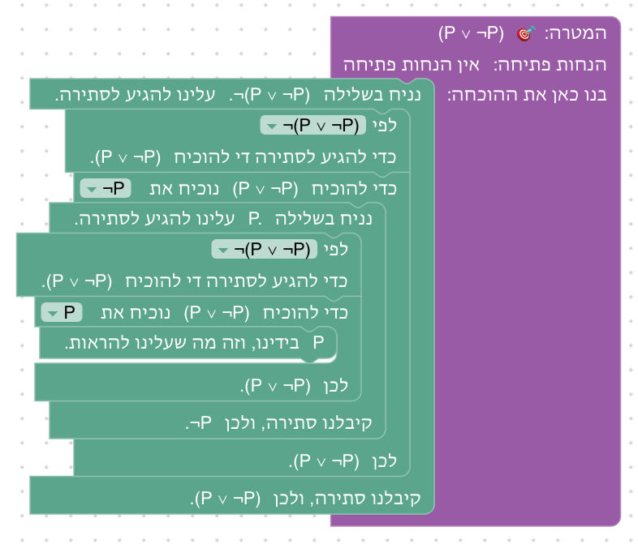
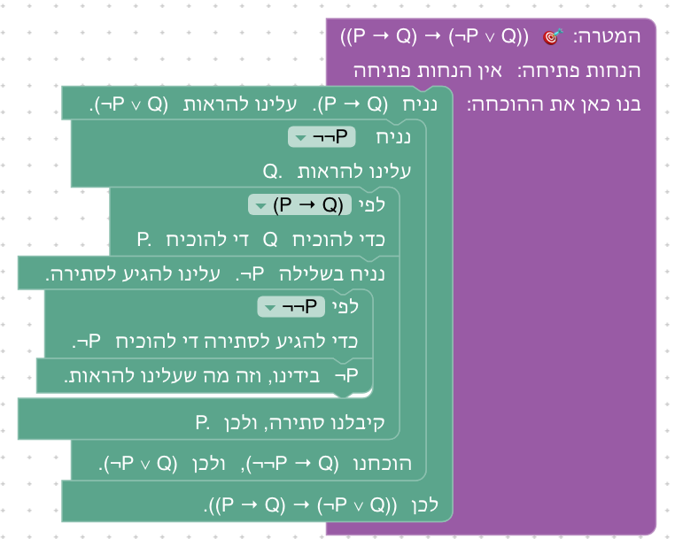

# יחידה 4 — שלילה והוכחה בשלילה

**מטרה:** הסטודנט מגיע לסתירה מטענה ושלילתה, מוכיח שלילה (מניח את הטענה ומגיע לסתירה), משתמש בשלילה שבידו (כדי להגיע לסתירה מוכיח את מה שהיא שוללת), מסיק מסתירה כל טענה, מבחין בין הוכחת שלילה לבין *הוכחה בשלילה*, ומוכיח "או" כמו בהרצאה: מניח את השלילה של צד אחד ומוכיח את השני. היחידה בנויה לפי כללי הדדוקציה הטבעית של ספרי הלימוד: forall x, Huth & Ryan, Logic and Proof, Theorem Proving in Lean ו־Formalising Mathematics של Kevin Buzzard. לכל כלל מהלך משלו, והשלבים הם הכללים הנגזרים והתרגילים שבספרים האלה: ¬¬P מ־P, modus tollens, ¬(P ∨ Q) ⊢ ¬P, דה מורגן, הוצאת אפשרות, P מ־¬¬P, קונטרה־פוזיציה, ו־P ∨ ¬P כשלב בונוס.

## המהלכים

הסתירה (`False` ב־Lean) מוצגת כ"סתירה (⊥)". כמו בכל הקורס, להנחות אין שמות: מהלך שמשתמש בהנחה בוחר אותה מרשימה של הטענות שבידינו באותו מקום בהוכחה (או ב"✎ כתיבה ידנית"), וכשהמהלך במקומו, הנוסחאות מושלמות בו לפי מצב ההוכחה. בעמודה הראשונה הנוסח של המהלך כשהוא במקומו, עם A כטענה כלשהי ו־Q כמטרה; בסוגריים מרובעים מה שבוחרים מהרשימה. עמודת Lean מציגה את מה שהמהלך מייצר מאחורי הקלעים; Lean מוצא כל הנחה לפי הטענה שלה (`‹A›`).

| מהלך | Lean | לפני → אחרי |
|---|---|---|
| **סתירה (¬E):** קיבלנו [A] וגם ¬A, בסתירה. | `exact (absurd ‹A› ‹¬(A)› : False)` | `A, ¬A ⊢ ⊥` ⟶ סגור |
| **שימוש בשלילה (¬E, אחורה):** לפי [¬A] כדי להגיע לסתירה די להוכיח A. | `refine (absurd ?_ ‹¬A› : False)` | `¬A ⊢ ⊥` ⟶ `¬A ⊢ A` |
| **הוכחת שלילה (¬I):** נניח בשלילה A. עלינו להגיע לסתירה. … קיבלנו סתירה, ולכן ¬A. | `refine Not.intro (fun _ => ?_)`, וההוכחה שבתוך הבלוק כחלק משלה, תחת `·` | `⊢ ¬A` ⟶ `A ⊢ ⊥` |
| **מסתירה נובע הכול:** מסתירה נובע הכול: כדי להוכיח Q די להגיע לסתירה. | `apply False.elim` | `⊢ Q` ⟶ `⊢ ⊥` |
| **הוכחה בשלילה:** נניח בשלילה ¬A. עלינו להגיע לסתירה. … קיבלנו סתירה, ולכן A. | `apply Classical.byContradiction` ו־`intro _`, וההוכחה שבתוך הבלוק כחלק משלה, תחת `·` | `⊢ A` ⟶ `¬A ⊢ ⊥` |
| **הוכחת "או" כמו בהרצאה (מיחידה 3; כאן ההנחה חיונית):** נניח ¬A. עלינו להראות B. … הוכחנו ¬A → B, ולכן A ∨ B. | `refine easylean_or_by_negation (fun _ => ?_)`, וההוכחה שבתוך הבלוק כחלק משלה, תחת `·` | `⊢ A ∨ B` ⟶ `¬A ⊢ B` |

**שני בלוקים שמחזיקים את ההוכחה בתוכם.** כמו בהרצאה, ל"הוכחת שלילה" ול"הוכחה בשלילה" יש שורת פתיחה ("נניח בשלילה … עלינו להגיע לסתירה.") ושורת סיום ("קיבלנו סתירה, ולכן …"), והדרך לסתירה נבנית בתוכם, בין שתי השורות. אחריהם אי אפשר להוסיף מהלך, ולכן המהלך הבא נגרר לתוכם. שני הבלוקים נקראים כמעט אותו דבר, וההבדל ביניהם הוא במה שמניחים: A כשהמטרה היא ¬A, ו־¬A כשהמטרה היא A.

**"או" כמו בהרצאה.** בהרצאה (הטבלה "המילה הראשית קובעת את מבנה ההוכחה") מוכיחים α ∨ β כך: מניחים ¬α ומוכיחים β, לפי השקילות של ¬α → β ו־α ∨ β (שלב 1.3). עד עכשיו איזי־לין לימדה רק בחירת צד (שלב 3.4), שהיא המקרה הפרטי שבו אפשר להוכיח צד אחד בלי שום הנחה. בחירת צד לא מספיקה לכל "או": אי אפשר להוכיח בה את P ∨ ¬P, וגם לא את ¬P ∨ Q מתוך P → Q, כי לא ידוע איזה צד נכון. לכן הוחלט (2026-10-23) להציג את הדרך של ההרצאה מיד אחרי השלילה, וב־2026-10-24 להקדים אותה עוד, ליחידה 3, כדרך הראשית (ראו [03-and-or-iff.md](03-and-or-iff.md)). כאן, בשלבים 4.10–4.11, ההנחה ¬α היא כל ההוכחה. הבלוק (`or_by_negation`, משפטים של `STRATEGY_PRELUDE`, שנוספים לכל שלב שמציע אותו) מניח כברירת מחדל את השלילה של הצד הראשון, כמו בטבלה של ההרצאה, ואפשר לבחור בו לשלול את הצד השני (`easylean_or_by_negation_right`).

**סתירה: בוחרים אחת מהשתיים.** בבלוק "סתירה" בוחרים את הטענה או את השלילה שלה, והבלוק משלים את השנייה: בחירה ב־P נקראת "קיבלנו P וגם ¬P, בסתירה.", ובחירה ב־¬P נקראת "קיבלנו ¬P וגם P, בסתירה." כשבוחרים שלילה ¬A, הבלוק משלים A, אלא אם בידינו ¬¬A (כמו בשלב 4.8), ואז הוא משלים ¬¬A. כך Lean מנסה את שתי האפשרויות (`first | … | exact (absurd ‹A› ‹¬A› : False)`), ואת A אחרונה, כדי שכשאף אחת מהן לא בידינו, ההסבר יגיד שאין בידינו A.

**מהלכים מיחידות קודמות** שבארגז של שלבים ביחידה הזאת:

| מהלך | Lean | לפני → אחרי |
|---|---|---|
| **נניח (יחידה 2):** נניח P. עלינו להראות Q. … לכן P → Q. | `easylean_assume` | `⊢ P → Q` ⟶ `P ⊢ Q` |
| **הסקה קדימה (יחידה 2):** מ־[P → Q] ומ־[P] נקבל Q. | `have := easylean_mp ‹P → Q› ‹P›` | `P → Q, P ⊢ …` ⟶ מוסיף `Q` |
| **מעבר לתנאי (יחידה 2):** לפי [P → Q] כדי להוכיח Q די להוכיח P. | `refine easylean_mp ‹P → Q› ?_` | `⊢ Q` ⟶ `⊢ P` |
| **זה בדיוק (שלב 2.1):** A בידינו, וזה מה שעלינו להראות. | `assumption` | `A ⊢ A` ⟶ סגור |
| **הוכחת "וגם" (יחידה 3):** נוכיח את שני החלקים של P ∧ Q. החלק הראשון: P … החלק השני: Q … הוכחנו את שני החלקים, ולכן P ∧ Q. | `apply And.intro` | `⊢ P ∧ Q` ⟶ שני חלקים: `⊢ P`, `⊢ Q` |
| **הוכחת "או" (יחידה 3):** כדי להוכיח P ∨ Q נוכיח את [P] … לכן P ∨ Q. | `apply Or.inl` / `apply Or.inr` | `⊢ P ∨ Q` ⟶ `⊢ P` (או `⊢ Q`) |
| **חלוקה למקרים (יחידה 3):** נחלק למקרים לפי [P ∨ Q]. מקרה 1: P … מקרה 2: Q … המקרים מכסים את כל האפשרויות, ובשניהם R. | `cases ‹P ∨ Q› with \| inl _ => … \| inr _ => …` | שני חלקים: `P ⊢ …`, `Q ⊢ …` |

**כלל ספציפי:** כל מהלך הוא הכלל עצמו, ולכן הוא נכשל כשמשתמשים בו במקום הלא נכון, וההסבר מנוסח במונחי הכלל. "סתירה" ו"שימוש בשלילה" מתאימים רק למטרה שהיא סתירה. על מטרה אחרת ההסבר מפנה למהלך "מסתירה נובע הכול" ("המטרה היא Q, ולא סתירה. כדי להשתמש בסתירה כאן, קודם השתמשו במהלך..."), וכך שני הכללים נלמדים בנפרד. "הוכחת שלילה" מתאימה רק למטרה שהיא שלילה; על מטרה שהיא כבר סתירה ההסבר אומר שאין טענה להניח, ומציע להשתמש בשלילה שבידינו.

**בלי Mathlib:** כל הכללים קיימים ב־Lean הבסיסי. `by_contra` ו־`push_neg` דורשים Mathlib, ובמקומם משתמשים ב־`Classical.byContradiction`. בקורס לוגיקה עדיף שהסטודנטים יוכיחו את חוקי דה מורגן בעצמם (שלב 4.5), במקום שמהלך כמו `push_neg` יעשה זאת אוטומטית.

**כיווניות:** בטקסט עברי הסימנים הלוגיים ניטרליים, ולכן נוסחה ליד מילה עברית עלולה להתהפך (`¬P` מוצג "P¬"). לכן כל נוסחה שיש בה סימן לוגי, בטקסטים, ברמזים, בהסברי השגיאות, בבלוקים ובבלוק המטרה, עטופה בבידוד משמאל לימין (`game/bidi.js`).

## שלבים

לכל שלב: מה לומדים בו, למה הוא בנוי כך, איך אנחנו רוצים שסטודנטים יפתרו אותו, ושיקולים ושאלות שעוד צריך להכריע. צילומי הפתרונות נוצרים מ־`frontend/e2e/solutions.js` (ראו [יחידה 2](02-implications.md#שלבים)).

**סדר היחידה.** כמו בספרים: קודם הכללים שלא דורשים הוכחה בשלילה. סתירה (4.1), הוכחת שלילה (4.2–4.3), שימוש בשלילה (4.4–4.5), מסתירה נובע הכול (4.6–4.7), אחריהם הוכחה בשלילה (4.8–4.9), ובסוף הוכחת "או" כמו בהרצאה, שדורשת שלילה (4.10–4.11). כל מהלך חדש מוצג בשלב משלו, עם ארגז שיש בו רק את המהלכים של הפתרון, ואחריו שלב תרגול שמשלב אותו עם מהלכים מוכרים.

**בלי הבחנה בין לוגיקה קלאסית ללא־קלאסית.** forall x ו־Logic and Proof מסמנים את הוכחה בשלילה ואת P ∨ ¬P כעקרונות "קלאסיים". הוחלט (2026-10-05) לא לדון בזה: כל המהלכים נלמדים ככלים רגילים של הוכחה. גם ביחידות הבאות אין סימון כזה.

**בכל שלב רק המהלכים של הפתרון שלו.** כך הסטודנט לא מחפש בין מהלכים שלא שייכים לשלב, והשלב שמציג מהלך חדש לא נפתר בלעדיו. המחיר הוא שאין כרגע ביחידה שלב עם שתי דרכים, מלבד שתי הבחירות בבלוק "סתירה" בשלב 3.1.

### שלב 4.1: טענה ושלילתה

`P, ¬P ⊢ ⊥` · בארגז: סתירה

**מה לומדים.** מה זו ¬P ("לא P"), ומה זו סתירה (⊥): טענה ושלילתה לא יכולות להיות נכונות יחד (¬E).

**למה כך.** השלב מציג שני מושגים חדשים, שלילה וסתירה, ומהלך אחד בלבד, כך שההחלטה היחידה היא איזו טענה לבחור ברשימה. ההוכחה היא משפט אחד, כמו שכותבים ביד: "קיבלנו P וגם ¬P, בסתירה". הבלוק סוגר רק מטרה שהיא סתירה, וזה מכין את ההבחנה של שלב 3.6.

**פתרון א.** בוחרים P, והבלוק משלים ¬P.

**פתרון ב: מהשלילה.** בוחרים ¬P, והבלוק משלים P.

**שיקולים ושאלות להכרעה.**
- הבלוק מקבל את שתי הבחירות. זה חוסך הסבר על "איזו מהשתיים לבחור", אבל הבלוק נקרא קצת אחרת בכל בחירה ("¬P וגם P"). האם הנוסח "קיבלנו ¬P וגם P, בסתירה." ברור, או שעדיף שהבלוק יציג תמיד את הטענה לפני השלילה, מה שלא נבחר?
- ברשימה מופיעות כל ההנחות, גם כאלה שהשלילה שלהן לא בידינו. בשלב הזה שתי ההנחות מתאימות, ולכן אין כאן טעות אפשרית. האם להגביל את הרשימה, בהמשך היחידה, לטענות שהבלוק יכול להשלים?
- סתירה מוצגת כ"סתירה (⊥)". האם להשתמש בסימן ⊥ בכלל, או רק במילה?

### שלב 4.2: מוכיחים שלילה

`P ⊢ ¬¬P` · בארגז: הוכחת שלילה, סתירה

**מה לומדים.** להוכיח שלילה (¬I): כדי להוכיח ¬A מניחים בשלילה A ומגיעים לסתירה. הבלוק כותב בעצמו מה מניחים: "נניח בשלילה ¬P. עלינו להגיע לסתירה.", ובשורת הסיום שלו "קיבלנו סתירה, ולכן ¬¬P."

**למה כך.** ¬¬P היא השלילה של ¬P, ולכן מניחים ¬P, והסתירה עם P מיידית בעזרת המהלך משלב 3.1. כך הרעיון החדש היחיד הוא הוכחת השלילה. זה הכלל הנגזר "הכנסת שלילה כפולה" שבכל הספרים, והוא חצי מזוג: בשלב 4.8 הכיוון ההפוך, שם צריך הוכחה בשלילה.

**פתרון.** "נניח בשלילה ¬P. עלינו להגיע לסתירה." בתוכו: "קיבלנו P וגם ¬P, בסתירה." ובסוף: "קיבלנו סתירה, ולכן ¬¬P."

**שיקולים ושאלות להכרעה.**
- שלילה כפולה מבלבלת סטודנטים רבים, ודווקא היא הדוגמה הראשונה להוכחת שלילה. בעד: הסתירה מיידית, והשלב מכין את 3.8. נגד: modus tollens (שלב 4.3) הוא דוגמה טבעית יותר. האם להחליף את הסדר של 4.2 ו־4.3?
- הבלוק משלים לבד את מה שמניחים. האם הסטודנט צריך לבחור או לכתוב את מה שהוא מניח, כדי שיבין שמניחים את הטענה שהמטרה שוללת?

### שלב 4.3: שלילה של המסקנה

`P → Q, ¬Q ⊢ ¬P` · בארגז: הוכחת שלילה, הסקה קדימה, סתירה

**מה לומדים.** לשלב הוכחת שלילה עם מהלך מיחידה 2: אחרי ההנחה P, ההסקה קדימה נותנת Q, והיא סותרת את ¬Q. בסיום השלב נותנים לכלל את שמו, *modus tollens*.

**למה כך.** שלב תרגול להוכחת שלילה, שבו הסתירה לא מוכנה מראש: צריך קודם להסיק את Q. ההוכחה נקראת כמו ההוכחה שכותבים ביד: "נניח בשלילה P. עלינו להגיע לסתירה. מ־P → Q ומ־P נקבל Q. קיבלנו Q וגם ¬Q, בסתירה. קיבלנו סתירה, ולכן ¬P."

**פתרון.** "נניח בשלילה P. עלינו להגיע לסתירה." בתוכו: "מ־P → Q ומ־P נקבל Q.", ואחריו "קיבלנו Q וגם ¬Q, בסתירה." ובסוף: "קיבלנו סתירה, ולכן ¬P."

**שיקולים ושאלות להכרעה.**
- יש דרך שנייה, אחורה: "לפי ¬Q כדי להגיע לסתירה די להוכיח Q.", ואז "לפי P → Q כדי להוכיח Q די להוכיח P." היא דורשת את "שימוש בשלילה", שמוצג רק בשלב הבא. האם להציע אותה כאן כפתרון שני אחרי שמזיזים את השלב אחרי 4.4, או להשאיר את השלב כתרגול של הדרך קדימה?
- ¬Q היא, ב־Lean, הגרירה Q → ⊥, ולכן אפשר היה גם "מ־¬Q ומ־Q נקבל ⊥" (ואז "זה בדיוק"). הארגז לא מאפשר זאת. האם לחשוף את הקשר הזה (ראו [שאלות שנוגעות ליחידה כולה](#שאלות-שנוגעות-ליחידה-כולה))?

### שלב 4.4: משתמשים בשלילה

`¬(P ∨ Q) ⊢ ¬P` · בארגז: הוכחת שלילה, שימוש בשלילה, הוכחת "או", זה בדיוק

**מה לומדים.** להשתמש בשלילה שבידינו: כשהמטרה היא סתירה ובידינו ¬A, די להוכיח את A (¬E, אחורה). "לפי ¬(P ∨ Q) כדי להגיע לסתירה די להוכיח P ∨ Q."

**למה כך.** סטודנטים נתקעים כשהמטרה היא סתירה ואין בידם טענה ושלילתה מוכנות. המהלך עונה על השאלה "מה עושים עכשיו?": בוחרים שלילה ומוכיחים את מה שהיא שוללת. בשלב הזה אין דרך אחרת: אין שום דרך להסיק קדימה את P ∨ Q, ולכן המהלך הכרחי. ההוכחה של P ∨ Q מ־P היא מיחידה 3. זה הכלל הנגזר ¬(P ∨ Q) ⊢ ¬P, והוא מכין את חוק דה מורגן בשלב הבא.

**פתרון.** "נניח בשלילה P. עלינו להגיע לסתירה." בתוכו: "לפי ¬(P ∨ Q) כדי להגיע לסתירה די להוכיח P ∨ Q.", ואחריו "כדי להוכיח P ∨ Q נוכיח את P", ובתוכו "P בידינו, וזה מה שעלינו להראות." ואז "לכן P ∨ Q." ובסוף: "קיבלנו סתירה, ולכן ¬P."

**שיקולים ושאלות להכרעה.**
- הסטודנט בוחר בהוכחת "או" את הצד מתוך רשימה של שני הצדדים. מי שבוחר Q נתקע בלי הסבר מיידי, ורק "זה בדיוק" ייכשל ("אין בידינו הנחה שאומרת Q"). האם זה מספיק כדי להבין שבחר צד שגוי?
- המהלך נקרא "שימוש בשלילה" בהסבר שבארגז, אבל כשהוא במקומו הוא נקרא "לפי ... כדי להגיע לסתירה די להוכיח ...". האם השם בהסבר צריך להתאים יותר לנוסח, למשל "סתירה מהשלילה"?

### שלב 4.5: שלילה של "או"

`⊢ ¬(P ∨ Q) → (¬P ∧ ¬Q)` · בארגז: נניח, הוכחת "וגם", הוכחת שלילה, שימוש בשלילה, הוכחת "או", זה בדיוק

**מה לומדים.** חוק דה מורגן הראשון, ולשלב מהלכים של שלוש יחידות.

**למה כך.** הסטודנטים מוכיחים את חוקי דה מורגן בעצמם: בקורס לוגיקה החוקים הם חומר הלימוד. הכיוון הזה נבחר כי הוא לא דורש הוכחה בשלילה. כל אחד משני החלקים הוא בדיוק ההוכחה של שלב 4.4, ולכן השלב מתרגל אותה פעמיים, פעם עם צד שמאל של ה"או" ופעם עם צד ימין.

**פתרון.** "נניח ¬(P ∨ Q). עלינו להראות ¬P ∧ ¬Q." בתוכו: "נוכיח את שני החלקים של ¬P ∧ ¬Q." ב"החלק הראשון: ¬P" ההוכחה של שלב 4.4, וב"החלק השני: ¬Q" אותה הוכחה עם Q. ובסוף: "הוכחנו את שני החלקים, ולכן ¬P ∧ ¬Q." ו"לכן ¬(P ∨ Q) → (¬P ∧ ¬Q)."

**שיקולים ושאלות להכרעה.**
- בארגז יש גם "נניח", בשביל הגרירה החיצונית. "נניח" לא מוכיח שלילה: על מטרה ¬P הוא נכשל, עם ההסבר "המטרה ¬P היא שלילה, ולא גרירה", ומפנה לבלוק של הוכחת שלילה. כך לכל כלל יש מהלך אחד.
- החלק השני חוזר על הראשון. האם להשאיר את החזרה (תרגול), או לקצר בעזרת מהלך לטענת ביניים, או בשימוש בשלב 4.4 כלמה?
- כדאי להוסיף את הכיוון ההפוך, `(¬P ∧ ¬Q) → ¬(P ∨ Q)` (שימוש ב"וגם" וחלוקה למקרים), כדי לקבל שקילות מלאה? ואת אותו חוק לקבוצות (`x ∉ A ∪ B ↔ x ∉ A ∧ x ∉ B`) ביחידה 7?

### שלב 4.6: מסתירה נובע הכול

`P, ¬P ⊢ Q` · בארגז: מסתירה נובע הכול, סתירה

**מה לומדים.** מסתירה נובעת כל טענה (ex falso): "מסתירה נובע הכול: כדי להוכיח Q די להגיע לסתירה."

**למה כך.** אותן הנחות כמו בשלב 4.1, אבל המטרה היא Q, שאין עליה שום הנחה. הבלוק "סתירה" לבדו נכשל כאן, כי הוא סוגר רק מטרה שהיא סתירה, וההסבר שלו מפנה למהלך החדש. זו בדיוק ההבחנה שהשלב מלמד: קודם מחליפים את המטרה בסתירה, ואחר כך מגיעים אליה.

**פתרון.** "מסתירה נובע הכול: כדי להוכיח Q די להגיע לסתירה." ואחריו "קיבלנו P וגם ¬P, בסתירה."

**שיקולים ושאלות להכרעה.**
- סטודנטים רבים מוצאים את ex falso מוזר ("למה מסתירה נובע הכול?"). הטקסט אומר רק שמסתירה אפשר להסיק כל טענה. האם צריך הסבר, למשל "אם P ו־¬P נכונות, אז P ∨ Q נכונה, ומכיוון ש־P לא נכונה, Q נכונה", או דרך טבלת האמת של גרירה?
- השלב קצר מאוד (שני בלוקים). זה מכוון, כמו בשלב 4.1: מהלך חדש בהקשר הכי פשוט, והתרגול בשלב הבא.

### שלב 4.7: מוציאים אפשרות

`P ∨ Q, ¬P ⊢ Q` · בארגז: חלוקה למקרים, מסתירה נובע הכול, סתירה, זה בדיוק

**מה לומדים.** למה צריך את "מסתירה נובע הכול" בתוך הוכחה: בחלוקה למקרים, מקרה שסותר את ההנחות נסגר בעזרתו. זה הכלל הנגזר "הוצאת אפשרות" (disjunctive syllogism).

**למה כך.** בשלב 4.6 ההנחות סותרות מההתחלה, ולכן הכלל נראה כמו תעלול. כאן הוא הכרחי: במקרה ש־P נכונה, המטרה היא Q, ואין דרך אחרת להגיע אליה. החלוקה למקרים מיחידה 3, והמקרה השני נסגר מיד.

**פתרון.** "נחלק למקרים לפי P ∨ Q". ב"מקרה 1: P": "מסתירה נובע הכול: כדי להוכיח Q די להגיע לסתירה." ואחריו "קיבלנו P וגם ¬P, בסתירה." ב"מקרה 2: Q": "Q בידינו, וזה מה שעלינו להראות." ובסוף: "בכל המקרים Q."

**שיקולים ושאלות להכרעה.**
- המקרה הסותר הוא הראשון. אם היה השני, הסטודנט היה פותר קודם את המקרה הקל. האם הסדר הנוכחי, שבו הקושי בא ראשון, עדיף?
- אפשר גם להוכיח בשלילה את Q במקרה הראשון ("נניח ¬Q", ואז סתירה מ־P ו־¬P), אבל המהלך הזה מוצג רק בשלב הבא, וההוכחה מסתירה היא מה שהספרים עושים. האם לחזור לשלב הזה כפתרון שני ביחידה מאוחרת?

### שלב 4.8: הוכחה בשלילה

`¬¬P ⊢ P` · בארגז: הוכחה בשלילה, סתירה

**מה לומדים.** הוכחה בשלילה: כדי להוכיח A מניחים בשלילה ¬A ומגיעים לסתירה. וההבדל בינה לבין הוכחת שלילה: שתיהן נפתחות ב"נניח בשלילה" ונסגרות ב"קיבלנו סתירה, ולכן", וההבדל הוא במה שמניחים: כדי להוכיח ¬A מניחים A, ובהוכחה בשלילה של A מניחים ¬A.

**למה כך.** הבלבול הנפוץ ביותר ביחידה הוא בין הוכחת ¬A לבין הוכחה בשלילה של A; forall x מבחין ביניהן (¬I מול IP), ו־Verbose Lean מזהיר מפני הבלבול. השלב הוא הכיוון ההפוך של שלב 4.2, והטקסט מסביר שהמטרה P אינה שלילה, ולכן אי אפשר להוכיח אותה כמו בשלב 3.2. אחרי ההנחה ¬P בידינו ¬P ו־¬¬P, והסתירה מיידית: בוחרים ¬P, והבלוק משלים ¬¬P, "קיבלנו ¬P וגם ¬¬P, בסתירה".

**פתרון.** "נניח בשלילה ¬P. עלינו להגיע לסתירה." בתוכו: "קיבלנו ¬P וגם ¬¬P, בסתירה." ובסוף: "קיבלנו סתירה, ולכן P." (¬¬P היא השלילה של ¬P.)

**שיקולים ושאלות להכרעה.**
- בבלוק "סתירה" אפשר לבחור גם ¬¬P (והבלוק משלים ¬P), ו־Lean מקבל גם את זה. זה לא פתרון נפרד בצילומים. האם להוסיף אותו, כמו בשלב 4.1?
- הבלוק "הוכחה בשלילה" מתקבל גם כשהמטרה היא שלילה (זה תקף, אבל מיותר: עדיף להוכיח שלילה). Verbose Lean מסרב ומסביר. ביחידה הזאת הארגז מונע את המצב, אבל ביחידה 5 המהלך שוב בארגז. האם לסרב ולהסביר?
- השלב משלים את הזוג עם 4.2: ¬¬P ו־P שקולות. האם לומר זאת במפורש כמשפט "אם ורק אם", כשלב תרגול שמשתמש ב"הוכחת אם ורק אם" מיחידה 3?

### שלב 4.9: קונטרה־פוזיציה

`⊢ (¬Q → ¬P) → (P → Q)` · בארגז: נניח, הוכחה בשלילה, הסקה קדימה, סתירה

**מה לומדים.** שהקונטרה־פוזיציה של גרירה מספיקה כדי להוכיח את הגרירה, ושהוכחה בשלילה היא הדרך כשאין דרך ישירה למטרה.

**למה כך.** זו דרך נפוצה להוכיח גרירה במתמטיקה, ולכן היא שלב ולא רק תרגיל: מניחים ש־Q לא נכונה ומראים ש־P לא נכונה. אחרי שתי ההנחות המטרה היא Q, ואין שום דרך ישירה אליה, ולכן מוכיחים בשלילה. ההוכחה, כמו שכותבים אותה ביד: "נניח ¬Q → ¬P. עלינו להראות P → Q. נניח P. עלינו להראות Q. נניח בשלילה ¬Q. עלינו להגיע לסתירה. מ־¬Q → ¬P ומ־¬Q נקבל ¬P. קיבלנו P וגם ¬P, בסתירה. קיבלנו סתירה, ולכן Q. לכן P → Q. לכן (¬Q → ¬P) → (P → Q)."

**פתרון.** "נניח ¬Q → ¬P. עלינו להראות P → Q.", ובתוכו "נניח P. עלינו להראות Q." בתוכו: "נניח בשלילה ¬Q. עלינו להגיע לסתירה.", ובתוכו "מ־¬Q → ¬P ומ־¬Q נקבל ¬P." ואחריו "קיבלנו P וגם ¬P, בסתירה." שורות הסיום, מבפנים החוצה: "קיבלנו סתירה, ולכן Q.", "לכן P → Q.", "לכן (¬Q → ¬P) → (P → Q)."

**שיקולים ושאלות להכרעה.**
- זו הוכחה של הכיוון הקשה בלבד. הכיוון השני, `(P → Q) → (¬Q → ¬P)`, הוא modus tollens (שלב 4.3) ולא דורש הוכחה בשלילה. האם להוסיף אותו, כדי שהסטודנט יראה ששני הכיוונים נכונים ושרק אחד דורש הוכחה בשלילה?
- מהלך "נוכיח את הקונטרה־פוזיציה" (`⊢ P → Q` ⟶ `⊢ ¬Q → ¬P`) לא נכלל כאן, כדי שהסטודנטים יוכיחו את העיקרון בעצמם. הקונטרה־פוזיציה נבדקת כשקילות בטבלת אמת ביחידה 1 (1.4), וביחידה 6 מחליפים לפיה (6.6).

### שלב 4.10: מוכיחים "או" כמו בהרצאה

`⊢ P ∨ ¬P` · בארגז: הוכחת "או" כמו בהרצאה, זה בדיוק

**מה לומדים.** את הדרך של ההרצאה להוכיח "או": מניחים את השלילה של צד אחד ומוכיחים את הצד השני. ואת חוק השלישי מן הנמנע, בלי שום הנחה.

**למה כך.** P ∨ ¬P היא הדוגמה שבה בחירת צד (שלב 3.4) לא עובדת: לא ידוע אם P נכונה, ולכן אף צד לא ניתן להוכחה לבדו. בדרך של ההרצאה ההוכחה קצרה: מניחים ¬P, והמטרה ¬P כבר בידינו. הטקסט מסביר את הדרך לפי השקילות של שלב 1.3, והסיום מראה שבחירת צד היא מקרה פרטי שלה. בארגז רק המהלכים של הפתרון, ולכן בחירת צד לא בו; הטקסט אומר במילים למה היא לא מתאימה כאן. השלב היה קודם שלב הבונוס של היחידה, ונפתר בהוכחה בשלילה: מניחים ¬(P ∨ ¬P), ובוחרים צד פעמיים, בכל פעם עם הנחה חדשה. ההוכחה הזאת הוסרה.

**פתרון.** "נניח ¬P. עלינו להראות ¬P.", ובתוכו "¬P בידינו, וזה מה שעלינו להראות." שורת הסיום: "הוכחנו ¬P → ¬P, ולכן P ∨ ¬P."

**שיקולים ושאלות להכרעה.**
- הטקסט פותח ב"כל טענה נכונה או לא נכונה". כאן בדיוק הוויכוח בין לוגיקה קלאסית לאינטואיציוניסטית, והוחלט לא לדון בו. האם בכל זאת להוסיף הערה קצרה למורה, או לסטודנט סקרן, בסיום השלב?
- בחירת צד לא בארגז, ולכן הסטודנט לא יכול לנסות אותה ולראות שהיא נתקעת. כלל "רק המהלכים של הפתרון" גובר כאן; האם שווה חריגה כדי שהסטודנט יחווה את הבעיה?

### שלב 4.11: שלב בונוס: גרירה כ"או"

`⊢ (P → Q) → (¬P ∨ Q)` · בארגז: נניח, הוכחת "או" כמו בהרצאה, מעבר לתנאי, הוכחה בשלילה, שימוש בשלילה, זה בדיוק

**מה לומדים.** לתרגל את הדרך של ההרצאה כשהצד הראשון הוא שלילה, ולשלב אותה עם הוכחה בשלילה.

**למה כך.** גם כאן אי אפשר לבחור צד, כי לא ידוע אם P נכונה. הבלוק מניח את השלילה של הצד הראשון, ¬¬P, ונשאר להוכיח Q. לפי P → Q די להוכיח P, ואת P מוכיחים בשלילה מתוך ¬¬P, כמו בשלב 4.8. השלב משלים את שלב 1.3 מהכיוון של הוכחה: שם נבדק בטבלה ש־α → β שקולה ל־¬α ∨ β, וכאן מוכיחים כיוון אחד.

**פתרון.** "נניח P → Q. עלינו להראות ¬P ∨ Q.", ובתוכו "נניח ¬¬P. עלינו להראות Q." בתוכו: "לפי P → Q כדי להוכיח Q די להוכיח P.", ואחריו "נניח בשלילה ¬P. עלינו להגיע לסתירה.", ובתוכו "לפי ¬¬P כדי להגיע לסתירה די להוכיח ¬P." ו"¬P בידינו, וזה מה שעלינו להראות." שורות הסיום, מבפנים החוצה: "קיבלנו סתירה, ולכן P.", "הוכחנו ¬¬P → Q, ולכן ¬P ∨ Q.", "לכן (P → Q) → (¬P ∨ Q)."

**שיקולים ושאלות להכרעה.**
- הבלוק מניח את השלילה של הצד הראשון, ולכן כאן ¬¬P ולא P. מי שמכיר את השקילות A → B ≡ ¬A ∨ B היה מצפה להניח P ישירות. להוסיף אפשרות לבחור איזה צד לשלול?

## שאלות שנוגעות ליחידה כולה

- **¬P היא P → ⊥.** ב־Lean השלילה מוגדרת כגרירה לסתירה, ולכן בלי בדיקה המהלכים של יחידה 2 היו עובדים גם על שלילות, ומשכפלים את המהלכים של היחידה. לכן הם מסרבים לשלילה, עם הסבר שמפנה למהלך המתאים: "נניח" על מטרה ¬A (להוכחת שלילה), "מעבר לתנאי" עם ¬A (לשימוש בשלילה), וההסקה קדימה מ־¬A ומ־A (ל"קיבלנו A וגם ¬A, בסתירה."). כך לכל כלל מהלך אחד, כמו בספרים. היחידה לא אומרת לסטודנט ששלילה היא גרירה. האם להציג זאת במפורש, למשל בסיום שלב 4.3, או להשאיר את השלילה מושג עצמאי, כמו ב־forall x?
- **מהלך לטענת ביניים** ("נוכיח קודם ש־..."). מהלך כזה, טענת עזר, נוסף ומוצג ביחידה 8 (שלב 8.3). כאן הוא היה מאפשר להוכיח בצד טענה כמו בשלב קודם (למשל ¬P ו־¬Q בשלב 4.5, כמו בשלב 4.4), ולבנות הוכחות שכותבים ביד בדרך הזאת, כמו "נוכיח קודם ש־¬P" בשלב 3.10. להקדים אותו ליחידה הזאת?
- **שתי דרכים.** כרגע בכל שלב רק המהלכים של הפתרון שלו, ולכן ביחידה כמעט אין בחירה. כמה שלבים מתאימים לדרך שנייה (4.3 אחורה בעזרת "שימוש בשלילה", 4.7 בהוכחה בשלילה, 4.8 בבחירה של ¬¬P). האם להציע אותן, כמו בשלבי התרגול של יחידות 2 ו־3, או שבנושא חדש כמו שלילה עדיף מסלול אחד?
- **שמות המהלכים.** בהסברים שבארגז המהלכים נקראים "סתירה", "הוכחת שלילה", "שימוש בשלילה", "מסתירה נובע הכול" ו"הוכחה בשלילה". "הוכחת שלילה" ו"הוכחה בשלילה" קרובים מאוד בעברית, וזה בדיוק הבלבול שהיחידה מנסה למנוע. גם הבלוקים עצמם נפתחים שניהם ב"נניח בשלילה" ונסגרים ב"קיבלנו סתירה", כמו בהרצאה, וההבדל הוא רק במה שמניחים. האם לשנות את אחד השמות (למשל "שלילת הנחה" במקום "הוכחת שלילה")?

