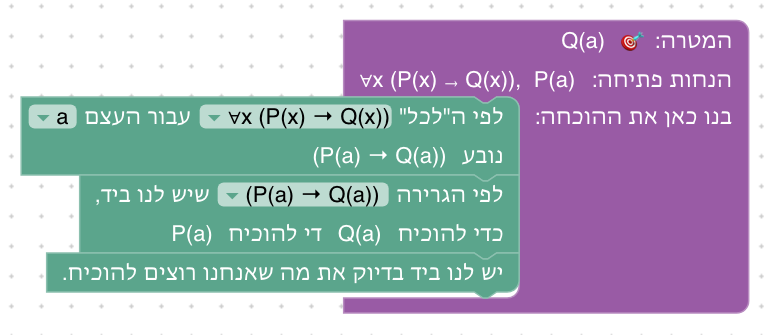
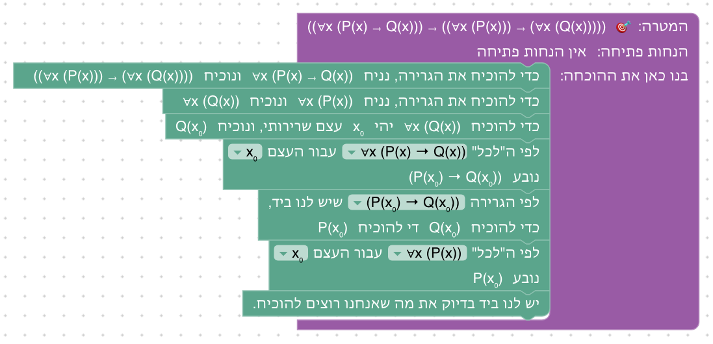
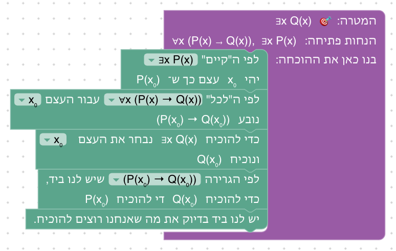

# יחידה 4 — כמתים

**מטרה:** שימוש בכמתים "לכל" ו"קיים" והוכחה שלהם, לפי ארבעת הכללים של דדוקציה טבעית, בסדר של Logic and Proof (פרקים 8–9): הוכחת "לכל" (∀I), שימוש ב"לכל" (∀E), הוכחת "קיים" (∃I) ושימוש ב"קיים" (∃E). השלבים הם הדוגמאות והתרגילים של Logic and Proof, עד ¬∀x P(x) → ∃x ¬P(x) כשלב בונוס. הסטודנט לוקח עצם שרירותי כדי להוכיח "לכל", מציב עצם בטענת "לכל", בוחר עד כדי להוכיח "קיים", ומקבל עצם חדש מטענת "קיים". הוא מבין שסדר המהלכים חשוב (אי אפשר להציב עצם או לבחור עד לפני שיש עצם ביד), שסדר הכמתים חשוב, ואיך שלילה עוברת דרך כמת.

## המהלכים

להנחות אין שמות, אבל לעצמים יש, כמו בהוכחה שכותבים ביד ("יהי x₀ עצם שרירותי"). מהלך שיוצר עצם חדש נותן לו את שם המשתנה שבטענה עם אינדקס: x₀, ואם x₀ כבר בידינו, x₁. כך העצם לא מתבלבל עם המשתנה הקשור של הנוסחה: ה־x שב־`∀x P(x)` רק מסמן "כל עצם", ואילו x₀ הוא עצם מסוים שיש בידינו. את שם העצם הסטודנט לא בוחר; הבלוק כותב אותו לפי מצב ההוכחה.

בכל מהלך שמשתמש בטענה או בעצם בוחרים אותם לפי מה שהם אומרים, מרשימה של מה שבידינו באותו מקום בהוכחה, או ב"✎ כתיבה ידנית". בטבלה, כל מהלך כפי שהוא נקרא כשהוא במקומו ושדותיו נבחרו:

| מהלך | Lean | לפני → אחרי |
|---|---|---|
| **הוכחת "לכל" (∀I):** כדי להוכיח ∀x P(x) יהי x₀ עצם שרירותי, ונוכיח P(x₀) | `refine easylean_forall_intro (fun x₀ => ?_)` | `⊢ ∀x P(x)` ⟶ עצם חדש x₀, `⊢ P(x₀)` |
| **שימוש ב"לכל" (∀E):** לפי ה"לכל" [∀x P(x)] עבור העצם [a] נובע P(a) | `have := easylean_forall_elim ‹∀ x, P x› (a)` | `∀x P(x)` ⟶ גם `P(a)` |
| **הוכחת "קיים" (∃I):** כדי להוכיח ∃x P(x) נבחר את העצם [a] ונוכיח P(a) | `apply Exists.intro (a)` | `⊢ ∃x P(x)` ⟶ `⊢ P(a)` |
| **שימוש ב"קיים" (∃E):** לפי ה"קיים" [∃x P(x)] יהי x₀ עצם כך ש־P(x₀) | `refine Exists.elim ‹∃ x, P x› (fun x₀ _ => ?_)` | `∃x P(x)` ⟶ גם עצם חדש x₀ ו־`P(x₀)` |

בסוגריים המרובעים: השדות שהסטודנט בוחר. הטענה נבחרת מבין ההנחות שבידינו, והעצם מבין העצמים שבידינו (הנתונים, ואלה שמהלכים קודמים יצרו). לפני שהבלוק במקומו הוא כתוב באופן כללי: "לפי ה"לכל" ? עבור העצם ?", "כדי להוכיח "לכל": יהי עצם שרירותי, ונוכיח שהוא מקיים את התכונה", "כדי להוכיח "קיים" נבחר את העצם ?", "לפי ה"קיים" ? יהי עצם חדש שמקיים אותו". אחרי הבחירה הבלוק משלים את מה שנובע (P(a), P(x₀)) ואת מה שנשאר להוכיח, לפי מצב ההוכחה.

**מהלכים מיחידות קודמות** שבארגז של שלבים ביחידה הזאת:

| מהלך | Lean | לפני → אחרי |
|---|---|---|
| **זה בדיוק (יחידה 0):** יש לנו ביד בדיוק את מה שאנחנו רוצים להוכיח. | `assumption` | `A ⊢ A` ⟶ סגור |
| **נניח (יחידה 1):** כדי להוכיח את הגרירה, נניח P ונוכיח Q | `easylean_assume` | `⊢ P → Q` ⟶ `P ⊢ Q` |
| **הסקה קדימה (יחידה 1):** מהגרירה [P → Q] ומ־[P] נובע Q | `have := easylean_mp ‹P → Q› ‹P›` | `P → Q, P` ⟶ גם `Q` |
| **מעבר לתנאי (יחידה 1):** לפי הגרירה [P → Q] שיש לנו ביד, כדי להוכיח Q די להוכיח P | `refine easylean_mp ‹P → Q› ?_` | `P → Q ⊢ Q` ⟶ `P → Q ⊢ P` |
| **שימוש ב"וגם" (יחידה 2):** מה"וגם" [P ∧ Q] נובע P ונובע Q | `have := And.left ‹P ∧ Q›` ו־`have := And.right ‹P ∧ Q›` | `P ∧ Q` ⟶ גם `P`, `Q` |
| **הוכחת "או" (יחידה 2):** כדי להוכיח P ∨ Q די להוכיח [P] | `apply Or.inl` / `apply Or.inr` | `⊢ P ∨ Q` ⟶ `⊢ P` (או `⊢ Q`) |
| **הוכחת שלילה (יחידה 3):** כדי להוכיח ¬A נניח A ונגיע לסתירה | `refine Not.intro (fun _ => ?_)` | `⊢ ¬A` ⟶ `A ⊢ ⊥` |
| **שימוש בשלילה (יחידה 3):** לפי השלילה [¬A] שיש לנו ביד, כדי להגיע לסתירה די להוכיח A | `refine (absurd ?_ ‹¬A› : False)` | `¬A ⊢ ⊥` ⟶ `¬A ⊢ A` |
| **הוכחה בשלילה (יחידה 3):** נוכיח בשלילה: נניח ¬A ונגיע לסתירה | `apply Classical.byContradiction` ו־`intro _` | `⊢ A` ⟶ `¬A ⊢ ⊥` |

**תחום מופשט עם משמעות.** הטענות מדברות על תחום מופשט ועל תכונות P, Q, R (כמו HTPI ו־Logic and Proof), וכל טקסט פתיחה נותן להן משמעות לדוגמה ("התחום: הסטודנטים בקורס; P(x): x עבר את הבוחן"). כך נמנעים מטאוטולוגיות ריקות (אזהרת Massot), בלי צורך באריתמטיקה וב־Mathlib.

**עצמים במצב ההוכחה.** טיפוס התחום ב־Lean נקרא `obj`, אבל הסטודנטים לא רואים אותו. במצב ההוכחה העצמים מוצגים בשורה נפרדת, "עצמים: a, x₀", לפני ההנחות. עצם נתון (כמו a בשלבים 4.1, 4.2 ו־4.5) מופיע רק שם, ולא בשורת "הנחות פתיחה" של בלוק המטרה, כי הוא לא טענה. כך ברור שעצם הוא משהו שיש ביד, ושאפשר לבחור אותו ברשימה של העצמים.

**סימון הקורס.** Lean כותב `∀ (x : obj), P x → Q x`; התצוגה ממירה ל־`∀x (P(x) → Q(x))`: סוגריים סביב ארגומנטים, בלי טיפוס התחום. כמת מתפרש עד סוף הנוסחה, ונוסחה עם כמת בתוך קשר מוקפת בסוגריים (`(∀x P(x)) → Q`), כדי שיהיה ברור היכן הוא נגמר. בטקסטים כתוב "לכל x מתקיים P(x)" ולא "לכל x, P(x)": פסיק בין שני רכיבים לועזיים מחבר אותם לרצף אחד משמאל לימין.

**הפרדה בין "לכל" לגרירה.** ב־Lean ‏∀ וגרירה הם אותו מבנה (גרירה היא ∀ על הוכחות). למות קטנות שמוצבות לפני כל הוכחה (`LEAN_PRELUDE` ב־`frontend/src/generator/lean.js`) מבחינות ביניהן: "לכל" רץ על עצמי התחום, וגרירה על טענות. לכן "נניח" וההסקה מגרירה נכשלים על "לכל", ו"יהי x₀ עצם שרירותי" והצבה ב"לכל" נכשלים על גרירה, וכל כישלון מקבל הסבר בעברית, למשל "ההנחה ∀x P(x) היא טענת "לכל" ולא גרירה. כדי להשתמש בה מציבים בה עצם." (עיקרון 2 ב[עקרונות העיצוב](design/principles.md): בלוק אחד לכל אסטרטגיה). גם על שלילה "נניח" נכשל, כי לשלילה יש מהלך משלה (יחידה 3).

## שלבים

לכל שלב: מה לומדים בו, למה הוא בנוי כך, איך אנחנו רוצים שסטודנטים יפתרו אותו, ושיקולים ושאלות שעוד צריך להכריע. צילומי הפתרונות נוצרים מ־`frontend/e2e/solutions.js` (ראו [יחידה 0](00-getting-started.md#שלבים)). בכל שלב בארגז רק המהלכים של הפתרונות שלו; כשיש שתי דרכים במהלכים מוכרים, בארגז יש את הבלוקים של שתיהן.

**סדר היחידה.** קודם "לכל" (4.1–4.4), ואחריו "קיים" (4.5–4.7), כמו ב־Logic and Proof וברוב המקורות. ב"לכל" השימוש (4.1) בא לפני ההוכחה (4.3), כי הוא דורש רק עצם נתון ומציג את המושגים החדשים (תחום, עצם, תכונה, כמת) במהלך הפשוט ביותר; ב"קיים" ההוכחה (4.5) באה לפני השימוש (4.6), כמו ב־Logic and Proof, כדי שבשלב של השימוש יהיה כבר במה להשתמש בעצם החדש. אחר כך שלילה של "קיים" (4.8), סדר הכמתים (4.9), ובונוס (4.10).

### שלב 4.1: משתמשים בהנחה מסוג "לכל"

`∀x P(x) ⊢ P(a)` · עצמים: a · בארגז: שימוש ב"לכל", זה בדיוק

**מה לומדים.** מה זה תחום, עצם, תכונה ו"לכל", ואת השימוש ב"לכל" (∀E): מציבים עצם.

**למה כך.** השלב מציג את כל המושגים החדשים של היחידה עם המהלך הפשוט ביותר. העצם a נתון, כדי שתהיה הצבה אפשרית מיד; הטקסט אומר שעצמים רואים במצב ההוכחה תחת "עצמים". בבלוק שני שדות, ובשניהם בוחרים ממה שבידינו: הטענה מבין ההנחות, והעצם מבין העצמים.

**פתרון.** "לפי ה"לכל" ∀x P(x) עבור העצם a נובע P(a)", ואחריו "יש לנו ביד בדיוק את מה שאנחנו רוצים להוכיח."

**שיקולים ושאלות להכרעה.**
- ברשימה של השדה הראשון כל ההנחות שבידינו, לא רק טענות "לכל". מי שבוחר טענה אחרת מקבל הסבר ("ההנחה ... היא לא טענת "לכל", ולכן אין במה להציב עצם"). לסנן את הרשימה, כמו במהלך ההגדרה ביחידה 5, או להשאיר לסטודנט את ההחלטה איזו טענה מתאימה?
- לפני שבוחרים, הבלוק כתוב "נובע מה שהוא אומר על העצם", ורק אחרי הבחירה מופיע P(a). האם כדאי שהסטודנט ינסח בעצמו את התוצאה, או שההשלמה האוטומטית מספיקה כדי שיבין מה זו הצבה?
- אם בהמשך יהיו כמה תחומים (למשל סטודנטים וקורסים), צריך יהיה להראות לאיזה תחום כל עצם שייך, ולסנן את רשימת העצמים לפי הכמת.

### שלב 4.2: "לכל" וגרירה

`∀x (P(x) → Q(x)), P(a) ⊢ Q(a)` · עצמים: a · בארגז: שימוש ב"לכל", הסקה קדימה, מעבר לתנאי (אחורה), זה בדיוק

**מה לומדים.** שהצבה ב"לכל" נותנת טענה רגילה, כאן גרירה על a, שמשתמשים בה במהלכים של יחידה 1.

**למה כך.** זה הדפוס הנפוץ ביותר בהוכחות עם "לכל" ("כל מי ש... הוא..."), והוא מחבר את היחידה לקודמות. שתי הדרכים של יחידה 1 פתוחות, והרמזים מתארים את הדרך קדימה ומזכירים את השנייה.

**פתרון א: קדימה.** "לפי ה"לכל" ∀x (P(x) → Q(x)) עבור העצם a נובע (P(a) → Q(a))", "מהגרירה P(a) → Q(a) ומ־P(a) נובע Q(a)", ו"יש לנו ביד...".

**פתרון ב: אחורה.** אותה הצבה, ואחריה "לפי הגרירה P(a) → Q(a) שיש לנו ביד, כדי להוכיח Q(a) די להוכיח P(a)", ו"יש לנו ביד...".

**שיקולים ושאלות להכרעה.**
- הגרירה P(a) → Q(a) מופיעה ברשימות של המהלכים שאחרי ההצבה, כי הרשימה נבנית ממה שבידינו לפני כל מהלך. כך הסטודנט רואה שההצבה הוסיפה טענה חדשה, שמשתמשים בה כמו בכל הנחה. האם להבליט במצב ההוכחה את מה שנוסף במהלך האחרון?
- Verbose Lean מאפשר "להחיל את h על a" ישירות בתוך מהלך אחר, בלי לשמור את התוצאה. כאן ההצבה תמיד מוסיפה טענה למה שבידינו, ולכן ההוכחה ארוכה בצעד אחד. זה תואם הוכחה כתובה ("עבור a נובע..."), אבל האם זה מאריך מדי בהמשך?

### שלב 4.3: מוכיחים טענה מסוג "לכל"

`⊢ (∀x (P(x) ∧ Q(x))) → (∀x P(x))` · בארגז: נניח, הוכחת "לכל", שימוש ב"לכל", שימוש ב"וגם", זה בדיוק

**מה לומדים.** להוכיח "לכל" בעזרת עצם שרירותי (∀I), ושאפשר להציב רק אחרי שיש עצם.

**למה כך.** הרעיון של עצם שרירותי הוא המושג הקשה ביחידה: x₀ לא נבחר בשום אופן מיוחד, ולכן מה שהוכח עליו נכון לכל עצם. הטקסט מסביר למה לעצם יש שם משלו, x₀, ולא x. טקסט הסיום מדגיש את סדר המהלכים: קודם לוקחים את x₀, ורק אז מציבים אותו (ההערה של HTPI: אי אפשר להשתמש ב"לכל" כשאין עוד אף עצם). מי שמנסה להציב לפני כן מוצא את רשימת העצמים ריקה.

**פתרון.** "כדי להוכיח את הגרירה, נניח ∀x (P(x) ∧ Q(x)) ונוכיח ∀x P(x)", "כדי להוכיח ∀x P(x) יהי x₀ עצם שרירותי, ונוכיח P(x₀)", "לפי ה"לכל" ∀x (P(x) ∧ Q(x)) עבור העצם x₀ נובע (P(x₀) ∧ Q(x₀))", "מה"וגם" P(x₀) ∧ Q(x₀) נובע P(x₀) ונובע Q(x₀)", ו"יש לנו ביד...".

**שיקולים ושאלות להכרעה.**
- התנאי על עצם שרירותי (שאסור שיופיע בהנחות קודמות; forall x ו־Logic and Proof מנסחים אותו במפורש) מתקיים תמיד, כי הבלוק בוחר בעצמו שם חדש. הסטודנטים לא יכולים להפר אותו, ולכן גם לא נתקלים בו. האם להסביר אותו בטקסט, או לחכות לשלב שבו הוא חשוב (4.4 או 4.9)?
- מי שמציב לפני שלקח את x₀ יכול לכתוב x ב"✎ כתיבה ידנית", ומקבל "x לא מופיעה בשלב הזה". האם צריך הסבר ייעודי ("אין עדיין עצם בידינו; קודם קחו עצם שרירותי")?

### שלב 4.4: "לכל" וגרירה, בשני הצדדים

`⊢ (∀x (P(x) → Q(x))) → ((∀x P(x)) → (∀x Q(x)))` · בארגז: נניח, הוכחת "לכל", שימוש ב"לכל", הסקה קדימה, מעבר לתנאי (אחורה), זה בדיוק

**מה לומדים.** לשלב הוכחת "לכל" עם שימוש בשתי טענות "לכל": מציבים את אותו עצם שרירותי בשתיהן.

**למה כך.** ש"לכל" מתפלג על גרירה הוא תרגיל ב־Logic and Proof. הוא מחייב להבין שהעצם השרירותי הוא עצם לכל דבר, שאפשר להציב בכל טענת "לכל".

**פתרון א: קדימה.** שתי הנחות, "יהי x₀ עצם שרירותי, ונוכיח Q(x₀)", הצבה של x₀ ב־∀x (P(x) → Q(x)) וב־∀x P(x), "מהגרירה P(x₀) → Q(x₀) ומ־P(x₀) נובע Q(x₀)", ו"יש לנו ביד...".

**פתרון ב: אחורה.** אחרי ההצבה הראשונה, "לפי הגרירה P(x₀) → Q(x₀) שיש לנו ביד, כדי להוכיח Q(x₀) די להוכיח P(x₀)", ורק אז הצבה של x₀ ב־∀x P(x), ו"יש לנו ביד...".

**שיקולים ושאלות להכרעה.**
- בדרך אחורה ההצבה השנייה באה אחרי המעבר לתנאי: היא נעשית כשברור מה צריך. כדאי שהרמזים ימליצו על הסדר הזה ("קודם בדקו מה המטרה, ואז הציבו")?
- האם להוסיף שלב שבו הצבה של עצם *לא* שרירותי נכשלת (למשל ∀x R(x,k) לא גוררת ∀x R(x,x)), כמו הדוגמאות השגויות ב־forall x? כרגע אין דרך להפר את התנאי, ולכן אי אפשר להראות את הטעות.

### שלב 4.5: מוכיחים טענה מסוג "קיים"

`P(a) ⊢ ∃x (P(x) ∨ Q(x))` · עצמים: a · בארגז: הוכחת "קיים", הוכחת "או", זה בדיוק

**מה לומדים.** להוכיח "קיים" (∃I): בוחרים עד, ומוכיחים שהוא מתאים.

**למה כך.** העד נתון (a), וברשימת העצמים הוא היחיד, כדי שהבחירה תהיה ברורה. אחרי הבחירה נשארת מטרה מסוג "או" מיחידה 2, כדי להראות שבחירת עד היא רק הצעד הראשון.

**פתרון.** "כדי להוכיח ∃x (P(x) ∨ Q(x)) נבחר את העצם a ונוכיח (P(a) ∨ Q(a))", "כדי להוכיח (P(a) ∨ Q(a)) די להוכיח P(a)", ו"יש לנו ביד...".

**שיקולים ושאלות להכרעה.**
- Waterproof ו־D∃∀duction מאפשרים לדחות את בחירת העד ("נבחר אחר כך"). כאן העד נבחר מיד. האם צריך מנגנון כזה בהמשך, כשהעד לא ברור מראש?
- ב"✎ כתיבה ידנית" אפשר לכתוב כעד גם ביטוי, ולא רק שם של עצם (זה נחוץ ביחידה 7, למשל n + 1). ביחידה הזאת אין ביטויים כאלה; האם להסתיר את האפשרות כאן?

### שלב 4.6: משתמשים בהנחה מסוג "קיים"

`⊢ (∃x (P(x) ∧ Q(x))) → (∃x P(x))` · בארגז: נניח, שימוש ב"קיים", שימוש ב"וגם", הוכחת "קיים", זה בדיוק

**מה לומדים.** להשתמש ב"קיים" (∃E): מקבלים עצם חדש, וידוע עליו רק מה שההנחה אומרת. ושאת העד בוחרים רק אחרי שמקבלים אותו.

**למה כך.** הטעות הנפוצה עם "קיים" היא לבחור עד לפני שיש אחד (HTPI ממליץ להשתמש ב"קיים" מיד). הטקסט מזהיר ממנה במפורש: לפני השימוש בהנחה אין שום עצם בידינו, ולכן אין עד לבחור. מי שמתחיל בבחירת העד רואה את זה בעצמו: רשימת העצמים בבלוק ריקה.

**פתרון.** "כדי להוכיח את הגרירה, נניח ∃x (P(x) ∧ Q(x)) ונוכיח ∃x P(x)", "לפי ה"קיים" ∃x (P(x) ∧ Q(x)) יהי x₀ עצם כך ש־(P(x₀) ∧ Q(x₀))", "מה"וגם" ... נובע P(x₀) ונובע Q(x₀)", "כדי להוכיח ∃x P(x) נבחר את העצם x₀ ונוכיח P(x₀)", ו"יש לנו ביד...".

**שיקולים ושאלות להכרעה.**
- השלב מתחיל ריק. אפשר לפתוח אותו עם בחירת עד מוקדמת כבר מחוברת, כטעות מתוכננת שמתקנים (עיקרון 7 ב[עקרונות העיצוב](design/principles.md)), אבל כאן אין עצם לבחור, וההסבר הקיים כללי ("בבלוק הזה יש שדה מסומן ?", או "x לא מופיעה בשלב הזה" אם העד נכתב ביד), ולא מדבר על העד. כדאי טעות מתוכננת כזאת, עם הסבר ייעודי?
- Massot מבחין בין "נתון שקיים" לבין "נקבע עצם". הניסוח "יהי x₀ עצם כך ש־P(x₀)" הוא הניסוח המקובל בהוכחה כתובה. האם ברור לסטודנטים ש־x₀ הוא עצם *חדש*, שלא ידוע עליו דבר מלבד P(x₀)?

### שלב 4.7: "לכל" ו"קיים" יחד

`∀x (P(x) → Q(x)), ∃x P(x) ⊢ ∃x Q(x)` · בארגז: שימוש ב"קיים", שימוש ב"לכל", הסקה קדימה, הוכחת "קיים", מעבר לתנאי (אחורה), זה בדיוק

**מה לומדים.** לשלב שלושה כללים: העצם שמתקבל מ"קיים" מוצב ב"לכל" ומשמש כעד.

**למה כך.** תרגיל מוכר מ־Logic and Proof. הוא מראה שעצם שהתקבל מ"קיים" הוא עצם לכל דבר. שתי ההנחות נתונות, כדי שההוכחה תתמקד בכמתים.

**פתרון א: קדימה.** "לפי ה"קיים" ∃x P(x) יהי x₀ עצם כך ש־P(x₀)", הצבה של x₀ ב־∀x (P(x) → Q(x)), "מהגרירה P(x₀) → Q(x₀) ומ־P(x₀) נובע Q(x₀)", "נבחר את העצם x₀ ונוכיח Q(x₀)", ו"יש לנו ביד...".

**פתרון ב: אחורה.** אחרי ההצבה, קודם בוחרים את x₀ כעד, ואז "לפי הגרירה P(x₀) → Q(x₀) שיש לנו ביד, כדי להוכיח Q(x₀) די להוכיח P(x₀)", ו"יש לנו ביד...".

**שיקולים ושאלות להכרעה.**
- בדרך אחורה העד נבחר לפני שהוכח שהוא מתאים. זו ההזדמנות להבחין בין "יש עצם בידינו" (תנאי לבחירה) לבין "הוכח שהוא מתאים" (מה שנשאר אחרי הבחירה). כדאי שהטקסט יאמר זאת?
- תרגיל מקביל בשפת הקבוצות (A ⊆ B ושיש איבר ב־A, ולכן יש איבר ב־B) מתאימה ליחידה 5. להוסיף אותה שם?

### שלב 4.8: שלילה של "קיים"

`⊢ (¬∃x P(x)) → (∀x ¬P(x))` · בארגז: נניח, הוכחת "לכל", הוכחת שלילה, שימוש בשלילה, הוכחת "קיים", זה בדיוק

**מה לומדים.** ששלילה עוברת דרך כמת: "אין עצם שמקיים P" פירושו "כל עצם לא מקיים P". ולשלב כמתים עם המהלכים של יחידה 3.

**למה כך.** כל המקורות מלמדים שלילת כמתים אחרי ארבעת הכללים. הכיוון הזה לא דורש הוכחה בשלילה, ולכן הוא בא לפני הבונוס. הסתירה מגיעה דרך עד ל"קיים", כך שמשתמשים גם ב"קיים" וגם ב"לכל".

**פתרון.** "כדי להוכיח את הגרירה, נניח ¬∃x P(x) ונוכיח ∀x ¬P(x)", "יהי x₀ עצם שרירותי, ונוכיח ¬P(x₀)", "כדי להוכיח ¬P(x₀) נניח P(x₀) ונגיע לסתירה", "לפי השלילה ¬∃x P(x) שיש לנו ביד, כדי להגיע לסתירה די להוכיח ∃x P(x)", "נבחר את העצם x₀ ונוכיח P(x₀)", ו"יש לנו ביד...".

**שיקולים ושאלות להכרעה.**
- "נניח" בארגז בשביל הגרירה החיצונית. על ¬P(x₀) הוא נכשל, עם הסבר שמפנה להוכחת שלילה, כך שלהוכחת השלילה יש מהלך אחד.
- האם להוסיף את הכיוון ההפוך (∀x ¬P(x) → ¬∃x P(x)), שגם הוא לא דורש הוכחה בשלילה, ולקבל שקילות?

### שלב 4.9: תרגיל מסכם: סדר הכמתים

`⊢ (∃x ∀y R(x,y)) → (∀y ∃x R(x,y))` · בארגז: נניח, הוכחת "לכל", שימוש ב"קיים", שימוש ב"לכל", הוכחת "קיים", זה בדיוק

**מה לומדים.** שסדר הכמתים חשוב: "יש מישהו שמכיר את כולם" חזק מ"כל אחד מוכר על ידי מישהו". ולהשתמש בכל ארבעת הכללים בהוכחה אחת.

**למה כך.** טעות נפוצה ומתועדת היא לא להבחין בין ∀∃ ל־∃∀ (Dubinsky ו־Yiparaki, לפי סיכום; המקור עצמו לא נקרא). התרגיל מופיע ב־Logic and Proof. שני העצמים מקבלים את שמות המשתנים שלהם, y₀ ו־x₀, ולכן קל לעקוב מאיזה כמת בא כל אחד. טקסט הסיום מסביר למה הכיוון ההפוך לא נכון.

**פתרון.** "נניח ∃x ∀y R(x,y) ונוכיח ∀y ∃x R(x,y)", "יהי y₀ עצם שרירותי, ונוכיח ∃x R(x,y₀)", "לפי ה"קיים" ∃x ∀y R(x,y) יהי x₀ עצם כך ש־∀y R(x₀,y)", "לפי ה"לכל" ∀y R(x₀,y) עבור העצם y₀ נובע R(x₀,y₀)", "נבחר את העצם x₀ ונוכיח R(x₀,y₀)", ו"יש לנו ביד...".

**שיקולים ושאלות להכרעה.**
- הכיוון ההפוך מוסבר רק בטקסט. בבלוקים אפשר לראות למה הוא נכשל: העצם שמתקבל מ"קיים" תלוי ב־y₀, ובמקום שבו צריך לבחור עד שלא תלוי בו, הוא עוד לא ברשימה. כדאי שלב שבו מנסים ונתקעים, עם הסבר בסיום?
- אפשר גם להתחיל בשימוש ב"קיים" ורק אחר כך לקחת את y₀; שני הסדרים עובדים, והשמות זהים. האם להזכיר זאת ברמזים, כדי שסטודנטים לא יחשבו שיש סדר אחד נכון?

### שלב 4.10: שלב בונוס: שלילה של "לכל"

`⊢ (¬∀x P(x)) → (∃x ¬P(x))` · בארגז: נניח, הוכחה בשלילה, שימוש בשלילה, הוכחת "לכל", הוכחת "קיים", זה בדיוק

**מה לומדים.** את הכיוון השני של שלילת כמתים, והוכחה בשלילה בתוך הוכחה בשלילה.

**למה כך.** מבין ארבעת הכיוונים של שלילת כמתים זה היחיד שדורש הוכחה בשלילה, ולכן הוא בונוס. הטקסט לא מסמן אותו כ"קלאסי" (ראו [יחידה 3](03-negation.md#שלבים)). מההנחה לא ידוע איזה עצם לא מקיים P, ולכן אין עד לבחור ישירות; ההוכחה בשלילה פותרת זאת.

**פתרון.** "נניח ¬∀x P(x) ונוכיח ∃x ¬P(x)", "נוכיח בשלילה: נניח ¬∃x ¬P(x) ונגיע לסתירה", "לפי השלילה ¬∀x P(x) שיש לנו ביד, כדי להגיע לסתירה די להוכיח ∀x P(x)", "יהי x₀ עצם שרירותי, ונוכיח P(x₀)", "נוכיח בשלילה: נניח ¬P(x₀) ונגיע לסתירה", "לפי השלילה ¬∃x ¬P(x) ..., די להוכיח ∃x ¬P(x)", "נבחר את העצם x₀ ונוכיח ¬P(x₀)", ו"יש לנו ביד...".

**שיקולים ושאלות להכרעה.**
- זו הוכחה עם שתי הוכחות בשלילה זו בתוך זו. האם היא קשה מדי גם כבונוס? חלופה: להשתמש בשלב 4.8 כטענה שכבר הוכחה, אבל אין עדיין מהלך לטענה כזאת (ראו בהמשך).
- העד x₀ הוא העצם השרירותי של ההוכחה הפנימית. זה המקום הראשון שבו עצם שרירותי משמש גם כעד; כדאי שטקסט הסיום יעיר על כך?

## שאלות שנוגעות ליחידה כולה

- **"עצם" שהוא קבוצה.** ביחידה 6 (קבוצות של קבוצות) משתמשים באותם מהלכים על "לכל" ו"קיים" מעל קבוצות, ולכן העד או העצם שמציבים יכולים להיות קבוצה. למשל, כשמוכיחים A ⊆ ⋃₀ F, העד הוא הקבוצה A, אבל הבלוק כותב "נבחר את העצם A". לכתוב "נבחר את A" בלי "העצם", או לשנות את המילה לפי סוג הדבר שנבחר?
- **מהלך לטענת ביניים.** אין עדיין מהלך כמו "נוכיח קודם ש־...", שמוסיף טענה ומוכיח אותה בצד. הוא יאפשר להשתמש בשלב 4.8 בתוך 4.10, ויאפשר הוכחות כמו 𝒫 A ⊆ 𝒫 B → A ⊆ B ביחידה 6, שדורשת להוכיח בצד את A ∈ 𝒫 A.
- **אותה טענה פעמיים.** כשאותה טענה נמצאת בידינו פעמיים (למשל אחרי שתי הצבות זהות), היא מופיעה ברשימה פעם אחת. Lean מוצא אותה לפי מה שהיא אומרת, ולכן אין הבדל. זה מספיק, או שמצב ההוכחה צריך להראות שהיא הופיעה פעמיים?
- **סוגריים סביב גוף הכמת:** גוף הכמת מוקף בסוגריים רק כשהוא מורכב: `∀x P(x)`, אבל `∀x (P(x) → Q(x))`. זו המוסכמה הנפוצה בספרי לוגיקה; אם מוסכמת הקורס שונה, זה שינוי בפונקציה אחת (`formatProofGoal`).
- **תחום ריק:** `∀x P(x) → ∃x P(x)` נכון רק בתחום לא ריק. האם להוסיף שלב בונוס שבו נתון עצם a, ולדון למה הוא נחוץ?
- **פרדוקס הספר:** ∀x (S(b,x) ↔ ¬S(x,x)) ⊢ ⊥ (Logic and Proof). חידה מוכרת ומעניינת לסטודנטים; להוסיף כבונוס נוסף?
- **∃ ו־∨:** `(∃x P(x)) ∨ (∃x Q(x)) ↔ ∃x (P(x) ∨ Q(x))` משלב את יחידה 2 עם כמתים. מתאים כשלב נוסף?

## רקע: מה עושים מדריכים אחרים

המשך הסקירה של [יחידה 2](02-and-or-iff.md#רקע-מה-עושים-מדריכים-אחרים), על כמתים:
- **סדר:** רוב המקורות (HTPI, Mathematics in Lean, Logic and Proof, D∃∀duction) מלמדים "לכל" לפני "קיים"; Mechanics of Proof הפוך. forall x מקדים את הכללים הקלים (∀E, ∃I) לאלה עם התנאים (∀I, ∃E). שלילת כמתים תמיד אחרי ארבעת הכללים.
- **ניסוח:**
  - Verbose Lean: "Fix x", "By h applied to a we get", "Let's prove that a works", "By h we get x such that".
  - Waterproof: "Take x", "Use x := a in (H)", "Choose m := n", "Obtain such an n".
  - HTPI: "Let x stand for an arbitrary object", "plug in any value".
  - הוכחה כתובה בעברית: "יהי x₀ עצם שרירותי", "נבחר את a", "יהי x₀ עצם כך ש־P(x₀)". המהלכים כאן בנויים לפי הניסוח הזה.
- **טעויות נפוצות:**
  - בחירת עד לפני שיש אחד, או לפני שימוש בהנחת "קיים" (שלב 4.6).
  - שימוש בעצם מסוים כאילו הוא שרירותי, או בשם שכבר תפוס. כאן השם נבחר אוטומטית, ולכן הטעות השנייה לא אפשרית.
  - ניסיון להשתמש ב"לכל" כשאין עוד אף עצם (שלב 4.3).
  - בלבול בסדר הכמתים (שלב 4.9).
- **תחום מופשט מול מספרים:** HTPI ו־Logic and Proof מופשטים (`U : Type`, תכונות `P : U → Prop`); D∃∀duction ו־Mechanics of Proof על מספרים, שדורשים כאן Mathlib. נבחר תחום מופשט עם משמעות בטקסט.
- **מקורות:**
  - [Verbose Lean](https://github.com/PatrickMassot/verbose-lean4)
  - [Waterproof](https://github.com/impermeable/coq-waterproof)
  - [D∃∀duction](https://github.com/dEAduction/dEAduction)
  - [How To Prove It with Lean, 3.3](https://djvelleman.github.io/HTPIwL/Chap3.html)
  - [forall x, Ch. 36–38](https://forallx.openlogicproject.org/html/Ch36.html)
  - [Logic and Proof](https://leanprover-community.github.io/logic_and_proof/natural_deduction_for_first_order_logic.html)
  - [Mathematics in Lean](https://leanprover-community.github.io/mathematics_in_lean/C03_Logic.html)
  - [The Mechanics of Proof](https://hrmacbeth.github.io/math2001/04_Proofs_with_Structure_II.html)

