# יחידה 5 — שקילויות לוגיות

**מטרה:** להשתמש בשקילויות לוגיות כמו בהוכחה כתובה: "לפי חוק דה מורגן, ¬(P ∨ Q) פירושו ¬P ∧ ¬Q". שתי טענות *שקולות* (A ↔ B) אם כל אחת נובעת מהשנייה, ואז מותר להחליף אחת בשנייה, במטרה או בטענה שבידינו, וגם בתוך טענה גדולה יותר. הסטודנט משלים קודם את השקילויות שהוכיח ביחידות 3 ו־4 בכיוון אחד בלבד (5.1, 5.2, 5.4, 5.5) ומוכיח שקילות חדשה בשני הכיוונים (5.3), ואז משתמש בהן במהלך חדש אחד, "לפי השקילות ... נחליף ...": מחליף את המטרה בטענה ששקולה לה (5.6), מחליף בטענה שבידינו (5.7), מוכיח גרירה דרך הקונטרה־פוזיציה שלה (5.8), מחליף בתוך טענה ובשרשרת (5.9), מעביר שלילה דרך כמתים (5.10), ומוכיח בעזרת שקילות חוק חדש, דה מורגן ל"וגם" (5.11, בונוס).

**המקום של השקילויות בספרי הלימוד.** בספרי הלוגיקה של Copi ושל Hurley השקילויות הן "כללי החלפה" (Rules of Replacement): דה מורגן, קונטרה־פוזיציה (Transposition), גרירה כ"או" (Material Implication), שלילה כפולה ועוד. הם באים מיד אחרי כללי ההסקה, וההבדל ביניהם מודגש: כלל הסקה פועל רק על טענה שלמה, ואילו החלפה לפי שקילות מותרת גם בתוך חלק של טענה. ספרי הדדוקציה הטבעית (forall x, Huth & Ryan, Logic and Proof) מוכיחים את השקילויות כתרגילים, ואחר כך משתמשים בהן ככללים נגזרים. ספרי המבוא להוכחות ולמתמטיקה בדידה (Rosen §1.3, Epp, How to Prove It של Velleman) מלמדים שקילויות מוקדם, ומשתמשים בהן כדי לשנות את המטרה: כדי להוכיח P ∨ Q מניחים ¬P ומוכיחים Q, וכשהמטרה היא שלילה מעבירים את השלילה פנימה, גם דרך כמתים. Gries ו־Schneider בונים את הלוגיקה כולה כחשבון של שקילויות. היחידה הזאת הולכת בדרך של ספרי הדדוקציה הטבעית: כל שקילות מוכחת קודם בשני הכיוונים, במהלכים של היחידות הקודמות, ורק אז היא כלל של החלפה, כמו אצל Copi ו־Hurley.

## המהלכים

ביחידה מהלך חדש אחד. כמו בכל הקורס, להנחות אין שמות: את הטענה שבה מחליפים בוחרים לפי מה שהיא אומרת, מרשימה של מה שבידינו באותו מקום בהוכחה, או ב"✎ כתיבה ידנית". בטבלה, המהלך כפי שהוא נקרא כשהוא במקומו ושדותיו נבחרו (בסוגריים המרובעים: מה שהסטודנט בוחר):

| מהלך | Lean | לפני → אחרי |
|---|---|---|
| **החלפה לפי שקילות, במטרה:** לפי השקילות [(A → B) ↔ (¬A ∨ B)] נחליף [את (A → B) ב־(¬A ∨ B)] בתוך [המטרה] | `(first \| rewrite [easylean_imp_or] \| simp only [easylean_imp_or] \| fail "…")` | `⊢ P → Q` ⟶ `⊢ ¬P ∨ Q` |
| **החלפה לפי שקילות, בטענה שבידינו:** לפי השקילות [¬(A ∨ B) ↔ (¬A ∧ ¬B)] נחליף [את ¬(A ∨ B) ב־(¬A ∧ ¬B)] בתוך [¬(P ∨ Q)] | `have := ‹¬(P ∨ Q)›; (first \| rewrite [easylean_not_or] at this \| simp only [easylean_not_or] at this \| fail "…")` | `¬(P ∨ Q)` ⟶ גם `¬P ∧ ¬Q` |
| **בכיוון ההפוך:** לפי השקילות [(A → B) ↔ (¬A ∨ B)] נחליף [את (¬A ∨ B) ב־(A → B)] בתוך [המטרה] | אותו קוד, עם `← easylean_imp_or` | `⊢ ¬P ∨ ¬Q` ⟶ `⊢ P → ¬Q` |

בבלוק שלושה שדות. בשדה הראשון בוחרים שקילות מתפריט של השקילויות של השלב. בשדה השני בוחרים את הכיוון, והוא מוצג כהחלפה עצמה: "את ¬(A ∨ B) ב־(¬A ∧ ¬B)" או "את (¬A ∧ ¬B) ב־¬(A ∨ B)", כמו הכיוון בהחלפה לפי שוויון ביחידה 8. בשדה השלישי בוחרים את המקום: "המטרה", שמופיעה ראשונה ברשימה, או טענה שבידינו. בהחלפה בטענה שבידינו, הטענה החדשה מצטרפת להנחות, והישנה נשארת, כמו בכל מהלך קדימה. לפני שהבלוק במקומו, השקילות שבו היא `?`, והמקום הוא המטרה.

**השקילויות.** כל שקילות היא שתי גרירות, וכל אחת מהן הוכחה בשלב משלה:

| שקילות | שם בכרטיס | כיוון אחד | כיוון שני | בתפריט בשלבים |
|---|---|---|---|---|
| `¬(A ∨ B) ↔ (¬A ∧ ¬B)` | דה מורגן ל"או" | 3.5 (→) | 5.1 (←) | 5.7, 5.9 |
| `(A → B) ↔ (¬B → ¬A)` | קונטרה־פוזיציה | 5.2 (→) | 3.9 (←) | 5.8 |
| `(A → B) ↔ (¬A ∨ B)` | גרירה כ"או" | 5.3 | 5.3 | 5.6, 5.11 |
| `¬∃x P(x) ↔ ∀x ¬P(x)` | שלילה של "קיים" | 4.8 (→) | 5.4 (←) | 5.10 |
| `¬∀x P(x) ↔ ∃x ¬P(x)` | שלילה של "לכל" | 4.10 (→) | 5.5 (←) | 5.10 |
| `¬¬A ↔ A` | שלילה כפולה | 3.8 (→) | 3.2 (←) | 5.9 |
| `¬(A ∧ B) ↔ (¬A ∨ ¬B)` | — | 5.11 (→) | לא הוכח | אף שלב |

כל שקילות מוצגת ככרטיס בשלב שבו היא מופיעה לראשונה בתפריט (גרירה כ"או" מוצגת שוב בשלב 5.11), והכרטיס אומר באילו שלבים הוכחו שני הכיוונים שלה.

**מהלכים מיחידות קודמות** שבארגז של שלבים ביחידה הזאת:

| מהלך | Lean | לפני → אחרי |
|---|---|---|
| **זה בדיוק (יחידה 0):** יש לנו ביד בדיוק את מה שאנחנו רוצים להוכיח. | `assumption` | `A ⊢ A` ⟶ סגור |
| **נניח (יחידה 1):** כדי להוכיח את הגרירה, נניח P ונוכיח Q | `easylean_assume` | `⊢ P → Q` ⟶ `P ⊢ Q` |
| **הסקה קדימה (יחידה 1):** מהגרירה [P → Q] ומ־[P] נובע Q | `have := easylean_mp ‹P → Q› ‹P›` | `P → Q, P` ⟶ גם `Q` |
| **מעבר לתנאי (יחידה 1):** לפי הגרירה [P → Q] שיש לנו ביד, כדי להוכיח Q די להוכיח P | `refine easylean_mp ‹P → Q› ?_` | `P → Q ⊢ Q` ⟶ `P → Q ⊢ P` |
| **שימוש ב"וגם" (יחידה 2):** מה"וגם" [P ∧ Q] נובע P ונובע Q | `have := And.left ‹P ∧ Q›` ו־`have := And.right ‹P ∧ Q›` | `P ∧ Q` ⟶ גם `P`, `Q` |
| **הוכחת "וגם" (יחידה 2):** כדי להוכיח P ∧ Q נוכיח כל צד לחוד; נוכיח P … נוכיח Q … | `apply And.intro` | `⊢ P ∧ Q` ⟶ שני חלקים: `⊢ P`, `⊢ Q` |
| **הוכחת "או" (יחידה 2):** כדי להוכיח P ∨ Q די להוכיח [P] | `apply Or.inl` / `apply Or.inr` | `⊢ P ∨ Q` ⟶ `⊢ P` (או `⊢ Q`) |
| **חלוקה למקרים (יחידה 2):** נחלק למקרים לפי ה"או" [P ∨ Q]; מקרה ראשון: נניח P … מקרה שני: נניח Q … | `cases ‹P ∨ Q› with \| inl _ => … \| inr _ => …` | שני חלקים: `P ⊢ …`, `Q ⊢ …` |
| **הוכחת "אם ורק אם" (יחידה 2):** כדי להוכיח P ↔ Q נוכיח את שני הכיוונים; בחלקים: "נוכיח P → Q", "נוכיח Q → P" | `apply Iff.intro` | `⊢ P ↔ Q` ⟶ שני חלקים: `⊢ P → Q`, `⊢ Q → P` |
| **סתירה (יחידה 3):** יש לנו ביד את [A] ואת ¬A, וזו סתירה. | `exact (absurd ‹A› ‹¬(A)› : False)` | `A, ¬A ⊢ ⊥` ⟶ סגור |
| **הוכחת שלילה (יחידה 3):** כדי להוכיח ¬A נניח A ונגיע לסתירה | `refine Not.intro (fun _ => ?_)` | `⊢ ¬A` ⟶ `A ⊢ ⊥` |
| **שימוש בשלילה (יחידה 3):** לפי השלילה [¬A] שיש לנו ביד, כדי להגיע לסתירה די להוכיח A | `refine (absurd ?_ ‹¬A› : False)` | `¬A ⊢ ⊥` ⟶ `¬A ⊢ A` |
| **מסתירה נובע הכול (יחידה 3):** מסתירה נובע הכול, ולכן כדי להוכיח Q די להגיע לסתירה | `apply False.elim` | `⊢ Q` ⟶ `⊢ ⊥` |
| **הוכחה בשלילה (יחידה 3):** נוכיח בשלילה: נניח ¬A ונגיע לסתירה | `apply Classical.byContradiction` ו־`intro _` | `⊢ A` ⟶ `¬A ⊢ ⊥` |
| **שימוש ב"לכל" (יחידה 4):** לפי ה"לכל" [∀x P(x)] עבור העצם [a] נובע P(a) | `have := easylean_forall_elim ‹∀ x, P x› (a)` | `∀x P(x)` ⟶ גם `P(a)` |
| **שימוש ב"קיים" (יחידה 4):** לפי ה"קיים" [∃x P(x)] יהי x₀ עצם כך ש־P(x₀) | `refine Exists.elim ‹∃ x, P x› (fun x₀ _ => ?_)` | `∃x P(x)` ⟶ גם עצם חדש x₀ ו־`P(x₀)` |

**הוחלט: שקילות משמשת רק אחרי ששני הכיוונים שלה הוכחו.** כך ההחלפה היא כלל נגזר, כמו בספרי הדדוקציה הטבעית, ולא עובדה שמקבלים מהמערכת: כל שקילות בתפריט היא משהו שהסטודנט עצמו הוכיח. לכן ארבעה מחמשת השלבים הראשונים משלימים את הכיוונים שחסרו ביחידות 3 ו־4 (ראו הטבלה), ושלב 5.3 מוכיח שקילות חדשה בשני הכיוונים. לשלילה הכפולה שני הכיוונים כבר הוכחו ביחידה 3. דה מורגן ל"וגם" הוכח בשלב 5.11 בכיוון אחד בלבד, ולכן הוא לא מופיע בתפריט של אף שלב, אף שהוא מוגדר בין השקילויות של המהלך (`easylean_not_and` ב־`LAWS`).

**הוחלט: בתפריט השקילויות כתובות באותיות סכמטיות A ו־B,** כמו הבלוקים של יחידה 3 בטבלאות, ולא כמופע שלהן בטענה ("את ¬(P ∨ Q) ב־(¬P ∧ ¬Q)"). מה שיצא מההחלפה רואים במצב ההוכחה: במטרה החדשה, או בטענה החדשה שבידינו. כך הסטודנט צריך לזהות בעצמו שהטענה היא מופע של השקילות (ש־P ממלא את A ו־Q את B), וזה הצעד הלוגי של המהלך. ראו שאלה (ה) בסוף.

**הוחלט: הבלוק אומר "נחליף", בלי לומר כמה פעמים.** ב־Lean ההחלפה היא `rewrite`, שמחליף את המופע הראשון שהוא מוצא של הצד שנבחר, וכל עותק זהה שלו. בתוך כמת `rewrite` לא מגיע (הוא לא מחליף מתחת למשתנה קשור), ואז המהלך עובר ל־`simp only`, שמחליף את כל המופעים. בשלבים של היחידה יש בכל מקום מופע אחד בלבד, ולכן ההבדל לא נראה.

**ב־Lean.** השקילויות מוכחות שוב ב־Lean, כמשפטים של הקורס (`EQUIV_PRELUDE` ב־`frontend/src/generator/lean.js`): `easylean_not_not`, `easylean_not_or`, `easylean_not_and`, `easylean_imp_or`, `easylean_contrapositive`, `easylean_not_exists`, `easylean_not_forall`. ההקדמה נוספת רק לשלבים שיש להם שקילויות (`level.laws`), ולכן לא מאטה את שאר השלבים. גם התפריט של המהלך מציע רק את השקילויות של השלב (`level.laws`), כמו שבארגז יש רק המהלכים של השלב.

**שקילות על כמת שומרת על שמות המשתנים.** השקילויות על כמתים מנוסחות ב־Lean עם משתנה קשור כלשהו, ו־`simp only` היה כותב בתוצאה שם חדש, למשל `∃ x, ∀ x_1, ¬R x x_1`. לכן, למהלך הזה בלבד, השקילות מנוסחת מחדש עם המשתנה הקשור של הטענה (`have easylean_law : … (¬∃ y, p y) ↔ ∀ y, ¬p y := …`, ואחרי ההחלפה `clear easylean_law`), ובשלב 5.10 מתקבל `∃x ∀y ¬R(x,y)`, כמו בהוכחה כתובה.

**שלילה כפולה רק בכיוון אחד.** התפריט מציע רק "את ¬¬A ב־A". בכיוון ההפוך, A מתאימה לכל טענה, ו"להוסיף ¬¬ לפני משהו" לא נקבע לפי הצורה. השקילות עצמה הוכחה בשני הכיוונים, והכרטיס שלה אומר זאת.

**כשאין מה להחליף.** אם במקום שנבחר אין חלק מהצורה של הצד שנבחר, Lean נכשל (`fail "easylean: no part of the form …"`), וההסבר הוא: "במקום שבחרתם אין חלק מהצורה ¬(A ∨ B), ולכן אין מה להחליף. בדקו את המקום ואת כיוון ההחלפה." (`frontend/src/game/moveExplanations.js`).

**מגבלה: קונטרה־פוזיציה בתוך כמת.** `simp only` עם `(A → B) ↔ (¬B → ¬A)` לא נעצר: גם התוצאה ¬B → ¬A היא גרירה, והוא מחליף אותה שוב ושוב. `rewrite` מחליף פעם אחת, ולכן מחוץ לכמת אין בעיה. אף שלב לא משתמש בקונטרה־פוזיציה בתוך כמת; שלב כזה ידרוש החלפה של מופע אחד בלבד גם בתוך כמת.

**מקום היחידה בקורס.** היחידה חדשה, ובאה אחרי הכמתים, כדי שהשלילה של כמתים תהיה בין השקילויות. היחידות שאחריה מוספרו מחדש: קבוצות היא יחידה 6, קבוצות של קבוצות יחידה 7, ושוויון ואינדוקציה יחידה 8. ביחידה 8 ההחלפה לפי שוויון מוצגת כאותו רעיון: אחרי "שקול בשקול" בא "שווה בשווה" ("כמו שביחידה 5 החלפתם טענה בטענה ששקולה לה"), והבלוק בנוי באותה צורה ("לפי השוויון ... נחליף ... בתוך ...").

## שלבים

לכל שלב: מה לומדים בו, למה הוא בנוי כך, איך אנחנו רוצים שסטודנטים יפתרו אותו, ושיקולים ושאלות שעוד צריך להכריע. צילומי הפתרונות נוצרים מ־`frontend/e2e/solutions.js` (ראו [יחידה 0](00-getting-started.md#שלבים)). בכל שלב בארגז רק המהלכים של הפתרונות שלו, ובתפריט של מהלך ההחלפה רק השקילויות שלהם.

**סדר היחידה.** קודם משלימים את החוקים (5.1–5.5), במהלכים מוכרים: דה מורגן ל"או" (5.1), קונטרה־פוזיציה (5.2), גרירה כ"או" (5.3, שקילות חדשה), ושלילה של כמתים (5.4–5.5). אחר כך המהלך החדש: במטרה (5.6), בטענה שבידינו (5.7), כשיטת הוכחה עם שתי דרכים (5.8), בתוך טענה ובשרשרת (5.9), ובתוך כמת (5.10). הבונוס (5.11) משתמש בשקילות כדי להוכיח חוק חדש.

### שלב 5.1: משלימים את דה מורגן

`⊢ (¬P ∧ ¬Q) → ¬(P ∨ Q)` · בארגז: נניח, שימוש ב"וגם", הוכחת שלילה, חלוקה למקרים, סתירה

**מה לומדים.** מה זו שקילות, ואת הכלל של היחידה: משתמשים רק בשקילות ששני הכיוונים שלה הוכחו. ואת הכיוון ← של דה מורגן ל"או".

**למה כך.** טקסט הפתיחה של היחידה מסביר ששקילות היא שתי גרירות, ושארבעה מחמשת השלבים הראשונים משלימים את מה שחסר. הכיוון הזה לא דורש הוכחה בשלילה: אחרי הנחת התנאי המטרה היא שלילה, ובכל אחד מהמקרים של ה"או" יש סתירה מוכנה. כך השלב חוזר על מהלכים של יחידות 2 ו־3 בלי קושי חדש, וטקסט הסיום נותן לשקילות את שמה, *חוק דה מורגן* ל"או".

**פתרון.** "כדי להוכיח את הגרירה, נניח (¬P ∧ ¬Q) ונוכיח ¬(P ∨ Q)", "מה"וגם" ¬P ∧ ¬Q נובע ¬P ונובע ¬Q", "כדי להוכיח ¬(P ∨ Q) נניח (P ∨ Q) ונגיע לסתירה", "נחלק למקרים לפי ה"או" P ∨ Q". "מקרה ראשון: נניח P": "יש לנו ביד את P ואת ¬P, וזו סתירה." "מקרה שני: נניח Q": אותו דבר עם Q.

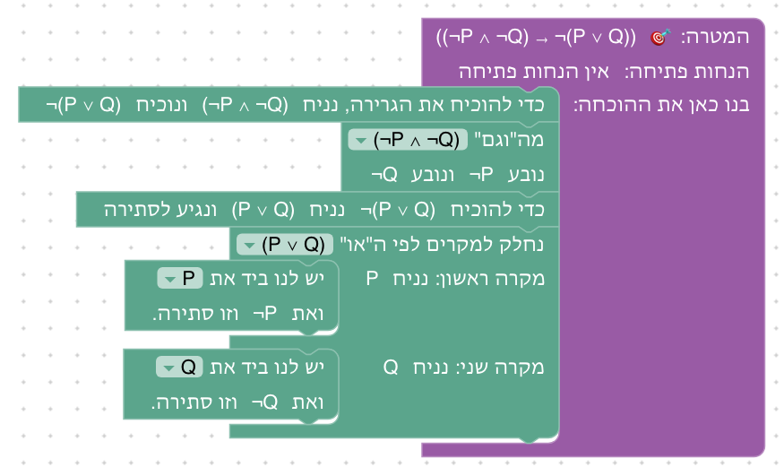

**שיקולים ושאלות להכרעה.**
- היחידה מתחילה בחמישה שלבים בלי מהלך חדש. אפשר לשזור אותם: להשלים שקילות, ומיד אחר כך להשתמש בה (5.1 ואחריו 5.7, 5.2 ואחריו 5.8). אז המהלך החדש יוצג מוקדם יותר, אבל שלב 5.6, שמציג אותו, צריך את שלב 5.3. מה עדיף?

### שלב 5.2: משלימים את הקונטרה־פוזיציה

`⊢ (P → Q) → (¬Q → ¬P)` · בארגז: נניח, הוכחת שלילה, הסקה קדימה, סתירה

**מה לומדים.** את הכיוון → של הקונטרה־פוזיציה: אם P גוררת את Q, אז ¬Q גוררת את ¬P.

**למה כך.** זה modus tollens של שלב 3.3, כשההנחות הופכות לתנאים של גרירה. הטקסט מפנה לשלב 3.3, כדי שהסטודנט יראה ששלב שהוכח עם הנחות נתונות הוא חוק כללי. הכיוון ההפוך, שלב 3.9, דרש הוכחה בשלילה; הכיוון הזה לא.

**פתרון.** "כדי להוכיח את הגרירה, נניח P → Q ונוכיח (¬Q → ¬P)", "נניח ¬Q ונוכיח ¬P", "כדי להוכיח ¬P נניח P ונגיע לסתירה", "מהגרירה P → Q ומ־P נובע Q", ו"יש לנו ביד את Q ואת ¬Q, וזו סתירה."

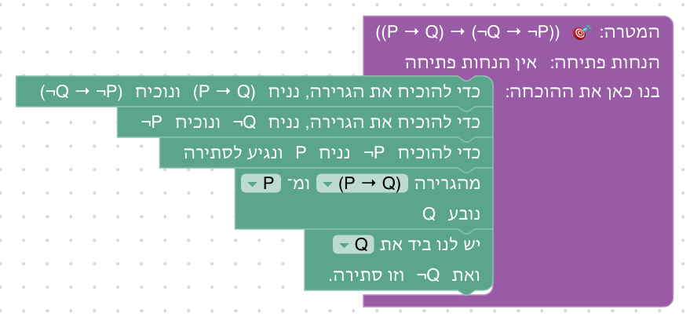

**שיקולים ושאלות להכרעה.**
- השלב כמעט זהה לשלב 3.3, עם שתי הנחות תנאי לפני ההוכחה. האם להגיד זאת במפורש, למשל בטקסט הסיום ("זו ההוכחה של שלב 3.3, עם הנחות שהפכו לתנאים"), או שההפניה בטקסט הפתיחה מספיקה?

### שלב 5.3: גרירה היא "או"

`⊢ (P → Q) ↔ (¬P ∨ Q)` · בארגז: הוכחת "אם ורק אם", נניח, הוכחה בשלילה, שימוש בשלילה, הוכחת "או", הוכחת שלילה, מעבר לתנאי, חלוקה למקרים, מסתירה נובע הכול, סתירה, זה בדיוק

**מה לומדים.** ש"אם P אז Q" אומרת "P לא נכונה, או Q נכונה", בשני הכיוונים. זו השקילות היחידה שהיחידה מוכיחה מההתחלה.

**למה כך.** השקילות הזאת היא הבסיס של שלבים 5.6 ו־5.11, ובספרים היא מופיעה בין הראשונות (Material Implication אצל Copi ו־Hurley, Rosen §1.3). שני הכיוונים חוזרים על שלבים מוכרים: הכיוון ← הוא הוצאת אפשרות (שלב 3.7), והכיוון → הוא ההוכחה של P ∨ ¬P (שלב 3.10): מניחים את השלילה של ה"או", ומשתמשים בה פעמיים, פעם עם כל צד. הטקסט מציג את שני הכיוונים ואומר מראש שהכיוון → קשה יותר, כי לא ידוע איזה צד של ה"או" נכון.

**פתרון.** "כדי להוכיח ((P → Q) ↔ (¬P ∨ Q)) נוכיח את שני הכיוונים". בחלק "נוכיח ((P → Q) → (¬P ∨ Q))": "נניח (P → Q) ונוכיח (¬P ∨ Q)", "נוכיח בשלילה: נניח ¬(¬P ∨ Q) ונגיע לסתירה", "לפי השלילה ¬(¬P ∨ Q) שיש לנו ביד, כדי להגיע לסתירה די להוכיח (¬P ∨ Q)", "כדי להוכיח (¬P ∨ Q) די להוכיח ¬P", "כדי להוכיח ¬P נניח P ונגיע לסתירה", שוב "לפי השלילה ¬(¬P ∨ Q) ... די להוכיח (¬P ∨ Q)", "די להוכיח Q", "לפי הגרירה (P → Q) שיש לנו ביד, כדי להוכיח Q די להוכיח P", ו"יש לנו ביד...". בחלק "נוכיח ((¬P ∨ Q) → (P → Q))": "נניח (¬P ∨ Q) ונוכיח (P → Q)", "נניח P ונוכיח Q", "נחלק למקרים לפי ה"או" (¬P ∨ Q)". "מקרה ראשון: נניח ¬P": "מסתירה נובע הכול, ולכן כדי להוכיח Q די להגיע לסתירה", ו"יש לנו ביד את P ואת ¬P, וזו סתירה." "מקרה שני: נניח Q": "יש לנו ביד...".

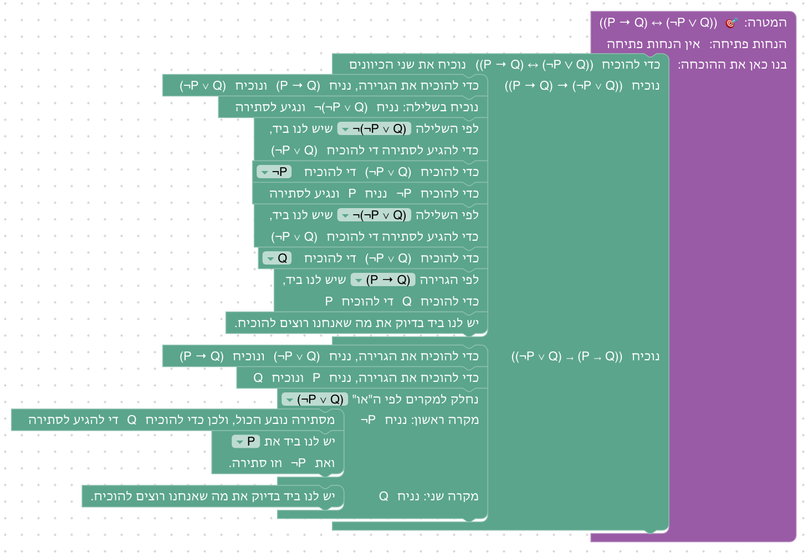

**שיקולים ושאלות להכרעה.**
- השלב ארוך: 16 בלוקים, ו־11 מהלכים בארגז. ראו שאלה (ד) בסוף.
- בכיוון → אין כאן את ההוכחה הנפוצה בספרים, בחלוקה למקרים לפי P ∨ ¬P, כי אין מהלך לטענת ביניים, ושלב 3.10 לא זמין כטענה שהוכחה.

### שלב 5.4: משלימים את השלילה של "קיים"

`⊢ (∀x ¬P(x)) → ¬∃x P(x)` · בארגז: נניח, הוכחת שלילה, שימוש ב"קיים", שימוש ב"לכל", סתירה

**מה לומדים.** את הכיוון ← של השלילה של "קיים": אם אף עצם לא מקיים את P, אז לא קיים עצם שמקיים את P.

**למה כך.** הכיוון הזה לא דורש הוכחה בשלילה: מניחים את ה"קיים", מקבלים עצם x₀, ומציבים אותו ב"לכל". השלב עונה על השאלה שנשארה פתוחה בשלב 4.8 (להוסיף את הכיוון ההפוך ולקבל שקילות).

**פתרון.** "כדי להוכיח את הגרירה, נניח ∀x ¬P(x) ונוכיח ¬∃x P(x)", "כדי להוכיח ¬∃x P(x) נניח ∃x P(x) ונגיע לסתירה", "לפי ה"קיים" ∃x P(x) יהי x₀ עצם כך ש־P(x₀)", "לפי ה"לכל" ∀x ¬P(x) עבור העצם x₀ נובע ¬P(x₀)", ו"יש לנו ביד את P(x₀) ואת ¬P(x₀), וזו סתירה."

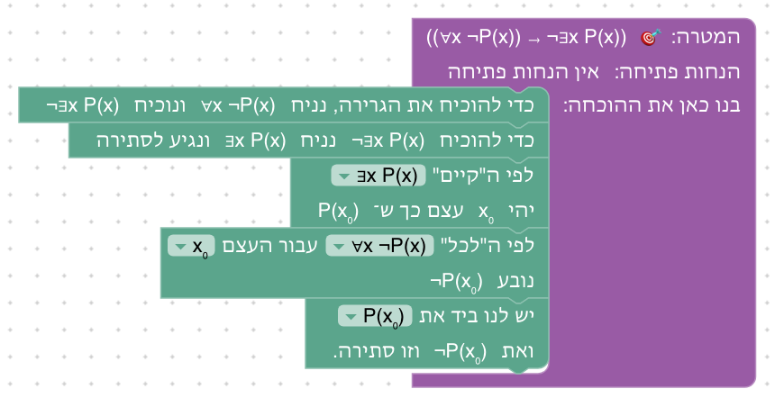

**שיקולים ושאלות להכרעה.**
- שלבים 5.4 ו־5.5 הם כמעט אותה הוכחה, עם אותו ארגז. ראו שאלה (ג) בסוף.

### שלב 5.5: משלימים את השלילה של "לכל"

`⊢ (∃x ¬P(x)) → ¬∀x P(x)` · בארגז: נניח, הוכחת שלילה, שימוש ב"קיים", שימוש ב"לכל", סתירה

**מה לומדים.** את הכיוון ← של השלילה של "לכל": אם יש עצם שלא מקיים את P, אז לא כל העצמים מקיימים את P.

**למה כך.** הכיוון → היה שלב הבונוס של יחידה 4, כי הוא דורש שתי הוכחות בשלילה. הכיוון הזה קל, והטקסט אומר זאת: מניחים את ה"לכל", ומציבים בו את העצם שמתקבל מה"קיים". טקסט הסיום אומר שיש עכשיו שש שקילויות, ושמהשלב הבא משתמשים בהן.

**פתרון.** "כדי להוכיח את הגרירה, נניח ∃x ¬P(x) ונוכיח ¬∀x P(x)", "כדי להוכיח ¬∀x P(x) נניח ∀x P(x) ונגיע לסתירה", "לפי ה"קיים" ∃x ¬P(x) יהי x₀ עצם כך ש־¬P(x₀)", "לפי ה"לכל" ∀x P(x) עבור העצם x₀ נובע P(x₀)", ו"יש לנו ביד את P(x₀) ואת ¬P(x₀), וזו סתירה."

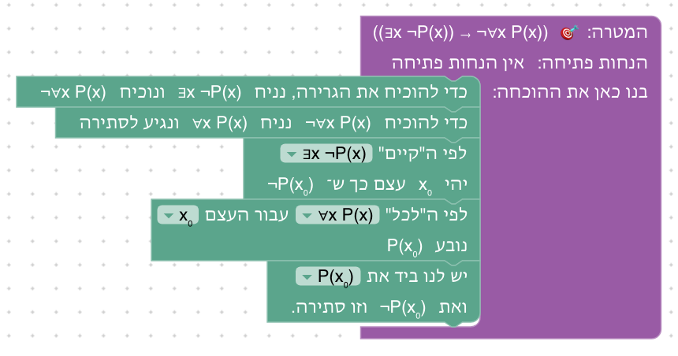

**שיקולים ושאלות להכרעה.**
- ההבדל היחיד מ־5.4 הוא איזו טענה מניחים ואיזו מתקבלת מה"קיים". אם השלבים יאוחדו, האם להשאיר את ההשוואה בין "לא קיים" ל"לא לכל" לטקסט?

### שלב 5.6: במקום גרירה, "או"

`¬P ⊢ P → Q` · בארגז: החלפה לפי שקילות, הוכחת "או", זה בדיוק · בתפריט: `(A → B) ↔ (¬A ∨ B)`

**מה לומדים.** את המהלך החדש, על המטרה: להוכיח טענה זה כמו להוכיח טענה ששקולה לה. ושגרירה שהתנאי שלה לא נכון היא נכונה (*אמת ריקה*).

**למה כך.** זו הדוגמה של מחבר הקורס: מוכיחים גרירה בהוכחה של ¬P ∨ Q. כשבידינו ¬P, הצד השמאלי של ה"או" כבר מוכח, וזה ההסבר לאמת הריקה, שסטודנטים מתקשים לקבל ("איך אם P אז Q נכונה, אם P בכלל לא נכונה?"). בארגז אין "נניח", ולכן השלב לא נפתר בלי המהלך החדש. טקסט הפתיחה מסביר את שלושת השדות, והרמזים אומרים מה לבחור בכל אחד. המקום כבר "המטרה" כשהבלוק נגרר, כך שההחלטה החדשה היחידה היא השקילות והכיוון. טקסט הסיום כותב את ההוכחה כפי שכותבים אותה ביד ("לפי השקילות ..., נחליף את P → Q ב־¬P ∨ Q") ונותן לתופעה את שמה.

**פתרון.** "לפי השקילות (A → B) ↔ (¬A ∨ B) נחליף את (A → B) ב־(¬A ∨ B) בתוך המטרה" (עכשיו המטרה ¬P ∨ Q), "כדי להוכיח (¬P ∨ Q) די להוכיח ¬P", ו"יש לנו ביד בדיוק את מה שאנחנו רוצים להוכיח."

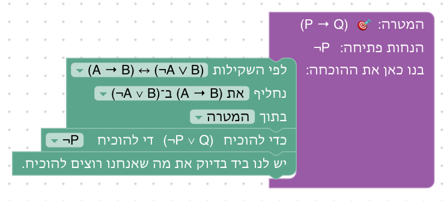

**שיקולים ושאלות להכרעה.**
- הבלוק לא כותב מה התקבל: את ¬P ∨ Q רואים רק במצב ההוכחה, ובבלוק הבא ("כדי להוכיח (¬P ∨ Q) די להוכיח ..."). האם הסטודנטים יבחינו בשינוי של המטרה? ראו שאלה (ה) בסוף.
- הטקסט מסביר את האמת הריקה דרך השקילות. ביחידה 3 אפשר היה להוכיח את אותה טענה בדרך אחרת (נניח P, ומסתירה נובע הכול). האם להזכיר את הדרך הזאת בסיום, כדי שהאמת הריקה לא תיראה כתלויה בשקילות?

### שלב 5.7: מחליפים בהנחה

`¬(P ∨ Q) ⊢ ¬Q` · בארגז: החלפה לפי שקילות, שימוש ב"וגם", זה בדיוק · בתפריט: `¬(A ∨ B) ↔ (¬A ∧ ¬B)`

**מה לומדים.** את המהלך על טענה שבידינו: הטענה החדשה מצטרפת להנחות, והישנה נשארת.

**למה כך.** ההשוואה לשלב 3.4 היא העיקר: שם הוכחתם ¬P מאותה הנחה בארבעה מהלכים של כללי השלילה (הוכחת שלילה, שימוש בשלילה, הוכחת "או", זה בדיוק). כאן ההוכחה היא מה שכותבים ביד: "לפי דה מורגן, ¬(P ∨ Q) פירושו ¬P ∧ ¬Q, ומזה נובע ¬Q". טקסט הסיום אומר זאת: שקילות שהוכחה פעם אחת חוסכת את העבודה בכל פעם שצריך אותה. המקום שבבלוק מתחיל כ"המטרה", וכאן צריך לשנות אותו, אחרת ההסבר הוא "במקום שבחרתם אין חלק מהצורה ¬(A ∨ B)".

**פתרון.** "לפי השקילות ¬(A ∨ B) ↔ (¬A ∧ ¬B) נחליף את ¬(A ∨ B) ב־(¬A ∧ ¬B) בתוך ¬(P ∨ Q)" (עכשיו בידינו ¬P ∧ ¬Q), "מה"וגם" ¬P ∧ ¬Q נובע ¬P ונובע ¬Q", ו"יש לנו ביד...".

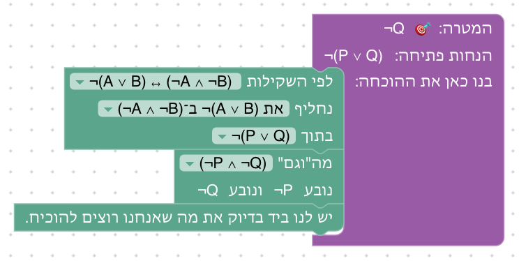

**שיקולים ושאלות להכרעה.**
- הטענה הישנה ¬(P ∨ Q) נשארת בידינו. זה נכון לוגית, וזה מה שקורה בכל מהלך קדימה, אבל בשרשרת של החלפות (5.9, 5.10) מצטברות טענות כמעט זהות. האם להבליט במצב ההוכחה את מה שנוסף במהלך האחרון?

### שלב 5.8: קונטרה־פוזיציה כשיטת הוכחה

`⊢ (¬Q → ¬P) → (P → Q)` · בארגז: נניח, החלפה לפי שקילות, זה בדיוק · בתפריט: `(A → B) ↔ (¬B → ¬A)`

**מה לומדים.** הוכחה דרך קונטרה־פוזיציה, כשיטה: כדי להוכיח "אם P אז Q" מוכיחים "אם לא Q אז לא P". ושאפשר להחליף או במטרה או בהנחה.

**למה כך.** אותה טענה כמו בשלב 3.9, שם היא דרשה הוכחה בשלילה. כאן היא החלפה אחת. בספרי המבוא להוכחות (Velleman, Rosen) הקונטרה־פוזיציה היא שיטת הוכחה בפני עצמה, ובשלב הזה היא מופיעה כך: משנים את המטרה. בשלב שתי דרכים, ובארגז המהלכים של שתיהן (אותם מהלכים): החלפה במטרה, בכיוון "את (A → B) ב־(¬B → ¬A)", או החלפה בהנחה, בכיוון ההפוך. הרמזים מתארים את הדרך במטרה ומזכירים את השנייה. ההשוואה בין השתיים מראה שהחלפה במטרה היא עבודה אחורה, והחלפה בהנחה היא עבודה קדימה, כמו שני הכיוונים של יחידה 1.

**פתרון א: במטרה.** "כדי להוכיח את הגרירה, נניח (¬Q → ¬P) ונוכיח (P → Q)", "לפי השקילות (A → B) ↔ (¬B → ¬A) נחליף את (A → B) ב־(¬B → ¬A) בתוך המטרה" (עכשיו המטרה ¬Q → ¬P), ו"יש לנו ביד...".

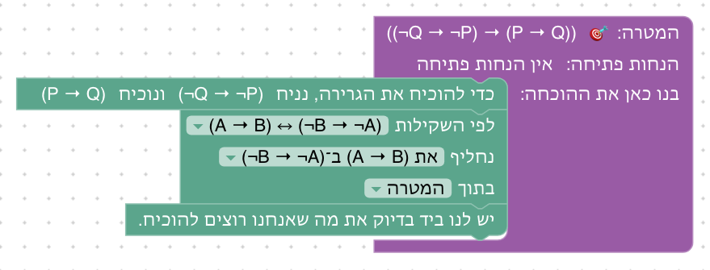

**פתרון ב: בהנחה.** אותה הנחה, ואחריה "לפי השקילות (A → B) ↔ (¬B → ¬A) נחליף את (¬B → ¬A) ב־(A → B) בתוך (¬Q → ¬P)" (עכשיו בידינו P → Q), ו"יש לנו ביד...".

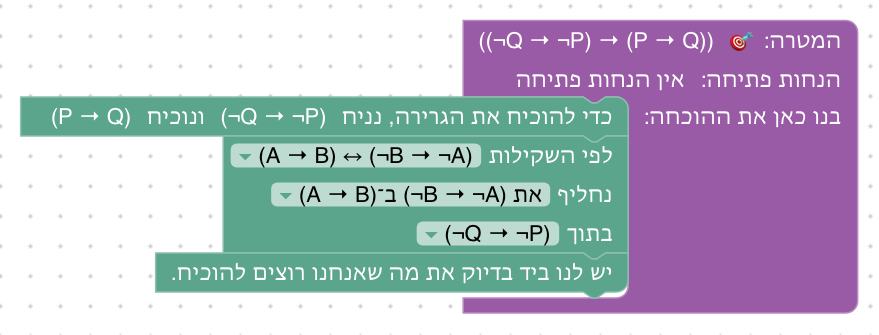

**שיקולים ושאלות להכרעה.**
- הטענה של השלב היא בדיוק הכיוון ← של השקילות, שהוכח בשלב 3.9. סטודנט חושב עשוי לשאול אם ההוכחה מעגלית. היא לא (3.9 הוכח בלי השקילות), אבל השלב מראה בעיקר שימוש בשלב 3.9 כחוק. האם להחליף את הטענה בטענה שבה הקונטרה־פוזיציה היא רק צעד אחד בהוכחה? דוגמה טבעית היא בתוך כמת (∀x (¬Q(x) → ¬P(x)) ⊢ ∀x (P(x) → Q(x))), אבל שם ההחלפה נתקעת (ראו "מגבלה" במהלכים).
- בדרך במטרה, גם ההנחה ¬Q → ¬P היא מהצורה A → B. היא לא מוחלפת, כי המקום הוא המטרה. האם כדאי שהטקסט יאמר שהמקום קובע איפה מחליפים, גם כשהצורה מופיעה בכמה טענות?

### שלב 5.9: שרשרת של החלפות

`⊢ ¬(P ∨ ¬Q) → (¬P ∧ Q)` · בארגז: נניח, החלפה לפי שקילות, זה בדיוק · בתפריט: `¬(A ∨ B) ↔ (¬A ∧ ¬B)`, `¬¬A ↔ A`

**מה לומדים.** להחליף בתוך חלק של טענה, ולהחליף כמה פעמים ברצף, כמו בחישוב: ¬(P ∨ ¬Q) ↔ (¬P ∧ ¬¬Q) ↔ (¬P ∧ Q).

**למה כך.** ההחלפה השנייה היא בתוך ה"וגם": רק ¬¬Q, הצד הימני שלו, מוחלפת ב־Q. זה מה שמבדיל החלפה לפי שקילות מכלל הסקה, ההבחנה שעליה Copi ו־Hurley חוזרים: כלל הסקה פועל רק על טענה שלמה, והחלפה גם בתוך חלק. כאן בפעם הראשונה יש בתפריט שתי שקילויות, ולכן צריך לבחור גם את השקילות. התרגיל דומה לדוגמה של Rosen §1.3, שמראה בשרשרת של שקילויות ש־¬(p ∨ (¬p ∧ q)) שקולה ל־¬p ∧ ¬q. טקסט הסיום משווה לזהויות באלגברה.

**פתרון.** "כדי להוכיח את הגרירה, נניח ¬(P ∨ ¬Q) ונוכיח (¬P ∧ Q)", "לפי השקילות ¬(A ∨ B) ↔ (¬A ∧ ¬B) נחליף את ¬(A ∨ B) ב־(¬A ∧ ¬B) בתוך ¬(P ∨ ¬Q)" (עכשיו בידינו ¬P ∧ ¬¬Q), "לפי השקילות ¬¬A ↔ A נחליף את ¬¬A ב־A בתוך (¬P ∧ ¬¬Q)" (עכשיו בידינו ¬P ∧ Q), ו"יש לנו ביד...".

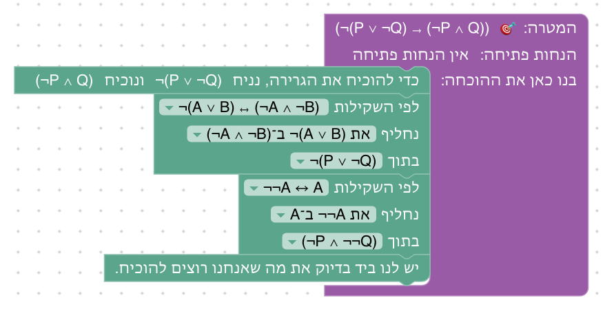

**שיקולים ושאלות להכרעה.**
- בהחלפה הראשונה B היא ¬Q, ולכן ¬B היא ¬¬Q. זה הרגע שבו הסטודנט צריך לראות שאות סכמטית יכולה לעמוד בשביל טענה מורכבת. האם הרמז צריך לומר זאת ("כאן B היא ¬Q")?
- כל ההחלפות בשלב הן בהנחה. החלפה במטרה לא אפשרית כאן: במטרה ¬P ∧ Q אין ¬¬, והכיוון ההפוך של השלילה הכפולה לא בתפריט. זה מכוון, או שכדאי שלב שבו השרשרת נבנית מהמטרה אחורה?

### שלב 5.10: דוחפים את השלילה פנימה

`⊢ (¬∀x ∃y R(x,y)) → (∃x ∀y ¬R(x,y))` · בארגז: נניח, החלפה לפי שקילות, זה בדיוק · בתפריט: `¬∀x P(x) ↔ ∃x ¬P(x)`, `¬∃x P(x) ↔ ∀x ¬P(x)`

**מה לומדים.** למצוא את השלילה של טענה עם כמתים: מעבירים את השלילה פנימה, כמת אחר כמת, ובכל מעבר "לכל" הופך ל"קיים" ולהפך.

**למה כך.** זה השימוש הנפוץ ביותר בשקילויות בספרי המבוא (Velleman, Rosen, Epp): כשהמטרה או ההנחה היא שלילה של טענה עם כמתים, מנסחים אותה מחדש בלי שלילה מבחוץ. הטקסט נותן לטענה משמעות: R(x,y) הוא "x מכיר את y", ו"לא כל אחד מכיר מישהו" פירושו "יש מישהו שלא מכיר אף אחד". בהחלפה הראשונה P(x) עומדת בשביל ∃y R(x,y), טענה עם כמת משלה. ההחלפה השנייה היא בתוך ה"קיים", מתחת למשתנה x, ולכן ב־Lean היא `simp only`, והשקילות מנוסחת מחדש עם המשתנה y, כדי שהתוצאה תהיה ∃x ∀y ¬R(x,y) (ראו במהלכים).

**פתרון.** "כדי להוכיח את הגרירה, נניח ¬∀x ∃y R(x,y) ונוכיח ∃x ∀y ¬R(x,y)", "לפי השקילות ¬∀x P(x) ↔ ∃x ¬P(x) נחליף את ¬∀x P(x) ב־∃x ¬P(x) בתוך ¬∀x ∃y R(x,y)" (עכשיו בידינו ∃x ¬∃y R(x,y)), "לפי השקילות ¬∃x P(x) ↔ ∀x ¬P(x) נחליף את ¬∃x P(x) ב־∀x ¬P(x) בתוך ∃x ¬∃y R(x,y)" (עכשיו בידינו ∃x ∀y ¬R(x,y)), ו"יש לנו ביד...".

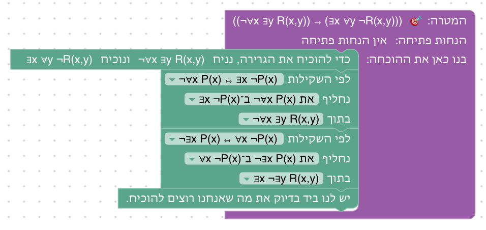

**שיקולים ושאלות להכרעה.**
- בתפריט השקילות כתובה עם x ו־P, אבל בהחלפה השנייה המשתנה הוא y והתכונה היא R(x,y). זו בדיוק ההכללה שהשלב מלמד, אבל היא עלולה לבלבל. ראו שאלה (ה) בסוף.
- ייתכן שיש דרך שנייה, אחורה מהמטרה, בכיוונים ההפוכים של אותן שקילויות (∃x ∀y ¬R(x,y) ⟵ ∃x ¬∃y R(x,y) ⟵ ¬∀x ∃y R(x,y)). היא לא נבדקה ואינה בין הפתרונות. אם היא עובדת, להוסיף אותה כפתרון שני ולהזכיר אותה ברמזים?

### שלב 5.11: שלב בונוס: דה מורגן ל"וגם"

`⊢ ¬(P ∧ Q) → (¬P ∨ ¬Q)` · בארגז: נניח, החלפה לפי שקילות, הוכחת שלילה, שימוש בשלילה, הוכחת "וגם", זה בדיוק · בתפריט: `(A → B) ↔ (¬A ∨ B)`

**מה לומדים.** להשתמש בשקילות כדי להוכיח חוק חדש. ואת הכיוון הקשה של דה מורגן ל"וגם".

**למה כך.** להוכיח "או" כשלא ידוע איזה צד נכון זה קשה, וביחידה 3 זה דרש הוכחה בשלילה (כמו בשלב 3.10). כאן השקילות של שלב 5.3, בכיוון ההפוך, הופכת את המטרה ¬P ∨ ¬Q לגרירה P → ¬Q, וגרירה יודעים להוכיח. החלק הקשה כבר נעשה בשלב 5.3, והשקילות חוסכת אותו. זו גם הפעם הראשונה שבה ההחלפה היא בכיוון ההפוך, "את (¬A ∨ B) ב־(A → B)", עם A = P ו־B = ¬Q. הכיוון השני של החוק (¬A ∨ ¬B → ¬(A ∧ B)) קל, אבל לא הוכח, ולכן דה מורגן ל"וגם" לא נכנס לתפריט.

**פתרון.** "כדי להוכיח את הגרירה, נניח ¬(P ∧ Q) ונוכיח (¬P ∨ ¬Q)", "לפי השקילות (A → B) ↔ (¬A ∨ B) נחליף את (¬A ∨ B) ב־(A → B) בתוך המטרה" (עכשיו המטרה P → ¬Q), "כדי להוכיח את הגרירה, נניח P ונוכיח ¬Q", "כדי להוכיח ¬Q נניח Q ונגיע לסתירה", "לפי השלילה ¬(P ∧ Q) שיש לנו ביד, כדי להגיע לסתירה די להוכיח (P ∧ Q)", "כדי להוכיח (P ∧ Q) נוכיח כל צד לחוד": בחלק "נוכיח P" ובחלק "נוכיח Q", "יש לנו ביד...".

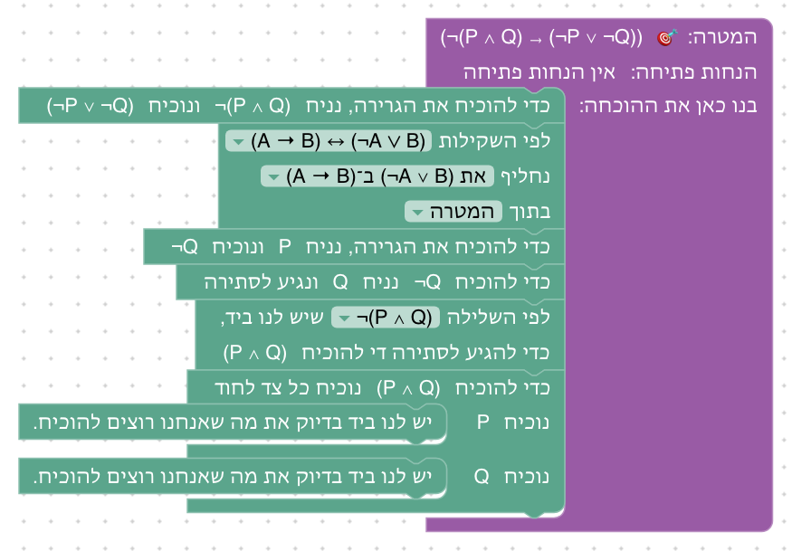

**שיקולים ושאלות להכרעה.**
- טקסט הסיום אומר שאותם חוקים מופיעים ביחידות על קבוצות בשפת הקבוצות (למשל דה מורגן לקבוצות, 6.11). מהלך ההחלפה עצמו לא מופיע שם: ראו שאלה (א) בסוף.
- ראו שאלה (ב) בסוף: האם להוסיף את הכיוון השני, כדי שדה מורגן ל"וגם" יהיה שקילות בתפריט.

## שאלות שנוגעות ליחידה כולה

- **(א) דה מורגן לקבוצות, בדרך של שקילויות.** הדרך השנייה שתוכננה לשלב הבונוס של יחידה 6 ((A ∪ B)ᶜ = Aᶜ ∩ Bᶜ, בעזרת דה מורגן במקום לבנות אותו שוב) לא נוספה. השקילויות פועלות על הצורה הלוגית של הטענה, ואחרי שימוש בהגדרת המשלים הטענה היא ¬(x₀ ∈ A ∪ B): השייכות שבתוך השלילה היא לא "או" בצורתה, ולכן ¬(A ∨ B) לא מתאימה לה, עד שפותחים את האיחוד *בתוך* השלילה. מהלך ההגדרה לא יכול לעשות זאת: הוא פועל על טענת שייכות שלמה. אפשרות: לאפשר למהלך ההחלפה להשתמש גם בהגדרות כשקילויות (x ∈ A ∪ B ↔ x ∈ A ∨ x ∈ B), ואז אפשר להחליף את השייכות בתוך השלילה, ואחר כך להשתמש בדה מורגן. כך גם D∃∀duction מנסח את ההגדרות.
- **(ב) דה מורגן ל"וגם" כשקילות.** שלב 5.11 מוכיח רק את הכיוון →. הכיוון ← קל (נניח ¬A ∨ ¬B ונניח A ∧ B, ונחלק למקרים). להוסיף אותו כשלב, כדי ש־`¬(A ∧ B) ↔ (¬A ∨ ¬B)` (כבר מוגדרת ב־`LAWS` כ־`easylean_not_and`) תיכנס לתפריט? אם כן, לפני 5.11 או אחריו?
- **(ג) לאחד את 5.4 ו־5.5?** שתי ההוכחות כמעט זהות: הנחה, הוכחת שלילה, שימוש ב"קיים", הצבה ב"לכל" וסתירה. אפשר לאחד אותן לשלב אחד, למשל עם המטרה כשקילות (`¬∃x P(x) ↔ ∀x ¬P(x)` בשני הכיוונים, כשהכיוון → חוזר על 4.8), או להשאיר שני שלבים קצרים, שכל אחד משלים שקילות אחרת.
- **(ד) לפצל את 5.3?** השלב ארוך (16 בלוקים), ובארגז 11 מהלכים. אפשר לפצל אותו לשני שלבים, כיוון בכל אחד, ולהשאיר את ההוכחה בשני הכיוונים כרגע שבו השקילות "נסגרת". המחיר: היחידה מתארכת בשלב נוסף לפני המהלך החדש.
- **(ה) להראות בבלוק את המופע של השקילות?** כרגע התפריט כתוב באותיות סכמטיות ("את ¬(A ∨ B) ב־(¬A ∧ ¬B)"), והתוצאה נראית רק במצב ההוכחה. אפשרות: אחרי שבוחרים מקום, לכתוב בבלוק את ההחלפה עצמה ("את ¬(P ∨ Q) ב־(¬P ∧ ¬Q)"), כמו שהכיוון בהחלפה לפי שוויון מוצג. זה קרוב יותר להוכחה כתובה, אבל דורש לחשב בצד הבלוק את ההתאמה בין השקילות לטענה (מה ממלא את A ואת B, ואיזה מופע מוחלף), והסטודנט כבר לא צריך לזהות בעצמו את המופע.

## רקע: מה עושים מדריכים אחרים

- **כללי החלפה (Copi, Hurley).** בספרי הלוגיקה הקלאסיים לסטודנטים, אחרי כללי ההסקה (תשעה אצל Copi, שמונה אצל Hurley) באים עשרה כללי החלפה: דה מורגן, קומוטטיביות, אסוציאטיביות, פילוג, שלילה כפולה, קונטרה־פוזיציה (Transposition), גרירה כ"או" (Material Implication), Material Equivalence, Exportation ו־Tautology. כלל החלפה מותר גם בתוך חלק של שורה, וכלל הסקה רק על שורה שלמה, ושני הספרים מדגישים את ההבדל. השקילויות לא מוכחות שם בכללי ההסקה: הן נתונות, ומוצדקות בטבלאות אמת. כאן הן מוכחות קודם.
- **כללים נגזרים (forall x, Huth & Ryan, Logic and Proof).** בספרי הדדוקציה הטבעית השקילויות הן תרגילים: מוכיחים את דה מורגן, את הקונטרה־פוזיציה ואת השלילה של כמתים בכללים הבסיסיים, ואחר כך מוסיפים אותם ככללים נגזרים (forall x: DeM, CQ). Huth & Ryan מגדירים שקילות כגזירה בשני הכיוונים (⊣⊢). כך בנויה גם היחידה הזאת: שקילות נכנסת לתפריט רק אחרי ששני הכיוונים הוכחו.
- **ספרי מבוא להוכחות ולמתמטיקה בדידה (Rosen §1.3–1.5, Epp פרקים 2–3, Velleman, How to Prove It).** טבלה של שקילויות מוצגת מוקדם, ומשמשת להוכחת שקילויות חדשות בשרשרת (שלב 5.9) ולשלילה של טענות עם כמתים (שלב 5.10). Velleman משתמש בהן כדי לשנות את המטרה: כדי להוכיח P ∨ Q מניחים ¬P ומוכיחים Q (הדרך של שלב 5.11), וכשהמטרה היא שלילה, "מנסחים אותה מחדש" בלי שלילה מבחוץ, לפי השקילויות של שלילת כמתים. הוכחה בקונטרה־פוזיציה היא שיטת הוכחה בפני עצמה (שלב 5.8).
- **חשבון של שקילויות (Gries ו־Schneider, A Logical Approach to Discrete Math).** הלוגיקה כולה בנויה כחשבון של שקילויות: כל הוכחה היא שרשרת של החלפות "שקול בשקול", לפי כלל לייבניץ, כמו בחישוב אלגברי. שלב 5.9 הוא טעימה מהסגנון הזה, וההחלפה לפי שוויון ביחידה 8 היא אותו כלל.
- **ב־Lean ובכלים אחרים.** ב־Lean מחליפים לפי שקילות ב־`rw` וב־`simp`, ו־`push_neg` של Mathlib מעביר שלילה פנימה בצעד אחד. כאן, כמו ביחידה 3, אין `push_neg`: כל מעבר של שלילה הוא צעד שהסטודנט בוחר, לפי שקילות שהוא הוכיח. D∃∀duction מנסח כל הגדרה כשקילות, וכך מאפשר להחליף לפיה (ראו שאלה (א)).
- **מקורות:**
  - Irving M. Copi, Carl Cohen, Kenneth McMahon, *Introduction to Logic*, פרק "Methods of Deduction" (כללי ההחלפה)
  - Patrick J. Hurley, *A Concise Introduction to Logic*, פרק 7 (Rules of Replacement I–II)
  - [forall x: Calgary](https://forallx.openlogicproject.org/)
  - Michael Huth, Mark Ryan, *Logic in Computer Science*, פרק 1.2
  - [Logic and Proof](https://leanprover-community.github.io/logic_and_proof/)
  - Kenneth H. Rosen, *Discrete Mathematics and Its Applications*, §1.3–1.5
  - Susanna S. Epp, *Discrete Mathematics with Applications*, פרקים 2–3
  - [How To Prove It with Lean, פרק 3](https://djvelleman.github.io/HTPIwL/Chap3.html)
  - David Gries, Fred B. Schneider, *A Logical Approach to Discrete Math*
  - [D∃∀duction](https://github.com/dEAduction/dEAduction)

