# יחידה 6 — שקילויות לוגיות

**מטרה:** להשתמש בשקילויות לוגיות כמו בהוכחה כתובה: "לפי חוק דה מורגן, ¬(P ∨ Q) פירושו ¬P ∧ ¬Q". שתי טענות *שקולות* אם יש להן אותו ערך אמת בכל השמה, ואז מותר להחליף אחת בשנייה, במטרה או בטענה שבידינו, וגם בתוך טענה גדולה יותר. את השקילויות של הקשרים הסטודנט כבר בדק בטבלאות אמת ביחידה 1. את השקילויות של הכמתים אי אפשר לבדוק בטבלה: ביחידה 5 הן הוכחו בכיוון אחד, וכאן הוא משלים את הכיוון השני (6.1, 6.2). אחר כך הוא משתמש בשקילויות במהלך חדש אחד, "לפי השקילות ... נחליף ...": מחליף את המטרה בטענה ששקולה לה (6.3), מחליף בטענה שבידינו (6.4), מוכיח גרירה דרך הקונטרה־פוזיציה שלה (6.5), מחליף בתוך טענה ובשרשרת (6.6), מעביר שלילה דרך כמתים (6.7), מנסח דוגמה נגדית (6.8), שולל טענות מורכבות עד שהשלילה נצמדת לטענות היסוד, כמו בתרגיל של ההרצאה (6.9, 6.10), ומוכיח "או" בטכניקה של ההרצאה: מניח את השלילה של צד אחד ומוכיח את הצד השני (6.11), גם כשהצד הזה הוא שלילה (6.12). בשלב הבונוס (6.13) הוא מוכיח באותה טכניקה את מה שבדק בטבלה, דה מורגן ל"וגם".

**המקום של השקילויות בספרי הלימוד.** בספרי הלוגיקה של Copi ושל Hurley השקילויות הן "כללי החלפה" (Rules of Replacement): דה מורגן, קונטרה־פוזיציה (Transposition), גרירה כ"או" (Material Implication), שלילה כפולה ועוד. הם באים מיד אחרי כללי ההסקה, וההבדל ביניהם מודגש: כלל הסקה פועל רק על טענה שלמה, ואילו החלפה לפי שקילות מותרת גם בתוך חלק של טענה. ספרי הדדוקציה הטבעית (forall x, Huth & Ryan, Logic and Proof) מוכיחים את השקילויות כתרגילים, ואחר כך משתמשים בהן ככללים נגזרים. ספרי המבוא להוכחות ולמתמטיקה בדידה (Rosen §1.3, Epp, How to Prove It של Velleman) מלמדים שקילויות מוקדם, ומשתמשים בהן כדי לשנות את המטרה: כדי להוכיח P ∨ Q מניחים ¬P ומוכיחים Q, וכשהמטרה היא שלילה מעבירים את השלילה פנימה, גם דרך כמתים. Gries ו־Schneider בונים את הלוגיקה כולה כחשבון של שקילויות. היחידה הזאת הולכת בדרך של ההרצאה, ושל Copi ו־Hurley: השקילויות של הקשרים מוצדקות בטבלאות אמת (יחידה 1), ורק אז הן כללי החלפה. השקילויות של הכמתים, שאין להן טבלה, מוכחות בשני הכיוונים במהלכים, כמו בספרי הדדוקציה הטבעית.

## המהלכים

ביחידה מהלך חדש אחד. כמו בכל הקורס, להנחות אין שמות: את הטענה שבה מחליפים בוחרים לפי מה שהיא אומרת, מרשימה של מה שבידינו באותו מקום בהוכחה, או ב"✎ כתיבה ידנית". בטבלה, המהלך כפי שהוא נקרא כשהוא במקומו ושדותיו נבחרו (בסוגריים המרובעים: מה שהסטודנט בוחר):

| מהלך | Lean | לפני → אחרי |
|---|---|---|
| **החלפה לפי שקילות, במטרה:** לפי השקילות [(A → B) ↔ (¬A ∨ B)] נחליף [את (A → B) ב־(¬A ∨ B)] בתוך [המטרה], ונקבל שצריך להוכיח … | `(first \| rewrite [easylean_imp_or] \| simp only [easylean_imp_or] \| fail "…")` | `⊢ P → Q` ⟶ `⊢ ¬P ∨ Q` |
| **החלפה לפי שקילות, בטענה שבידינו:** לפי השקילות [¬(A ∨ B) ↔ (¬A ∧ ¬B)] נחליף [את ¬(A ∨ B) ב־(¬A ∧ ¬B)] בתוך [¬(P ∨ Q)], ונקבל (¬P ∧ ¬Q) | `have := ‹¬(P ∨ Q)›; (first \| rewrite [easylean_not_or] at this \| simp only [easylean_not_or] at this \| fail "…")` | `¬(P ∨ Q)` ⟶ גם `¬P ∧ ¬Q` |
| **בכיוון ההפוך:** לפי השקילות [(A → B) ↔ (¬A ∨ B)] נחליף [את (¬A ∨ B) ב־(A → B)] בתוך [המטרה], ונקבל שצריך להוכיח … | אותו קוד, עם `← easylean_imp_or` | `⊢ ¬P ∨ ¬Q` ⟶ `⊢ P → ¬Q` |

בבלוק שלושה שדות. בשדה הראשון בוחרים שקילות מתפריט של השקילויות של השלב. בשדה השני בוחרים את הכיוון, והוא מוצג כהחלפה עצמה: "את ¬(A ∨ B) ב־(¬A ∧ ¬B)" או "את (¬A ∧ ¬B) ב־¬(A ∨ B)", כמו הכיוון בהחלפה לפי שוויון ביחידה 9. בשדה השלישי בוחרים את המקום: "המטרה", שמופיעה ראשונה ברשימה, או טענה שבידינו. בהחלפה בטענה שבידינו, הטענה החדשה מצטרפת להנחות, והישנה נשארת, כמו בכל מהלך קדימה. לפני שהבלוק במקומו, השקילות שבו היא `?`, והמקום הוא המטרה.

**השקילויות.** כל שקילות בתפריט הוכחה לפני שהיא משמשת: של הקשרים בטבלת אמת ביחידה 1, ושל הכמתים בשני הכיוונים, במהלכים:

| שקילות | שם בכרטיס | הוכחה | בתפריט בשלבים |
|---|---|---|---|
| `¬(A ∨ B) ↔ (¬A ∧ ¬B)` | דה מורגן ל"או" | טבלת אמת, 1.6 | 6.4, 6.6, 6.9 |
| `¬(A ∧ B) ↔ (¬A ∨ ¬B)` | דה מורגן ל"וגם" | טבלת אמת, 1.5 | 6.10 |
| `(A → B) ↔ (¬B → ¬A)` | קונטרה־פוזיציה | טבלת אמת, 1.4 | 6.5 |
| `(A → B) ↔ (¬A ∨ B)` | גרירה כ"או" | טבלת אמת, 1.4 | 6.3, 6.13 |
| `(¬A → B) ↔ (A ∨ B)` | "או" כגרירה | טבלת אמת, 1.3 | 6.11, 6.12, 6.13 |
| `¬¬A ↔ A` | שלילה כפולה | טבלת אמת, 1.5 | 6.6, 6.9, 6.12, 6.13 |
| `¬(A → B) ↔ (A ∧ ¬B)` | שלילה של גרירה | טבלת אמת, 1.5 | 6.8, 6.9 |
| `¬∃x (P(x)) ↔ ∀x (¬P(x))` | שלילה של "קיים" | 5.8 (→), 6.1 (←) | 6.7, 6.10 |
| `¬∀x (P(x)) ↔ ∃x (¬P(x))` | שלילה של "לכל" | 5.10 (→), 6.2 (←) | 6.7, 6.8, 6.10 |

כל שקילות מוצגת ככרטיס בשלב שבו היא מופיעה לראשונה בתפריט (גרירה כ"או" מוצגת שוב בשלב 6.13, ושלילה של "לכל" בשלב 6.8), והכרטיס אומר איפה היא הוכחה. בשקילויות כתובות האותיות A ו־B, ובטבלאות α ו־β; טקסט הפתיחה של היחידה אומר שאלה אותן אותיות סכמטיות: כל טענה.

**מהלכים מיחידות קודמות** שבארגז של שלבים ביחידה הזאת. כמו בהרצאה, נניח, הוכחת "או", הוכחת שלילה, הוכחה בשלילה, הוכחת "לכל" והוכחת "קיים" מחזיקים את המשך ההוכחה בתוכם, בין שורת פתיחה ("נניח P. עלינו להראות Q.") לשורת סגירה ("לכן P → Q."), ושום מהלך לא בא אחריהם; גם המהלכים עם חלקים מסתיימים בשורת סגירה. ב־Lean מה שבתוך מהלך כזה הוא חלק משלו, תחת `·`:

| מהלך | Lean | לפני → אחרי |
|---|---|---|
| **זה בדיוק (שלב 2.1):** A בידינו, וזה מה שעלינו להראות. | `assumption` | `A ⊢ A` ⟶ סגור |
| **נניח (יחידה 2):** נניח P. עלינו להראות Q. … לכן P → Q. | `easylean_assume` | `⊢ P → Q` ⟶ `P ⊢ Q` |
| **הסקה קדימה (יחידה 2):** מ־[P → Q] ומ־[P] נקבל Q. | `have := easylean_mp ‹P → Q› ‹P›` | `P → Q, P` ⟶ גם `Q` |
| **מעבר לתנאי (יחידה 2):** לפי [P → Q] כדי להוכיח Q די להוכיח P. | `refine easylean_mp ‹P → Q› ?_` | `P → Q ⊢ Q` ⟶ `P → Q ⊢ P` |
| **שימוש ב"וגם" (יחידה 3):** מ־[P ∧ Q] נקבל P וגם Q. | `have := And.left ‹P ∧ Q›` ו־`have := And.right ‹P ∧ Q›` | `P ∧ Q` ⟶ גם `P`, `Q` |
| **הוכחת "וגם" (יחידה 3):** נוכיח את שני החלקים של P ∧ Q. החלק הראשון: P … החלק השני: Q … הוכחנו את שני החלקים, ולכן P ∧ Q. | `apply And.intro` | `⊢ P ∧ Q` ⟶ שני חלקים: `⊢ P`, `⊢ Q` |
| **הוכחת "או" (יחידה 3):** כדי להוכיח P ∨ Q נוכיח את [P] … לכן P ∨ Q. | `apply Or.inl` / `apply Or.inr` | `⊢ P ∨ Q` ⟶ `⊢ P` (או `⊢ Q`) |
| **חלוקה למקרים (יחידה 3):** נחלק למקרים לפי [P ∨ Q]. מקרה 1: P … מקרה 2: Q … המקרים מכסים את כל האפשרויות, ובשניהם R. | `cases ‹P ∨ Q› with \| inl _ => … \| inr _ => …` | שני חלקים: `P ⊢ …`, `Q ⊢ …` |
| **הוכחת "אם ורק אם" (יחידה 3):** נוכיח את שני הכיוונים של P ↔ Q. הכיוון הראשון: P → Q … הכיוון השני: Q → P … הוכחנו את שני הכיוונים, ולכן P ↔ Q. | `apply Iff.intro` | `⊢ P ↔ Q` ⟶ שני חלקים: `⊢ P → Q`, `⊢ Q → P` |
| **סתירה (יחידה 4):** קיבלנו [A] וגם ¬A, בסתירה. | `exact (absurd ‹A› ‹¬(A)› : False)` | `A, ¬A ⊢ ⊥` ⟶ סגור |
| **הוכחת שלילה (יחידה 4):** נניח בשלילה A. עלינו להגיע לסתירה. … קיבלנו סתירה, ולכן ¬A. | `refine Not.intro (fun _ => ?_)` | `⊢ ¬A` ⟶ `A ⊢ ⊥` |
| **שימוש בשלילה (יחידה 4):** לפי [¬A] כדי להגיע לסתירה די להוכיח A. | `refine (absurd ?_ ‹¬A› : False)` | `¬A ⊢ ⊥` ⟶ `¬A ⊢ A` |
| **מסתירה נובע הכול (יחידה 4):** מסתירה נובע הכול: כדי להוכיח Q די להגיע לסתירה. | `apply False.elim` | `⊢ Q` ⟶ `⊢ ⊥` |
| **הוכחה בשלילה (יחידה 4):** נניח בשלילה ¬A. עלינו להגיע לסתירה. … קיבלנו סתירה, ולכן A. | `apply Classical.byContradiction` ו־`intro _` | `⊢ A` ⟶ `¬A ⊢ ⊥` |
| **שימוש ב"לכל" (יחידה 5):** ב־[∀x (P(x))] נציב x = [a] ונקבל P(a). | `have := easylean_forall_elim ‹∀ x, P x› (a)` | `∀x (P(x))` ⟶ גם `P(a)` |
| **שימוש ב"קיים" (יחידה 5):** לפי [∃x (P(x))] יהי x כזה, כלומר P(x). | `refine Exists.elim ‹∃ x, P x› (fun x _ => ?_)` | `∃x (P(x))` ⟶ גם עצם חדש x ו־`P(x)` |

**הוחלט: שקילות משמשת רק אחרי שהוכחה.** כך כל שקילות בתפריט היא משהו שהסטודנט עצמו הראה, ולא עובדה שמקבלים מהמערכת. הוכחה בטבלת אמת היא הוכחה, כמו בהרצאה, ולכן השקילויות של הקשרים נכנסות לתפריט מהטבלאות של יחידה 1, בלי להוכיח אותן שוב במהלכים. בגרסה הקודמת של היחידה (בענף `main`) כל שקילות הוכחה בשני הכיוונים במהלכים, וחמשת השלבים הראשונים השלימו את הכיוונים שחסרו; כאן נשארו מהם רק השלבים של הכמתים, שאין להם טבלה. דה מורגן ל"וגם" נבדק בטבלה (1.5), אבל אף שלב לא מציע אותו בתפריט (`easylean_not_and` ב־`LAWS`).

**הוחלט: השקילות כתובה באותיות סכמטיות A ו־B, וההחלפה כתובה כמו שהיא בטענה.** ברשימת השקילויות החוקים כתובים כמו הבלוקים של יחידה 4 ("¬(A ∨ B) ↔ (¬A ∧ ¬B)"). אחרי שבוחרים מקום, השורה "נחליף" כותבת את ההחלפה עצמה, למשל "את ¬(P ∨ ¬Q) ב־(¬P ∧ ¬¬Q)", או "את ¬¬Q ב־Q" (בהצעת מחבר הקורס), כמו שהכיוון כתוב בהחלפה לפי שוויון. הבלוק מחפש בטענה את החלק הראשון שיש לו הצורה של צד השקילות, באותו סדר שבו Lean מחפש: קודם הטענה כולה, ואחר כך החלקים שלה משמאל לימין. כשאין במקום חלק כזה, הכיוון כתוב באותיות של השקילות.

**הוחלט: מחליפים חלק אחד.** "את ¬¬Q ב־Q" מחליף את החלק הראשון מהצורה של הצד (ב־Lean, `rewrite (occs := .pos [1])`). בתוך כמת `rewrite` לא מגיע (הוא לא מחליף מתחת למשתנה קשור), ואז המהלך עובר ל־`simp only`, שמחליף את כל החלקים מהצורה הזאת; בשלבים של היחידה יש בכל מקום חלק אחד כזה בלבד. בהתחלה הוצעה גם האפשרות "את כל הביטויים מהצורה ¬¬A ב־A" (בהצעת מחבר הקורס), והוחלט לוותר עליה, כמו על "כל החלקים" בשכתוב לפי הגדרה (יחידות 9–10): כך ההוכחה אומרת מה בדיוק מוחלף, והסטודנט עוקב אחרי כל החלפה.

**ב־Lean.** השקילויות מוכחות שוב ב־Lean, כמשפטים של הקורס (`EQUIV_PRELUDE` ב־`frontend/src/generator/lean.js`): `easylean_not_not`, `easylean_not_or`, `easylean_not_and`, `easylean_imp_or`, `easylean_or_as_imp`, `easylean_contrapositive`, `easylean_not_imp`, `easylean_not_exists`, `easylean_not_forall`. ההקדמה נוספת רק לשלבים שיש להם שקילויות (`level.laws`), ולכן לא מאטה את שאר השלבים. גם התפריט של המהלך מציע רק את השקילויות של השלב (`level.laws`), כמו שבארגז יש רק המהלכים של השלב.

**שקילות על כמת שומרת על שמות המשתנים.** השקילויות על כמתים מנוסחות ב־Lean עם משתנה קשור כלשהו, ו־`simp only` היה כותב בתוצאה שם חדש, למשל `∃ x, ∀ x_1, ¬R x x_1`. לכן, למהלך הזה בלבד, השקילות מנוסחת מחדש עם המשתנה הקשור של הטענה (`have easylean_law : … (¬∃ y, p y) ↔ ∀ y, ¬p y := …`, ואחרי ההחלפה `clear easylean_law`), ובשלב 6.7 מתקבל `∃x (∀y (¬R(x,y)))`, כמו בהוכחה כתובה.

**שלילה כפולה רק בכיוון אחד.** התפריט מציע רק "את ¬¬A ב־A". בכיוון ההפוך, A מתאימה לכל טענה, ו"להוסיף ¬¬ לפני משהו" לא נקבע לפי הצורה. השקילות עצמה הוכחה בשני הכיוונים, והכרטיס שלה אומר זאת.

**כשאין מה להחליף.** אם במקום שנבחר אין חלק מהצורה של הצד שנבחר, Lean נכשל (`fail "easylean: no part of the form …"`), וההסבר הוא: "במקום שבחרתם אין חלק מהצורה ¬(A ∨ B), ולכן אין מה להחליף. בדקו את המקום ואת כיוון ההחלפה." (`frontend/src/game/moveExplanations.js`).

**מגבלה: קונטרה־פוזיציה בתוך כמת.** `simp only` עם `(A → B) ↔ (¬B → ¬A)` לא נעצר: גם התוצאה ¬B → ¬A היא גרירה, והוא מחליף אותה שוב ושוב. `rewrite` מחליף פעם אחת, ולכן מחוץ לכמת אין בעיה. אף שלב לא משתמש בקונטרה־פוזיציה בתוך כמת; שלב כזה ידרוש החלפה של מופע אחד בלבד גם בתוך כמת.

**מקום היחידה בקורס.** היחידה באה אחרי הכמתים, כדי שהשלילה של כמתים תהיה בין השקילויות.

## שלבים

לכל שלב: מה לומדים בו, למה הוא בנוי כך, איך אנחנו רוצים שסטודנטים יפתרו אותו, ושיקולים ושאלות שעוד צריך להכריע. צילומי הפתרונות נוצרים מ־`frontend/e2e/solutions.js` (ראו [יחידה 2](02-implications.md#שלבים)). בכל שלב בארגז רק המהלכים של הפתרונות שלו, ובתפריט של מהלך ההחלפה רק השקילויות שלהם.

**סדר היחידה.** קודם משלימים את השקילויות של הכמתים (6.1–6.2), במהלכים מוכרים. אחר כך המהלך החדש: במטרה (6.3), בטענה שבידינו (6.4), כשיטת הוכחה עם שתי דרכים (6.5), בתוך טענה ובשרשרת (6.6), ובתוך כמת (6.7), ושתי ההחלפות יחד, דרך "לכל" ודרך גרירה, כדי לנסח דוגמה נגדית (6.8). אחר כך שני התרגילים של ההרצאה על שלילת טענות מורכבות: בלי כמתים (6.9) ועם כמתים (6.10). אחר כך הוכחת "או" כמו בהרצאה (6.11, ובצד שהוא שלילה 6.12), והבונוס (6.13) מוכיח באותה טכניקה את מה שנבדק בטבלה.

### שלב 6.1: משלימים את השלילה של "קיים"

`⊢ (∀x (¬P(x))) → ¬∃x (P(x))` · בארגז: נניח, הוכחת שלילה, שימוש ב"קיים", שימוש ב"לכל", סתירה

**מה לומדים.** את הכיוון ← של השלילה של "קיים": אם אף עצם לא מקיים את P, אז לא קיים עצם שמקיים את P.

**למה כך.** הכיוון הזה לא דורש הוכחה בשלילה: מניחים את ה"קיים", מקבלים עצם x, ומציבים אותו ב"לכל". השלב עונה על השאלה שנשארה פתוחה בשלב 5.8 (להוסיף את הכיוון ההפוך ולקבל שקילות). זה השלב הראשון ביחידה, ולכן טקסט הפתיחה שלו אומר שהשקילויות של הקשרים כבר נבדקו בטבלאות אמת ביחידה 1, שאת השקילויות של הכמתים אי אפשר לבדוק בטבלה, ושלכן שני השלבים הראשונים משלימים אותן.

**פתרון.** "נניח ∀x (¬P(x)). עלינו להראות ¬∃x (P(x))." ובתוכו "נניח בשלילה ∃x (P(x)). עלינו להגיע לסתירה." ובתוכו "לפי ∃x (P(x)) יהי x כזה, כלומר P(x).", "ב־∀x (¬P(x)) נציב את x ונקבל ¬P(x).", ו"קיבלנו P(x) וגם ¬P(x), בסתירה." אחר כך שורות הסגירה: "קיבלנו סתירה, ולכן ¬∃x (P(x))." ו"לכן (∀x (¬P(x))) → (¬∃x (P(x)))."

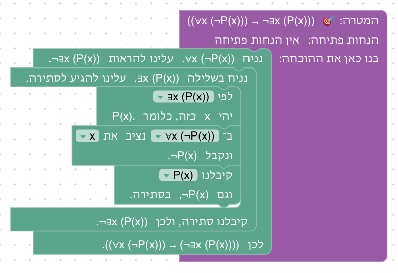

**שיקולים ושאלות להכרעה.**
- שלבים 6.1 ו־6.2 הם כמעט אותה הוכחה, עם אותו ארגז. ראו שאלה (ג) בסוף.

### שלב 6.2: משלימים את השלילה של "לכל"

`⊢ (∃x (¬P(x))) → ¬∀x (P(x))` · בארגז: נניח, הוכחת שלילה, שימוש ב"קיים", שימוש ב"לכל", סתירה

**מה לומדים.** את הכיוון ← של השלילה של "לכל": אם יש עצם שלא מקיים את P, אז לא כל העצמים מקיימים את P.

**למה כך.** הכיוון → היה שלב הבונוס של יחידה 5, כי הוא דורש שתי הוכחות בשלילה. הכיוון הזה קל, והטקסט אומר זאת: מניחים את ה"לכל", ומציבים בו את העצם שמתקבל מה"קיים". טקסט הסיום אומר שעכשיו גם השקילויות של הכמתים הוכחו בשני הכיוונים, ושמהשלב הבא משתמשים בהן, יחד עם השקילויות מהטבלאות.

**פתרון.** "נניח ∃x (¬P(x)). עלינו להראות ¬∀x (P(x))." ובתוכו "נניח בשלילה ∀x (P(x)). עלינו להגיע לסתירה." ובתוכו "לפי ∃x (¬P(x)) יהי x כזה, כלומר ¬P(x).", "ב־∀x (P(x)) נציב את x ונקבל P(x).", ו"קיבלנו P(x) וגם ¬P(x), בסתירה." אחר כך שורות הסגירה: "קיבלנו סתירה, ולכן ¬∀x (P(x))." ו"לכן (∃x (¬P(x))) → (¬∀x (P(x)))."

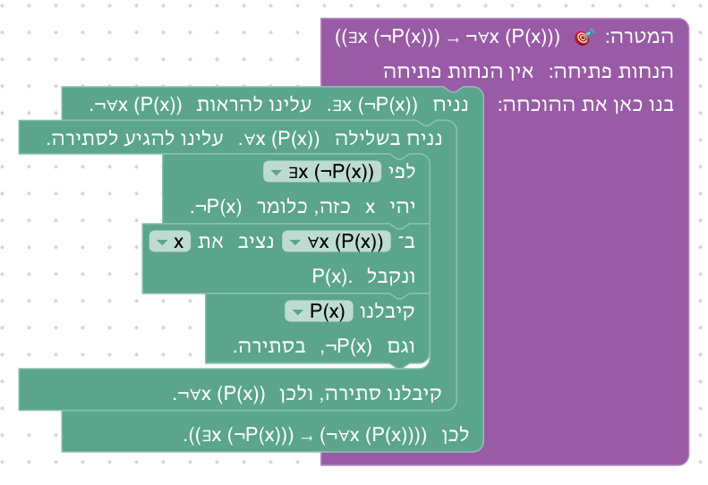

**שיקולים ושאלות להכרעה.**
- ההבדל היחיד מ־6.1 הוא איזו טענה מניחים ואיזו מתקבלת מה"קיים". אם השלבים יאוחדו, האם להשאיר את ההשוואה בין "לא קיים" ל"לא לכל" לטקסט?

### שלב 6.3: במקום גרירה, "או"

`¬P ⊢ P → Q` · בארגז: החלפה לפי שקילות, הוכחת "או", זה בדיוק · בתפריט: `(A → B) ↔ (¬A ∨ B)`

**מה לומדים.** את המהלך החדש, על המטרה: להוכיח טענה זה כמו להוכיח טענה ששקולה לה. ושגרירה שהתנאי שלה לא נכון היא נכונה (*אמת ריקה*).

**למה כך.** זו הדוגמה של מחבר הקורס: מוכיחים גרירה בהוכחה של ¬P ∨ Q. כשבידינו ¬P, הצד השמאלי של ה"או" כבר מוכח, וזה ההסבר לאמת הריקה, שסטודנטים מתקשים לקבל ("איך אם P אז Q נכונה, אם P בכלל לא נכונה?"). בארגז אין "נניח", ולכן השלב לא נפתר בלי המהלך החדש. טקסט הפתיחה מסביר את שלושת השדות, והרמזים אומרים מה לבחור בכל אחד. המקום כבר "המטרה" כשהבלוק נגרר, כך שההחלטה החדשה היחידה היא השקילות והכיוון. טקסט הסיום כותב את ההוכחה כפי שכותבים אותה ביד ("לפי השקילות ..., נחליף את P → Q ב־¬P ∨ Q") ונותן לתופעה את שמה.

**פתרון.** "לפי השקילות (A → B) ↔ (¬A ∨ B) נחליף את (P → Q) ב־(¬P ∨ Q) בתוך המטרה, ונקבל שצריך להוכיח (¬P ∨ Q)", "כדי להוכיח (¬P ∨ Q) נוכיח את ¬P", ובתוכו "¬P בידינו, וזה מה שעלינו להראות.", ושורת הסגירה "לכן (¬P ∨ Q)."

**שיקולים ושאלות להכרעה.**
- הבלוק כותב את ההחלפה ("נחליף את (P → Q) ב־(¬P ∨ Q)"), ואת המטרה החדשה רואים בשורה "ונקבל שצריך להוכיח (¬P ∨ Q)", במצב ההוכחה ובבלוק הבא ("כדי להוכיח (¬P ∨ Q) נוכיח את ...").
- הטקסט מסביר את האמת הריקה דרך השקילות. ביחידה 4 אפשר היה להוכיח את אותה טענה בדרך אחרת (נניח P, ומסתירה נובע הכול). האם להזכיר את הדרך הזאת בסיום, כדי שהאמת הריקה לא תיראה כתלויה בשקילות?

### שלב 6.4: מחליפים בהנחה

`¬(P ∨ Q) ⊢ ¬Q` · בארגז: החלפה לפי שקילות, שימוש ב"וגם", זה בדיוק · בתפריט: `¬(A ∨ B) ↔ (¬A ∧ ¬B)`

**מה לומדים.** את המהלך על טענה שבידינו: הטענה החדשה מצטרפת להנחות, והישנה נשארת.

**למה כך.** ההשוואה לשלב 4.4 היא העיקר: שם הוכחתם ¬P מאותה הנחה בארבעה מהלכים של כללי השלילה (הוכחת שלילה, שימוש בשלילה, הוכחת "או", זה בדיוק). כאן ההוכחה היא מה שכותבים ביד: "לפי דה מורגן, ¬(P ∨ Q) פירושו ¬P ∧ ¬Q, ומזה נקבל ¬Q". טקסט הסיום אומר זאת: שקילות שהוכחה פעם אחת חוסכת את העבודה בכל פעם שצריך אותה. המקום שבבלוק מתחיל כ"המטרה", וכאן צריך לשנות אותו, אחרת ההסבר הוא "במקום שבחרתם אין חלק מהצורה ¬(A ∨ B)".

**פתרון.** "לפי השקילות ¬(A ∨ B) ↔ (¬A ∧ ¬B) נחליף את ¬(P ∨ Q) ב־(¬P ∧ ¬Q) בתוך ¬(P ∨ Q), ונקבל (¬P ∧ ¬Q)", "מ־(¬P ∧ ¬Q) נקבל ¬P וגם ¬Q.", ו"¬Q בידינו, וזה מה שעלינו להראות."

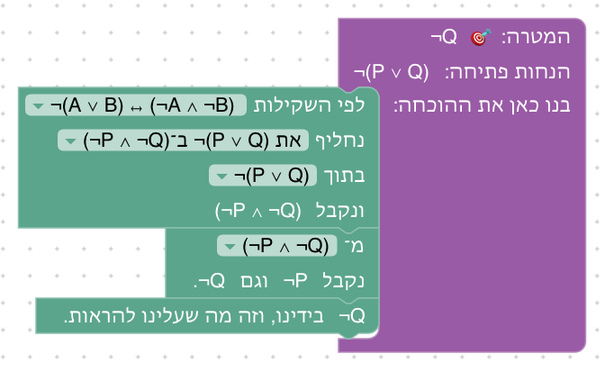

**שיקולים ושאלות להכרעה.**
- הטענה הישנה ¬(P ∨ Q) נשארת בידינו. זה נכון לוגית, וזה מה שקורה בכל מהלך קדימה, אבל בשרשרת של החלפות (6.6, 6.7) מצטברות טענות כמעט זהות. האם להבליט במצב ההוכחה את מה שנוסף במהלך האחרון?

### שלב 6.5: קונטרה־פוזיציה כשיטת הוכחה

`⊢ (¬Q → ¬P) → (P → Q)` · בארגז: נניח, החלפה לפי שקילות, זה בדיוק · בתפריט: `(A → B) ↔ (¬B → ¬A)`

**מה לומדים.** הוכחה דרך קונטרה־פוזיציה, כשיטה: כדי להוכיח "אם P אז Q" מוכיחים "אם לא Q אז לא P". ושאפשר להחליף או במטרה או בהנחה.

**למה כך.** אותה טענה כמו בשלב 4.9, שם היא דרשה הוכחה בשלילה. כאן היא החלפה אחת. בספרי המבוא להוכחות (Velleman, Rosen) הקונטרה־פוזיציה היא שיטת הוכחה בפני עצמה, ובשלב הזה היא מופיעה כך: משנים את המטרה. בשלב שתי דרכים, ובארגז המהלכים של שתיהן (אותם מהלכים): החלפה במטרה, בכיוון "את (A → B) ב־(¬B → ¬A)", או החלפה בהנחה, בכיוון ההפוך. הרמזים מתארים את הדרך במטרה ומזכירים את השנייה. ההשוואה בין השתיים מראה שהחלפה במטרה היא עבודה אחורה, והחלפה בהנחה היא עבודה קדימה, כמו שני הכיוונים של יחידה 2.

**פתרון א: במטרה.** "נניח (¬Q → ¬P). עלינו להראות (P → Q)." ובתוכו "לפי השקילות (A → B) ↔ (¬B → ¬A) נחליף את (P → Q) ב־(¬Q → ¬P) בתוך המטרה, ונקבל שצריך להוכיח (¬Q → ¬P)", ו"(¬Q → ¬P) בידינו, וזה מה שעלינו להראות.", ושורת הסגירה "לכן ((¬Q → ¬P) → (P → Q))."

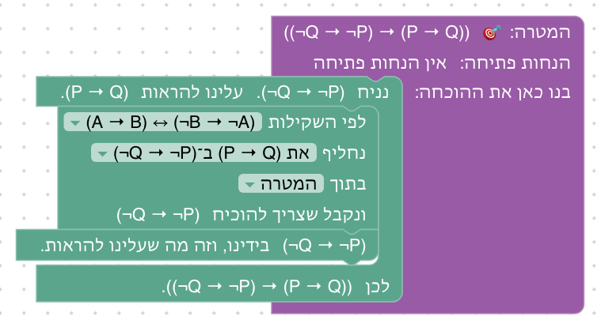

**פתרון ב: בהנחה.** אותה הנחה, ובתוכה "לפי השקילות (A → B) ↔ (¬B → ¬A) נחליף את (¬Q → ¬P) ב־(P → Q) בתוך (¬Q → ¬P), ונקבל (P → Q)", ו"(P → Q) בידינו, וזה מה שעלינו להראות.", ושורת הסגירה.

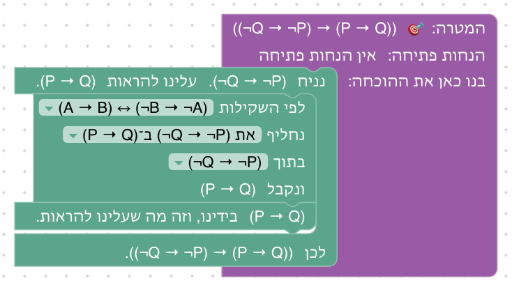

**שיקולים ושאלות להכרעה.**
- הטענה של השלב היא בדיוק הכיוון ← של השקילות, שהוכח בשלב 3.9. סטודנט חושב עשוי לשאול אם ההוכחה מעגלית. היא לא (4.9 הוכח בלי השקילות), אבל השלב מראה בעיקר שימוש בשלב 4.9 כחוק. האם להחליף את הטענה בטענה שבה הקונטרה־פוזיציה היא רק צעד אחד בהוכחה? דוגמה טבעית היא בתוך כמת (∀x (¬Q(x) → ¬P(x)) ⊢ ∀x (P(x) → Q(x))), אבל שם ההחלפה נתקעת (ראו "מגבלה" במהלכים).
- בדרך במטרה, גם ההנחה ¬Q → ¬P היא מהצורה A → B. היא לא מוחלפת, כי המקום הוא המטרה. האם כדאי שהטקסט יאמר שהמקום קובע איפה מחליפים, גם כשהצורה מופיעה בכמה טענות?

### שלב 6.6: שרשרת של החלפות

`⊢ ¬(P ∨ ¬Q) → (¬P ∧ Q)` · בארגז: נניח, החלפה לפי שקילות, זה בדיוק · בתפריט: `¬(A ∨ B) ↔ (¬A ∧ ¬B)`, `¬¬A ↔ A`

**מה לומדים.** להחליף בתוך חלק של טענה, ולהחליף כמה פעמים ברצף, כמו בחישוב: ¬(P ∨ ¬Q) ↔ (¬P ∧ ¬¬Q) ↔ (¬P ∧ Q).

**למה כך.** ההחלפה השנייה היא בתוך ה"וגם": רק ¬¬Q, הצד הימני שלו, מוחלפת ב־Q. זה מה שמבדיל החלפה לפי שקילות מכלל הסקה, ההבחנה שעליה Copi ו־Hurley חוזרים: כלל הסקה פועל רק על טענה שלמה, והחלפה גם בתוך חלק. כאן בפעם הראשונה יש בתפריט שתי שקילויות, ולכן צריך לבחור גם את השקילות. התרגיל דומה לדוגמה של Rosen §1.3, שמראה בשרשרת של שקילויות ש־¬(p ∨ (¬p ∧ q)) שקולה ל־¬p ∧ ¬q. טקסט הסיום משווה לזהויות באלגברה.

**פתרון.** "נניח ¬(P ∨ ¬Q). עלינו להראות (¬P ∧ Q)." ובתוכו "לפי השקילות ¬(A ∨ B) ↔ (¬A ∧ ¬B) נחליף את ¬(P ∨ ¬Q) ב־(¬P ∧ ¬¬Q) בתוך ¬(P ∨ ¬Q), ונקבל (¬P ∧ ¬¬Q)", "לפי השקילות ¬¬A ↔ A נחליף את ¬¬Q ב־Q בתוך (¬P ∧ ¬¬Q), ונקבל (¬P ∧ Q)", ו"(¬P ∧ Q) בידינו, וזה מה שעלינו להראות.", ושורת הסגירה "לכן (¬(P ∨ ¬Q) → (¬P ∧ Q))."

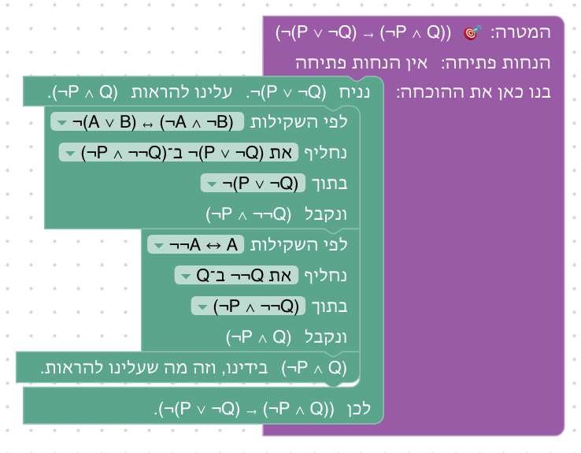

**שיקולים ושאלות להכרעה.**
- בהחלפה הראשונה B היא ¬Q, ולכן ¬B היא ¬¬Q. זה הרגע שבו הסטודנט צריך לראות שאות סכמטית יכולה לעמוד בשביל טענה מורכבת. האם הרמז צריך לומר זאת ("כאן B היא ¬Q")?
- כל ההחלפות בשלב הן בהנחה. החלפה במטרה לא אפשרית כאן: במטרה ¬P ∧ Q אין ¬¬, והכיוון ההפוך של השלילה הכפולה לא בתפריט. זה מכוון, או שכדאי שלב שבו השרשרת נבנית מהמטרה אחורה?

### שלב 6.7: דוחפים את השלילה פנימה

`⊢ (¬∀x (∃y (R(x,y)))) → (∃x (∀y (¬R(x,y))))` · בארגז: נניח, החלפה לפי שקילות, זה בדיוק · בתפריט: `¬∀x (P(x)) ↔ ∃x (¬P(x))`, `¬∃x (P(x)) ↔ ∀x (¬P(x))`

**מה לומדים.** למצוא את השלילה של טענה עם כמתים: מעבירים את השלילה פנימה, כמת אחר כמת, ובכל מעבר "לכל" הופך ל"קיים" ולהפך.

**למה כך.** זה השימוש הנפוץ ביותר בשקילויות בספרי המבוא (Velleman, Rosen, Epp): כשהמטרה או ההנחה היא שלילה של טענה עם כמתים, מנסחים אותה מחדש בלי שלילה מבחוץ. הטקסט נותן לטענה משמעות: R(x,y) הוא "x מכיר את y", ו"לא כל אחד מכיר מישהו" פירושו "יש מישהו שלא מכיר אף אחד". בהחלפה הראשונה P(x) עומדת בשביל ∃y (R(x,y)), טענה עם כמת משלה. ההחלפה השנייה היא בתוך ה"קיים", מתחת למשתנה x, ולכן ב־Lean היא `simp only`, והשקילות מנוסחת מחדש עם המשתנה y, כדי שהתוצאה תהיה ∃x (∀y (¬R(x,y))) (ראו במהלכים).

**פתרון.** "נניח ¬∀x (∃y (R(x,y))). עלינו להראות ∃x (∀y (¬R(x,y)))." ובתוכו "לפי השקילות ¬∀x (P(x)) ↔ ∃x (¬P(x)) נחליף את ¬∀x (∃y (R(x,y))) ב־∃x (¬∃y (R(x,y))) בתוך ¬∀x (∃y (R(x,y))), ונקבל ∃x (¬∃y (R(x,y)))", "לפי השקילות ¬∃x (P(x)) ↔ ∀x (¬P(x)) נחליף את ¬∃y (R(x,y)) ב־∀y (¬R(x,y)) בתוך ∃x (¬∃y (R(x,y))), ונקבל ∃x (∀y (¬R(x,y)))", ו"∃x (∀y (¬R(x,y))) בידינו, וזה מה שעלינו להראות.", ושורת הסגירה "לכן …".

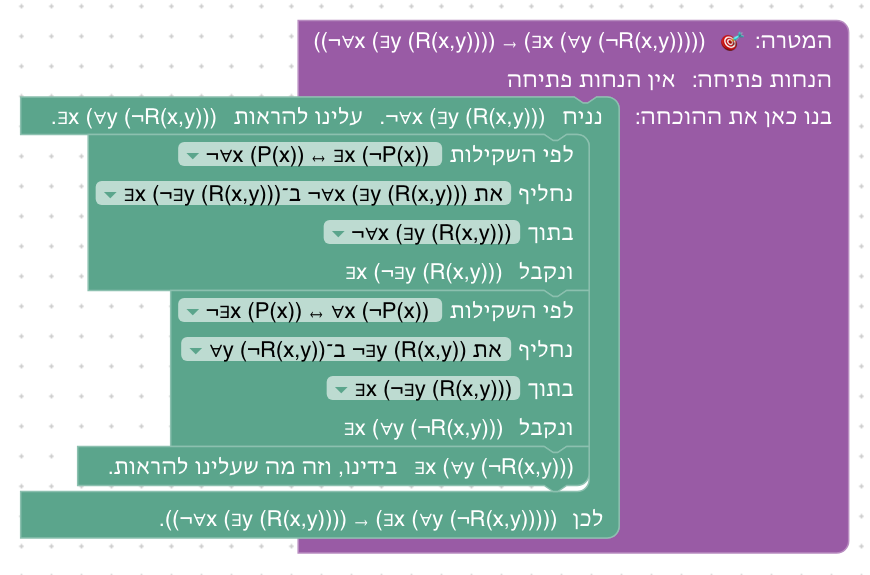

**שיקולים ושאלות להכרעה.**
- ברשימה השקילות כתובה עם x ו־P, ובשורה "נחליף" כתובה ההחלפה עם y ו־R(x,y): "את ¬∃y (R(x,y)) ב־∀y (¬R(x,y))". כך רואים איך החוק הכללי חל על הטענה.
- ייתכן שיש דרך שנייה, אחורה מהמטרה, בכיוונים ההפוכים של אותן שקילויות (∃x (∀y (¬R(x,y))) ⟵ ∃x (¬∃y (R(x,y))) ⟵ ¬∀x (∃y (R(x,y)))). היא לא נבדקה ואינה בין הפתרונות. אם היא עובדת, להוסיף אותה כפתרון שני ולהזכיר אותה ברמזים?

### שלב 6.8: דוגמה נגדית

`⊢ (¬∀x (P(x) → Q(x))) → (∃x (P(x) ∧ ¬Q(x)))` · בארגז: נניח, החלפה לפי שקילות, זה בדיוק · בתפריט: `¬∀x (P(x)) ↔ ∃x (¬P(x))`, `¬(A → B) ↔ (A ∧ ¬B)`

**מה לומדים.** מה פירוש השלילה של "כל P הוא Q": "יש P שאינו Q", כלומר *דוגמה נגדית*. ולהשתמש בשלילה של גרירה, שנבדקה בטבלת אמת.

**למה כך.** "כל P הוא Q", ∀x (P(x) → Q(x)), היא הצורה הנפוצה ביותר של טענה כללית, ומפריכים אותה בדוגמה נגדית. השלב מראה שזה נובע מהשקילויות: מעבירים את השלילה פנימה, קודם דרך ה"לכל" (כמו בשלב 6.7), ואחר כך דרך הגרירה, לפי השלילה של גרירה שנבדקה בטבלה בשלב 1.5. בהחלפה הראשונה P(x) של השקילות עומדת בשביל P(x) → Q(x), טענה מורכבת. ההחלפה השנייה היא בתוך ה"קיים", מתחת למשתנה x, כמו ההחלפה השנייה בשלב 6.7, ולכן ב־Lean היא `simp only`. בארגז אין מהלכים של "קיים", ולכן השלב לא נפתר בלי שתי ההחלפות. שתי השקילויות מוצגות ככרטיסים: השלילה של "לכל" שוב, והשלילה של גרירה בפעם הראשונה. טקסט הסיום אומר ש"לא כל P הוא Q" פירושו "יש P שאינו Q", וכך מפריכים טענה כללית.

**פתרון.** "נניח ¬∀x (P(x) → Q(x)). עלינו להראות ∃x (P(x) ∧ ¬Q(x))." ובתוכו "לפי השקילות ¬∀x (P(x)) ↔ ∃x (¬P(x)) נחליף את ¬∀x (P(x) → Q(x)) ב־∃x (¬(P(x) → Q(x))) בתוך ¬∀x (P(x) → Q(x)), ונקבל ∃x (¬(P(x) → Q(x)))", "לפי השקילות ¬(A → B) ↔ (A ∧ ¬B) נחליף את ¬(P(x) → Q(x)) ב־(P(x) ∧ ¬Q(x)) בתוך ∃x (¬(P(x) → Q(x))), ונקבל ∃x (P(x) ∧ ¬Q(x))", ו"∃x (P(x) ∧ ¬Q(x)) בידינו, וזה מה שעלינו להראות.", ושורת הסגירה "לכן …".

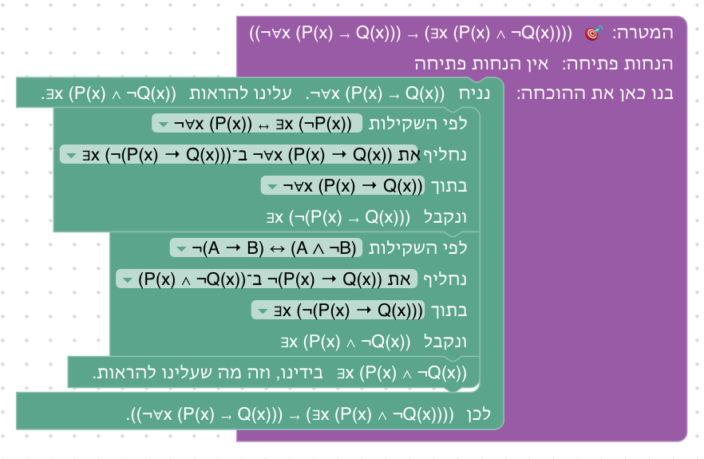

**שיקולים ושאלות להכרעה.**
- בשורה "נחליף" של ההחלפה השנייה מופיע x מחוץ לכמת שלו: "את ¬(P(x) → Q(x)) ב־(P(x) ∧ ¬Q(x))". כך גם בשלב 6.7 ("את ¬∃y (R(x,y)) ב־∀y (¬R(x,y))"). האם זה מבלבל, או שזה בדיוק מה שכותבים בהוכחה ("לכל x, ¬(P(x) → Q(x)) פירושו ...")?
- כמו בשלב 6.7, ייתכן שיש דרך שנייה, אחורה מהמטרה, בכיוונים ההפוכים של אותן שקילויות. היא לא נבדקה ואינה בין הפתרונות.
- השלב מוכיח רק את הכיוון →. אפשר להפוך אותו לשקילות (הכיוון ← הוא אותן החלפות בכיוון ההפוך), אבל אז הוא כמעט יוכפל באורכו, בלי רעיון חדש.

### שלב 6.9: שלילת טענה מורכבת

`⊢ ¬((P ∧ Q) → (R ∨ ¬S)) → ((P ∧ Q) ∧ (¬R ∧ S))` · בארגז: נניח, החלפה לפי שקילות, זה בדיוק · בתפריט: `¬(A → B) ↔ (A ∧ ¬B)`, `¬(A ∨ B) ↔ (¬A ∧ ¬B)`, `¬¬A ↔ A`

**מה לומדים.** לשלול טענה מורכבת עד שסימני השלילה מופיעים רק ליד טענות היסוד, ובכל שלב לשאול מהי המילה הראשית: היא קובעת איזה כלל שלילה מפעילים.

**למה כך.** זה התרגיל הראשון של השקף "תרגיל: שלילת טענות מורכבות" בהרצאה, באותה טענה ובאותם שלבים: המילה הראשית היא →, ולכן שלילת גרירה; בחלק השני ∨, ולכן דה מורגן; ולבסוף שלילה כפולה. ההחלפה השנייה והשלישית הן בתוך חלק של טענה, כמו בשלב 6.6. טקסט הסיום חוזר על "בדיקת השפיות" של ההרצאה: הגרירה שקרית בדיוק כשהתנאי נכון והמסקנה לא. השלב ממש את מה שטקסט הסיום של שלב 1.6 מבטיח: שהכללים מעבירים את השלילה פנימה, צעד אחר צעד.

**פתרון.** "נניח ¬((P ∧ Q) → (R ∨ ¬S)). עלינו להראות ((P ∧ Q) ∧ (¬R ∧ S))." ובתוכו שלוש החלפות בטענה שבידינו: לפי השלילה של גרירה ("ונקבל ((P ∧ Q) ∧ ¬(R ∨ ¬S))"), לפי דה מורגן ל"או" ("ונקבל ((P ∧ Q) ∧ (¬R ∧ ¬¬S))"), ולפי השלילה הכפולה ("ונקבל ((P ∧ Q) ∧ (¬R ∧ S))"), ו"((P ∧ Q) ∧ (¬R ∧ S)) בידינו, וזה מה שעלינו להראות.", ושורת הסגירה "לכן …".

### שלב 6.10: שלילת טענה עם כמתים

`⊢ (¬∀x (∃y (R(x,y) ∧ Q(y)))) → (∃x (∀y (¬R(x,y) ∨ ¬Q(y))))` · בארגז: נניח, החלפה לפי שקילות, זה בדיוק · בתפריט: `¬∀x (P(x)) ↔ ∃x (¬P(x))`, `¬∃x (P(x)) ↔ ∀x (¬P(x))`, `¬(A ∧ B) ↔ (¬A ∨ ¬B)`

**מה לומדים.** לשלול טענה עם שני כמתים ו"וגם" בפנים: השלילה הופכת את שני הכמתים, ובסוף עוברת דרך ה"וגם".

**למה כך.** זה התרגיל השני של אותו שקף ("לכל טבעי n יש טבעי m כך ש־m > n ו־m ראשוני"), בצורה כללית: R(x,y) במקום m > n, ו־Q(y) במקום "ראשוני". טקסט הפתיחה מזכיר את המשמעות בהרצאה: יש רק מספר סופי של ראשוניים. אחרי שתי ההחלפות של שלב 6.7 באה החלפה שלישית מתחת לשני הכמתים, לפי דה מורגן ל"וגם", שנבדק בטבלה בשלב 1.5 ומוצג כאן ככרטיס בפעם הראשונה.

**פתרון.** "נניח ¬∀x (∃y (R(x,y) ∧ Q(y))). עלינו להראות ∃x (∀y (¬R(x,y) ∨ ¬Q(y)))." ובתוכו שלוש החלפות בטענה שבידינו: לפי השלילה של "לכל" ("ונקבל ∃x (¬∃y (R(x,y) ∧ Q(y)))"), לפי השלילה של "קיים" ("ונקבל ∃x (∀y (¬(R(x,y) ∧ Q(y))))"), ולפי דה מורגן ל"וגם" ("ונקבל ∃x (∀y (¬R(x,y) ∨ ¬Q(y)))"), ו"∃x (∀y (¬R(x,y) ∨ ¬Q(y))) בידינו, וזה מה שעלינו להראות.", ושורת הסגירה "לכן …".

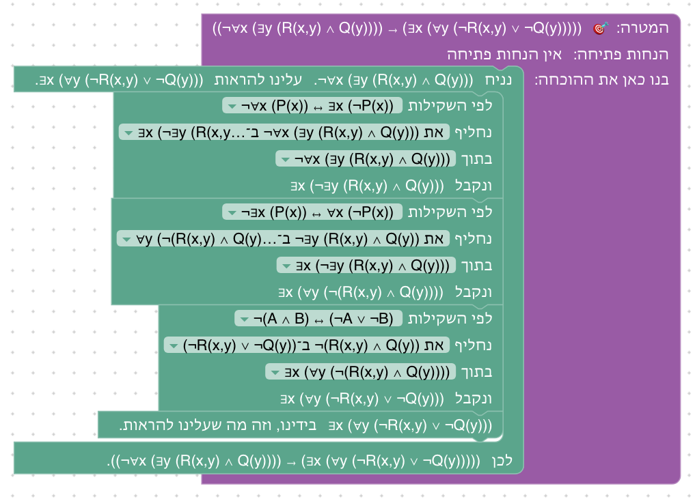

**שיקולים ושאלות להכרעה.**
- בהרצאה השלילה של m > n נכתבת m ≤ n. כאן היא נשארת ¬R(x,y), כי R הוא יחס כללי. להוסיף שלב עם יחס סדר על מספרים, כדי לסיים כמו בהרצאה?

### שלב 6.11: הוכחת "או": נניח את השלילה של צד אחד

`¬P → R, R → Q ⊢ P ∨ Q` · בארגז: החלפה לפי שקילות, נניח, הסקה קדימה, זה בדיוק · בתפריט: `(¬A → B) ↔ (A ∨ B)`

**מה לומדים.** את הטכניקה של ההרצאה להוכחת "או": כדי להוכיח α ∨ β, נניח ¬α ונוכיח β. היא נובעת מהשקילות ¬α → β ≡ α ∨ β, שנבדקה בטבלה בשלב 1.3 (המטריה).

**למה כך.** בטבלה של ההרצאה ("המילה הראשית קובעת את מבנה ההוכחה") השורה של α ∨ β היא "נניח ¬α", "נשאר להוכיח β", והדוגמה היא "אם ab = 0 אז a = 0 או b = 0": נניח a ≠ 0 ונוכיח b = 0. כמו שם, הצד שמניחים את השלילה שלו, P, הוא טענה חיובית, ולכן אין צורך בשלילה כפולה (היא בשלב 6.12). אחרי ההנחה, את Q מקבלים בשתי הסקות קדימה, כך שהרעיון החדש היחיד הוא ההחלפה של המטרה. השקילות מוצגת ככרטיס בפעם הראשונה.

**פתרון.** "לפי השקילות (¬A → B) ↔ (A ∨ B) נחליף את (P ∨ Q) ב־(¬P → Q) בתוך המטרה, ונקבל שצריך להוכיח (¬P → Q)", ואחריו "נניח ¬P. עלינו להראות Q." ובתוכו "מ־(¬P → R) ומ־¬P נקבל R.", "מ־(R → Q) ומ־R נקבל Q.", ו"Q בידינו, וזה מה שעלינו להראות.", ושורת הסגירה "לכן (¬P → Q)."

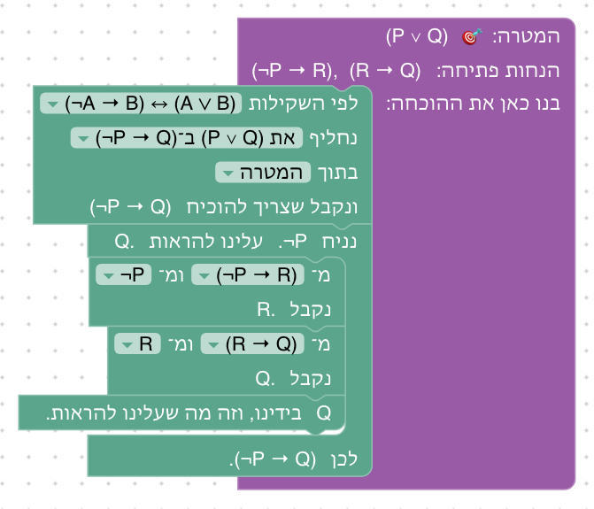

### שלב 6.12: הוכחת "או", כשהצד הוא שלילה

`P → Q ⊢ ¬P ∨ Q` · בארגז: החלפה לפי שקילות, נניח, הסקה קדימה, זה בדיוק · בתפריט: `(¬A → B) ↔ (A ∨ B)`, `¬¬A ↔ A`

**מה לומדים.** את אותה טכניקה, כשהצד שמניחים את השלילה שלו הוא בעצמו שלילה: כדי להוכיח ¬P ∨ Q מניחים ¬¬P, ולפי השלילה הכפולה מקבלים P.

**למה כך.** אחרי שלב 6.11, שבו הצד חיובי, זה הצעד הבא: ¬P ∨ Q מוחלפת ב־¬¬P → Q. הטענה עצמה, ¬P ∨ Q מתוך P → Q, היא הכיוון → של גרירה כ"או" (שלב 1.4), אבל השקילות הזאת לא בתפריט, כדי שהשלב לא ייפתר בהחלפה אחת. בארגז אין הוכחת "או", ולכן אי אפשר לבחור צד. השלב מכין את הבונוס, שבו שני הצדדים הם שלילות.

**פתרון.** "לפי השקילות (¬A → B) ↔ (A ∨ B) נחליף את (¬P ∨ Q) ב־(¬¬P → Q) בתוך המטרה, ונקבל שצריך להוכיח (¬¬P → Q)", ואחריו "נניח ¬¬P. עלינו להראות Q." ובתוכו "לפי השקילות ¬¬A ↔ A נחליף את ¬¬P ב־P בתוך ¬¬P, ונקבל P", "מ־(P → Q) ומ־P נקבל Q.", ו"Q בידינו, וזה מה שעלינו להראות.", ושורת הסגירה "לכן (¬¬P → Q)."

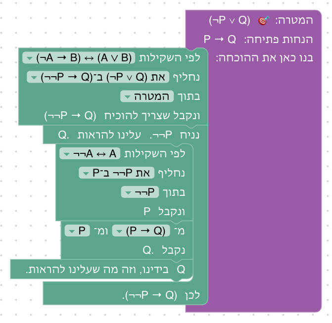

**שיקולים ושאלות להכרעה.**
- **הוחלט (עם מחבר הקורס):** להשאיר גם את המהלך "הוכחת 'או'" שבוחר צד (יחידה 3), וגם את הדרך של ההרצאה. בשלבים 6.11–6.13 אין בארגז בחירת צד, כדי שהדרך של ההרצאה תהיה הדרך היחידה.

### שלב 6.13: שלב בונוס: דה מורגן ל"וגם"

`⊢ ¬(P ∧ Q) → (¬P ∨ ¬Q)` · בארגז: נניח, החלפה לפי שקילות, הוכחת שלילה, שימוש בשלילה, הוכחת "וגם", זה בדיוק · בתפריט: `(¬A → B) ↔ (A ∨ B)`, `¬¬A ↔ A`, `(A → B) ↔ (¬A ∨ B)`

**מה לומדים.** שטבלה היא רק אחת הדרכים להוכיח שקילות: את הכיוון → של דה מורגן ל"וגם", שנבדק בטבלה בשלב 1.5, מוכיחים כאן במהלכים, בטכניקה של שלבים 6.11 ו־6.12.

**למה כך.** אחרי הנחת התנאי המטרה היא "או", ¬P ∨ ¬Q, ולא ידוע איזה צד נכון; ביחידה 4 זה דרש הוכחה בשלילה (כמו בשלב 4.10). כמו בשלב 6.12, לפי (¬A → B) ↔ (A ∨ B) מחליפים אותה ב־¬¬P → ¬Q, מניחים ¬¬P, ומקבלים P לפי השלילה הכפולה. טקסט הפתיחה מציע גם דרך קצרה יותר: לפי (A → B) ↔ (¬A ∨ B), בכיוון ההפוך, המטרה הופכת ל־P → ¬Q, בלי שלילה כפולה. זו הפעם הראשונה שבה ההחלפה במטרה לפי גרירה כ"או" היא בכיוון ההפוך (בשלב 6.5 הכיוון ההפוך היה רק בדרך השנייה, בהנחה). בשתי הדרכים ההמשך זהה: מוכיחים ¬Q בהנחת Q, ומגיעים לסתירה לפי ¬(P ∧ Q).

**פתרון א: כמו בהרצאה.** "נניח ¬(P ∧ Q). עלינו להראות (¬P ∨ ¬Q)." ובתוכו "לפי השקילות (¬A → B) ↔ (A ∨ B) נחליף את (¬P ∨ ¬Q) ב־(¬¬P → ¬Q) בתוך המטרה, ונקבל שצריך להוכיח (¬¬P → ¬Q)", ואחריו "נניח ¬¬P. עלינו להראות ¬Q." ובתוכו "לפי השקילות ¬¬A ↔ A נחליף את ¬¬P ב־P בתוך ¬¬P, ונקבל P", ואחריו "נניח בשלילה Q. עלינו להגיע לסתירה." ובתוכו "לפי ¬(P ∧ Q) כדי להגיע לסתירה די להוכיח (P ∧ Q).", ואחריו "נוכיח את שני החלקים של (P ∧ Q).": ב"החלק הראשון: P" ו"P בידינו, וזה מה שעלינו להראות.", וב"החלק השני: Q" ו"Q בידינו, וזה מה שעלינו להראות.", ו"הוכחנו את שני החלקים, ולכן (P ∧ Q)." אחר כך שורות הסגירה: "קיבלנו סתירה, ולכן ¬Q.", "לכן (¬¬P → ¬Q).", ו"לכן (¬(P ∧ Q) → (¬P ∨ ¬Q)).".

**פתרון ב: גרירה כ"או".** "נניח ¬(P ∧ Q). עלינו להראות (¬P ∨ ¬Q)." ובתוכו "לפי השקילות (A → B) ↔ (¬A ∨ B) נחליף את (¬P ∨ ¬Q) ב־(P → ¬Q) בתוך המטרה, ונקבל שצריך להוכיח (P → ¬Q)", ואחריו "נניח P. עלינו להראות ¬Q.", ומשם כמו בפתרון א, בלי השלילה הכפולה.

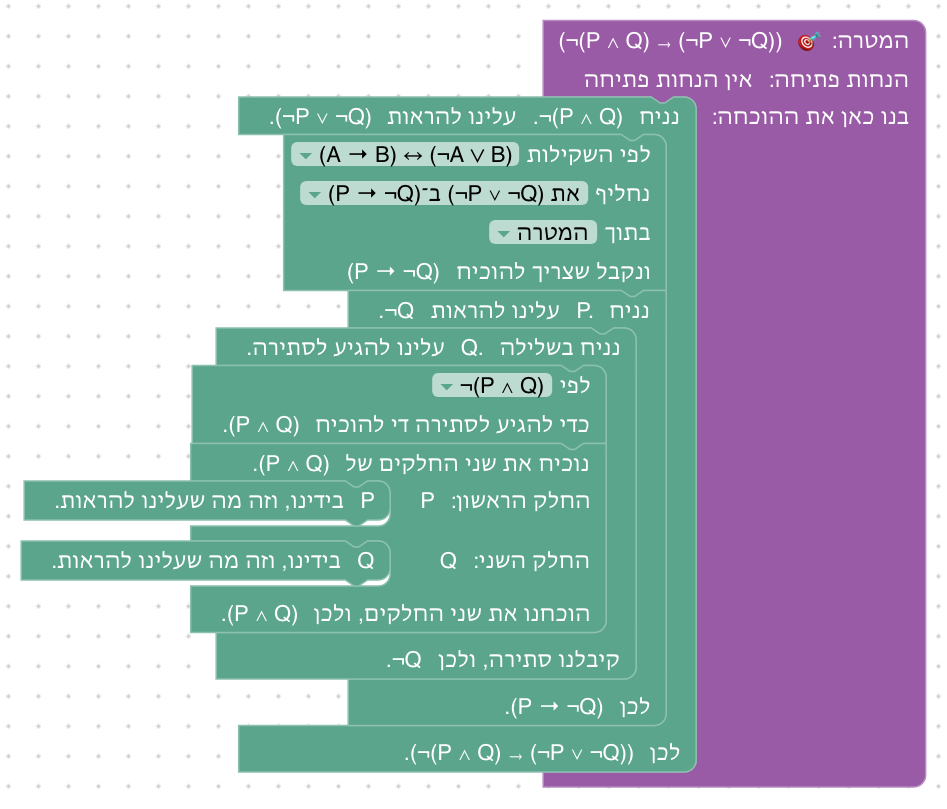

**שיקולים ושאלות להכרעה.**

## שאלות שנוגעות ליחידה כולה

- **(א) דה מורגן לקבוצות, בדרך של שקילויות.** הדרך השנייה שתוכננה לשלב הבונוס של יחידה 7 (A \ (B ∪ C) = (A \ B) ∩ (A \ C), בעזרת דה מורגן במקום לבנות אותו שוב) לא נוספה. השקילויות פועלות על הצורה הלוגית של הטענה, ואחרי פתיחת ההפרש ושימוש ב"וגם" בידינו ¬x ∈ (B ∪ C): השייכות שבתוך השלילה היא לא "או" בצורתה, ולכן ¬(A ∨ B) לא מתאימה לה, עד שפותחים את האיחוד *בתוך* השלילה. מהלך ההגדרה לא יכול לעשות זאת: הוא פועל על טענת שייכות שלמה. אפשרות: לאפשר למהלך ההחלפה להשתמש גם בהגדרות כשקילויות (x ∈ (A ∪ B) ↔ x ∈ A ∨ x ∈ B), ואז אפשר להחליף את השייכות בתוך השלילה, ואחר כך להשתמש בדה מורגן. כך גם D∃∀duction מנסח את ההגדרות.
- **(ב) דה מורגן ל"וגם" בתפריט:** נכנס בשלב 6.10, שלילת טענה עם כמתים.
- **(ג) לאחד את 6.1 ו־6.2?** שתי ההוכחות כמעט זהות: הנחה, הוכחת שלילה, שימוש ב"קיים", הצבה ב"לכל" וסתירה. אפשר לאחד אותן לשלב אחד, למשל עם המטרה כשקילות (`¬∃x (P(x)) ↔ ∀x (¬P(x))` בשני הכיוונים, כשהכיוון → חוזר על 5.8), או להשאיר שני שלבים קצרים, שכל אחד משלים שקילות אחרת.
- **(ה) הוחלט:** הבלוק כותב את ההחלפה עצמה, ומחליף חלק אחד בכל פעם (ראו בתחילת המסמך).

## רקע: מה עושים מדריכים אחרים

- **כללי החלפה (Copi, Hurley).** בספרי הלוגיקה הקלאסיים לסטודנטים, אחרי כללי ההסקה (תשעה אצל Copi, שמונה אצל Hurley) באים עשרה כללי החלפה: דה מורגן, קומוטטיביות, אסוציאטיביות, פילוג, שלילה כפולה, קונטרה־פוזיציה (Transposition), גרירה כ"או" (Material Implication), Material Equivalence, Exportation ו־Tautology. כלל החלפה מותר גם בתוך חלק של שורה, וכלל הסקה רק על שורה שלמה, ושני הספרים מדגישים את ההבדל. השקילויות לא מוכחות שם בכללי ההסקה: הן מוצדקות בטבלאות אמת, וכך גם כאן, ביחידה 1.
- **כללים נגזרים (forall x, Huth & Ryan, Logic and Proof).** בספרי הדדוקציה הטבעית השקילויות הן תרגילים: מוכיחים את דה מורגן, את הקונטרה־פוזיציה ואת השלילה של כמתים בכללים הבסיסיים, ואחר כך מוסיפים אותם ככללים נגזרים (forall x: DeM, CQ). Huth & Ryan מגדירים שקילות כגזירה בשני הכיוונים (⊣⊢). כך בנויות כאן השקילויות של הכמתים: הן נכנסות לתפריט רק אחרי ששני הכיוונים הוכחו.
- **ספרי מבוא להוכחות ולמתמטיקה בדידה (Rosen §1.3–1.5, Epp פרקים 2–3, Velleman, How to Prove It).** טבלה של שקילויות מוצגת מוקדם, ומשמשת להוכחת שקילויות חדשות בשרשרת (שלב 6.6) ולשלילה של טענות עם כמתים (שלבים 6.7 ו־6.8). Velleman משתמש בהן כדי לשנות את המטרה: כדי להוכיח P ∨ Q מניחים ¬P ומוכיחים Q (הדרך של שלבים 6.11–6.13), וכשהמטרה היא שלילה, "מנסחים אותה מחדש" בלי שלילה מבחוץ, לפי השקילויות של שלילת כמתים. הוכחה בקונטרה־פוזיציה היא שיטת הוכחה בפני עצמה (שלב 6.5).
- **חשבון של שקילויות (Gries ו־Schneider, A Logical Approach to Discrete Math).** הלוגיקה כולה בנויה כחשבון של שקילויות: כל הוכחה היא שרשרת של החלפות "שקול בשקול", לפי כלל לייבניץ, כמו בחישוב אלגברי. שלב 6.6 הוא טעימה מהסגנון הזה, וההחלפה לפי שוויון ביחידה 9 היא אותו כלל.
- **ב־Lean ובכלים אחרים.** ב־Lean מחליפים לפי שקילות ב־`rw` וב־`simp`, ו־`push_neg` של Mathlib מעביר שלילה פנימה בצעד אחד. כאן, כמו ביחידה 4, אין `push_neg`: כל מעבר של שלילה הוא צעד שהסטודנט בוחר, לפי שקילות שהוא הוכיח. D∃∀duction מנסח כל הגדרה כשקילות, וכך מאפשר להחליף לפיה (ראו שאלה (א)).
- **מקורות:**
  - Irving M. Copi, Carl Cohen, Kenneth McMahon, *Introduction to Logic*, פרק "Methods of Deduction" (כללי ההחלפה)
  - Patrick J. Hurley, *A Concise Introduction to Logic*, פרק 7 (Rules of Replacement I–II)
  - [forall x: Calgary](https://forallx.openlogicproject.org/)
  - Michael Huth, Mark Ryan, *Logic in Computer Science*, פרק 2.3
  - [Logic and Proof](https://leanprover-community.github.io/logic_and_proof/)
  - Kenneth H. Rosen, *Discrete Mathematics and Its Applications*, §1.3–1.5
  - Susanna S. Epp, *Discrete Mathematics with Applications*, פרקים 2–3
  - [How To Prove It with Lean, פרק 3](https://djvelleman.github.io/HTPIwL/Chap3.html)
  - David Gries, Fred B. Schneider, *A Logical Approach to Discrete Math*
  - [D∃∀duction](https://github.com/dEAduction/dEAduction)

