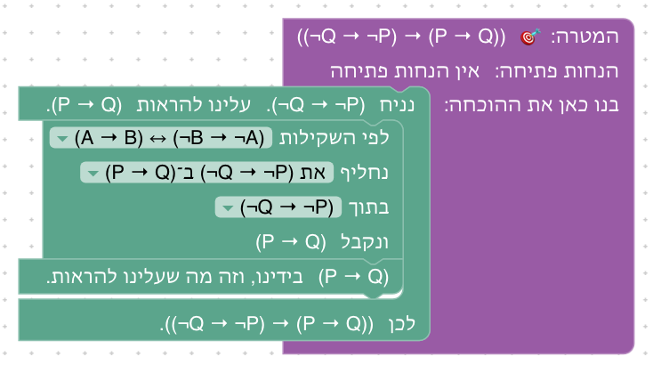

# יחידה 6 — קבוצות

**מטרה:** הוכחת טענות על קבוצות של עצמים: הכלה, חיתוך, איחוד, שוויון, פילוג, הפרש, הפרש סימטרי והקבוצה הריקה, עד חוק דה מורגן לקבוצות (בעזרת הפרש) כשלב בונוס, כמו ב־Logic and Proof (פרקים 11–12) וב־Mathematics in Lean (4.1). הסטודנט מוכיח הכלה בעזרת איבר שרירותי ומשתמש בה בעזרת איבר, מוכיח שוויון בשתי הכלות, ומבין שכל פעולה על קבוצות מוגדרת דרך שייכות: אחרי שימוש בהגדרה נשארת נוסחה לוגית מהיחידות הקודמות. חיתוך הוא "וגם", איחוד הוא "או", הפרש הוא "וגם" עם שלילה, הפרש סימטרי הוא "או" של שני הפרשים, והקבוצה הריקה היא סתירה. כמו בקורס, היחידה מלמדת הפרש ולא משלים; המשלים מוזכר רק בסיום שלב הבונוס (ראו "הוחלט: הפרש, ולא משלים" למטה). קבוצת החזקה ומשפחות של קבוצות באות ביחידה 7.

## המהלכים

כמו ביחידה 4, להנחות אין שמות, ולעצמים יש. האיבר שלוקחים כדי להוכיח הכלה נקרא x₀ (ואם x₀ כבר בידינו, x₁). בכל מהלך בוחרים את הטענות לפי מה שהן אומרות, מרשימה של מה שבידינו באותו מקום בהוכחה, או ב"✎ כתיבה ידנית". בטבלה, כל מהלך כפי שהוא נקרא כשהוא במקומו ושדותיו נבחרו (בסוגריים המרובעים: מה שהסטודנט בוחר):

| מהלך | Lean | לפני → אחרי |
|---|---|---|
| **הוכחת הכלה (⊆I):** כדי להוכיח A ⊆ B יהי x₀ ∈ A ונוכיח x₀ ∈ B | `refine easylean_subset_intro (fun x₀ _ => ?_)` | `⊢ A ⊆ B` ⟶ עצם חדש x₀, `x₀ ∈ A ⊢ x₀ ∈ B` |
| **שימוש בהכלה (⊆E):** לפי ההכלה [A ⊆ B] ומ־[x₀ ∈ A] נובע x₀ ∈ B | `have := easylean_subset_elim ‹A ⊆ B› ‹x₀ ∈ A›` | `A ⊆ B, x₀ ∈ A` ⟶ גם `x₀ ∈ B` |
| **שוויון קבוצות:** כדי להוכיח A = B נוכיח שתי הכלות; בראש החלקים: "נוכיח A ⊆ B", "נוכיח B ⊆ A" | `apply easylean_set_eq` | `⊢ A = B` ⟶ שני חלקים: `⊢ A ⊆ B`, `⊢ B ⊆ A` |
| **לפי ההגדרה, על טענה שבידינו:** לפי הגדרת החיתוך, [x₀ ∈ (A ∩ B)] פירושו (x₀ ∈ A ∧ x₀ ∈ B) | `first \| (guard_target =ₛ x₀ ∈ A ∩ B; apply easylean_mem_inter.mpr) \| have := easylean_mem_inter.mp ‹x₀ ∈ A ∩ B›` | `x₀ ∈ A ∩ B` ⟶ גם `x₀ ∈ A ∧ x₀ ∈ B` |
| **לפי ההגדרה, על המטרה:** לפי הגדרת האיחוד, כדי להוכיח [x₀ ∈ (A ∪ B)] די להוכיח (x₀ ∈ A ∨ x₀ ∈ B) | אותו קוד, עם `easylean_mem_union` | `⊢ x₀ ∈ A ∪ B` ⟶ `⊢ x₀ ∈ A ∨ x₀ ∈ B` |

לפני שהבלוקים במקומם הם כתובים באופן כללי: "כדי להוכיח הכלה: יהי איבר של הקבוצה המוכלת, ונוכיח שהוא שייך לקבוצה המכילה", "לפי ההכלה ? ומ־?", "כדי להוכיח שוויון קבוצות, נוכיח שתי הכלות", "לפי ההגדרה, ?".

**מהלך אחד לכל ההגדרות.** מהלך ההגדרה משמש לכל הפעולות, וכותב לפי איזו הגדרה הוא פועל: "לפי הגדרת החיתוך", "לפי הגדרת ההפרש" וכן הלאה, כמו שכותבים בהוכחה. ברשימה שלו רק טענות שייכות שיש להן הגדרה: קודם המטרה, אם היא כזאת, ואחריה הטענות שבידינו. על טענה שבידינו הוא כותב "פירושו ...", ומה שהיא אומרת מצטרף למה שבידינו; על המטרה הוא כותב "כדי להוכיח ... די להוכיח ...", ומה שהיא אומרת הוא מה שנשאר להוכיח. Lean מנסה קודם את המטרה, אבל רק אם הטענה שנבחרה כתובה בדיוק כמו המטרה (`guard_target =ₛ`): טענה שאומרת אותו דבר לפי ההגדרות אבל כתובה אחרת לא נחשבת למטרה. כך הקוד לא תלוי במצב ההוכחה, וכשהטענה לא המטרה וגם לא בידינו, ההסבר הוא "אין בידינו הנחה שאומרת ...".

ההגדרות:

| פעולה | הבלוק כותב | פירוש השייכות | מוצגת בשלב |
|---|---|---|---|
| `x₀ ∈ A ∩ B` | לפי הגדרת החיתוך | `x₀ ∈ A ∧ x₀ ∈ B` | 6.3 |
| `x₀ ∈ A ∪ B` | לפי הגדרת האיחוד | `x₀ ∈ A ∨ x₀ ∈ B` | 6.4 |
| `x₀ ∈ A \ B` | לפי הגדרת ההפרש | `x₀ ∈ A ∧ ¬x₀ ∈ B` | 6.8 |
| `x₀ ∈ A ∆ B` | לפי הגדרת ההפרש הסימטרי | `x₀ ∈ (A \ B) ∨ x₀ ∈ (B \ A)` | 6.10 |
| `x₀ ∈ ∅` | לפי הגדרת הקבוצה הריקה | `⊥` | 6.11 |

המשלים לא בטבלה: אף שלב לא משתמש בו, ואין לו כרטיס ביחידה (ראו "הוחלט: הפרש, ולא משלים" למטה). מהלך ההגדרה עדיין מכיר אותו בקוד (`easylean_mem_compl`).

**מהלכים מיחידות קודמות** שבארגז של שלבים ביחידה הזאת:

| מהלך | Lean | לפני → אחרי |
|---|---|---|
| **זה בדיוק (יחידה 0):** יש לנו ביד בדיוק את מה שאנחנו רוצים להוכיח. | `assumption` | `A ⊢ A` ⟶ סגור |
| **נניח (יחידה 1):** כדי להוכיח את הגרירה, נניח P ונוכיח Q | `easylean_assume` | `⊢ P → Q` ⟶ `P ⊢ Q` |
| **שימוש ב"וגם" (יחידה 2):** מה"וגם" [P ∧ Q] נובע P ונובע Q | `have := And.left ‹P ∧ Q›` ו־`have := And.right ‹P ∧ Q›` | `P ∧ Q` ⟶ גם `P`, `Q` |
| **הוכחת "וגם" (יחידה 2):** כדי להוכיח P ∧ Q נוכיח כל צד לחוד; נוכיח P … נוכיח Q … | `apply And.intro` | `⊢ P ∧ Q` ⟶ שני חלקים: `⊢ P`, `⊢ Q` |
| **צירוף ל"וגם" (יחידה 2):** מ־[P] ומ־[Q] נובע P ∧ Q | `have := And.intro ‹P› ‹Q›` | `P, Q` ⟶ גם `P ∧ Q` |
| **הוכחת "או" (יחידה 2):** כדי להוכיח P ∨ Q די להוכיח [P] | `apply Or.inl` / `apply Or.inr` | `⊢ P ∨ Q` ⟶ `⊢ P` (או `⊢ Q`) |
| **חלוקה למקרים (יחידה 2):** נחלק למקרים לפי ה"או" [P ∨ Q]; מקרה ראשון: נניח P … מקרה שני: נניח Q … | `cases ‹P ∨ Q› with \| inl _ => … \| inr _ => …` | שני חלקים: `P ⊢ …`, `Q ⊢ …` |
| **סתירה (יחידה 3):** יש לנו ביד את [A] ואת ¬A, וזו סתירה. | `exact (absurd ‹A› ‹¬(A)› : False)` | `A, ¬A ⊢ ⊥` ⟶ סגור |
| **הוכחת שלילה (יחידה 3):** כדי להוכיח ¬A נניח A ונגיע לסתירה | `refine Not.intro (fun _ => ?_)` | `⊢ ¬A` ⟶ `A ⊢ ⊥` |
| **שימוש בשלילה (יחידה 3):** לפי השלילה [¬A] שיש לנו ביד, כדי להגיע לסתירה די להוכיח A | `refine (absurd ?_ ‹¬A› : False)` | `¬A ⊢ ⊥` ⟶ `¬A ⊢ A` |
| **מסתירה נובע הכול (יחידה 3):** מסתירה נובע הכול, ולכן כדי להוכיח Q די להגיע לסתירה | `apply False.elim` | `⊢ Q` ⟶ `⊢ ⊥` |
| **הוכחה בשלילה (יחידה 3):** נוכיח בשלילה: נניח ¬A ונגיע לסתירה | `apply Classical.byContradiction` ו־`intro _` | `⊢ A` ⟶ `¬A ⊢ ⊥` |

**תורת קבוצות קטנה משלנו, בלי Mathlib.** ב־Lean הבסיסי אין קבוצות. במקום Mathlib, שהייתה מאטה כל בדיקה ומגדילה את אימג' השרת בכמה GB, הוגדרה תורת קבוצות קטנה (`SET_PRELUDE` ב־`frontend/src/generator/lean.js`): קבוצה היא תכונה של עצמים, וכל פעולה מוגדרת דרך שייכות. ההפרש הסימטרי מוגדר שם כ־`Set.symmDiff`, עם הסימון ∆ (`infixl:65`, כמו האיחוד), ושייכות אליו היא "או" של שתי שייכויות להפרש (`easylean_mem_symmDiff`). ההקדמה נטענת רק בשלבים שמשתמשים בקבוצות (`usesSets`), והבדיקה נשארת מהירה. ההגדרות הן למות `easylean_mem_*`, שמוכחות ב־`Iff.rfl`: הפירוש שווה לשייכות לפי ההגדרה עצמה (ראו בשאלות שבסוף).

**הכלה כמו "לכל".** הוכחת הכלה היא כמו "יהי x₀ עצם שרירותי" ביחידה 4, יחד עם הנחת התנאי x₀ ∈ A, במהלך אחד; שימוש בהכלה הוא כמו הצבה ב"לכל" והסקה מהגרירה שמתקבלת, גם הוא במהלך אחד. כך גם ב־Set Theory Game וב־Verbose Lean ("Fix x ∈ A", "Since A ⊆ B and x ∈ A we get that x ∈ B"). ההכלה עצמה לא נפתחת במהלך ההגדרה: המהלכים שלה עובדים עליה ישירות.

**תצוגה.** במצב ההוכחה הקבוצות מוצגות בשורה נפרדת, "קבוצות: A, B", והעצמים בשורה "עצמים: x₀", בלי הסימון `A : Set obj`. פעולה על קבוצות שנמצאת בתוך פעולה אחרת נכתבת עם הסוגריים שלה, בכל מקום שבו מוצגת טענה (במצב ההוכחה, בבלוקים ובכותרות של החלקים): (A ∩ B) ∪ (A ∩ C) ו־(A \ B) ∩ (A \ C), ולא כמו ש־Lean כותב אותן לפי סדר הקדימות (A ∩ B ∪ A ∩ C). כך גם בשרשור של רשימות ביחידה 9. בנוסף, קבוצה שהיא פעולה ומופיעה אחרי ∈ כתובה בסוגריים: x₀ ∈ (A ∩ B), ¬x₀ ∈ (A \ B) ו־x₀ ∈ ((A ∩ B) ∪ (A ∩ C)), ולא ¬x₀ ∈ A \ B, שאפשר לקרוא בטעות כ־(¬x₀ ∈ A) \ B. הוחלט (לבקשת מחבר הקורס), כדי שהטענה תיכתב אותו דבר בכל מקום: גם הפירוש שמהלך ההגדרה כותב, (x₀ ∈ (A ∩ B) ∨ x₀ ∈ (A ∩ C)), כותב כך. אחרי ⊆ ו־= אין סוגריים כאלה (A ∩ B ⊆ A). ההפרש הסימטרי ∆ נכתב לפי אותו כלל, ובאותה קדימות כמו ∪: x₀ ∈ (A ∆ B), ו־A ∆ B ⊆ (A ∪ B) \ (A ∩ B).

## שלבים

לכל שלב: מה לומדים בו, למה הוא בנוי כך, איך אנחנו רוצים שסטודנטים יפתרו אותו, ושיקולים ושאלות שעוד צריך להכריע. צילומי הפתרונות נוצרים מ־`frontend/e2e/solutions.js` (ראו [יחידה 0](00-getting-started.md#שלבים)). בכל שלב בארגז רק המהלכים של הפתרונות שלו.

**סדר היחידה.** הכלה: שימוש (6.1) והוכחה (6.2); חיתוך ואיחוד (6.3–6.5), שבהם מוצג מהלך ההגדרה, קודם על טענה שבידינו ואחר כך על המטרה; שוויון (6.6) ופילוג (6.7); הפרש (6.8–6.9), הפרש סימטרי (6.10) והקבוצה הריקה (6.11), שמחברים את הקבוצות ליחידה 3: הוכחת שלילה, הוכחה בשלילה וסתירה; ובונוס (6.12), חוק דה מורגן בעזרת הפרש. הסדר דומה ל־Logic and Proof ול־Set Theory Game (הכלה, משלים, חיתוך, איחוד, שילובים), אלא שבמקום העולם של המשלים יש כאן הפרש.

**הוחלט: הפרש, ולא משלים.** לבקשת מחבר הקורס, היחידה הולכת לפי הקורס באוניברסיטה, שמלמד הפרש ולא משלים. המשלים מוזכר שם רק בדרך אגב, כדי להראות את ההקבלה בין חוק דה מורגן לקבוצות לבין חוק דה מורגן בלוגיקה, וכך גם כאן: טקסט הסיום של שלב 6.12 אומר שאם U היא קבוצה שמכילה את כל העצמים שמדברים עליהם, ו־Bᶜ = U \ B, החוק שהוכח (עם A = U) הוא (B ∪ C)ᶜ = Bᶜ ∩ Cᶜ. אין כרטיס של משלים, ואף שלב לא משתמש בו. שלב 6.8 (שהיה Bᶜ ⊆ Aᶜ) הוא עכשיו C \ B ⊆ C \ A, שלב 6.9 (שהיה A \ B ⊆ A ∩ Bᶜ) הוא עכשיו A \ (A \ B) ⊆ A ∩ B, ושלב הבונוס, 6.12 (שהיה (A ∪ B)ᶜ = Aᶜ ∩ Bᶜ), הוא עכשיו A \ (B ∪ C) = (A \ B) ∩ (A \ C). יתרון נוסף: ההפרש לא תלוי בתחום, ולכן אין צורך לדבר על "קבוצה אוניברסלית" כדי להגדיר אותו.

### שלב 6.1: משתמשים בהכלה

`A ⊆ B, x₀ ∈ A ⊢ x₀ ∈ B` · עצמים: x₀ · בארגז: שימוש בהכלה, זה בדיוק

**מה לומדים.** מה זו קבוצה, שייכות והכלה, ואת השימוש בהכלה (⊆E).

**למה כך.** כמו ב־Set Theory Game, השימוש בהכלה בא ראשון, והוא נראה כמו הסקה מגרירה: השייכות ל־A היא התנאי. כך ההבחנה בין ∈ (שייכות של איבר) ל־⊆ (יחס בין קבוצות) מופיעה כבר בשלב הראשון: בבלוק שדה לכל אחת מהן. האיבר נתון, ושמו x₀, כמו שמות האיברים שהמהלכים ייצרו בהמשך.

**פתרון.** "לפי ההכלה A ⊆ B ומ־x₀ ∈ A נובע x₀ ∈ B", ו"יש לנו ביד בדיוק את מה שאנחנו רוצים להוכיח."

**שיקולים ושאלות להכרעה.**
- בשתי הרשימות של הבלוק מופיעות שתי ההנחות, A ⊆ B ו־x₀ ∈ A. מי שמחליף ביניהן מקבל הסבר ("ההנחה ... היא לא הכלה"). זו בדיוק ההבחנה בין ∈ ל־⊆ שהשלב רוצה ללמד (הבלבול ביניהן הוא טעות מוכרת, Mechanics of Proof), ולכן כרגע הרשימות לא מסוננות. נכון להשאיר כך?
- השם x₀ לאיבר נתון עשוי להיראות מוזר ("למה לא x?"). הוא עקבי עם השלבים הבאים; האם הטקסט צריך להסביר אותו, כמו ביחידה 4?

### שלב 6.2: מוכיחים הכלה

`⊢ (A ⊆ B) → ((B ⊆ C) → (A ⊆ C))` · בארגז: נניח, הוכחת הכלה, שימוש בהכלה, זה בדיוק

**מה לומדים.** להוכיח הכלה (⊆I): לוקחים איבר שרירותי של הקבוצה המוכלת. ולהשתמש בשתי הכלות ברצף.

**למה כך.** הטרנזיטיביות של ההכלה היא התרגיל הראשון בכל המקורות. השלב משלב את המהלך החדש עם שתי הצבות ברצף, כמו השרשרת של יחידה 1, כדי לחזק את ההקבלה בין הכלה לגרירה. הטקסט מקשר לעצם השרירותי של יחידה 4.

**פתרון.** שתי הנחות, "כדי להוכיח A ⊆ C יהי x₀ ∈ A ונוכיח x₀ ∈ C", "לפי ההכלה A ⊆ B ומ־x₀ ∈ A נובע x₀ ∈ B", "לפי ההכלה B ⊆ C ומ־x₀ ∈ B נובע x₀ ∈ C", ו"יש לנו ביד...".

**שיקולים ושאלות להכרעה.**
- אין מהלך שמשתמש בהכלה אחורה ("לפי ההכלה B ⊆ C, כדי להוכיח x₀ ∈ C די להוכיח x₀ ∈ B"), כמו שיש לגרירה. להוסיף אותו, כדי שגם כאן יהיו שתי דרכים?
- ב־Logic and Proof ההכלה היא ∀x (x ∈ A → x ∈ B), וההוכחה שלה היא שני צעדים (∀I ו־→I). כאן זה מהלך אחד. האם להראות לסטודנטים, בטקסט לפחות, שהמהלך הזה הוא שני המהלכים המוכרים יחד?

### שלב 6.3: חיתוך

`⊢ A ∩ B ⊆ A` · בארגז: הוכחת הכלה, לפי ההגדרה, שימוש ב"וגם", זה בדיוק

**מה לומדים.** מה זה חיתוך, ואת מהלך ההגדרה, על טענה שבידינו.

**למה כך.** הטענה הפשוטה ביותר על חיתוך. השימוש בהגדרה הוא צעד מפורש, כמו ההנחיה ב־Set Theory Game ("write out the meaning of intersection"): כך רואים שמתחת לחיתוך יש "וגם". הבלוק כותב "לפי הגדרת החיתוך", כמו שכותבים בהוכחה.

**פתרון.** "כדי להוכיח A ∩ B ⊆ A יהי x₀ ∈ (A ∩ B) ונוכיח x₀ ∈ A", "לפי הגדרת החיתוך, x₀ ∈ (A ∩ B) פירושו (x₀ ∈ A ∧ x₀ ∈ B)", "מה"וגם" ... נובע x₀ ∈ A ונובע x₀ ∈ B", ו"יש לנו ביד...".

**שיקולים ושאלות להכרעה.**
- Lean לא מחייב את מהלך ההגדרה: "מה"וגם"" עם x₀ ∈ (A ∩ B) עצמה מתקבל, ונותן x₀ ∈ A ו־x₀ ∈ B (נבדק), אבל הבלוק כותב אז רק "נובעים שני הצדדים שלו". ראו בשאלות שבסוף.
- Set Theory Game מקדים שלב שבו ההנחה כבר כתובה כ"וגם" (x ∈ A ∧ x ∈ B), כדי להפריד בין "וגם" לחיתוך. האם להוסיף שלב כזה?

### שלב 6.4: איחוד

`⊢ A ⊆ A ∪ B` · בארגז: הוכחת הכלה, לפי ההגדרה, הוכחת "או", זה בדיוק

**מה לומדים.** מה זה איחוד, ואת מהלך ההגדרה על המטרה.

**למה כך.** אותו מהלך כמו בשלב הקודם, הפעם על המטרה, כדי להראות שהוא עובד בשני המקומות, ושהניסוח משתנה בהתאם: "פירושו" על מה שבידינו, "כדי להוכיח ... די להוכיח" על המטרה. ברשימה של הבלוק יש כאן טענה אחת בלבד, המטרה x₀ ∈ (A ∪ B), כי ל־x₀ ∈ A אין הגדרה.

**פתרון.** "יהי x₀ ∈ A ונוכיח x₀ ∈ (A ∪ B)", "לפי הגדרת האיחוד, כדי להוכיח x₀ ∈ (A ∪ B) די להוכיח (x₀ ∈ A ∨ x₀ ∈ B)", "כדי להוכיח (x₀ ∈ A ∨ x₀ ∈ B) די להוכיח x₀ ∈ A", ו"יש לנו ביד...".

**שיקולים ושאלות להכרעה.**
- ברשימה של הבלוק המטרה לא מסומנת כמטרה: היא פשוט ראשונה. רק אחרי הבחירה רואים לפי הניסוח ("כדי להוכיח ... די להוכיח") שזו המטרה. לסמן אותה ברשימה (למשל "המטרה: x₀ ∈ (A ∪ B)")?

### שלב 6.5: הכלה של איחוד

`A ⊆ C, B ⊆ C ⊢ A ∪ B ⊆ C` · בארגז: הוכחת הכלה, לפי ההגדרה, חלוקה למקרים, שימוש בהכלה, זה בדיוק

**מה לומדים.** שהשימוש באיחוד הוא חלוקה למקרים.

**למה כך.** התרגיל המקביל לחלוקה למקרים של יחידה 2, בשפת הקבוצות; Set Theory Game משתמש באותה טענה. הוא משלב את שני המהלכים של ההכלה: מוכיחים הכלה, ובכל מקרה משתמשים בהכלה אחרת.

**פתרון.** "יהי x₀ ∈ (A ∪ B) ונוכיח x₀ ∈ C", "לפי הגדרת האיחוד, x₀ ∈ (A ∪ B) פירושו (x₀ ∈ A ∨ x₀ ∈ B)", "נחלק למקרים לפי ה"או" ...". "מקרה ראשון: נניח x₀ ∈ A": "לפי ההכלה A ⊆ C ומ־x₀ ∈ A נובע x₀ ∈ C", ו"יש לנו ביד...". "מקרה שני: נניח x₀ ∈ B": אותו דבר עם B ⊆ C.

**שיקולים ושאלות להכרעה.**
- גם כאן Lean מקבל חלוקה למקרים ישירות לפי x₀ ∈ (A ∪ B), בלי מהלך ההגדרה (נבדק). ראו בשאלות שבסוף.
- הכיוון ההפוך (A ∪ B ⊆ C → A ⊆ C) קל, ומראה שימוש בהכלה על איחוד. להוסיף אותו כשלב תרגול, או כחלק משוויון?

### שלב 6.6: שוויון קבוצות

`⊢ A ∩ B = B ∩ A` · בארגז: שוויון קבוצות, הוכחת הכלה, לפי ההגדרה, שימוש ב"וגם", הוכחת "וגם", צירוף ל"וגם", זה בדיוק

**מה לומדים.** להוכיח שוויון קבוצות בשתי הכלות, ולהשתמש בהגדרה גם בהנחה וגם במטרה באותה הוכחה.

**למה כך.** הטעות הנפוצה היא להוכיח הכלה אחת בלבד; המהלך מפצל את ההוכחה לשני חלקים, וכותב בראש כל אחד מה מוכיחים בו, כך שאי אפשר לשכוח את השנייה. Set Theory Game משתמש באותה טענה (חילוף החיתוך). בשלב שתי דרכים להוכחת ה"וגם" שבמטרה, כמו ביחידה 2, ובארגז הבלוקים של שתיהן.

**פתרון א: בשני חלקים.** "כדי להוכיח A ∩ B = B ∩ A נוכיח שתי הכלות". בחלק "נוכיח A ∩ B ⊆ B ∩ A": "יהי x₀ ∈ (A ∩ B) ונוכיח x₀ ∈ (B ∩ A)", הגדרת החיתוך על x₀ ∈ (A ∩ B) ו"מה"וגם"", הגדרת החיתוך על המטרה ("כדי להוכיח x₀ ∈ (B ∩ A) די להוכיח (x₀ ∈ B ∧ x₀ ∈ A)"), "כדי להוכיח ... נוכיח כל צד לחוד", ובכל צד "יש לנו ביד...". החלק השני זהה, עם A ו־B בתפקידים הפוכים; גם בו האיבר נקרא x₀, כי ה־x₀ של החלק הראשון לא נמצא בידינו בחלק השני.

**פתרון ב: קדימה.** כמו א, אבל אחרי הגדרת החיתוך על המטרה: "מ־x₀ ∈ B ומ־x₀ ∈ A נובע (x₀ ∈ B ∧ x₀ ∈ A)", ו"יש לנו ביד...".

**שיקולים ושאלות להכרעה.**
- שתי ההכלות כמעט זהות, והסטודנט בונה אותן פעמיים. Set Theory Game מאפשר להשתמש שוב בהכלה שהוכחה. מנגנון של "טענות שהוכחו" יקצר את זה (ראו גם [יחידה 4](04-quantifiers.md#שאלות-שנוגעות-ליחידה-כולה)). מהלך טענת העזר (יחידה 7, שלב 7.3) לא מספיק כאן: טענת עזר היא על הקבוצות A ו־B שבהוכחה, וההכלה השנייה, עם A ו־B בתפקידים הפוכים, היא טענה אחרת, שצריך להוכיח בכל זאת.
- כדאי לחשוב אם הסטודנטים מבינים שה־x₀ של החלק השני הוא איבר אחר מזה של הראשון. השם זהה כי כל חלק הוא הוכחה נפרדת; האם להסביר זאת בטקסט?

### שלב 6.7: פילוג

`⊢ A ∩ (B ∪ C) ⊆ (A ∩ B) ∪ (A ∩ C)` · בארגז: הוכחת הכלה, לפי ההגדרה, שימוש ב"וגם", חלוקה למקרים, הוכחת "או", הוכחת "וגם", זה בדיוק

**מה לומדים.** שאחרי השימוש בהגדרות נשארת הוכחה לוגית מוכרת: כאן הפילוג של יחידה 2.

**למה כך.** רק הכלה אחת, ולא השוויון כולו, כי ההוכחה ארוכה (16 בלוקים); ההכלה השנייה דומה. ההגדרות משמשות ארבע פעמים, בהנחות ובמטרה, ובכל פעם בוחרים לאיזו טענה.

**פתרון.** "יהי x₀ ∈ (A ∩ (B ∪ C))", הגדרת החיתוך עליה ו"מה"וגם"" (נובע x₀ ∈ A ונובע x₀ ∈ (B ∪ C)), הגדרת האיחוד על x₀ ∈ (B ∪ C), הגדרת האיחוד על המטרה ("לפי הגדרת האיחוד, כדי להוכיח x₀ ∈ ((A ∩ B) ∪ (A ∩ C)) די להוכיח (x₀ ∈ (A ∩ B) ∨ x₀ ∈ (A ∩ C))"), ו"נחלק למקרים לפי ה"או" (x₀ ∈ B ∨ x₀ ∈ C)". במקרה הראשון: "די להוכיח x₀ ∈ (A ∩ B)", הגדרת החיתוך על המטרה, "נוכיח כל צד לחוד", ובכל צד "יש לנו ביד...". המקרה השני דומה, עם x₀ ∈ (A ∩ C).

**שיקולים ושאלות להכרעה.**
- הוחלט: הסוגריים כתובים בכל מקום לפי אותו כלל (ראו "תצוגה" למעלה), ולכן בבלוקים, במצב ההוכחה ובפירוש שמהלך ההגדרה כותב המטרה היא x₀ ∈ ((A ∩ B) ∪ (A ∩ C)), והמקרים הם x₀ ∈ (A ∩ B) ו־x₀ ∈ (A ∩ C), ולא x₀ ∈ A ∩ B ∪ A ∩ C כמו ש־Lean כותב אותה.
- להפוך את השלב לשוויון מלא (שתי הכלות)? זה כפול באורך.

### שלב 6.8: הפרש

`⊢ (A ⊆ B) → (C \ B ⊆ C \ A)` · בארגז: נניח, הוכחת הכלה, לפי ההגדרה, שימוש ב"וגם", הוכחת "וגם", הוכחת שלילה, שימוש בהכלה, סתירה, זה בדיוק

**מה לומדים.** מה זה הפרש: x₀ ∈ (C \ B) פירושו (x₀ ∈ C ∧ ¬x₀ ∈ B), "וגם" עם שלילה. ולשלב קבוצות עם המהלכים של יחידה 3.

**למה כך.** ההגדרה החדשה משמשת פעמיים באותה הוכחה, על מה שבידינו ועל המטרה, ואחרי שתי הפתיחות נשארים "וגם" (יחידה 2) ושלילה (יחידה 3). הטענה אינטואיטיבית ("מוציאים פחות, ונשאר יותר"), והחלק של השלילה מקביל ל־modus tollens של יחידה 3: אם x₀ ∈ A גורר x₀ ∈ B, אז ¬x₀ ∈ B גורר ¬x₀ ∈ A. היא לא דורשת הוכחה בשלילה. הכיוון של ההכלה מתהפך, וטקסט הסיום אומר זאת.

**פתרון.** "נניח A ⊆ B ונוכיח C \ B ⊆ C \ A", "יהי x₀ ∈ (C \ B) ונוכיח x₀ ∈ (C \ A)", "לפי הגדרת ההפרש, x₀ ∈ (C \ B) פירושו (x₀ ∈ C ∧ ¬x₀ ∈ B)", "מה"וגם" ... נובע x₀ ∈ C ונובע ¬x₀ ∈ B", "לפי הגדרת ההפרש, כדי להוכיח x₀ ∈ (C \ A) די להוכיח (x₀ ∈ C ∧ ¬x₀ ∈ A)", ו"כדי להוכיח (x₀ ∈ C ∧ ¬x₀ ∈ A) נוכיח כל צד לחוד". בחלק "נוכיח x₀ ∈ C": "יש לנו ביד...". בחלק "נוכיח ¬x₀ ∈ A": "כדי להוכיח ¬x₀ ∈ A נניח x₀ ∈ A ונגיע לסתירה", "לפי ההכלה A ⊆ B ומ־x₀ ∈ A נובע x₀ ∈ B", ו"יש לנו ביד את x₀ ∈ B ואת ¬x₀ ∈ B, וזו סתירה."

**שיקולים ושאלות להכרעה.**
- "נניח" נמצא בארגז (בשביל A ⊆ B), אבל הוא לא מוכיח שלילה: על ¬x₀ ∈ A הוא נכשל עם הסבר שמפנה להוכחת שלילה.
- זה השלב הראשון עם הפרש, וכבר יש בו הנחה, שתי פתיחות של ההגדרה, "וגם" ושלילה (10 בלוקים). להקדים לו שלב קצר, כמו C \ B ⊆ C (שמקביל לשלב 6.3), שבו רואים את ההגדרה לבדה?

### שלב 6.9: הפרש של הפרש

`⊢ A \ (A \ B) ⊆ A ∩ B` · בארגז: הוכחת הכלה, לפי ההגדרה, שימוש ב"וגם", הוכחת "וגם", הוכחה בשלילה, שימוש בשלילה, זה בדיוק

**מה לומדים.** הוכחה בשלילה (יחידה 3) בתוך הוכחה על קבוצות, ושימוש בשלילה של שייכות להפרש: כדי להגיע לסתירה מ־¬x₀ ∈ (A \ B) די להוכיח x₀ ∈ (A \ B), ואת זה מוכיחים בעזרת ההגדרה.

**למה כך.** אחרי פתיחת ההגדרות בידינו x₀ ∈ A ו־¬x₀ ∈ (A \ B), וצריך להוכיח x₀ ∈ B. אין דרך ישירה: מהשלילה אפשר רק להגיע לסתירה, ולכן מוכיחים בשלילה, כמו בשלב 3.8. הטקסט אומר זאת. זה השלב היחיד ביחידה שדורש הוכחה בשלילה (ראו ברקע, "קונסטרוקטיבי מול קלאסי"). ההגדרות נפתחות שלוש פעמים, ובכל פעם במקום אחר: ההפרש על מה שבידינו, x₀ ∈ (A \ (A \ B)); החיתוך על המטרה x₀ ∈ (A ∩ B); ושוב ההפרש, על x₀ ∈ (A \ B), שהיא המטרה אחרי השימוש בשלילה. טקסט הסיום אומר שגם ההכלה ההפוכה נכונה, ולכן A \ (A \ B) = A ∩ B.

**פתרון.** "יהי x₀ ∈ (A \ (A \ B)) ונוכיח x₀ ∈ (A ∩ B)", "לפי הגדרת ההפרש, x₀ ∈ (A \ (A \ B)) פירושו (x₀ ∈ A ∧ ¬x₀ ∈ (A \ B))", "מה"וגם" ... נובע x₀ ∈ A ונובע ¬x₀ ∈ (A \ B)", "לפי הגדרת החיתוך, כדי להוכיח x₀ ∈ (A ∩ B) די להוכיח (x₀ ∈ A ∧ x₀ ∈ B)", ו"נוכיח כל צד לחוד". בחלק "נוכיח x₀ ∈ A": "יש לנו ביד...". בחלק "נוכיח x₀ ∈ B": "נוכיח בשלילה: נניח ¬x₀ ∈ B ונגיע לסתירה", "לפי השלילה ¬x₀ ∈ (A \ B) שיש לנו ביד, כדי להגיע לסתירה די להוכיח x₀ ∈ (A \ B)", "לפי הגדרת ההפרש, כדי להוכיח x₀ ∈ (A \ B) די להוכיח (x₀ ∈ A ∧ ¬x₀ ∈ B)", ו"נוכיח כל צד לחוד": בשני החלקים "יש לנו ביד...".

**שיקולים ושאלות להכרעה.**
- להפוך את השלב לשוויון, A \ (A \ B) = A ∩ B? ההכלה ההפוכה ישירה (הוכחת שלילה וסתירה, בלי הוכחה בשלילה), אבל השלב כמעט יוכפל באורכו (עכשיו 12 בלוקים).
- חלופה להוכחה בשלילה: חלוקה למקרים לפי x₀ ∈ B ∨ ¬x₀ ∈ B, שהוכחה בשלב 3.10. כרגע אין דרך להשתמש בטענה שהוכחה בשלב קודם (ראו "טענות שהוכחו" בשאלות שבסוף), ולכן ההוכחה בשלילה היא הדרך כאן.

### שלב 6.10: הפרש סימטרי

`⊢ A ∆ B ⊆ (A ∪ B) \ (A ∩ B)` · בארגז: הוכחת הכלה, לפי ההגדרה, חלוקה למקרים, שימוש ב"וגם", הוכחת "וגם", הוכחת "או", הוכחת שלילה, סתירה, זה בדיוק

**מה לומדים.** מה זה הפרש סימטרי: x₀ ∈ (A ∆ B) פירושו (x₀ ∈ (A \ B) ∨ x₀ ∈ (B \ A)), כלומר האיברים שבאחת הקבוצות ולא בשנייה. ושיש לו הגדרה שנייה, (A ∪ B) \ (A ∩ B), מה שבאיחוד ולא בחיתוך. השלב מוכיח הכלה אחת בין שתי ההגדרות.

**למה כך.** הקורס מלמד את ההפרש הסימטרי עם שתי ההגדרות שלו, והשאלה הטבעית היא למה הן אומרות אותו דבר. ההגדרה של ההפרש הסימטרי בנויה מהפרשים, ולכן אחרי שפותחים אותה פותחים שוב, את הגדרת ההפרש, בכל אחד מהמקרים: הגדרה בתוך הגדרה, שנפתחות זו אחר זו. ההוכחה חוזרת על מה שנלמד ביחידה: חלוקה למקרים לפי שייכות (6.5), הגדרת האיחוד על המטרה (6.4), הגדרת החיתוך על טענה שבידינו (6.3), והוכחת שלילה שמגיעה לסתירה (6.8). הרמזים פותחים את ההגדרה של המטרה לפני החלוקה למקרים, כך שהיא נפתחת פעם אחת ולא בכל מקרה. רק הכלה אחת, כמו בשלב 6.7, כי ההוכחה כבר ארוכה (24 בלוקים). טקסט הסיום אומר שגם ההכלה ההפוכה נכונה, ולכן שתי ההגדרות שוות, ושאותה יוכיחו ביחידה 10, יחידה מסכמת שמתוכננת ועוד לא קיימת.

**פתרון.** "כדי להוכיח A ∆ B ⊆ (A ∪ B) \ (A ∩ B) יהי x₀ ∈ (A ∆ B) ונוכיח x₀ ∈ ((A ∪ B) \ (A ∩ B))", "לפי הגדרת ההפרש הסימטרי, x₀ ∈ (A ∆ B) פירושו (x₀ ∈ (A \ B) ∨ x₀ ∈ (B \ A))", "לפי הגדרת ההפרש, כדי להוכיח x₀ ∈ ((A ∪ B) \ (A ∩ B)) די להוכיח (x₀ ∈ (A ∪ B) ∧ ¬x₀ ∈ (A ∩ B))", ו"נחלק למקרים לפי ה"או" (x₀ ∈ (A \ B) ∨ x₀ ∈ (B \ A))". "מקרה ראשון: נניח x₀ ∈ (A \ B)": "לפי הגדרת ההפרש, x₀ ∈ (A \ B) פירושו (x₀ ∈ A ∧ ¬x₀ ∈ B)", "מה"וגם" (x₀ ∈ A ∧ ¬x₀ ∈ B) נובע x₀ ∈ A ונובע ¬x₀ ∈ B", ו"כדי להוכיח (x₀ ∈ (A ∪ B) ∧ ¬x₀ ∈ (A ∩ B)) נוכיח כל צד לחוד". בחלק "נוכיח x₀ ∈ (A ∪ B)": "לפי הגדרת האיחוד, כדי להוכיח x₀ ∈ (A ∪ B) די להוכיח (x₀ ∈ A ∨ x₀ ∈ B)", "כדי להוכיח (x₀ ∈ A ∨ x₀ ∈ B) די להוכיח x₀ ∈ A", ו"יש לנו ביד...". בחלק "נוכיח ¬x₀ ∈ (A ∩ B)": "כדי להוכיח ¬x₀ ∈ (A ∩ B) נניח x₀ ∈ (A ∩ B) ונגיע לסתירה", "לפי הגדרת החיתוך, x₀ ∈ (A ∩ B) פירושו (x₀ ∈ A ∧ x₀ ∈ B)", "מה"וגם" (x₀ ∈ A ∧ x₀ ∈ B) נובע x₀ ∈ A ונובע x₀ ∈ B", ו"יש לנו ביד את x₀ ∈ B ואת ¬x₀ ∈ B, וזו סתירה." "מקרה שני: נניח x₀ ∈ (B \ A)": אותו דבר, עם A ו־B בתפקידים הפוכים: בחלק של האיחוד "די להוכיח x₀ ∈ B", והסתירה היא "יש לנו ביד את x₀ ∈ A ואת ¬x₀ ∈ A, וזו סתירה."

**שיקולים ושאלות להכרעה.**
- שני המקרים כמעט זהים, והסטודנט בונה אותם פעמיים (10 בלוקים בכל מקרה). זו אותה שאלה כמו בשלב 6.6: מנגנון של "טענות שהוכחו" יקצר את זה; טענת עזר (יחידה 7) לא, כי המקרים הם טענות שונות.
- ההכלה ההפוכה, (A ∪ B) \ (A ∩ B) ⊆ A ∆ B, מתוכננת ליחידה 10. האם נכון לפצל את השוויון בין שתי היחידות, או להפוך את השלב לשוויון (שתי הכלות), במחיר של שלב ארוך פי שניים?
- ההגדרה שהמהלך כותב היא "או" של שני הפרשים, (x₀ ∈ (A \ B) ∨ x₀ ∈ (B \ A)), ולא (A \ B) ∪ (B \ A) כאיחוד: כך פתיחה אחת של ההגדרה נותנת "או", כמו שאר ההגדרות ביחידה. טקסט הפתיחה מזכיר את שתי הצורות.

### שלב 6.11: הקבוצה הריקה

`⊢ ∅ ⊆ A` · בארגז: הוכחת הכלה, לפי ההגדרה, מסתירה נובע הכול, זה בדיוק

**מה לומדים.** מה זו הקבוצה הריקה, ולמה היא מוכלת בכל קבוצה.

**למה כך.** טענה שסטודנטים מתקשים להבין ("אבל אין בה כלום"). ההוכחה מראה למה: ההנחה על איבר של ∅ היא סתירה, ומסתירה נובע הכול (יחידה 3).

**פתרון.** "כדי להוכיח ∅ ⊆ A יהי x₀ ∈ ∅ ונוכיח x₀ ∈ A", "לפי הגדרת הקבוצה הריקה, x₀ ∈ ∅ פירושו ⊥", "מסתירה נובע הכול, ולכן כדי להוכיח x₀ ∈ A די להגיע לסתירה", ו"יש לנו ביד..." (הסתירה ⊥ כבר בידינו).

**שיקולים ושאלות להכרעה.**
- ההוכחה נגמרת ב"יש לנו ביד" על המטרה ⊥, כי ⊥ נמצאת בין מה שבידינו. האם זה מבלבל ("יש לנו סתירה ביד")? ניסוח של טקסט הסיום יכול לעזור.
- להוסיף שלב של שוויון לקבוצה הריקה, כמו A ∩ (B \ A) = ∅? זה דפוס נפוץ (D∃∀duction מנסח אותו במפורש: A = ∅ ↔ ∀x (x ∉ A)), ושתי ההכלות בו שונות מאוד: אחת מגיעה לסתירה, השנייה משתמשת בה.

### שלב 6.12: שלב בונוס: חוק דה מורגן לקבוצות

`⊢ A \ (B ∪ C) = (A \ B) ∩ (A \ C)` · בארגז: שוויון קבוצות, הוכחת הכלה, לפי ההגדרה, הוכחת "וגם", שימוש ב"וגם", הוכחת שלילה, שימוש בשלילה, הוכחת "או", חלוקה למקרים, סתירה, זה בדיוק

**מה לומדים.** לשלב שוויון, הפרש, איחוד וחיתוך בהוכחה אחת, ולראות את חוק דה מורגן בשפת הקבוצות.

**למה כך.** חוק דה מורגן לקבוצות, בצורה שבה הקורס מלמד אותו, עם הפרש: מה שב־A ולא באיחוד של B ו־C הוא מה שב־A ולא ב־B, וגם ב־A ולא ב־C. אחרי השימוש בהגדרות נשארת ההוכחה של ¬(P ∨ Q) ↔ (¬P ∧ ¬Q) מיחידה 3, בתוך "x₀ ∈ A וגם". הכיוון הזה לא דורש הוכחה בשלילה באף אחת מההכלות. הוא בונוס בגלל האורך. טקסט הסיום מזכיר את המשלים בדרך אגב, כמו בקורס: אם U היא קבוצה שמכילה את כל העצמים שמדברים עליהם, ו־Bᶜ, המשלים של B, הוא U \ B, החוק שהוכח (עם A = U) הוא (B ∪ C)ᶜ = Bᶜ ∩ Cᶜ, בהקבלה מלאה לחוק דה מורגן בלוגיקה: ∪ במקום ∨, ∩ במקום ∧, ומשלים במקום שלילה.

**פתרון.** "כדי להוכיח A \ (B ∪ C) = (A \ B) ∩ (A \ C) נוכיח שתי הכלות". בהכלה הראשונה: "יהי x₀ ∈ (A \ (B ∪ C))", הגדרת ההפרש עליה ("פירושו (x₀ ∈ A ∧ ¬x₀ ∈ (B ∪ C))") ו"מה"וגם"" (נובע x₀ ∈ A ונובע ¬x₀ ∈ (B ∪ C)), הגדרת החיתוך על המטרה ("לפי הגדרת החיתוך, כדי להוכיח x₀ ∈ ((A \ B) ∩ (A \ C)) די להוכיח (x₀ ∈ (A \ B) ∧ x₀ ∈ (A \ C))"), ו"נוכיח כל צד לחוד". בצד "נוכיח x₀ ∈ (A \ B)": הגדרת ההפרש על המטרה (די להוכיח (x₀ ∈ A ∧ ¬x₀ ∈ B)), ו"נוכיח כל צד לחוד": ב־x₀ ∈ A "יש לנו ביד..."; ב־¬x₀ ∈ B "נניח x₀ ∈ B ונגיע לסתירה", "לפי השלילה ¬x₀ ∈ (B ∪ C) שיש לנו ביד, כדי להגיע לסתירה די להוכיח x₀ ∈ (B ∪ C)", הגדרת האיחוד על המטרה, "די להוכיח x₀ ∈ B", ו"יש לנו ביד...". הצד של A \ C דומה. בהכלה השנייה: "יהי x₀ ∈ ((A \ B) ∩ (A \ C))", הגדרת החיתוך ו"מה"וגם"" (נובע x₀ ∈ (A \ B) ונובע x₀ ∈ (A \ C)), הגדרת ההפרש על כל אחת מהן ו"מה"וגם"" (נובעים x₀ ∈ A, ¬x₀ ∈ B ו־¬x₀ ∈ C), הגדרת ההפרש על המטרה (די להוכיח (x₀ ∈ A ∧ ¬x₀ ∈ (B ∪ C))), ו"נוכיח כל צד לחוד": ב־x₀ ∈ A "יש לנו ביד..."; ב־¬x₀ ∈ (B ∪ C) "נניח x₀ ∈ (B ∪ C) ונגיע לסתירה", הגדרת האיחוד עליה, ו"נחלק למקרים לפי ה"או" (x₀ ∈ B ∨ x₀ ∈ C)": בכל מקרה "יש לנו ביד את x₀ ∈ B ואת ¬x₀ ∈ B, וזו סתירה." (ובמקרה השני עם C).

**שיקולים ושאלות להכרעה.**
- ההוכחה ארוכה מאוד (37 בלוקים), ו־11 מהם הם מהלך ההגדרה. אם יוחלט שאחרי שלב מסוים מותר לדלג על ההגדרות (ראו בשאלות שבסוף), השלב יתקצר מאוד. אפשרות אחרת: לקצר אותו להכלה אחת, כמו בשלב 6.7.
- החלפה לפי השקילות של דה מורגן מיחידה 5 תאפשר להשתמש בחוק במקום להוכיח אותו שוב. טענת עזר (יחידה 7) לא חוסכת כאן עבודה: היא מוכיחה טענה על הקבוצות שבהוכחה, ולא מאפשרת להציב בחוק של יחידה 3. ההחלפה עדיין לא אפשרית כאן: אחרי פתיחת ההפרש בידינו ¬x₀ ∈ (B ∪ C), וה"או" שבתוכה מופיע רק אחרי פתיחת האיחוד בתוך השלילה (ראו 05-equivalences.md, שאלה א). זה מה שעושים בהוכחה כתובה ("לפי חוק דה מורגן"); האם זה המטרה כאן, או דווקא לבנות שוב?

## שאלות שנוגעות ליחידה כולה

- **האם לחייב את מהלך ההגדרה?** ההגדרות נכונות לפי ההגדרה עצמה (`Iff.rfl`), ולכן Lean מקבל גם מהלכים שמדלגים עליהן (נבדק): "מה"וגם"" על x₀ ∈ (A ∩ B), "כדי להוכיח ... די להוכיח" על המטרה x₀ ∈ (A ∪ B), חלוקה למקרים לפי x₀ ∈ (A ∪ B), ואפילו "יש לנו ביד" על ⊥ כש־x₀ ∈ ∅ בידינו. במקרים האלה הבלוקים כותבים ניסוח כללי ("נובעים שני הצדדים שלו", "צד שמאל"), כי הטענה לא כתובה כ"וגם" או כ"או". אפשרויות: לחייב את ההגדרה (לסנן את הרשימות לפי צורת הטענה, ולבדוק ב־Lean שהטענה כתובה בצורה הנכונה), או לאפשר את הקיצור, כמו Verbose Lean, שבו שייכות לחיתוך ולאיחוד משמשת ישירות במהלכים של "וגם" ו"או". אפשרות שלישית: לחייב ביחידה הזאת, ולאפשר ביחידה 7.
- **"טענות שהוכחו" וטענת ביניים.** כמה שלבים בונים פעמיים כמעט אותה הכלה (6.6, 6.12) או אותו מקרה (6.10), ושלב 6.12 בונה שוב את חוק דה מורגן של יחידה 3. מנגנון שמאפשר להשתמש בטענה משלב קודם (כמו ב־Set Theory Game וב־D∃∀duction) יקצר אותם. מהלך "נוכיח קודם את טענת העזר ..." קיים, ומוצג ביחידה 7 (שלב 7.3), אבל הוא מוכיח טענה על הקבוצות שבהוכחה, ולא חוק כללי שאפשר להציב בו. להקדים אותו ליחידה הזאת?
- **הקלדת סימנים.** ב"✎ כתיבה ידנית" אין דרך נוחה להקליד ∈ ⊆ ∩ ∪. ברוב המקרים הרשימות מספיקות, אבל מקלדת סימנים קטנה ליד אזור העבודה תעזור למי שבוחר לכתוב בעצמו.
- **הכלה כמהלך אחד.** הוכחת הכלה עושה בבת אחת "יהי x₀" ו"נניח x₀ ∈ A". ביחידה 7, כשהאיבר הוא קבוצה (איבר של קבוצת חזקה), המהלך קורא לו X₀. האם השם צריך לרמוז על הסוג (איבר או קבוצה), או שעדיף שם אחיד?

## רקע: מה עושים מדריכים אחרים

- **Set Theory Game** ([STG4](https://github.com/djvelleman/STG4)): עולמות הכלה, משלים, חיתוך, איחוד, שילובים, ושלושה עולמות של משפחות (אצלנו ביחידה 7); 51 שלבים. הכלה משמשת כמו גרירה ("h1 h2 is a proof of x ∈ B"), ∩ ∪ ᶜ נפתחים בלמות שייכות ("write out the meaning of intersection"), ושוויון מוכח בשתי הכלות ואחר כך ב־ext.
- **Verbose Lean:** "Fix x ∈ A" להוכחת הכלה, "Since A ⊆ B and x ∈ A we get that x ∈ B" לשימוש בה; שייכות לחיתוך ולאיחוד משמשת ישירות במהלכים של "וגם" ו"או", בלי צעד של הגדרה.
- **D∃∀duction** (קורסי ENSEMBLES): כל הגדרה מנוסחת כשקילות, והמורה קובע אילו הגדרות נפתחות ביד. בין התרגילים: חילוף, פילוג, דה מורגן, (Aᶜ)ᶜ = A, והפרשים.
- **Mechanics of Proof (פרק 9), Mathematics in Lean (4.1), Logic and Proof (פרקים 11–12):** קבוצות מוגדרות דרך שייכות; שוויון בשתי הכלות; MIL מראה שלוש דרכים להשתמש בהגדרה (rw, simp, או לתת ל־Lean לפתוח בעצמו). Logic and Proof כותב את ההוכחות בניסוח של הוכחה כתובה ("let x be any element of A ∩ B"), כמו המהלכים כאן.
- **קונסטרוקטיבי מול קלאסי** (ניתוח, לא בדיקה במקור): דורשים הוכחה בשלילה A \ (A \ B) ⊆ A ∩ B, A \ (B ∩ C) ⊆ (A \ B) ∪ (A \ C), ו־A ⊆ B ∪ (A \ B); לא דורשים שני חוקי הפילוג, A \ (B ∪ C) = (A \ B) ∩ (A \ C), A ∩ B ⊆ A \ (A \ B), A ⊆ B → C \ B ⊆ C \ A, ו־A ∆ B ⊆ (A ∪ B) \ (A ∩ B). ביחידה רק שלב 6.9 הוא מהסוג הראשון, ובו ההוכחה בשלילה של יחידה 3 (ביחידה 3 הוחלט לא להבחין בין לוגיקה קלאסית לקונסטרוקטיבית, ולכן הטקסט לא מסמן אותה). בשפת המשלים, אלה הטענות (Aᶜ)ᶜ ⊆ A, (A ∩ B)ᶜ ⊆ Aᶜ ∪ Bᶜ ו־A ∪ Aᶜ = U מול (A ∪ B)ᶜ = Aᶜ ∩ Bᶜ ו־A ⊆ B → Bᶜ ⊆ Aᶜ.

