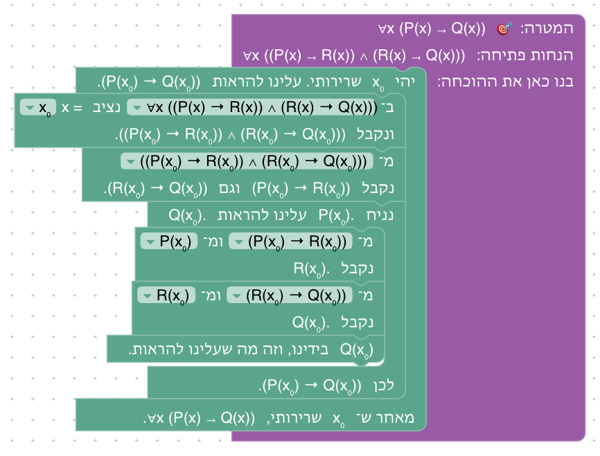
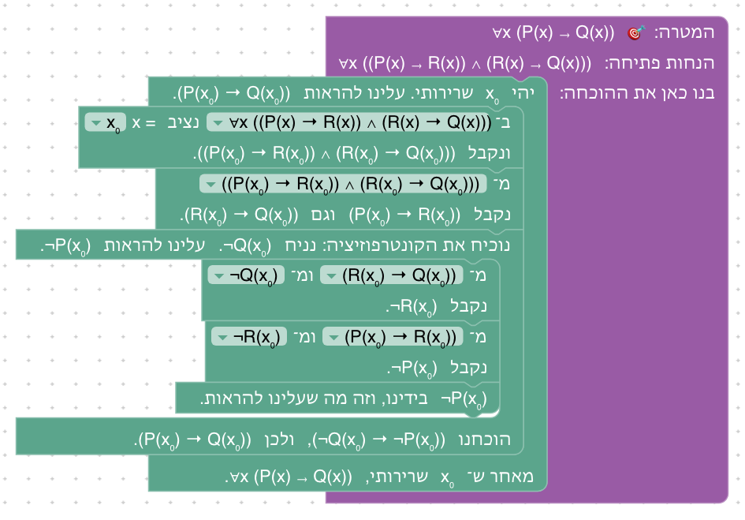
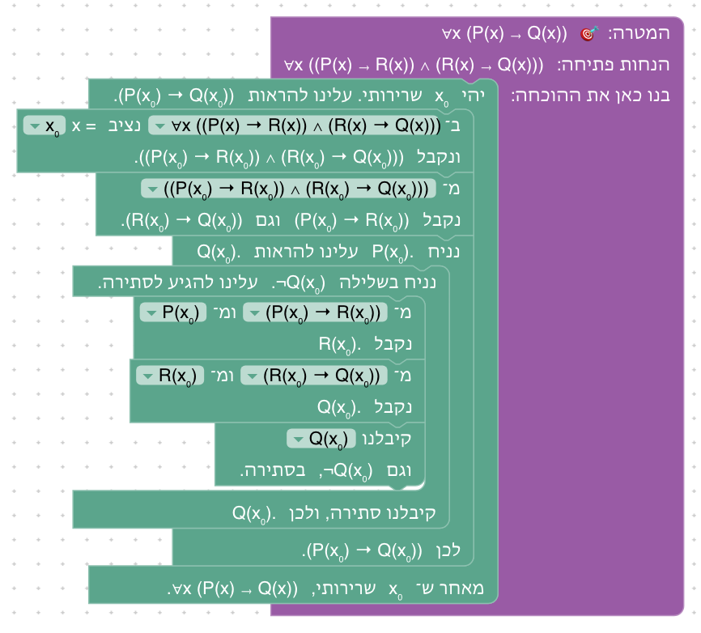
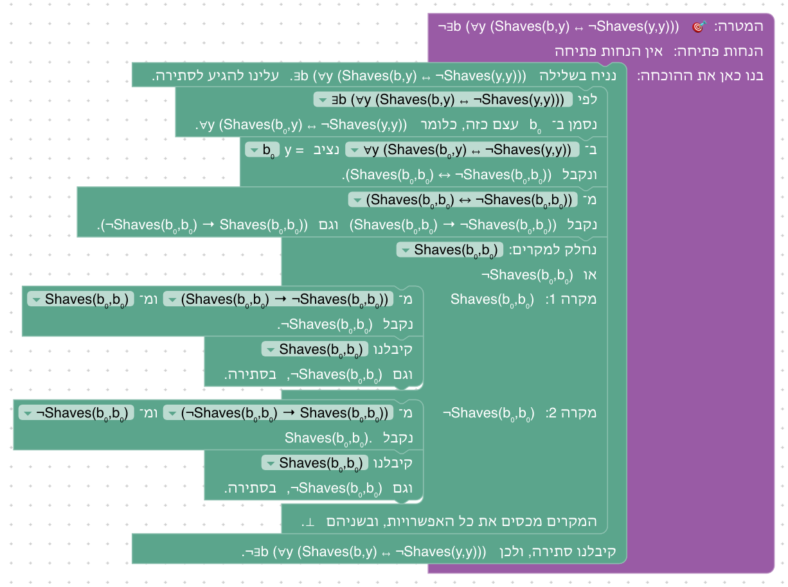
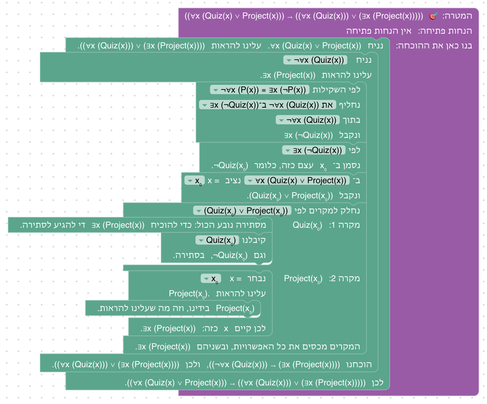
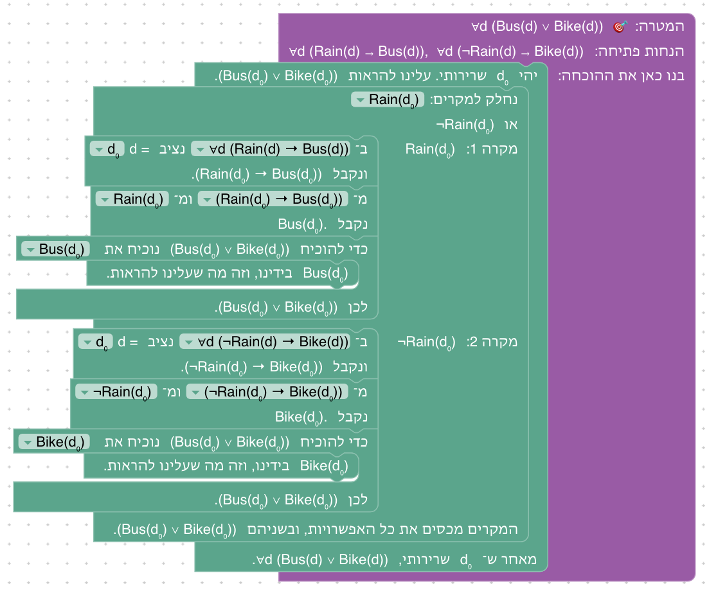

# יחידה 7 — מבני הוכחה

**מטרה:** החלק של ההרצאה הראשונה על הוכחות, עם הדוגמאות של השקפים ובסדר שלהם. בכל הוכחה יש שורת פתיחה, גוף ושורת סיום, לפי המילה הראשית: גרירה נתונה כשיש שלילת המסקנה (7.1) והוכחה בקונטרפוזיציה (7.2), מהטבלאות של ההרצאה; הוכחות "לכל" (7.3) ו"קיים" (7.4), שימוש בהנחות עם שני כמתים (7.5) וטווח (7.6); הוכחה מול מלל משכנע (7.7), שלוש דרכים להוכחת גרירה (7.8), פרדוקס הספר (7.9), והוכחות "וגם" (7.10), "או" (7.11) וחלוקה למקרים (7.12). הסדר הוא הסדר הנוכחי של השקפים: במצגת הוזזו השקפים על הוכחת "לכל" ו"קיים" לפני הדוגמאות שמשתמשות בהם (commit bdbbfeea במאגר המצגות), והיחידה סודרה מחדש בהתאם (2026-10-25). פסקת הפתיחה של היחידה, על מבנה ההוכחה, נמצאת בשלב 7.1.

היחידה משתמשת בטענות של השקפים, עם הפרדיקטים שלהם (Penguin, Quiz, Shaves, Rain וכו'), ולא באותיות P, Q, R בלבד, כדי שהסטודנט יזהה בה את ההרצאה.

## המהלכים החדשים

בטבלאות של ההרצאה ("המילה הראשית קובעת את מבנה ההוכחה", "לכל קשר וכמת: כשצריך להוכיח וכשזה נתון") יש ארבע אסטרטגיות שלא היה להן מהלך. שלוש מהן מוצגות ביחידה הזאת; הוכחת "או" בהנחת השלילה של צד אחד היא הדרך הראשית להוכיח "או" כבר מיחידה 3 (שלב 3.4), וכאן היא מהלך מוכר (7.11). הן כללים נגזרים: ב־Lean הן משפטים של הקורס (`STRATEGY_PRELUDE` ב־`frontend/src/generator/lean.js`), שנוספים רק לשלבים שמציעים אותן.

| מהלך | כשהוא במקומו | Lean |
|---|---|---|
| **גרירה ושלילת המסקנה** (modus tollens) | "מ־ P → Q ומ־ ¬Q נקבל ¬P." | `have := easylean_mt ‹P → Q› ‹¬Q›` |
| **הוכחה בקונטרפוזיציה** (עוטף) | "נוכיח את הקונטרפוזיציה: נניח ¬Q. עלינו להראות ¬P." … "הוכחנו ¬Q → ¬P, ולכן P → Q." | `refine easylean_by_contrapositive (fun _ => ?_)`, והמשך ההוכחה אחרי `·` |
| **הוכחת "או"** (עוטף) | "נניח ¬P. עלינו להראות Q." … "הוכחנו ¬P → Q, ולכן P ∨ Q." | `refine easylean_or_by_negation (fun _ => ?_)`, והמשך אחרי `·` |
| **חלוקה למקרים: טענה ושלילתה** | "נחלק למקרים: [P] או ¬P"; בחלקים: "מקרה 1: P", "מקרה 2: ¬P"; בסוף: "המקרים מכסים את כל האפשרויות, ובשניהם R." | `cases Classical.em (P) with \| inl _ => … \| inr _ => …` |

את הטענה שלפיה מחלקים למקרים בוחרים מתפריט של הטענות של השלב (`level.claims`, כמו בטענת עזר), או ב"✎ כתיבה ידנית".

הוכחת "או" בבחירת צד (יחידה 3) נשארת כקיצור. הוחלט עם מחבר הקורס: ההרצאה מלמדת את "נניח ¬α", ומ־2026-10-24 זו הדרך הראשית, מיחידה 3, ומוצעת בכל שלב שמוכיחים בו "או" (ראו [03-and-or-iff.md](03-and-or-iff.md)).

## שלבים

הפתרונות ב־`frontend/e2e/solutions.js`, וההליכות כסטודנט ב־`frontend/e2e/walk.spec.js`, כמו בשאר היחידות (ראו [יחידה 2](02-implications.md#שלבים)).

| שלב | שקף בהרצאה | הטענה | בארגז |
|---|---|---|---|
| 7.1 | לכל קשר וכמת: כשצריך להוכיח וכשזה נתון (→ נתונה, ¬β) | P → Q, ¬Q ⊢ ¬P | גרירה ושלילת המסקנה, סיום |
| 7.2 | המילה הראשית קובעת את מבנה ההוכחה: גרירה ושלילה (קונטרפוזיציה) | ¬R → ¬Q, ¬Q → ¬P ⊢ P → R | קונטרפוזיציה, הסקה קדימה, סיום |
| 7.3 | הוכחת טענות מהצורה ∀x(α) | הדלתות: ∀x Locked(x) → ∀x (Floor2(x) → Locked(x)) | נניח, "לכל", הצבה, סיום |
| 7.4 | הוכחת טענות מהצורה ∃x(α) | ∀x Friend(x,x) → ∀x ∃y Friend(x,y) | נניח, "לכל", בחירת עד, הצבה, סיום |
| 7.5 | שימוש בהנחות עם כמתים | ∃x ∀y Knows(x,y) → ∀y ∃x Knows(x,y) | נניח, "קיים", "לכל", בחירת עד, הצבה, סיום |
| 7.6 | טווח: על מה חלה כל מילה? | ∀x (∀y Trusts(x,y) → Trusts(x,x)) | "לכל", נניח, הצבה, סיום |
| 7.7 | הוכחה מול מלל משכנע | ∀x (P(x) ∧ Q(x)) → (∀x P(x) ∧ ∀x Q(x)) | נניח, "וגם", "לכל", הצבה, שימוש ב"וגם", סיום |
| 7.8 | דוגמה: שלוש דרכים להוכחת גרירה | ∀x ((P(x) → R(x)) ∧ (R(x) → Q(x))) ⊢ ∀x (P(x) → Q(x)) | המהלכים של שלוש הדרכים |
| 7.9 | דוגמה להוכחה בשלילה: פרדוקס הספר | ⊢ ¬∃b ∀y (Shaves(b,y) ↔ ¬Shaves(y,y)) | הוכחת שלילה, "קיים", הצבה, "אם ורק אם", חלוקה למקרים לפי טענה ושלילתה, סתירה |
| 7.10 | הוכחת קוניונקציה ("וגם") | הפינגווינים | "לכל", נניח, "וגם", הצבה, הסקה קדימה, סיום |
| 7.11 | הוכחת דיסיונקציה ("או") | ∀x (Quiz(x) ∨ Project(x)) → (∀x Quiz(x) ∨ ∃x Project(x)) | נניח, הוכחת "או", החלפה לפי שלילת "לכל", "קיים", הצבה, חלוקה למקרים, סתירה, בחירת עד, סיום |
| 7.12 | הוכחה באמצעות חלוקה למקרים | הגשם: ∀d (Bus(d) ∨ Bike(d)) | "לכל", חלוקה למקרים לפי טענה ושלילתה, הצבה, הסקה קדימה, בחירת צד, סיום |

### 7.8: שלוש דרכים להוכחת גרירה

לשלב שלושה פתרונות, כמו שלוש העמודות של השקף. בכולן: "יהי x₀ שרירותי", הצבה של x₀ בנתון ושימוש ב"וגם". ההבדל במבנה שבתוכו:

**ישירה.** "נניח P(x₀). עלינו להראות Q(x₀)." … "מ־P(x₀) → R(x₀) ומ־P(x₀) נקבל R(x₀)." "מ־R(x₀) → Q(x₀) ומ־R(x₀) נקבל Q(x₀)." … "לכן P(x₀) → Q(x₀)."

**קונטרפוזיציה.** "נוכיח את הקונטרפוזיציה: נניח ¬Q(x₀). עלינו להראות ¬P(x₀)." … "מ־R(x₀) → Q(x₀) ומ־¬Q(x₀) נקבל ¬R(x₀)." "מ־P(x₀) → R(x₀) ומ־¬R(x₀) נקבל ¬P(x₀)." … "הוכחנו ¬Q(x₀) → ¬P(x₀), ולכן P(x₀) → Q(x₀)."

**בשלילה.** "נניח P(x₀)." ובתוכו "נניח בשלילה ¬Q(x₀)." … "קיבלנו Q(x₀) וגם ¬Q(x₀), בסתירה." בהרצאה מניחים את שתיהן בבת אחת ("נניח בשלילה P(x₀) וגם ¬Q(x₀)"); כאן הן שני מהלכים, אחד בתוך השני, וטקסט הפתיחה אומר זאת.

### שאר השלבים

כל שלב הוא ההוכחה מהשקף שלו, וטקסט הסיום מצטט אותה כמו בשקף, בניסוח של הבלוקים: x₀ במקום x של השקף (ראו [יחידה 5](05-quantifiers.md#המהלכים)), "יהי x₀ שרירותי" ו"מאחר ש־x₀ שרירותי" (בשקפים גם "כללי" ו"כלשהו"), ו"נסמן ב־x₀ עצם כזה" לעצם מהנחת "קיים". בפרדוקס הספר (7.9) ההרצאה מראה בטבלת אמת שטענה מהצורה α ↔ ¬α היא סתירה; השלב מוכיח זאת במהלכים, בחלוקה למקרים, וטקסט הפתיחה אומר זאת. ב־7.11 המהלך של הוכחת "או" הוא מיחידה 3. הצילומים:

## שאלות פתוחות

- **שם לעצם מ"קיים".** בדוגמאות של השקפים עצם שמתקבל מהנחת "קיים" מקבל שם חדש ("יהי a כזה"), ובטבלה של ההרצאה הוא שומר על שם המשתנה ("יהי x כזה"). הבלוק נותן לו את שם המשתנה עם אינדקס, בניסוח שההרצאה ממליצה עליו לשימוש ב"קיים" ("נסמן ב־x₀ עצם כזה"; "יהי" שמור להוכחת "לכל"), כדי שלא יתבלבל עם x הקשור. לתת לו במקום זה שם חדש לגמרי (a, b, …), כמו בדוגמאות?
- **7.11 בלי "מאחר ש־¬Quiz(x), מתקיים Project(x)".** בשקף זה צעד אחד; כאן חלוקה למקרים לפי Quiz(x) ∨ Project(x), ובמקרה הראשון סתירה. להוסיף מהלך "מ־α ∨ β ומ־¬α נקבל β"?
- **"נניח בשלילה α וגם ¬β".** ב־7.8 ההנחה של השקף היא שני מהלכים. להוסיף מהלך להוכחת גרירה בשלילה?

