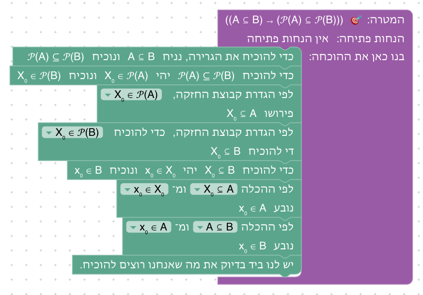
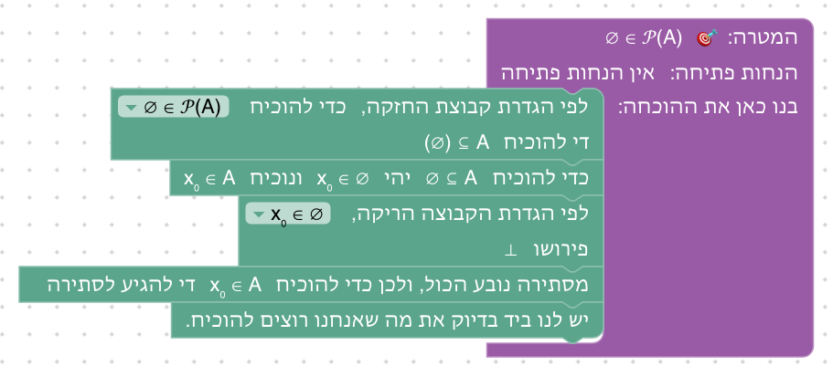
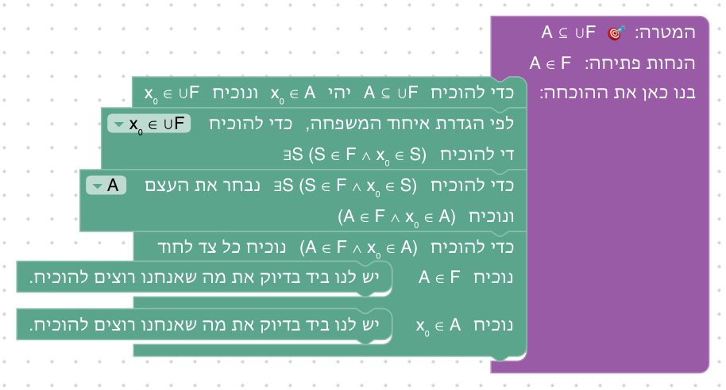
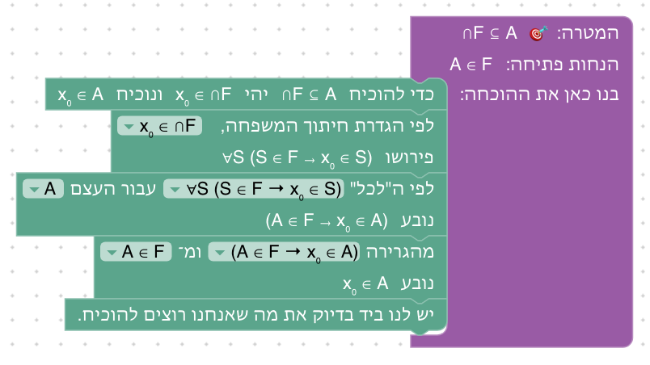
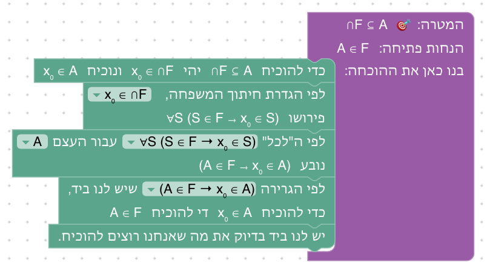
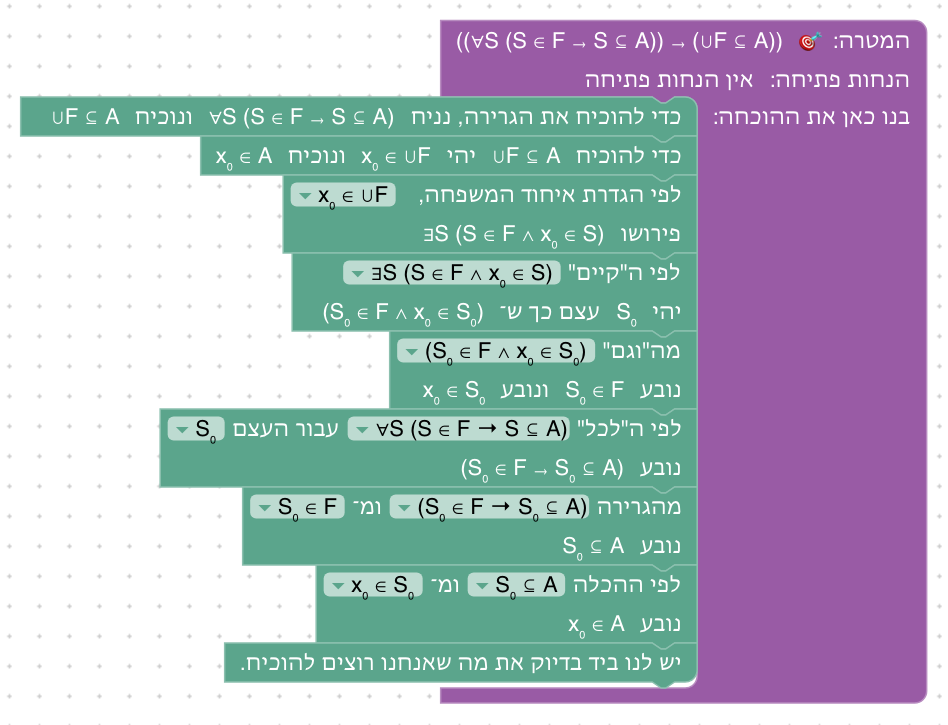

# יחידה 7 — קבוצות של קבוצות

**מטרה:** קבוצות שהאיברים שלהן הם קבוצות: קבוצת החזקה, ואיחוד וחיתוך של משפחה של קבוצות. הסטודנט רואה שהמהלכים של יחידה 6 עובדים גם כשהאיברים הם קבוצות, ושפתיחת ההגדרה של איחוד או חיתוך של משפחה משאירה "קיים" או "לכל" מעל קבוצות, שמשתמשים בהם במהלכים של יחידה 4. בשלב 7.3 הוא לומד מהלך חדש, *טענת עזר*: מוכיחים קודם טענה שתעזור בהמשך (כאן A ∈ 𝒫(A)), ומעכשיו היא בידינו. כך הוא מוכיח את הכיוון ההפוך של שלב 7.2. היחידה בנויה לפי Logic and Proof (פרק 12), וכמו התרגילים על קבוצות חזקה ומשפחות ב־How To Prove It (סעיף 2.3).

## המהלכים

ביחידה מהלך חדש אחד, טענת עזר (שלב 7.3). מלבדו, החדש הוא שלוש הגדרות, שנפתחות באותו מהלך הגדרה של [יחידה 6](06-sets.md), והעובדה שהאיברים והעצמים שבהוכחה הם לפעמים קבוצות. בטבלה המהלכים כפי שהם נקראים אחרי שהם במקומם, עם דוגמאות מהשלבים; בסוגריים המרובעים מה שבוחרים מהרשימה.

| מהלך (כשהוא במקומו) | Lean | לפני → אחרי |
|---|---|---|
| לפי הגדרת קבוצת החזקה, כדי להוכיח [A ∈ 𝒫(A ∪ B)] די להוכיח A ⊆ A ∪ B | `apply easylean_mem_powerset.mpr` | `⊢ A ∈ 𝒫(A ∪ B)` ⟶ `⊢ A ⊆ A ∪ B` |
| לפי הגדרת קבוצת החזקה, [X₀ ∈ 𝒫(A)] פירושו X₀ ⊆ A | `have := easylean_mem_powerset.mp ‹X₀ ∈ 𝒫(A)›` | `X₀ ∈ 𝒫(A) ⊢ …` ⟶ גם `X₀ ⊆ A` |
| לפי הגדרת איחוד המשפחה, כדי להוכיח [x₀ ∈ ⋃F] די להוכיח ∃S (S ∈ F ∧ x₀ ∈ S) | `apply easylean_mem_sUnion.mpr` | `⊢ x₀ ∈ ⋃ F` ⟶ `⊢ ∃S (S ∈ F ∧ x₀ ∈ S)` |
| לפי הגדרת חיתוך המשפחה, [x₀ ∈ ⋂F] פירושו ∀S (S ∈ F → x₀ ∈ S) | `have := easylean_mem_sInter.mp ‹x₀ ∈ ⋂ F›` | `x₀ ∈ ⋂ F ⊢ …` ⟶ גם `∀S (S ∈ F → x₀ ∈ S)` |
| כדי להוכיח 𝒫(A) ⊆ 𝒫(B) יהי X₀ ∈ 𝒫(A) ונוכיח X₀ ∈ 𝒫(B) | `refine easylean_subset_intro (fun X₀ _ => ?_)` | `⊢ 𝒫(A) ⊆ 𝒫(B)` ⟶ `X₀ ∈ 𝒫(A) ⊢ X₀ ∈ 𝒫(B)`, ובידינו הקבוצה X₀ |
| לפי ההכלה [X₀ ⊆ A] ומ־[x₀ ∈ X₀] נובע x₀ ∈ A | `have := easylean_subset_elim ‹X₀ ⊆ A› ‹x₀ ∈ X₀›` | `X₀ ⊆ A, x₀ ∈ X₀ ⊢ …` ⟶ גם `x₀ ∈ A` |
| כדי להוכיח ∃S (S ∈ F ∧ x₀ ∈ S) נבחר את העצם [A] ונוכיח (A ∈ F ∧ x₀ ∈ A) | `apply Exists.intro (A)` | `⊢ ∃S (S ∈ F ∧ x₀ ∈ S)` ⟶ `⊢ A ∈ F ∧ x₀ ∈ A` |
| לפי ה"קיים" [∃S (S ∈ F ∧ x₀ ∈ S)] יהי S₀ עצם כך ש־(S₀ ∈ F ∧ x₀ ∈ S₀) | `refine Exists.elim ‹∃ S, S ∈ F ∧ x₀ ∈ S› (fun S₀ _ => ?_)` | `∃S (S ∈ F ∧ x₀ ∈ S) ⊢ …` ⟶ גם `S₀ ∈ F ∧ x₀ ∈ S₀`, ובידינו הקבוצה S₀ |
| לפי ה"לכל" [∀S (S ∈ F → x₀ ∈ S)] עבור העצם [A] נובע (A ∈ F → x₀ ∈ A) | `have := easylean_forall_elim ‹∀ S, S ∈ F → x₀ ∈ S› (A)` | `∀S (S ∈ F → x₀ ∈ S) ⊢ …` ⟶ גם `A ∈ F → x₀ ∈ A` |
| **טענת עזר (חדש):** נוכיח קודם את טענת העזר [A ∈ 𝒫(A)]; בראש החלק: "נוכיח A ∈ 𝒫(A)"; אחרי החלק: "ומעכשיו A ∈ 𝒫(A) בידינו" | `have : A ∈ 𝒫 A := by`, ומתחתיו, מוזחים, המהלכים של החלק | `𝒫(A) ⊆ 𝒫(B) ⊢ A ⊆ B` ⟶ חלק: `𝒫(A) ⊆ 𝒫(B) ⊢ A ∈ 𝒫(A)`, ואחרי הבלוק `𝒫(A) ⊆ 𝒫(B), A ∈ 𝒫(A) ⊢ A ⊆ B` |

מקור המהלכים (מלבד טענת העזר): פתיחת הגדרה, הוכחת הכלה ושימוש בהכלה מיחידה 6; שימוש ב"לכל", הוכחת "קיים" ושימוש ב"קיים" מיחידה 4. מלבדם משתמשים ב"יש לנו ביד בדיוק את מה שאנחנו רוצים להוכיח." (יחידה 0), בהנחת התנאי ובשתי דרכי השימוש בגרירה, קדימה ואחורה (יחידה 1), בשימוש ב"וגם", בהוכחת "וגם" ובהוכחת "או" (יחידה 2), וב"מסתירה נובע הכול" (יחידה 3).

ההגדרות החדשות (בשלבים 7.1 ו־7.4 משתמשים גם בהגדרות האיחוד והקבוצה הריקה מיחידה 6):

| הגדרה (כפי שהמהלך כותב) | טענה | פירושה | Lean |
|---|---|---|---|
| קבוצת החזקה | `X ∈ 𝒫(A)` | `X ⊆ A` | `Set.powerset`, `easylean_mem_powerset` |
| איחוד המשפחה | `x ∈ ⋃ F` | `∃S (S ∈ F ∧ x ∈ S)` | `Set.sUnion`, `easylean_mem_sUnion` |
| חיתוך המשפחה | `x ∈ ⋂ F` | `∀S (S ∈ F → x ∈ S)` | `Set.sInter`, `easylean_mem_sInter` |

**אותה תורת קבוצות, קומה אחת למעלה.** ההגדרות נמצאות ב־`SET_PRELUDE` (`frontend/src/generator/lean.js`), יחד עם אלה של יחידה 6: קבוצה של קבוצות היא `Set (Set obj)`, ושייכות של קבוצה לקבוצה של קבוצות היא אותה שייכות `∈`. כל הגדרה היא שקילות שמתקיימת לפי ההגדרה עצמה (`Iff.rfl`), כך שפתיחת הגדרה היא צעד לוגי גלוי ולא חישוב.

**מהלך הגדרה אחד.** כמו ביחידה 6, אותו מהלך פותח כל הגדרה, ומה שהוא כותב תלוי בטענה שנבחרה: "לפי הגדרת קבוצת החזקה", "לפי הגדרת איחוד המשפחה". ברשימה רק טענות שייכות שיש להן הגדרה, מהמטרה וממה שבידינו. על המטרה הוא כותב "כדי להוכיח … די להוכיח …", ועל טענה שבידינו "פירושו …", והפירוש מצטרף למה שבידינו. ב־Lean המהלך מנסה קודם את המטרה, רק אם היא כתובה בדיוק כמו הטענה שנבחרה (`first | (guard_target =ₛ …; apply ….mpr) | have := ….mp ‹…›`). ההגדרה נפתחת לפי הפעולה הראשית: ב־`A ∈ 𝒫(A ∪ B)` זו קבוצת החזקה, והאיחוד נשאר בפנים.

**"לכל" ו"קיים" מעל קבוצות.** אחרי פתיחת ההגדרה של איחוד או חיתוך של משפחה המשתנה הקשור S רץ על קבוצות. המהלכים של יחידה 4 עובדים עליו כמו שהם: הלמות שלהם (`easylean_forall_elim`, `Exists.intro`, `Exists.elim`) מוגדרות לכל תחום, וגם `Set obj` הוא תחום. התצוגה כותבת `∀S (S ∈ F → x₀ ∈ S)`, בלי `(S : Set obj)`.

**שמות.** להנחות אין שמות; לעצמים ולקבוצות יש. איבר שלוקחים כדי להוכיח הכלה נקרא x₀, ואם הקבוצה המוכלת היא קבוצת חזקה, האיבר הוא קבוצה ונקרא X₀, באות גדולה. קבוצה שמתקבלת מ"קיים" נקראת לפי המשתנה הקשור, עם אינדקס: S₀. ברשימות של המהלכים "עבור העצם" ו"נבחר את העצם" מופיעים גם העצמים וגם הקבוצות שבידינו.

**טענת עזר.** בהוכחה כתובה מוכיחים לפעמים קודם טענה שתעזור בהמשך: "נוכיח קודם ש־A ∈ 𝒫(A)". המהלך "נוכיח קודם את טענת העזר [ ▾]" עושה בדיוק את זה. את הטענה בוחרים מתפריט של טענות העזר של השלב (`level.claims`), שחלקן לא נחוצות, כך שהבחירה בטענה היא חלק מהרעיון של ההוכחה; או בוחרים "✎ כתיבה ידנית" ומקלידים טענה ("כתבו את טענת העזר, למשל A ⊆ B"). בתוך הבלוק יש חלק משלו, שבראשו "נוכיח A ∈ 𝒫(A)", ובו מוכיחים את הטענה, עם כל מה שבידינו לפני הבלוק. אחרי החלק הבלוק כותב "ומעכשיו A ∈ 𝒫(A) בידינו", והטענה מצטרפת למה שבידינו בהמשך ההוכחה; מה שנוסף בתוך החלק (למשל x₀) לא נשאר. לפני שנבחרה טענה, הבלוק כתוב "נוכיח קודם את טענת העזר ?", בראש החלק "נוכיח אותה:", ואחריו "ומעכשיו היא בידינו". ב־Lean המהלך הוא `have : A ∈ 𝒫 A := by`, והמהלכים של החלק מוזחים תחתיו; ההנחה החדשה, כמו כל הנחה בקורס, בלי שם. כמו התפריט של השקילויות ביחידה 5, התפריט מציע רק את הטענות של השלב (`setLevelClaims` ב־`frontend/src/blocks/moves.js`).

## שלבים

לכל שלב: מה לומדים בו, למה הוא בנוי כך, איך אנחנו רוצים שסטודנטים יפתרו אותו, ושיקולים ושאלות שעוד צריך להכריע. צילומי הפתרונות נוצרים מ־`frontend/e2e/solutions.js` (ראו [יחידה 0](00-getting-started.md#שלבים)).

**סדר היחידה.** קבוצת החזקה (7.1–7.4), ובה המהלך החדש, טענת עזר (7.3), מיד אחרי השלב שהוא מוכיח את הכיוון ההפוך שלו; איחוד וחיתוך של משפחה (7.5–7.6), ותרגיל מסכם (7.7). בכל נושא קודם ההגדרה על המטרה, ואחר כך גם על טענה שבידינו.

### שלב 7.1: קבוצת החזקה

`⊢ A ∈ 𝒫(A ∪ B)` · בארגז: לפי ההגדרה, הוכחת הכלה, הוכחת "או", יש לנו ביד

**מה לומדים.** מה זו קבוצת חזקה, שקבוצה יכולה להיות איבר של קבוצה, ושלפי ההגדרה `X ∈ 𝒫(A)` פירושו `X ⊆ A`.

**למה כך.** הטענה הפשוטה ביותר שבה קבוצה היא איבר. ההגדרה נפתחת על המטרה, ואחרי הפתיחה נשארת ההכלה A ⊆ A ∪ B, שהוכחה כבר בשלב 6.4. כך החדש בשלב הוא רק ההגדרה, וכל השאר מוכר. הסטודנט פותח שתי הגדרות זו אחר זו, קודם של קבוצת החזקה ואחר כך של האיחוד, ורואה שהמהלך פותח כל פעם את הפעולה הראשית.

**פתרון.** "לפי הגדרת קבוצת החזקה, כדי להוכיח A ∈ 𝒫(A ∪ B) די להוכיח A ⊆ A ∪ B." אחר כך "כדי להוכיח A ⊆ A ∪ B יהי x₀ ∈ A ונוכיח x₀ ∈ (A ∪ B)", ופותחים את הגדרת האיחוד במטרה: "כדי להוכיח x₀ ∈ (A ∪ B) די להוכיח x₀ ∈ A ∨ x₀ ∈ B". די להוכיח x₀ ∈ A, ויש לנו ביד בדיוק את זה.

**שיקולים ושאלות להכרעה.**
- ברשימה של מהלך ההגדרה מופיעה כאן רק המטרה. האם הסטודנט מבין למה המהלך כותב "לפי הגדרת קבוצת החזקה" ולא "לפי הגדרת האיחוד", כשבמטרה יש את שתיהן? אולי כדאי שהטקסט יאמר במפורש שההגדרה נפתחת לפי הפעולה החיצונית.
- ביחידה 6 השימוש בהגדרה הופיע קודם על טענה שבידינו ורק אחר כך על המטרה. כאן הסדר הפוך. האם שלב שבו `X ∈ 𝒫(A)` בידינו, לפני השלב הזה, יעזור?

### שלב 7.2: הכלה של קבוצות חזקה

`⊢ (A ⊆ B) → (𝒫(A) ⊆ 𝒫(B))` · בארגז: הנחת התנאי, הוכחת הכלה, לפי ההגדרה, שימוש בהכלה, יש לנו ביד

**מה לומדים.** להוכיח הכלה בין שתי קבוצות של קבוצות: האיבר שלוקחים הוא קבוצה, X₀. ולפתוח את אותה הגדרה גם בטענה שבידינו וגם במטרה.

**למה כך.** המונוטוניות של קבוצת החזקה היא תרגיל קלאסי (Logic and Proof, How To Prove It). ההוכחה היא שתי הכלות מקוננות: הכלה של קבוצות של קבוצות, ובתוכה הכלה של קבוצות. כך רואים שההוכחה זהה בשתי הקומות, ושרק השם מבחין ביניהן: X₀ לקבוצה, x₀ לאיבר שלה.

**פתרון.** נניח A ⊆ B. "כדי להוכיח 𝒫(A) ⊆ 𝒫(B) יהי X₀ ∈ 𝒫(A) ונוכיח X₀ ∈ 𝒫(B)." לפי הגדרת קבוצת החזקה, כדי להוכיח X₀ ∈ 𝒫(A) פירושו X₀ ⊆ A, ובמטרה: די להוכיח X₀ ⊆ B. יהי x₀ ∈ X₀ ונוכיח x₀ ∈ B. לפי ההכלה X₀ ⊆ A ומ־x₀ ∈ X₀ נובע x₀ ∈ A, ולפי ההכלה A ⊆ B ומ־x₀ ∈ A נובע x₀ ∈ B, וזה בדיוק מה שרוצים להוכיח.

**שיקולים ושאלות להכרעה.**
- הכיוון ההפוך, 𝒫(A) ⊆ 𝒫(B) → A ⊆ B, הוא השלב הבא, 7.3, עם טענת עזר. כדאי שטקסט הסיום ישאל עליו, כדי שהשלב הבא יתחיל משאלה פתוחה?
- האם האות הגדולה מספיקה כדי להבחין בין X₀ ל־x₀, בעיקר בתצוגה קטנה ועם אינדקס? אפשרות אחרת: אות אחרת לקבוצה (למשל S₀), כמו בחלק מהספרים.
- הרמזים פותחים את ההגדרה בהנחה לפני המטרה. אפשר גם בסדר הפוך, וגם לפתוח את המטרה רק אחרי שלוקחים את x₀; לא בדקנו אם הסדר משפיע על ההבנה.

### שלב 7.3: טענת עזר

`⊢ 𝒫(A) ⊆ 𝒫(B) → A ⊆ B` · בארגז: הנחת התנאי, טענת עזר, לפי ההגדרה, הוכחת הכלה, שימוש בהכלה, יש לנו ביד · בתפריט של טענת העזר: `A ∈ 𝒫(A)`, `B ∈ 𝒫(B)`, `A ∈ 𝒫(B)`

**מה לומדים.** את המהלך החדש, טענת עזר: "נוכיח קודם ש־A ∈ 𝒫(A)", מוכיחים אותה בחלק משלה, ומעכשיו היא בידינו. ואת הכיוון ההפוך של שלב 7.2: אם 𝒫(A) ⊆ 𝒫(B), אז A ⊆ B.

**למה כך.** ההכלה 𝒫(A) ⊆ 𝒫(B) מדברת על האיברים של 𝒫(A), ולכן כדי להשתמש בה צריך בידינו איבר של 𝒫(A). הרעיון של ההוכחה הוא לבחור איבר כזה: A עצמה. בהוכחה כתובה כותבים "נוכיח קודם ש־A ∈ 𝒫(A)", וזה בדיוק המהלך החדש. בלי המהלך אי אפשר לבנות את ההוכחה: שימוש בהכלה דורש ש־A ∈ 𝒫(A) תהיה בידינו, ואף מהלך אחר בארגז לא מוסיף אותה. ההוכחה של טענת העזר קצרה, וחוזרת על מה שנלמד: פתיחת ההגדרה על המטרה (7.1), והכלה של קבוצה בעצמה. אחרי הבלוק משתמשים בטענה בשימוש בהכלה, ופותחים את ההגדרה בטענה שמתקבלת, A ∈ 𝒫(B), שפירושה המטרה. בתפריט שלוש טענות, ורק אחת מהן עוזרת: B ∈ 𝒫(B) נכונה, אבל לא מאפשרת להשתמש בהנחה; A ∈ 𝒫(B) היא בדיוק מה שצריך, אבל להוכיח אותה זה להוכיח את המטרה עצמה. כך הבחירה בטענה היא הרעיון של ההוכחה, וטקסט הסיום אומר זאת: טענת העזר A ∈ 𝒫(A) היא הרעיון, ולכן כותבים אותה במפורש. הטקסט גם מסכם את שני השלבים: A ⊆ B אם ורק אם 𝒫(A) ⊆ 𝒫(B).

**פתרון.** "כדי להוכיח את הגרירה, נניח 𝒫(A) ⊆ 𝒫(B) ונוכיח A ⊆ B", ו"נוכיח קודם את טענת העזר A ∈ 𝒫(A)". בחלק "נוכיח A ∈ 𝒫(A)": "לפי הגדרת קבוצת החזקה, כדי להוכיח A ∈ 𝒫(A) די להוכיח A ⊆ A", "כדי להוכיח A ⊆ A יהי x₀ ∈ A ונוכיח x₀ ∈ A", ו"יש לנו ביד בדיוק את מה שאנחנו רוצים להוכיח." אחרי החלק הבלוק כותב "ומעכשיו A ∈ 𝒫(A) בידינו". אחר כך "לפי ההכלה 𝒫(A) ⊆ 𝒫(B) ומ־A ∈ 𝒫(A) נובע A ∈ 𝒫(B)", "לפי הגדרת קבוצת החזקה, A ∈ 𝒫(B) פירושו A ⊆ B", ו"יש לנו ביד...".

**שיקולים ושאלות להכרעה.**
- בתפריט שלוש טענות. מי שבוחר A ∈ 𝒫(B) מגיע בחלק לאותה מטרה, A ⊆ B, ונתקע באותו מקום. האם להוסיף רמז או הסבר למקרה הזה, או שהטעות מלמדת בעצמה?
- בחלק של טענת העזר האיבר נקרא x₀, כי הקבוצה המוכלת היא A, לא קבוצת חזקה. ההבחנה בין A כאיבר של 𝒫(A) לבין A כקבוצה של עצמים מופיעה כאן באותה הוכחה; האם הטקסט צריך להצביע עליה?
- בכתיבה ידנית קשה להקליד 𝒫 ו־∈ (ראו "הקלדת סימנים" ביחידה 6). בשלב הזה התפריט מספיק; בשלבים שבהם הטענה תוקלד, תידרש מקלדת סימנים.
- המהלך מוצג רק ביחידה 7. ראו בשאלות שבסוף: האם להקדים אותו.

### שלב 7.4: הקבוצה הריקה בקבוצת החזקה

`⊢ ∅ ∈ 𝒫(A)` · בארגז: לפי ההגדרה, הוכחת הכלה, מסתירה נובע הכול, יש לנו ביד

**מה לומדים.** שהקבוצה הריקה היא איבר של כל קבוצת חזקה, ולכן קבוצת חזקה אף פעם לא ריקה.

**למה כך.** אחרי פתיחת ההגדרה נשארת ההכלה ∅ ⊆ A, שהוכחה בשלב 6.11. הסטודנט רואה ש"∅ ∈ 𝒫(A)" ו־"∅ ⊆ A" הן אותה טענה לפי ההגדרה, ומבחין בין ∈ ל־⊆ כשהקבוצה הריקה מופיעה פעם כאיבר ופעם כקבוצה.

**פתרון.** "לפי הגדרת קבוצת החזקה, כדי להוכיח ∅ ∈ 𝒫(A) די להוכיח ∅ ⊆ A." יהי x₀ ∈ ∅ ונוכיח x₀ ∈ A. לפי הגדרת הקבוצה הריקה, x₀ ∈ ∅ פירושו ⊥. "מסתירה נובע הכול, ולכן כדי להוכיח x₀ ∈ A די להגיע לסתירה", והסתירה כבר בידינו.

**שיקולים ושאלות להכרעה.**
- אחרי השורה הראשונה ההוכחה חוזרת על שלב 6.11 כולו. אם יהיה מנגנון לשימוש בטענות שכבר הוכחו, זה יהיה צעד אחד. האם החזרה מחזקת את מה שנלמד ביחידה 6, או שעדיף שלב אחר, למשל עם `X ∈ 𝒫(A)` בידינו?
- השלב קצר ודומה ל־7.1. אפשר לאחד את שניהם, או להפוך אותו לשאלה בטקסט של שלב 7.1.

### שלב 7.5: איחוד של משפחה

`A ∈ F ⊢ A ⊆ ⋃ F` · בארגז: הוכחת הכלה, לפי ההגדרה, הוכחת "קיים", הוכחת "וגם", יש לנו ביד

**מה לומדים.** מה זו משפחה של קבוצות ומה האיחוד שלה, ששייכות לאיחוד של משפחה היא טענת "קיים" מעל קבוצות, ושמוכיחים אותה בבחירת עד שהוא קבוצה.

**למה כך.** הטענה הפשוטה ביותר על איחוד של משפחה. העד הוא A עצמה, שכבר בידינו, כך שהסטודנט לא צריך לבנות אותו. אחרי בחירת העד נשאר "וגם" ששני הצדדים שלו בידינו, ולכן כל הקושי הוא בהבנת ההגדרה.

**פתרון.** "כדי להוכיח A ⊆ ⋃F יהי x₀ ∈ A ונוכיח x₀ ∈ ⋃F." "לפי הגדרת איחוד המשפחה, כדי להוכיח x₀ ∈ ⋃F די להוכיח ∃S (S ∈ F ∧ x₀ ∈ S)." "כדי להוכיח ∃S (S ∈ F ∧ x₀ ∈ S) נבחר את העצם A ונוכיח (A ∈ F ∧ x₀ ∈ A)." מוכיחים כל צד לחוד: A ∈ F בידינו, וגם x₀ ∈ A.

**שיקולים ושאלות להכרעה.**
- העד הוא קבוצה, אבל המהלך כותב "נבחר את העצם A" (ראו בסוף המסמך).
- ברשימת העצמים מופיעים גם x₀ ו־F. אם בוחרים אחד מהם, Lean נכשל כי הסוג לא מתאים. כדאי לבדוק שההסבר שמוצג אז מובן, או לסנן את הרשימה לפי סוג המשתנה הקשור.
- את ה"וגם" שבסוף מוכיחים בשני חלקים. אפשר גם "מ־A ∈ F ומ־x₀ ∈ A נובע …" (יחידה 2), אבל המהלך הזה לא בארגז, כדי שהשלב יתמקד בהגדרה ובעד.

### שלב 7.6: חיתוך של משפחה

`A ∈ F ⊢ ⋂ F ⊆ A` · בארגז: הוכחת הכלה, לפי ההגדרה, שימוש ב"לכל", גרירה קדימה, גרירה אחורה, יש לנו ביד

**מה לומדים.** מה החיתוך של משפחה, שהשייכות אליו היא טענת "לכל" מעל קבוצות, ושמשתמשים בה בהצבה של קבוצה.

**למה כך.** השלב הדואלי ל־7.5: איחוד הוא "קיים", וחיתוך הוא "לכל". ההגדרה נפתחת כאן על טענה שבידינו, לא על המטרה. אחרי ההצבה יש גרירה רגילה, ולכן שתי הדרכים של יחידה 1 פתוחות.

**פתרון א: קדימה.** "כדי להוכיח ⋂F ⊆ A יהי x₀ ∈ ⋂F ונוכיח x₀ ∈ A." לפי הגדרת חיתוך המשפחה, x₀ ∈ ⋂F פירושו ∀S (S ∈ F → x₀ ∈ S). "לפי ה"לכל" ∀S (S ∈ F → x₀ ∈ S) עבור העצם A נובע (A ∈ F → x₀ ∈ A)." מהגרירה A ∈ F → x₀ ∈ A ומ־A ∈ F נובע x₀ ∈ A, וזה בדיוק מה שרוצים להוכיח.

**פתרון ב: אחורה.** אותה התחלה, ואחרי ההצבה: "לפי הגרירה A ∈ F → x₀ ∈ A שיש לנו ביד, כדי להוכיח x₀ ∈ A די להוכיח A ∈ F", וזה בידינו.

**שיקולים ושאלות להכרעה.**
- שתי הדרכים נבדלות רק בצעד האחרון. האם יש טעם להציע את שתיהן כאן, או שעדיף לצמצם את הארגז ולהשאיר את הבחירה לשלב המסכם?
- גם כאן המהלך כותב "עבור העצם A", אף שמציבים קבוצה.
- טקסט הסיום יכול לומר במפורש את הדואליות: ⋃הוא "קיים" ו־⋂הוא "לכל", כמו ש־∪ הוא "או" ו־∩ הוא "וגם".

### שלב 7.7: תרגיל מסכם: איחוד מוכל

`⊢ (∀S (S ∈ F → S ⊆ A)) → (⋃ F ⊆ A)` · בארגז: הנחת התנאי, הוכחת הכלה, לפי ההגדרה, שימוש ב"קיים", שימוש ב"וגם", שימוש ב"לכל", גרירה קדימה, שימוש בהכלה, יש לנו ביד

**מה לומדים.** להשתמש בשייכות לאיחוד של משפחה: מטענת "קיים" מקבלים קבוצה חדשה S₀, ומציבים אותה בטענת "לכל". כל הכלים של היחידות הקודמות בהוכחה אחת.

**למה כך.** זו התכונה המרכזית של האיחוד: הוא הקבוצה הקטנה ביותר שמכילה את כל הקבוצות במשפחה. בהוכחה משתמשים באיחוד (בשלב 7.5 הוכיחו שייכות אליו), והסדר מוכרח, כמו ביחידה 4: קודם מקבלים את S₀, ורק אחר כך מציבים אותה ב"לכל". שם המשתנה הקשור S והשם S₀ מבחינים בין "כל קבוצה" לבין קבוצה מסוימת שבידינו.

**פתרון.** "כדי להוכיח את הגרירה, נניח ∀S (S ∈ F → S ⊆ A) ונוכיח ⋃F ⊆ A." יהי x₀ ∈ ⋃F ונוכיח x₀ ∈ A. לפי הגדרת איחוד המשפחה, x₀ ∈ ⋃F פירושו ∃S (S ∈ F ∧ x₀ ∈ S). "לפי ה"קיים" ∃S (S ∈ F ∧ x₀ ∈ S) יהי S₀ עצם כך ש־(S₀ ∈ F ∧ x₀ ∈ S₀)." מה"וגם" נובע S₀ ∈ F ונובע x₀ ∈ S₀. לפי ה"לכל" עבור העצם S₀ נובע (S₀ ∈ F → S₀ ⊆ A), ומהגרירה ומ־S₀ ∈ F נובע S₀ ⊆ A. לבסוף, לפי ההכלה S₀ ⊆ A ומ־x₀ ∈ S₀ נובע x₀ ∈ A.

**שיקולים ושאלות להכרעה.**
- ההוכחה ארוכה (תשעה מהלכים) והארגז גדול. אפשר להתחיל אותה עם טעות מתוכננת: הצבה ב"לכל" לפני שיש S₀, כמו הטעות הנפוצה ביחידה 4.
- גם כאן אפשר להשתמש בגרירה אחורה במקום קדימה, אבל רק אם המטרה היא S₀ ⊆ A. טענת עזר (7.3) יכולה להציב אותה כמטרת ביניים ("נוכיח קודם את טענת העזר S₀ ⊆ A", בכתיבה ידנית), אבל היא לא בארגז של השלב, ולכן הארגז מציע רק את הדרך קדימה. להוסיף אותה כדרך שנייה?
- האם צריך שלב בונוס? מועמדים: ⋂F ⊆ ⋃F כש־F לא ריקה (עד מ"קיים" והצבה ב"לכל" באותה הוכחה), או שלב נוסף עם טענת עזר, כמו 7.3.

## שאלות שנוגעות ליחידה כולה

- **הוחלט: טענת עזר כמהלך.** 𝒫(A) ⊆ 𝒫(B) → A ⊆ B צריכה להוכיח בצד טענת ביניים, A ∈ 𝒫(A), ואז להשתמש בהכלה עליה. לבקשת מחבר הקורס נוסף המהלך "נוכיח קודם את טענת העזר …" (ראו במהלכים), ומוצג בשלב 7.3. שאלות שנשארו: האם להקדים אותו ליחידות הקודמות, שבהן הוא היה מקצר הוכחות או מאפשר את הדרך של הספרים (למשל P ∨ ¬P כטענת עזר בשלבים 3.10 ו־5.3, או ¬P ו־¬Q בשלב 3.5); וכמה טענות להציע בתפריט: מעט, כך שהבחירה כמעט נתונה, או יותר, כך שהבחירה בטענה היא חלק מהעבודה.
- **"עצם" או "קבוצה".** בשלבים 7.5–7.7 המהלכים של יחידה 4 כותבים "נבחר את העצם A", "עבור העצם A" ו"יהי S₀ עצם כך ש־…", אף שאלה קבוצות. אפשר לבחור את המילה לפי התחום של המשתנה הקשור ("נבחר את הקבוצה A"), או להסביר בטקסט של 7.5 ש"עצם" הוא כל דבר שהכמת רץ עליו.
- **שם האיבר לפי התחום.** המהלך של הוכחת הכלה קורא לאיבר X₀ רק כשהקבוצה המוכלת היא קבוצת חזקה. בהכלה בין שתי משפחות (F ⊆ G) האיבר הוא קבוצה, אבל ייקרא x₀. כדאי שהשם ייקבע לפי הסוג של האיברים, ולא לפי צורת הקבוצה.
- **שמות ההגדרות.** בכרטיס השלב ההגדרות נקראות "איחוד של משפחה" ו"חיתוך של משפחה", והמהלך כותב "לפי הגדרת איחוד המשפחה" ו"לפי הגדרת חיתוך המשפחה". כדאי לאחד.
- **משפחות עם אינדקס.** Logic and Proof עוסק גם במשפחות כמו ⋃ᵢ Aᵢ. הן לא נכללו כאן; האם להוסיף אותן, או להסתפק במשפחה כקבוצה של קבוצות?

