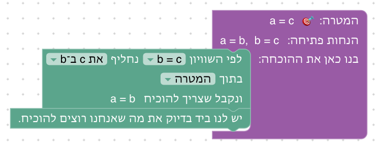
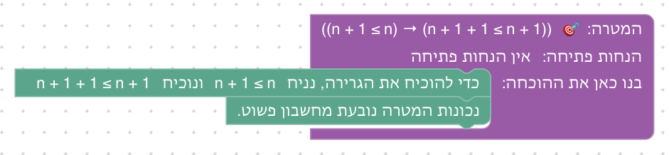
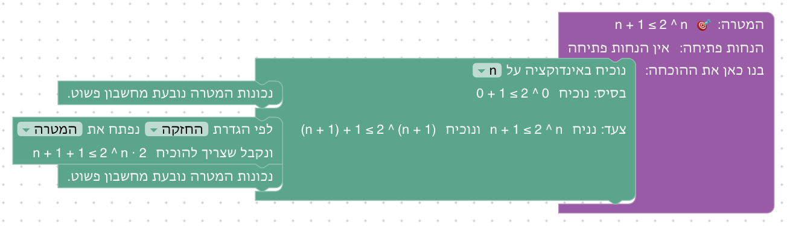
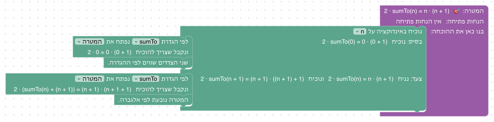
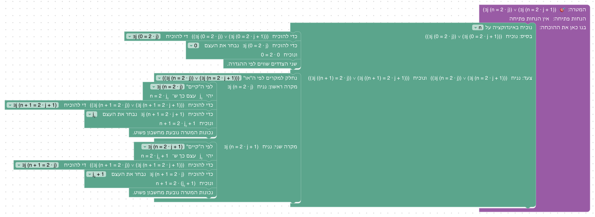
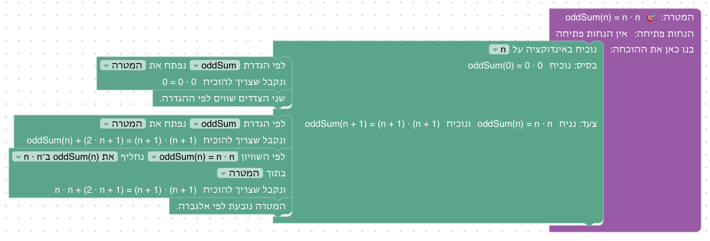

# יחידה 8 — שוויון ואינדוקציה

**מטרה:** שוויון כעיקרון לוגי (כל דבר שווה לעצמו, ומותר להחליף שווה בשווה; מהם נובעות הסימטריה והטרנזיטיביות), והוכחה באינדוקציה על המספרים הטבעיים: בסיס, צעד והנחת האינדוקציה. הסטודנט מבין למה צריך גם בסיס וגם צעד, ומבחין בין מה שנכון לפי ההגדרה לבין מה שדורש הוכחה. היחידה בנויה לפי Logic and Proof (פרק 17) ולפי Natural Number Game, ושני העקרונות של השוויון הם הכללים =I ו־=E של forall x (פרק 39).

## המהלכים

בטבלה המהלכים החדשים כפי שהם נקראים אחרי שהם במקומם, עם דוגמאות מהשלבים; בסוגריים המרובעים מה שבוחרים מהרשימה.

| מהלך (כשהוא במקומו) | Lean | לפני → אחרי |
|---|---|---|
| שני הצדדים שווים לפי ההגדרה. | `rfl` | `⊢ n + 0 = n` ⟶ סגור |
| לפי השוויון [y = x + 7] נחליף [את y ב־x + 7] בתוך [המטרה], ונקבל שצריך להוכיח 2 · (x + 7) = 2 · (x + 7) | `rewrite [‹y = x + 7›]` | `y = x + 7 ⊢ 2 · y = 2 · (x + 7)` ⟶ `y = x + 7 ⊢ 2 · (x + 7) = 2 · (x + 7)` |
| לפי השוויון [a = b] נחליף [את b ב־a] בתוך [P(b)], ונקבל P(a) | `have := ‹P b›`, ואחריו `rewrite [← ‹a = b›] at this` | `a = b, P(b) ⊢ P(a)` ⟶ `a = b, P(b), P(a) ⊢ P(a)` |
| נוכיח באינדוקציה על [n]; בחלק הראשון "בסיס: נוכיח double(0) = 0 + 0", ובשני "צעד: נניח double(n) = n + n ונוכיח double(n + 1) = (n + 1) + (n + 1)" | `induction n with`, ובחלקים `\| zero =>` ו־`\| succ n _ =>` | `⊢ P(n)` ⟶ שני חלקים: `⊢ P(0)`, ו־`P(n) ⊢ P(n + 1)` |
| לפי הגדרת [double] נפתח את [המטרה], ונקבל שצריך להוכיח double(n) + 2 = (n + 1) + (n + 1). אפשר לפתוח הגדרה גם בטענה שבידינו, ואז התוצאה מצטרפת להנחות. | `rewrite [double]` | `⊢ double(n + 1) = (n + 1) + (n + 1)` ⟶ `⊢ double(n) + 2 = (n + 1) + (n + 1)` |
| נכונות המטרה נובעת מחשבון פשוט. | `omega` | `n + 1 ≤ 2^n ⊢ n + 1 + 1 ≤ 2^n · 2` ⟶ סגור |
| המטרה נובעת לפי אלגברה. | `grind` | `2 · sumTo(n) = n · (n + 1) ⊢ 2 · (sumTo(n) + (n + 1)) = (n + 1) · (n + 1 + 1)` ⟶ סגור |

מלבדם משתמשים במהלכים של יחידות קודמות: "יש לנו ביד בדיוק את מה שאנחנו רוצים להוכיח." (יחידה 0) בשלבים 8.3 ו־8.4, הנחת התנאי (יחידה 1) בשלב 8.7, וחלוקה למקרים, הוכחת "או", שימוש ב"קיים" והוכחת "קיים" (יחידות 2 ו־4) בשלב 8.10.

ההגדרות שהיחידה משתמשת בהן, והשלב שבו כל אחת מופיעה לראשונה:

| הגדרה (בתפריט של פתיחת ההגדרה) | משוואות | מה Lean פותח | שלב |
|---|---|---|---|
| החיבור | `n + 0 = n`, ו־`n + (m + 1) = (n + m) + 1` | `easylean_add_succ` | 8.1 |
| double | `double(0) = 0`, ו־`double(n + 1) = double(n) + 2` | המשוואות של `double` | 8.5 |
| החזקה | `2^0 = 1`, ו־`2^(n + 1) = 2^n · 2` | `Nat.pow_succ` | 8.8 |
| sumTo | `sumTo(0) = 0`, ו־`sumTo(n + 1) = sumTo(n) + (n + 1)` | המשוואות של `sumTo` | 8.9 |
| oddSum | `oddSum(0) = 0`, ו־`oddSum(n + 1) = oddSum(n) + (2n + 1)` | המשוואות של `oddSum` | 8.11 |

**פונקציות משלנו, בהגדרה רקורסיבית.** `double`, `sumTo` ו־`oddSum` מוגדרות ב־`NAT_PRELUDE` (`frontend/src/generator/lean.js`), שנטען רק בשלבים של היחידה (`usesNat`), עם משוואה עבור 0 ומשוואה עבור n + 1, וכך פתיחת ההגדרה היא צעד גלוי. החיבור של Lean מוגדר לפי המחובר השני, ולכן `n + 0 = n` נכון לפי ההגדרה, אבל `0 + n = n` דורש אינדוקציה, כמו ב־Natural Number Game. הלמה `easylean_add_succ` היא המשוואה השנייה של החיבור, בניסוח שהסטודנט מכיר.

**החלפה לפי שוויון.** בוחרים את השוויון מבין השוויונות שבידינו, ואחר כך את ההחלפה: הרשימה מציגה את שני הכיוונים כהחלפות עצמן ("את y ב־x + 7", "את x + 7 ב־y"), כך שאין צורך לחשוב על "שמאל" ו"ימין". המקום הוא המטרה (הראשונה ברשימה) או טענה שבידינו. בטענה שבידינו ההחלפה נעשית בעותק שלה, והתוצאה מצטרפת למה שבידינו, כמו בהסקה קדימה; הטענה המקורית נשארת. ההחלפה לא סוגרת את המטרה בעצמה (`rewrite` ולא `rw`), כך שהסטודנט רואה מה התקבל וסוגר בעצמו.

**אינדוקציה.** המהלך מפצל את ההוכחה לשני חלקים, כמו המהלכים של יחידה 2, ובראש כל חלק כתוב מה מוכיחים בו, לפי המטרה ולפי המשתנה שנבחר: "בסיס: נוכיח P(0)" ו"צעד: נניח P(n) ונוכיח P(n + 1)". כך אי אפשר לשכוח את הבסיס, והנחת האינדוקציה כתובה במפורש. בצעד המשתנה שומר על שמו (`| succ n _ =>`), כמו ב־Logic and Proof, ולהנחת האינדוקציה אין שם: משתמשים בה לפי מה שהיא אומרת, כמו בכל הנחה.

**פתיחת הגדרה.** המהלך פותח הגדרה במטרה בלבד, ובוחרים בו את ההגדרה מתפריט קבוע של חמש ההגדרות. אם אין במטרה מקום לפתוח בו את ההגדרה, ההסבר אומר זאת ("היא נפתחת רק על 0 או על משהו מהצורה n + 1").

**חשבון ואלגברה בלי להסתיר את הלוגיקה.** "נכונות המטרה נובעת מחשבון פשוט" (`omega`) ו"המטרה נובעת לפי אלגברה" (`grind`), שניהם ב־Lean הבסיסי, בלי Mathlib, משלימים את מה שאינו עיקר השלב. הם לא פותחים את ההגדרות של double, sumTo ו־oddSum, ולכן פתיחת ההגדרה נשארת אצל הסטודנט, וההסבר בכישלון אומר לו את זה ("החשבון לבדו לא מספיק… אולי צריך קודם לפתוח הגדרה, או להחליף לפי הנחת האינדוקציה?"). הם כן משתמשים במה שבידינו, כולל הנחת האינדוקציה (ראו שאלות). בשלבים שבהם השוויון או האינדוקציה עצמם הם העיקר (8.1–8.4, 8.6) אין חשבון בארגז.

**תצוגה.** פונקציות מוצגות בסימון הקורס (`double(n)`, ולא `double n`), וכפל כ־`·`. מספרים מוצגים בחלונית מצב ההוכחה בשורה נפרדת, "מספרים: n", כמו עצמים וקבוצות.

## שלבים

לכל שלב: מה לומדים בו, למה הוא בנוי כך, איך אנחנו רוצים שסטודנטים יפתרו אותו, ושיקולים ושאלות שעוד צריך להכריע. צילומי הפתרונות נוצרים מ־`frontend/e2e/solutions.js` (ראו [יחידה 0](00-getting-started.md#שלבים)).

**סדר היחידה.** קודם שוויון (8.1–8.4), כי האינדוקציה משתמשת בהחלפה, ואחר כך אינדוקציה (8.5–8.10) ובונוס (8.11).

### שלב 8.1: שוויון לפי ההגדרה

`⊢ n + 0 = n` · מספרים: n · בארגז: שוויון לפי ההגדרה

**מה לומדים.** רפלקסיביות: שוויון ששני צדדיו זהים לפי ההגדרות מוכח מיד. ומספרים טבעיים, עם הגדרת החיבור.

**למה כך.** כמו הרמה הראשונה של Natural Number Game. הטענה נבחרה כך שהיא נכונה לפי ההגדרה, כדי שבשלב 8.6 יהיה ניגוד ל־`0 + n = n`, שאינה.

**פתרון.** "שני הצדדים שווים לפי ההגדרה.": n + 0 הוא n לפי הגדרת החיבור.

**שיקולים ושאלות להכרעה.**
- "לפי ההגדרה" כולל גם חישוב: המהלך סוגר גם `2 + 2 = 4` וגם `double(0) = 0 + 0` בלי לפתוח הגדרה. הגבול בין "לפי ההגדרה" ל"צריך הוכחה" לא תמיד ברור לסטודנט. האם להסביר בטקסט שההגדרות "מחושבות" עד הסוף?
- בשלב יש מהלך אחד ואין מה לבחור. הוא מציג בעיקר את המספרים ואת הגדרת החיבור; אפשר לצרף אותו לטקסט של שלב 8.2.

### שלב 8.2: מחליפים לפי שוויון

`y = x + 7 ⊢ 2 · y = 2 · (x + 7)` · מספרים: x, y · בארגז: החלפה לפי שוויון, שוויון לפי ההגדרה

**מה לומדים.** העיקרון של החלפת שווה בשווה (=E, חוק לייבניץ), ואיך בוחרים במהלך שוויון, החלפה ומקום.

**למה כך.** אותה דוגמה כמו ב־Natural Number Game ("substitute in for y"). ההחלפה לא סוגרת את המטרה, כך שהסטודנט רואה ששני הצדדים נעשו זהים, וסוגר בעיקרון של שלב 8.1. שני העקרונות של השוויון מופיעים כך זה אחר זה.

**פתרון.** "לפי השוויון y = x + 7 נחליף את y ב־x + 7 בתוך המטרה." עכשיו המטרה היא 2 · (x + 7) = 2 · (x + 7), ו"שני הצדדים שווים לפי ההגדרה."

**שיקולים ושאלות להכרעה.**
- בבלוק שלושה שדות, וזה המהלך הראשון בקורס שבוחרים בו גם כיוון וגם מקום. ברשימת ההחלפות יש גם "את x + 7 ב־y", והבחירה בה נותנת `2 · y = 2 · y`, שגם היא נסגרת לפי ההגדרה. האם זה מבלבל, או דווקא מראה שיש יותר מדרך אחת?
- שני העקרונות מוצגים בשני שלבים קצרים. אפשר לשקול שלב שבו ההחלפה צריכה לקרות פעמיים, לפני שעוברים לכיוון.

### שלב 8.3: כיוון ההחלפה

`a = b, P(b) ⊢ P(a)` · עצמים: a, b · בארגז: החלפה לפי שוויון, יש לנו ביד

**מה לומדים.** שלשוויון יש שני כיוונים, ושאפשר להחליף גם בטענה שבידינו, לא רק במטרה.

**למה כך.** החלפה בכיוון הלא נכון היא טעות נפוצה, ו־Natural Number Game מקדיש לה שלב. כאן הכיוון מוצג כהחלפה עצמה, ולכן השאלה היא לא "שמאל או ימין" אלא מה מחליפים במה, ואיפה. התחום מופשט (כמו ביחידה 4), כדי להראות שהשוויון אינו רק של מספרים. יש שתי דרכים, והן נבדלות במקום: בטענה שבידינו או במטרה.

**פתרון א: בטענה שבידינו.** "לפי השוויון a = b נחליף את b ב־a בתוך P(b)." P(a) מצטרפת למה שבידינו, ו"יש לנו ביד בדיוק את מה שאנחנו רוצים להוכיח."

**פתרון ב: במטרה.** "לפי השוויון a = b נחליף את a ב־b בתוך המטרה." המטרה היא עכשיו P(b), וזה בידינו.

**שיקולים ושאלות להכרעה.**
- כיוון שגוי מוסבר ("ב־P(b) לא מופיע a, ולכן אין מה להחליף. אולי צריך להחליף בכיוון השני, או במקום אחר?"), אבל השלב לא מתחיל בטעות מתוכננת: כשההחלפה כתובה במפורש, טעות כזאת נראית כבר לפני הבדיקה. האם עדיין כדאי שהסטודנט ייתקל בה?
- בהחלפה בטענה שבידינו, P(b) נשארת ו־P(a) מתווספת, והבלוק כותב "ונקבל P(a)", כמו בספרים. האם צריך להסביר שהטענה הישנה נשארת בידינו?

### שלב 8.4: שרשרת של שוויונות

`a = b, b = c ⊢ a = c` · עצמים: a, b, c · בארגז: החלפה לפי שוויון, יש לנו ביד

**מה לומדים.** טרנזיטיביות, כתוצאה של העיקרון של החלפה.

**למה כך.** forall x מראה שהסימטריה והטרנזיטיביות נובעות משני העקרונות של 8.1 ו־8.2 בלבד; כאן רואים זאת בפועל. יש שתי דרכים, לפי השוויון שבוחרים, וטקסט הסיום מזכיר גם את הסימטריה.

**פתרון א: את a ב־b.** "לפי השוויון a = b נחליף את a ב־b בתוך המטרה." המטרה היא b = c, וזה בידינו.

**פתרון ב: את c ב־b.** "לפי השוויון b = c נחליף את c ב־b בתוך המטרה." המטרה היא a = b, וזה בידינו.

**שיקולים ושאלות להכרעה.**
- שרשרת מתקבלת כאן מהחלפות רצופות. האם צריך מהלך נפרד לשרשרת "a = b = c", כמו ב־Waterproof וב־Verbose Lean?
- הסימטריה (מ־a = b נובע b = a) מוזכרת רק בטקסט הסיום. היא שלב קצר וטוב לכיוון ההחלפה, ואפשר להוסיף אותה לפני השלב הזה.

### שלב 8.5: אינדוקציה ראשונה

`⊢ double(n) = n + n` · מספרים: n · בארגז: אינדוקציה, פתיחת הגדרה, החלפה לפי שוויון, שוויון לפי ההגדרה, חשבון

**מה לומדים.** אינדוקציה: בסיס, צעד והנחת האינדוקציה. ופתיחה של הגדרה רקורסיבית.

**למה כך.** פונקציה פשוטה שמוגדרת ברקורסיה, כך שהמבנה של ההוכחה בולט: פתיחת ההגדרה, החלפה לפי הנחת האינדוקציה, חשבון. הטקסט מסביר את האינדוקציה כשרשרת "מ־0 ל־1, מ־1 ל־2". הכותרות של החלקים כותבות את הבסיס ואת הצעד לפי המטרה, כך שהסטודנט רואה מה בדיוק הנחת האינדוקציה ומה צריך להוכיח בצעד.

**פתרון.** "נוכיח באינדוקציה על n." בחלק "בסיס: נוכיח double(0) = 0 + 0": לפי הגדרת double נפתח את המטרה, ו"שני הצדדים שווים לפי ההגדרה." בחלק "צעד: נניח double(n) = n + n ונוכיח double(n + 1) = (n + 1) + (n + 1)": לפי הגדרת double נפתח את המטרה (double(n) + 2 = (n + 1) + (n + 1)); לפי השוויון double(n) = n + n נחליף את double(n) ב־n + n בתוך המטרה; ונכונות המטרה נובעת מחשבון פשוט.

**שיקולים ושאלות להכרעה.**
- השלב מציג שלושה מהלכים חדשים יחד (אינדוקציה, פתיחת הגדרה, חשבון), בניגוד לכלל שבשלב שמציג מהלך חדש יש רק אותו. אפשר להקדים את שלב 8.6, שאין בו חשבון, או שלב שבו הצעד הוא רק פתיחת הגדרה והחלפה.
- החשבון משתמש בהנחת האינדוקציה, ולכן בצעד אפשר לדלג על ההחלפה: אחרי פתיחת ההגדרה, "נכונות המטרה נובעת מחשבון פשוט" מספיק (נבדק ב־Lean). על פתיחת ההגדרה אי אפשר לדלג, וטקסט הסיום אומר רק את זה. אם רוצים שההחלפה תהיה הכרחית, צריך להגביל את החשבון כך שלא ישתמש במה שבידינו.
- גם בבסיס אפשר לדלג על פתיחת ההגדרה: double(0) = 0 + 0 נכון לפי ההגדרה, ו"שני הצדדים שווים לפי ההגדרה" סוגר אותו מיד (ראו 8.1).

### שלב 8.6: 0 + n = n

`⊢ 0 + n = n` · מספרים: n · בארגז: אינדוקציה, פתיחת הגדרה, החלפה לפי שוויון, שוויון לפי ההגדרה

**מה לומדים.** שטענה שנראית מובנת מאליה יכולה לדרוש אינדוקציה, ולהבחין בין "לפי ההגדרה" ל"לפי הוכחה".

**למה כך.** הניגוד לשלב 8.1, כמו ב־Natural Number Game ("Wait, don't we already know that? No!"). אין חשבון בארגז: כל צעד הוא פתיחת הגדרה, החלפה או שוויון לפי ההגדרה, כך שהאינדוקציה עצמה במרכז. אם הסטודנט מנסה "שני הצדדים שווים לפי ההגדרה" ישירות, ההסבר אומר ששני הצדדים לא שווים לפי ההגדרות בלבד, ומציע אינדוקציה.

**פתרון.** "נוכיח באינדוקציה על n." בבסיס, 0 + 0 = 0, ושני הצדדים שווים לפי ההגדרה. בצעד ("נניח 0 + n = n ונוכיח 0 + (n + 1) = n + 1"): לפי הגדרת החיבור נפתח את המטרה, והיא (0 + n) + 1 = n + 1; לפי השוויון 0 + n = n נחליף את 0 + n ב־n בתוך המטרה, ושני הצדדים שווים לפי ההגדרה.

**שיקולים ושאלות להכרעה.**
- הנחת האינדוקציה היא כאן שוויון, ולכן משתמשים בה במהלך ההחלפה. זו ההזדמנות הראשונה לראות שהנחת האינדוקציה היא הנחה רגילה. כדאי לומר זאת בטקסט הסיום?
- Natural Number Game ממשיך מכאן לחילוף ולקיבוץ של החיבור. בלי מנגנון לשימוש בטענות שכבר הוכחו, אין המשך טבעי כזה.

### שלב 8.7: צעד בלי בסיס

`⊢ (n + 1 ≤ n) → (n + 1 + 1 ≤ n + 1)` · מספרים: n · בארגז: הנחת התנאי, חשבון

**מה לומדים.** למה הבסיס נחוץ: לטענה שקרית (n + 1 ≤ n) יש צעד נכון.

**למה כך.** התרגיל "Propriété héréditaire mais fausse" של D∃∀duction, נגד הטעות הנפוצה שהבסיס הוא פורמליות. הסטודנט מוכיח את הצעד בעצמו, וטקסט הסיום מראה שהבסיס, 0 + 1 ≤ 0, לא נכון, ולכן השרשרת לא מתחילה. אין אינדוקציה בארגז: מוכיחים רק את הצעד.

**פתרון.** "כדי להוכיח את הגרירה, נניח n + 1 ≤ n ונוכיח n + 1 + 1 ≤ n + 1." נכונות המטרה נובעת מחשבון פשוט ממה שבידינו.

**שיקולים ושאלות להכרעה.**
- השלב מתבסס על הסבר בטקסט יותר מאשר על ההוכחה, שהיא קצרה. חלופה: לבקש מהסטודנט להוכיח גם שהבסיס לא נכון, ¬(0 + 1 ≤ 0), במהלכים של יחידה 3 ובחשבון. כך שני חלקי הטיעון נעשים בהוכחה.
- חלופה אחרת: לתת לסטודנט לנסות להוכיח את n + 1 ≤ n באינדוקציה, ולהיתקע בבסיס. זה דורש שלב בלי פתרון, ואין לנו מנגנון כזה.

### שלב 8.8: אינדוקציה ואי־שוויון

`⊢ n + 1 ≤ 2^n` · מספרים: n · בארגז: אינדוקציה, פתיחת הגדרה, חשבון

**מה לומדים.** שאינדוקציה מוכיחה גם אי־שוויונות, ושמשתמשים בהנחת האינדוקציה גם בלי להחליף לפיה.

**למה כך.** הדוגמה הראשונה ב־Mechanics of Proof. אחרי פתיחת הגדרת החזקה החשבון לינארי (2^n הוא "איבר" אחד), ולכן מספיק החשבון. בניגוד לשלבים 8.5–8.6, הנחת האינדוקציה היא אי־שוויון, ואין מה להחליף לפיה: החשבון משתמש בה.

**פתרון.** "נוכיח באינדוקציה על n." בבסיס ("נוכיח 0 + 1 ≤ 2^0") נכונות המטרה נובעת מחשבון פשוט. בצעד ("נניח n + 1 ≤ 2^n ונוכיח (n + 1) + 1 ≤ 2^(n + 1)"): לפי הגדרת החזקה נפתח את המטרה, והיא (n + 1) + 1 ≤ 2^n · 2; נכונות המטרה נובעת מחשבון פשוט.

**שיקולים ושאלות להכרעה.**
- החשבון של Lean מכיר את החזקה: הוא סוגר את הבסיס בלי לפתוח את ההגדרה, וגם את הצעד בלי לפתוח אותה (נבדק ב־Lean). לכן פתיחת ההגדרה כאן לא נחוצה, אף שהפתיחה והרמז מציעים אותה (טקסט הסיום כבר לא טוען שהיא נחוצה). אם רוצים שתהיה נחוצה, אפשר להגדיר חזקה משלנו, כמו double, כדי שהחשבון לא יכיר אותה.
- זה השלב הראשון שבו הנחת האינדוקציה לא מופיעה במטרה אחרי הפתיחה. כדאי שהטקסט יאמר במפורש שהחשבון משתמש בה.

### שלב 8.9: סכום המספרים

`⊢ 2 · sumTo(n) = n · (n + 1)` · מספרים: n · בארגז: אינדוקציה, פתיחת הגדרה, שוויון לפי ההגדרה, אלגברה

**מה לומדים.** את נוסחת הסכום הקלאסית, ואת מהלך האלגברה.

**למה כך.** הנוסחה דורשת כפל של משתנים, ולכן היא מחוץ לטווח של החשבון; `grind` עושה את האלגברה. הנוסחה מנוסחת כ"פעמיים הסכום", כדי להימנע מחילוק במספרים טבעיים (אזהרה של HTPI).

**פתרון.** "נוכיח באינדוקציה על n." בבסיס ("נוכיח 2 · sumTo(0) = 0 · (0 + 1)"): לפי הגדרת sumTo נפתח את המטרה, ושני הצדדים שווים לפי ההגדרה. בצעד: לפי הגדרת sumTo נפתח את המטרה, והיא 2 · (sumTo(n) + (n + 1)) = (n + 1) · ((n + 1) + 1); המטרה נובעת לפי אלגברה, בעזרת הנחת האינדוקציה.

**שיקולים ושאלות להכרעה.**
- גם כאן האלגברה משתמשת בהנחת האינדוקציה, ואין החלפה בארגז. אחרי הפתיחה, sumTo(n) מופיע במטרה בתוך מכפלה, והחלפה לפי הנחת האינדוקציה לא אפשרית ישירות (בהנחה מופיע 2 · sumTo(n)). לכן השימוש בה כאן סמוי. האם להסביר זאת בטקסט?
- גם כאן אפשר לסגור את הבסיס בלי לפתוח את ההגדרה.

### שלב 8.10: תרגיל מסכם: זוגי או אי־זוגי

`⊢ (∃j (n = 2 · j)) ∨ (∃j (n = 2 · j + 1))` · מספרים: n · בארגז: אינדוקציה, חלוקה למקרים, הוכחת "או", שימוש ב"קיים", הוכחת "קיים", שוויון לפי ההגדרה, חשבון

**מה לומדים.** אינדוקציה יחד עם הכלים של יחידות 2 ו־4: הנחת האינדוקציה היא "או", ובכל מקרה מקבלים עצם מ"קיים" ובוחרים עד. ועד שהוא ביטוי, ולא שם של עצם שבידינו.

**למה כך.** התרגיל מופיע ב־D∃∀duction וב־Mechanics of Proof. הוא מראה שהנחת האינדוקציה היא הנחה רגילה, שמשתמשים בה בכל הכלים. העדים 0 ו־j₀ + 1 לא מופיעים ברשימת העצמים, ולכן כותבים אותם ב"✎ כתיבה ידנית"; הטקסט אומר זאת מראש.

**פתרון.** "נוכיח באינדוקציה על n." בבסיס ("נוכיח (∃j (0 = 2 · j)) ∨ (∃j (0 = 2 · j + 1))"): די להוכיח ∃j (0 = 2 · j); נבחר את העצם 0 (בכתיבה ידנית) ונוכיח 0 = 2 · 0, ושני הצדדים שווים לפי ההגדרה. בצעד, נחלק למקרים לפי ה"או" שבהנחת האינדוקציה. במקרה הראשון, לפי ה"קיים" ∃j (n = 2 · j) יהי j₀ עצם כך ש־n = 2 · j₀; די להוכיח ∃j (n + 1 = 2 · j + 1); נבחר את העצם j₀ ונוכיח n + 1 = 2 · j₀ + 1, ונכונות המטרה נובעת מחשבון פשוט. במקרה השני, יהי j₀ עצם כך ש־n = 2 · j₀ + 1; די להוכיח ∃j (n + 1 = 2 · j); נבחר את העצם j₀ + 1 (בכתיבה ידנית) ונוכיח n + 1 = 2 · (j₀ + 1), ונכונות המטרה נובעת מחשבון פשוט.

**שיקולים ושאלות להכרעה.**
- כדי לכתוב את העד j₀ + 1 צריך להקליד את האינדקס ₀, שאין במקלדת. אפשר לקבל גם `j0`, או להציע ברשימה גם את j₀ + 1 (לפי העצמים שבידינו), או להוסיף מקלדת סימנים.
- המהלך כותב "נבחר את העצם 0": מספר נקרא כאן "עצם". זה עקבי עם יחידה 4, אבל אולי מוזר לסטודנטים.
- זו ההוכחה הארוכה ביותר ביחידה, עם שלוש רמות של חלקים מקוננים. כדאי לבדוק עם סטודנטים אם הרמזים מספיקים, או לפצל לשני שלבים (למשל, קודם רק הצעד, כשהנחת האינדוקציה היא הנחה רגילה).

### שלב 8.11: שלב בונוס: סכום האי־זוגיים

`⊢ oddSum(n) = n · n` · מספרים: n · בארגז: אינדוקציה, פתיחת הגדרה, החלפה לפי שוויון, שוויון לפי ההגדרה, אלגברה

**מה לומדים.** אינדוקציה עם נוסחה נוספת, הפעם בלי עזרה מפורטת.

**למה כך.** סכום האי־זוגיים הוא תרגיל קלאסי שעובר ב־Lean הבסיסי (הבונוס שהוצע במקור, `3 ∣ n³ + 2n`, לא עובר גם עם `grind`). הטקסט מראה את הדוגמאות הראשונות (1, 4, 9), כדי שהסטודנט יראה את הדפוס לפני ההוכחה.

**פתרון.** "נוכיח באינדוקציה על n." בבסיס: לפי הגדרת oddSum נפתח את המטרה, ושני הצדדים שווים לפי ההגדרה. בצעד: לפי הגדרת oddSum נפתח את המטרה, והיא oddSum(n) + (2 · n + 1) = (n + 1) · (n + 1); לפי השוויון oddSum(n) = n · n נחליף את oddSum(n) ב־n · n בתוך המטרה; והמטרה נובעת לפי אלגברה.

**שיקולים ושאלות להכרעה.**
- כמו בשלב 8.5, ההחלפה לא נחוצה: אחרי פתיחת ההגדרה האלגברה סוגרת את המטרה בעזרת הנחת האינדוקציה (נבדק ב־Lean). אם רוצים שההחלפה תהיה חלק מהבונוס, צריך להגביל את האלגברה.
- הבונוס דומה מאוד ל־8.9. אפשרות לבונוס שונה: אינדוקציה שבה הנחת האינדוקציה היא גרירה או "לכל", למשל טענה עם שני משתנים.

## רקע: מה עושים מדריכים אחרים

- **שוויון כלוגיקה:** forall x (פרק 39) מגדיר שני כללים, =I ("c = c") ו־=E (החלפה, חוק לייבניץ), ומוכיח מהם סימטריה וטרנזיטיביות. Logic and Proof (פרק 17) מציג את האינדוקציה עם אותו שם משתנה בבסיס ובצעד, כמו כאן.
- **Natural Number Game** ([NNG4](https://github.com/leanprover-community/NNG4)): עולם ההדרכה (rfl, rw, כיוון ההחלפה) ועולם החיבור (0 + n = n כאינדוקציה ראשונה, ואחר כך חילוף וקיבוץ). המשחק בונה את המספרים, החיבור והכפל בעצמו, ולכן כל צעד הוא החלפה לפי הגדרה או לפי טענה קודמת, בלי אוטומציה.
- **ניסוח:**
  - Verbose Lean: "We rewrite using …", "Calc a = b by hypothesis"; לאינדוקציה "Let's prove by induction".
  - Waterproof: "We use induction on n. We first show the base case… We now show the induction step."
  - D∃∀duction: "Choose which expression you want to replace"; "Base case / Induction step".
- **סדרות תרגילים:**
  - HTPI 6.1: `3 ∣ n³ + 2n`, סכום חזקות של 2, `2ⁿ > n²` עבור n ≥ 5.
  - Mechanics of Proof 6: `2ⁿ ≥ n + 1`, זוגי או אי־זוגי, שאריות.
  - D∃∀duction: סדרות, ו"תכונה שעוברת מ־n ל־n + 1 אבל לא נכונה".
- **טעויות נפוצות:**
  - שכחת הבסיס, או מחשבה שהוא לא נחוץ. ממנה נולד שלב 8.7.
  - החלפה בכיוון הלא נכון. ממנה נולד שלב 8.3.
  - בלבול בין `n + 0 = n` לבין `0 + n = n`. ממנו נולד שלב 8.6.
  - שימוש בהנחת האינדוקציה לפני שהצד שלה מופיע במטרה (לפני פתיחת ההגדרה).
- **מקורות:**
  - [forall x, פרק 39](https://forallx.openlogicproject.org/html/Ch39.html)
  - [Logic and Proof, פרק 17](https://leanprover-community.github.io/logic_and_proof/the_natural_numbers_and_induction.html)
  - [How To Prove It with Lean, 6.1](https://djvelleman.github.io/HTPIwL/Chap6.html)
  - [The Mechanics of Proof, 6](https://hrmacbeth.github.io/math2001/06_Induction.html)

**ביחידה 9** אותו בלוק אינדוקציה עובד גם על רשימות, עצים ונוסחאות: הוא פותח חלק לכל דרך לבנות את המבנה של השלב. המספרים הטבעיים הם המקרה של שתי דרכים, 0 ו־n + 1, ולכן ביחידה הזאת הבלוק נשאר כמו שהוא.

## שאלות שנוגעות ליחידה כולה

- **חשבון ואלגברה שמשתמשים במה שבידינו.** בגלל זה ההחלפה לפי הנחת האינדוקציה לא נחוצה בשלבים 8.5 ו־8.11, ובשלבים 8.8 ו־8.9 השימוש בהנחת האינדוקציה סמוי. אם מגבילים את המהלכים האלה כך שלא ישתמשו במה שבידינו, השימוש בהנחת האינדוקציה יהיה תמיד מפורש, אבל שלבים 8.7 ו־8.8 יצטרכו מהלך נוסף (או ניסוח אחר).
- **שם המשתנה בצעד.** הצעד כותב "נניח P(n) ונוכיח P(n + 1)", כמו Logic and Proof, אף שה־n שבצעד הוא מספר מסוים ולא ה־n של המטרה. ביחידה 4 הקפדנו להבחין בין משתנה קשור לעצם (x₀). האם לתת בצעד שם חדש (k, או n₀), או שהמוסכמה המקובלת בספרים חשובה יותר?
- **שני מהלכי הגדרה.** ביחידות 6–7 מהלך ההגדרה בוחר טענה מהמטרה או ממה שבידינו, וכותב "פירושו …". כאן פתיחת ההגדרה עובדת רק על המטרה, ובוחרים בה הגדרה מתפריט קבוע, גם אם היא לא מופיעה במטרה. האם לאחד אותם למהלך אחד שנקרא אותו דבר?
- **טענות שכבר הוכחו.** כמו ב־Natural Number Game, אפשר היה להשתמש ב־`0 + n = n` משלב 8.6 בשלבים הבאים. השאלה עלתה גם ביחידות 2, 5 ו־6.
- **אינדוקציה חזקה ואינדוקציה מנקודה מסוימת** (n ≥ 5): לא נכללו. האם להוסיף?
- **הקלדת סימנים.** העדים בשלב 8.10, ובמיוחד האינדקס ₀, מוקלדים בשדה. מקלדת סימנים תעזור גם כאן.

