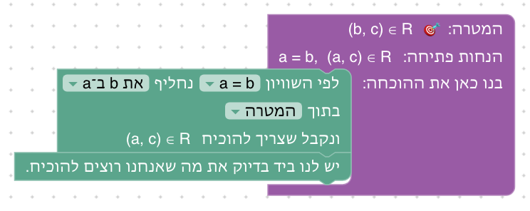
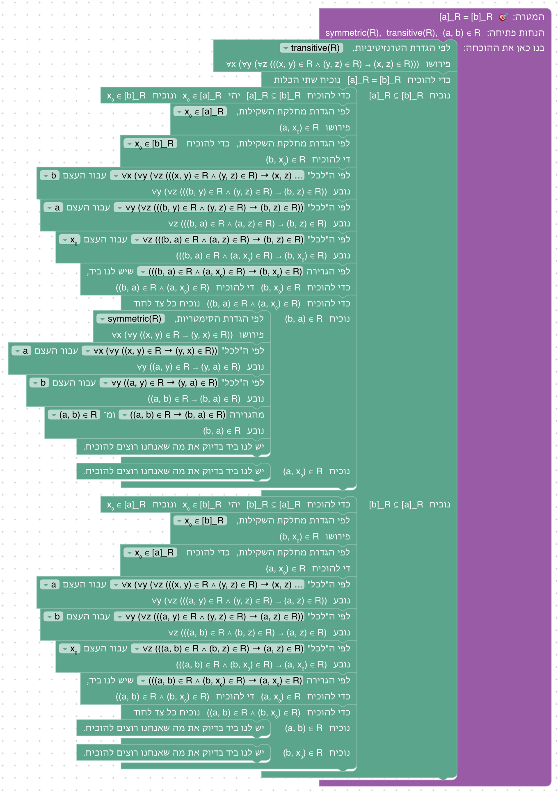
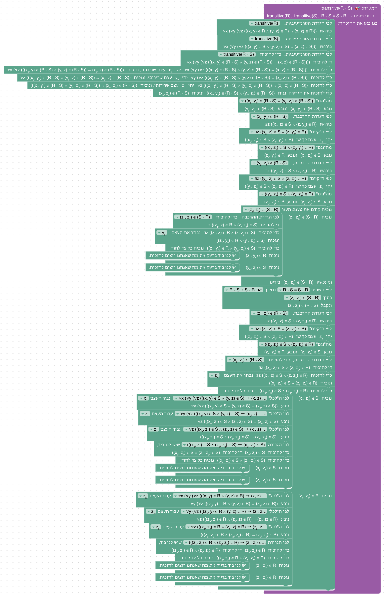

# יחידה 8 — שוויון ויחסים

**מטרה:** יחסים, כמו בקורס: יחס על העצמים הוא קבוצה של זוגות סדורים. היחידה מתחילה ביחס המוכר ביותר, השוויון, ובשני העקרונות שלו (כל דבר שווה לעצמו, ומותר להחליף שווה בשווה), ומראה שמהם נובע שהשוויון רפלקסיבי, סימטרי וטרנזיטיבי, כלומר יחס שקילות (8.1–8.4). אחר כך יחסים כלליים (8.5–8.14): היחס ההפוך, הרכבה, התכונות של יחס (רפלקסיביות, סימטריות, טרנזיטיביות ואנטי־סימטריות), מינימום, ומחלקות שקילות. הסטודנט רואה שיחס הוא קבוצה, ולכן כל המהלכים של יחידות 6–7 עובדים עליו (הכלה, שוויון בשתי הכלות, מהלך ההגדרה), שהאיבר של יחס הוא זוג, ושאחרי פתיחת ההגדרות נשארת נוסחה עם כמתים, שמוכיחים במהלכים של יחידה 4. שני העקרונות של השוויון הם הכללים =I ו־=E של forall x (פרק 39), והיחסים בנויים לפי Logic and Proof (פרקים 13–14) ו־How To Prove It (פרק 4).

## המהלכים

ביחידה שני מהלכים חדשים, של השוויון: שוויון לפי ההגדרה (8.1) והחלפה לפי שוויון (8.2). ביחסים אין מהלך חדש: מהלך ההגדרה של יחידות 6–7 פותח גם את ההגדרות של היחסים, ומהלך הוכחת ההכלה לוקח זוג כשהקבוצות הן יחסים. בטבלה המהלכים כפי שהם נקראים אחרי שהם במקומם, עם דוגמאות מהשלבים; בסוגריים המרובעים מה שבוחרים מהרשימה.

| מהלך (כשהוא במקומו) | Lean | לפני → אחרי |
|---|---|---|
| **שוויון לפי ההגדרה (חדש):** שני הצדדים שווים לפי ההגדרה. | `rfl` | `⊢ a = a` ⟶ סגור |
| **החלפה לפי שוויון (חדש), בטענה שבידינו:** לפי השוויון [a = b] נחליף [את a ב־b] בתוך [(a, c) ∈ R], ונקבל (b, c) ∈ R | `have := ‹(a, c) ∈ R›`, ואחריו `rewrite [‹a = b›] at this` | `a = b, (a, c) ∈ R ⊢ (b, c) ∈ R` ⟶ `a = b, (a, c) ∈ R, (b, c) ∈ R ⊢ (b, c) ∈ R` |
| **החלפה לפי שוויון, במטרה:** לפי השוויון [a = b] נחליף [את a ב־b] בתוך [המטרה], ונקבל שצריך להוכיח b = b | `rewrite [‹a = b›]` (ובכיוון השני `rewrite [← ‹a = b›]`) | `a = b ⊢ b = a` ⟶ `a = b ⊢ b = b` |
| **הוכחת הכלה של יחסים:** כדי להוכיח R ⊆ R ∘ R יהי (x₀, y₀) ∈ R ונוכיח (x₀, y₀) ∈ (R ∘ R) | `first \| refine easylean_subset_intro_pair (fun x₀ y₀ _ => ?_) \| refine easylean_subset_intro (fun x₀ _ => ?_)` | `⊢ R ⊆ R ∘ R` ⟶ עצמים חדשים x₀, y₀, `(x₀, y₀) ∈ R ⊢ (x₀, y₀) ∈ (R ∘ R)` |
| **לפי ההגדרה, על טענה שבידינו:** לפי הגדרת היחס ההפוך, [(x₀, y₀) ∈ (R ∘ S)⁻¹] פירושו (y₀, x₀) ∈ (R ∘ S) | `first \| (guard_target =ₛ …; apply easylean_mem_inv.mpr) \| (have := easylean_mem_inv.mp ‹(x₀, y₀) ∈ (R ∘ S)⁻¹›)` | `(x₀, y₀) ∈ (R ∘ S)⁻¹` ⟶ גם `(y₀, x₀) ∈ (R ∘ S)` |
| **לפי ההגדרה, על המטרה:** לפי הגדרת ההרכבה, כדי להוכיח [(x₀, y₀) ∈ (R ∘ R)] די להוכיח ∃z ((x₀, z) ∈ R ∧ (z, y₀) ∈ R) | אותו קוד, עם `easylean_mem_comp` | `⊢ (x₀, y₀) ∈ (R ∘ R)` ⟶ `⊢ ∃z ((x₀, z) ∈ R ∧ (z, y₀) ∈ R)` |
| **לפי ההגדרה, על תכונה של יחס:** לפי הגדרת הרפלקסיביות, [reflexive(R)] פירושו ∀x ((x, x) ∈ R) | אותו קוד, עם `easylean_reflexive` | `reflexive(R) ⊢ …` ⟶ גם `∀x ((x, x) ∈ R)` |

לפני שהבלוקים במקומם הם כתובים באופן כללי: "שני הצדדים שווים לפי ההגדרה.", "לפי השוויון ? נחליף ... בתוך ...", "כדי להוכיח הכלה: יהי איבר של הקבוצה המוכלת, ונוכיח שהוא שייך לקבוצה המכילה", "לפי ההגדרה, ?".

ההגדרות של היחידה, כפי שמהלך ההגדרה כותב אותן (בשלבים משתמשים גם בהגדרת החיתוך מיחידה 6):

| הגדרה (כפי שהמהלך כותב) | טענה | פירושה | Lean | שלב |
|---|---|---|---|---|
| היחס ההפוך | `(x, y) ∈ R⁻¹` | `(y, x) ∈ R` | `Set.inv`, `easylean_mem_inv` | 8.5 |
| ההרכבה | `(x, y) ∈ (R ∘ S)` | `∃z ((x, z) ∈ S ∧ (z, y) ∈ R)` | `Set.comp`, `easylean_mem_comp` | 8.6 |
| הרפלקסיביות | `reflexive(R)` | `∀x ((x, x) ∈ R)` | `reflexive`, `easylean_reflexive` | 8.7 |
| הסימטריות | `symmetric(R)` | `∀x (∀y ((x, y) ∈ R → (y, x) ∈ R))` | `symmetric`, `easylean_symmetric` | 8.8 |
| הטרנזיטיביות | `transitive(R)` | `∀x (∀y (∀z (((x, y) ∈ R ∧ (y, z) ∈ R) → (x, z) ∈ R)))` | `transitive`, `easylean_transitive` | 8.9 |
| האנטי־סימטריות | `antisymmetric(R)` | `∀x (∀y (((x, y) ∈ R ∧ (y, x) ∈ R) → x = y))` | `antisymmetric`, `easylean_antisymmetric` | 8.10 |
| מחלקת השקילות | `x ∈ [a]_R` | `(a, x) ∈ R` | `Set.cls`, `easylean_mem_cls` | 8.12 |

**מהלכים מיחידות קודמות** שבארגז של שלבים ביחידה הזאת: "יש לנו ביד בדיוק את מה שאנחנו רוצים להוכיח." (יחידה 0); הנחת התנאי, גרירה קדימה וגרירה אחורה (יחידה 1); שימוש ב"וגם", הוכחת "וגם" והוכחת "אם ורק אם" (יחידה 2); הוכחת "לכל", שימוש ב"לכל", הוכחת "קיים" ושימוש ב"קיים" (יחידה 4); הוכחת הכלה, שימוש בהכלה, שוויון קבוצות ולפי ההגדרה (יחידה 6); וטענת עזר (יחידה 7).

**יחסים כקבוצות של זוגות.** ההגדרות נמצאות ב־`RELATION_PRELUDE` (`frontend/src/generator/lean.js`), שנטען אחרי `SET_PRELUDE` בשלבים שמשתמשים ביחסים (`level.usesRelations`). יחס על העצמים הוא `Set (obj × obj)`: קבוצה, ולכן ⊆, ∩, = והמהלכים שלהם הם אלה של יחידה 6, בלי שום תוספת. היחס ההפוך (`R⁻¹`, `postfix:max`), ההרכבה (`R ∘ S`, `infixr:90`) ומחלקת השקילות (`[a]_R`) הן פעולות על קבוצות, כמו החיתוך, וכל אחת מהן באה עם למה `easylean_mem_*` שמוכחת ב־`Iff.rfl`. התכונות של יחס (`reflexive R` וכן הלאה) הן הגדרות (`def`), שגם להן יש למה כזאת (`easylean_reflexive` וכן הלאה), וכך אותו מהלך הגדרה פותח את כולן: הוא מזהה תכונה לפי השם שלה, ושייכות לפי הפעולה הראשית של הקבוצה (`unfoldMembership` ב־`frontend/src/game/formatProofGoal.js`).

**הכלה של יחסים: האיבר הוא זוג.** כשהקבוצות בהכלה הן יחסים, מהלך הוכחת ההכלה כותב "יהי (x₀, y₀) ∈ R" ולא "יהי x₀ ∈ R" (`elementName` ו־`isRelationSet` ב־`frontend/src/blocks/moves.js`), וב־Lean הוא משתמש בלמה `easylean_subset_intro_pair` (ב־`SET_PRELUDE`), שמפרקת את הזוג לשני עצמים. הקוד מנסה קודם את הזוג, ורק אם הלמה לא מתאימה (הקבוצות אינן יחסים) לוקח איבר אחד: `first | refine easylean_subset_intro_pair (fun x₀ y₀ _ => ?_) | refine easylean_subset_intro (fun x₀ _ => ?_)`. כך הקוד נכון גם לפני שמצב ההוכחה הגיע, כשהבלוק עוד לא יודע שהקבוצות הן יחסים. כך בידינו שני עצמים, x₀ ו־y₀, שאפשר להציב אותם ב"לכל" ולבחור אותם כעדים, ולא זוג `p` עם `p.1` ו־`p.2`. מחלקת שקילות היא קבוצה של עצמים, ולכן בהכלה של מחלקות האיבר הוא עצם: "יהי x₀ ∈ [a]_R".

**תצוגה.** במצב ההוכחה היחסים מוצגים בשורה נפרדת, "יחסים: R, S", כמו "קבוצות:" ביחידה 6. תכונה של יחס נכתבת כמופעלת, reflexive(R), כמו הפונקציות של יחידה 10. ההרכבה נכתבת לפי אותו כלל כמו הפעולות של יחידה 6: אחרי ∈ היא בסוגריים, (x₀, y₀) ∈ (R ∘ S), ואחרי ⊆ ו־= בלי סוגריים, R ∘ R ⊆ R. היא קושרת חזק מ־∩ ו־∪, ומימין: R ∘ S ∘ T הוא R ∘ (S ∘ T). את ההפוך של ההפוך Lean כותב `R⁻¹⁻¹`, והתצוגה כותבת (R⁻¹)⁻¹. היחס ההפוך ומחלקת השקילות לא נכתבים בסוגריים אחרי ∈: (x₀, y₀) ∈ R⁻¹, x₀ ∈ [a]_R.

## שלבים

לכל שלב: מה לומדים בו, למה הוא בנוי כך, איך אנחנו רוצים שסטודנטים יפתרו אותו, ושיקולים ושאלות שעוד צריך להכריע. צילומי הפתרונות נוצרים מ־`frontend/e2e/solutions.js` (ראו [יחידה 0](00-getting-started.md#שלבים)). בכל שלב בארגז רק המהלכים של הפתרונות שלו.

**סדר היחידה.** שוויון (8.1–8.4): רפלקסיביות, החלפה, סימטריה וטרנזיטיביות, ובסופן "השוויון הוא יחס שקילות". אחר כך יחסים: היחס ההפוך (8.5) והרכבה (8.6), שהן פעולות על יחסים; התכונות של יחס, כל אחת בשלב משלה וכל אחת מנוסחת מחדש כהכלה של יחסים (8.7–8.9) או כתכונה שעוברת לחיתוך (8.10); מינימום בסדר חלקי (8.11); מחלקות שקילות (8.12–8.13); ובונוס (8.14), שאלה ממבחן שמשלבת הרכבה, טרנזיטיביות והחלפה לפי שוויון של יחסים.

**הוחלט: יחסים כקבוצות של זוגות.** בקורס יחס הוא קבוצה של זוגות סדורים, R ⊆ A × A, ו־(x, y) ∈ R פירושו ש־x ביחס R ל־y. מחבר הקורס בחר בזה, ולא בכתיבה של יחס כטענה על שני עצמים, R(x,y) (כמו בשלבים 12.3–12.4, שנכתבו לפני היחידה). היתרונות: זה הכתיב של הקורס; יחס הוא קבוצה, ולכן חיתוך, איחוד, הכלה ושוויון של יחסים הם הפעולות של יחידה 6, והמהלכים שלהן עובדים כמו שהם; ותכונה כמו "R סימטרי" אפשר לנסח כהכלה, R⁻¹ ⊆ R (8.8). המחיר: האיבר של יחס הוא זוג, ולכן מהלך הוכחת ההכלה צריך לפרק אותו (ראו למעלה). כל היחסים ביחידה הם על תחום אחד, העצמים (`Set (obj × obj)`); יחס בין שתי קבוצות שונות, ומכפלה קרטזית A × B כקבוצה, לא נכללו.

**הוחלט: סדר ההרכבה.** R ∘ S היא "קודם S, ואחר כך R": (x, y) ∈ R ∘ S פירושו ∃z ((x, z) ∈ S ∧ (z, y) ∈ R). זה הסדר של הקורס, והוא גם הסדר של הרכבת פונקציות ביחידה 9 ((g ∘ f)(x) = g(f(x)): קודם f). יש ספרים שכותבים את ההרכבה בסדר ההפוך, ולכן ההגדרה כתובה במפורש בכרטיס של שלב 8.6 ובטקסט הפתיחה שלו ("קודם S, ואחר כך R"), והמהלך כותב אותה בכל פעם שפותחים אותה. השלבים בנויים כך שהסדר משנה: ב־8.6 הסדר של ההפוכים מתהפך, (R ∘ S)⁻¹ ⊆ S⁻¹ ∘ R⁻¹, וב־8.14 השוויון R ∘ S = S ∘ R הוא הנחה, ולא דבר שנכון תמיד.

**הוחלט: השוויון בתחילת יחידת היחסים, ונכתב מחדש.** לבקשת מחבר הקורס, סדר היחידות הוא עכשיו של תכנון הסמסטר: קבוצות, יחסים, פונקציות, אינדוקציה. קודם השוויון היה בתחילת יחידת האינדוקציה, ועל מספרים (y = x + 7 ⊢ 2 · y = 2 · (x + 7)); עכשיו הוא בתחילת יחידת היחסים, כי השוויון הוא היחס הראשון, והשלבים שלו נכתבו מחדש לפי התכונות של יחס: 8.1 הוא רפלקסיביות (a = a), 8.2 החלפה, בתוך טענה על יחס ((a, c) ∈ R ⊢ (b, c) ∈ R), 8.3 סימטריה ו־8.4 טרנזיטיביות, וטקסט הסיום של 8.4 אומר שהשוויון הוא יחס שקילות. הסימטריה, שקודם הוזכרה רק בטקסט הסיום של הטרנזיטיביות, היא עכשיו שלב משלה. השלב n + 0 = n, שהציג את "שני הצדדים שווים לפי ההגדרה" על מספרים, עבר ליחידת האינדוקציה (10.1), ושם המהלך כבר מוכר. יחידת האינדוקציה (10) משתמשת בשני המהלכים של השוויון כמו שהם.

**הוחלט: תכונות של יחס הן הגדרות.** רפלקסיביות, סימטריות, טרנזיטיביות ואנטי־סימטריות מוגדרות כמו הפעולות על קבוצות, ונפתחות באותו מהלך, "לפי ההגדרה": "לפי הגדרת הסימטריות, symmetric(R) פירושו ∀x (∀y ((x, y) ∈ R → (y, x) ∈ R))". כך הנחה כמו "R טרנזיטיבי" כתובה בשמה, כמו שכותבים בהוכחה, ופתיחת ההגדרה היא צעד גלוי שאחריו נשארת נוסחה עם כמתים. גם בשלבים שבהם התכונה היא הנחה (8.11–8.14) היא כתובה בשמה, ולא כנוסחה הפתוחה.

### שלב 8.1: שוויון הוא רפלקסיבי

`⊢ a = a` · עצמים: a · בארגז: שוויון לפי ההגדרה

**מה לומדים.** שהיחידה עוסקת ביחסים, ושהשוויון הוא היחס הראשון. העיקרון הראשון של השוויון: כל דבר שווה לעצמו, ושוויון ששני הצדדים שלו זהים מוכח מיד, במהלך "שני הצדדים שווים לפי ההגדרה.". טקסט הסיום קורא לזה בשם: השוויון *רפלקסיבי*.

**למה כך.** הטענה הפשוטה ביותר על שוויון, הכלל =I של forall x ("c = c"). התחום מופשט, כמו ביחידה 4, כדי שהשוויון לא ייראה כדבר של מספרים. השם "רפלקסיבי" מופיע כבר כאן, כדי שבשלב 8.7 הסטודנט יכיר את התכונה, ויראה שהשוויון הוא דוגמה לה.

**פתרון.** "שני הצדדים שווים לפי ההגדרה."

**שיקולים ושאלות להכרעה.**
- בשלב מהלך אחד, ואין בו מה לבחור. הוא בעיקר פתיחה של היחידה. אפשר לאחד אותו עם שלב 8.3, שבו המהלך סוגר את b = b.
- השם "לפי ההגדרה" מתאים יותר ל־n + 0 = n (10.1), שבו צריך לחשב את ההגדרה של החיבור. כאן אין הגדרה לחשב: a ו־a זהים. האם לקרוא למהלך אחרת בשלב הזה, או להסביר בטקסט ש"זהים" הוא המקרה הפשוט של "שווים לפי ההגדרה"?

### שלב 8.2: מחליפים שווה בשווה

`a = b, (a, c) ∈ R ⊢ (b, c) ∈ R` · עצמים: a, b, c · יחסים: R · בארגז: החלפה לפי שוויון, יש לנו ביד

**מה לומדים.** העיקרון השני של השוויון: מותר להחליף שווה בשווה (=E, חוק לייבניץ). ואיך בוחרים במהלך את השוויון, את ההחלפה ואת המקום: המטרה או טענה שבידינו. וגם, בדרך אגב, מה זה יחס: (a, c) ∈ R פירושו ש־a ביחס R ל־c ("a מכיר את c"); טקסט הפתיחה אומר שהיחסים יבואו בהרחבה מהשלב החמישי.

**למה כך.** הטענה היא החלפה בתוך טענה על יחס, כדי שהיחס יופיע כבר כאן, בלי הגדרות. יש שתי דרכים, והן נבדלות במקום ובכיוון: בטענה שבידינו מחליפים את a ב־b, ובמטרה את b ב־a. כך השלב מראה גם את הכיוון וגם את המקום, שהיו שני שלבים בסדר הקודם. ההחלפה מוצגת כהחלפה עצמה ("את a ב־b"), ולכן השאלה היא לא "שמאל או ימין" אלא מה מחליפים במה, ואיפה. טקסט הפתיחה מקשר להחלפה של יחידה 5: שם מחליפים טענה בטענה ששקולה לה, וכאן עצם בעצם ששווה לו.

**פתרון א: בטענה שבידינו.** "לפי השוויון a = b נחליף את a ב־b בתוך (a, c) ∈ R, ונקבל (b, c) ∈ R". (b, c) ∈ R מצטרפת למה שבידינו, ו"יש לנו ביד בדיוק את מה שאנחנו רוצים להוכיח."

**פתרון ב: במטרה.** "לפי השוויון a = b נחליף את b ב־a בתוך המטרה, ונקבל שצריך להוכיח (a, c) ∈ R", ו"יש לנו ביד...".

**שיקולים ושאלות להכרעה.**
- בבלוק שלושה שדות, וזה המהלך הראשון בקורס שבוחרים בו גם כיוון וגם מקום. כיוון שגוי מוסבר ("ב־… לא מופיע …, ולכן אין מה להחליף. אולי צריך להחליף בכיוון השני, או במקום אחר?"). כשההחלפה כתובה במפורש, טעות כזאת נראית כבר לפני הבדיקה; האם עדיין כדאי שהסטודנט ייתקל בה, למשל בטעות מתוכננת?
- בהחלפה בטענה שבידינו, (a, c) ∈ R נשארת ו־(b, c) ∈ R מתווספת, והבלוק כותב "ונקבל (b, c) ∈ R", כמו בספרים. האם צריך להסביר שהטענה הישנה נשארת בידינו?
- היחס מופיע כאן לפני ההגדרה שלו (8.5), ורק כ"טענה על זוג". האם זה מבלבל, או דווקא מכין את הקרקע? אפשרות אחרת: P(a) ⊢ P(b), כמו ביחידה 4, בלי יחס.

### שלב 8.3: שוויון הוא סימטרי

`a = b ⊢ b = a` · עצמים: a, b · בארגז: החלפה לפי שוויון, שוויון לפי ההגדרה

**מה לומדים.** שהשוויון *סימטרי*, ושזה נובע משני העקרונות: מחליפים במטרה, ואחר כך שני הצדדים זהים.

**למה כך.** forall x מראה שהסימטריה והטרנזיטיביות נובעות מ־=I ו־=E בלבד, וכאן רואים זאת בפועל: החלפה (8.2) ואחריה רפלקסיביות (8.1). זה גם תרגול של כיוון ההחלפה: הבחירה "את a ב־b" נותנת b = b, והבחירה "את b ב־a" נותנת a = a; שתיהן נסגרות. השלב לא היה בסדר הקודם (הסימטריה הוזכרה שם רק בטקסט סיום), ונוסף כדי שלכל אחת משלוש התכונות של יחס שקילות יהיה שלב.

**פתרון.** "לפי השוויון a = b נחליף את a ב־b בתוך המטרה, ונקבל שצריך להוכיח b = b", ו"שני הצדדים שווים לפי ההגדרה."

**שיקולים ושאלות להכרעה.**
- גם "את b ב־a" פותרת את השלב (המטרה נעשית a = a), אבל אין לה פתרון משלה ב־`solutions.js` ולא צילום. להוסיף אותה כפתרון ב?
- אפשר גם להחליף בטענה שבידינו: "את a ב־b בתוך a = b" נותן b = b, שלא עוזר; "את b ב־a" נותן a = a. זו דוגמה טובה לכך שלא כל החלפה מקדמת. האם להראות אותה בטקסט?

### שלב 8.4: שוויון הוא טרנזיטיבי

`a = b, b = c ⊢ a = c` · עצמים: a, b, c · בארגז: החלפה לפי שוויון, יש לנו ביד

**מה לומדים.** שהשוויון *טרנזיטיבי*, כתוצאה של העיקרון של החלפה. וטקסט הסיום מסכם את ארבעת השלבים: השוויון רפלקסיבי, סימטרי וטרנזיטיבי, ויחס עם שלוש התכונות האלה נקרא *יחס שקילות*.

**למה כך.** השלב שסוגר את השוויון ופותח את היחסים: שלוש התכונות שהוכחו לשוויון הן בדיוק התכונות שהשלבים הבאים מגדירים לכל יחס (8.7–8.9), ויחס שקילות חוזר ב־8.12–8.13. יש שתי דרכים, לפי השוויון שבוחרים.

**פתרון א: את a ב־b.** "לפי השוויון a = b נחליף את a ב־b בתוך המטרה, ונקבל שצריך להוכיח b = c", וזה בידינו: "יש לנו ביד...".

**פתרון ב: את c ב־b.** "לפי השוויון b = c נחליף את c ב־b בתוך המטרה, ונקבל שצריך להוכיח a = b", ו"יש לנו ביד...".

**שיקולים ושאלות להכרעה.**
- שרשרת מתקבלת כאן מהחלפות רצופות. האם צריך מהלך נפרד לשרשרת "a = b = c", כמו ב־Waterproof וב־Verbose Lean?
- טקסט הסיום אומר "יחס עם שלוש התכונות האלה נקרא יחס שקילות" לפני שהיחס הוגדר (8.5). אפשר להעביר את המשפט לשלב 8.12, שבו יחס שקילות מוגדר, ולהשאיר כאן רק את שלוש התכונות.

### שלב 8.5: היחס ההפוך

`⊢ (R⁻¹)⁻¹ = R` · יחסים: R · בארגז: שוויון קבוצות, הוכחת הכלה, לפי ההגדרה, יש לנו ביד

**מה לומדים.** מה זה יחס: קבוצה של זוגות סדורים. מה זה היחס ההפוך: (x, y) ∈ R⁻¹ פירושו (y, x) ∈ R. ושכל מה שנלמד על קבוצות עובד על יחסים: שוויון בשתי הכלות, הכלה בעזרת איבר, ופתיחת הגדרות; רק שהאיבר הוא זוג, "יהי (x₀, y₀)".

**למה כך.** הטענה הפשוטה ביותר על יחס הפוך, והוכחה שכולה מהלכים מוכרים מיחידה 6, כך שהחדש הוא רק היחס, ההגדרה שלו והזוג. בכל הכלה פותחים את אותה הגדרה פעמיים, זו אחר זו: בהכלה הראשונה בטענה שבידינו, ובשנייה במטרה, כמו בשלבים 6.3–6.4. כרטיס "הכלה של יחסים" (`pairsInfo`) אומר שהבלוק של הוכחת ההכלה הוא אותו בלוק, ושהפעם הוא לוקח זוג.

**פתרון.** "כדי להוכיח (R⁻¹)⁻¹ = R נוכיח שתי הכלות". בחלק "נוכיח (R⁻¹)⁻¹ ⊆ R": "כדי להוכיח (R⁻¹)⁻¹ ⊆ R יהי (x₀, y₀) ∈ (R⁻¹)⁻¹ ונוכיח (x₀, y₀) ∈ R", "לפי הגדרת היחס ההפוך, (x₀, y₀) ∈ (R⁻¹)⁻¹ פירושו (y₀, x₀) ∈ R⁻¹", "לפי הגדרת היחס ההפוך, (y₀, x₀) ∈ R⁻¹ פירושו (x₀, y₀) ∈ R", ו"יש לנו ביד...". בחלק "נוכיח R ⊆ (R⁻¹)⁻¹": "יהי (x₀, y₀) ∈ R ונוכיח (x₀, y₀) ∈ (R⁻¹)⁻¹", "לפי הגדרת היחס ההפוך, כדי להוכיח (x₀, y₀) ∈ (R⁻¹)⁻¹ די להוכיח (y₀, x₀) ∈ R⁻¹", "לפי הגדרת היחס ההפוך, כדי להוכיח (y₀, x₀) ∈ R⁻¹ די להוכיח (x₀, y₀) ∈ R", ו"יש לנו ביד...". 9 בלוקים.

**שיקולים ושאלות להכרעה.**
- בתפריט של מהלך ההגדרה מופיעה גם המטרה, אבל ל־(x₀, y₀) ∈ R אין הגדרה, ולכן היא לא ברשימה. כמו ב־6.4, הסטודנט צריך לראות שההגדרה נפתחת לפי הפעולה החיצונית: ב־(R⁻¹)⁻¹ זה ההפוך החיצוני.
- (R⁻¹)⁻¹ מוצג בסוגריים, אף ש־Lean כותב R⁻¹⁻¹. האם הסטודנטים כותבים כך גם בקורס?

### שלב 8.6: הרכבה

`⊢ (R ∘ S)⁻¹ ⊆ S⁻¹ ∘ R⁻¹` · יחסים: R, S · בארגז: הוכחת הכלה, לפי ההגדרה, שימוש ב"קיים", שימוש ב"וגם", הוכחת "קיים", הוכחת "וגם", יש לנו ביד

**מה לומדים.** מה זו הרכבה של יחסים: R ∘ S היא קודם S ואחר כך R, ושייכות אליה היא "קיים" של תחנת ביניים. ושההפוך של הרכבה הוא ההרכבה של ההפוכים, בסדר ההפוך.

**למה כך.** ההגדרה של ההרכבה היא "קיים", ולכן משתמשים בה כמו ביחידה 4: מקבלים ממנה את תחנת הביניים z₀ בהנחה, ובוחרים אותה כעד במטרה, כמו בשלבים 7.5 ו־7.7. הטענה מכריחה לשים לב לסדר: בהנחה S בא קודם, ובמטרה R⁻¹ בא קודם. טקסט הסיום אומר שגם ההכלה ההפוכה נכונה, ונותן את הדימוי של גרביים ונעליים.

**פתרון.** "כדי להוכיח (R ∘ S)⁻¹ ⊆ S⁻¹ ∘ R⁻¹ יהי (x₀, y₀) ∈ (R ∘ S)⁻¹ ונוכיח (x₀, y₀) ∈ (S⁻¹ ∘ R⁻¹)", "לפי הגדרת היחס ההפוך, (x₀, y₀) ∈ (R ∘ S)⁻¹ פירושו (y₀, x₀) ∈ (R ∘ S)", "לפי הגדרת ההרכבה, (y₀, x₀) ∈ (R ∘ S) פירושו ∃z ((y₀, z) ∈ S ∧ (z, x₀) ∈ R)", "לפי ה"קיים" ∃z ((y₀, z) ∈ S ∧ (z, x₀) ∈ R) יהי z₀ עצם כך ש־((y₀, z₀) ∈ S ∧ (z₀, x₀) ∈ R)", ו"מה"וגם" … נובע (y₀, z₀) ∈ S ונובע (z₀, x₀) ∈ R". במטרה: "לפי הגדרת ההרכבה, כדי להוכיח (x₀, y₀) ∈ (S⁻¹ ∘ R⁻¹) די להוכיח ∃z ((x₀, z) ∈ R⁻¹ ∧ (z, y₀) ∈ S⁻¹)", "כדי להוכיח ∃z (…) נבחר את העצם z₀ ונוכיח ((x₀, z₀) ∈ R⁻¹ ∧ (z₀, y₀) ∈ S⁻¹)", ו"נוכיח כל צד לחוד". בחלק "נוכיח (x₀, z₀) ∈ R⁻¹": "לפי הגדרת היחס ההפוך, כדי להוכיח (x₀, z₀) ∈ R⁻¹ די להוכיח (z₀, x₀) ∈ R", ו"יש לנו ביד...". בחלק "נוכיח (z₀, y₀) ∈ S⁻¹": "… די להוכיח (y₀, z₀) ∈ S", ו"יש לנו ביד...". 12 בלוקים.

**שיקולים ושאלות להכרעה.**
- רק הכלה אחת. השוויון כולו כמעט כפול באורכו, וההכלה השנייה דומה. טקסט הסיום אומר שהיא נכונה.
- תחנת הביניים נקראת z₀, לפי המשתנה הקשור z. בהוכחה כתובה היא נקראת לפעמים z או c. השם עקבי עם יחידה 4.
- אין שלב שבו ההרכבה נפתחת לבדה, לפני שהיא משתלבת עם ההפוך. להקדים שלב קצר, למשל R ∘ (S ∘ T) ⊆ (R ∘ S) ∘ T (אסוציאטיביות), או שהוא ארוך מדי לשלב היכרות?

### שלב 8.7: יחס רפלקסיבי

`⊢ reflexive(R) → R ⊆ R ∘ R` · יחסים: R · בארגז: הנחת התנאי, לפי ההגדרה, הוכחת הכלה, הוכחת "קיים", הוכחת "וגם", שימוש ב"לכל", יש לנו ביד

**מה לומדים.** מה זה יחס רפלקסיבי, ושגם תכונה של יחס היא הגדרה, שנפתחת באותו מהלך: "לפי הגדרת הרפלקסיביות, reflexive(R) פירושו ∀x ((x, x) ∈ R)".

**למה כך.** תכונה ראשונה, בהוכחה קצרה שמשתמשת בה פעם אחת: בתחנת הביניים בוחרים את y₀, ואת הזוג (y₀, y₀) נותנת הרפלקסיביות, בהצבה ב"לכל". טקסט הפתיחה נותן את הרעיון ("אפשר לעבור מ־x₀ ל־y₀, ואחר כך להישאר ב־y₀"), וטקסט הסיום מכין את 8.9: ההכלה ההפוכה, R ∘ R ⊆ R, היא בדיוק טרנזיטיביות.

**פתרון.** "כדי להוכיח את הגרירה, נניח reflexive(R) ונוכיח R ⊆ R ∘ R", "לפי הגדרת הרפלקסיביות, reflexive(R) פירושו ∀x ((x, x) ∈ R)", "כדי להוכיח R ⊆ R ∘ R יהי (x₀, y₀) ∈ R ונוכיח (x₀, y₀) ∈ (R ∘ R)", "לפי הגדרת ההרכבה, כדי להוכיח (x₀, y₀) ∈ (R ∘ R) די להוכיח ∃z ((x₀, z) ∈ R ∧ (z, y₀) ∈ R)", "… נבחר את העצם y₀ ונוכיח ((x₀, y₀) ∈ R ∧ (y₀, y₀) ∈ R)", ו"נוכיח כל צד לחוד". בחלק "נוכיח (x₀, y₀) ∈ R": "יש לנו ביד...". בחלק "נוכיח (y₀, y₀) ∈ R": "לפי ה"לכל" ∀x ((x, x) ∈ R) עבור העצם y₀ נובע (y₀, y₀) ∈ R", ו"יש לנו ביד...". 9 בלוקים.

**שיקולים ושאלות להכרעה.**
- אפשר לבחור גם את x₀ כתחנת הביניים: אז הצד הראשון, (x₀, x₀) ∈ R, בא מהרפלקסיביות, והשני בידינו. אין לה פתרון משלה; להוסיף כפתרון ב?
- השלב לא אומר במפורש שהשוויון של 8.1 הוא יחס רפלקסיבי. ביחידה אין יחס השוויון כקבוצה של זוגות, ולכן אי אפשר לכתוב reflexive(=); טקסט הפתיחה יכול לפחות להזכיר את 8.1.

### שלב 8.8: יחס סימטרי

`⊢ symmetric(R) ↔ R⁻¹ ⊆ R` · יחסים: R · בארגז: הוכחת "אם ורק אם", הנחת התנאי, לפי ההגדרה, הוכחת הכלה, שימוש ב"לכל", גרירה קדימה, הוכחת "לכל", טענת עזר, שימוש בהכלה, יש לנו ביד · בתפריט של טענת העזר: `(y₀, x₀) ∈ R⁻¹`, `(x₀, y₀) ∈ R⁻¹`, `(y₀, x₀) ∈ R`

**מה לומדים.** מה זה יחס סימטרי, ושאפשר לנסח תכונה של יחס בלי כמתים, כהכלה של יחסים. ולהשתמש בתכונה פעם כהנחה (בהצבה של שני עצמים), ופעם כמטרה (בשני "יהי").

**למה כך.** שני הכיוונים מראים את שני הצדדים של אותה הגדרה. בכיוון →, הסימטריות היא הנחה, ומציבים בה את y₀ ואת x₀, בסדר הזה. בכיוון ←, הסימטריות היא מטרה, ואחרי פתיחת ההגדרה לוקחים x₀ ו־y₀ ומניחים (x₀, y₀) ∈ R. כדי להשתמש בהכלה R⁻¹ ⊆ R צריך בידינו זוג ב־R⁻¹, ואף מהלך אחר לא נותן אותו: זה המקום לטענת עזר, כמו בשלב 7.3, וטקסט הפתיחה אומר זאת. בתפריט שלוש טענות: (x₀, y₀) ∈ R⁻¹ לא נכונה לפי מה שבידינו, ו־(y₀, x₀) ∈ R היא המטרה עצמה.

**פתרון.** "כדי להוכיח (symmetric(R) ↔ R⁻¹ ⊆ R) נוכיח את שני הכיוונים". בחלק "נוכיח (symmetric(R) → R⁻¹ ⊆ R)": "נניח symmetric(R) ונוכיח R⁻¹ ⊆ R", "לפי הגדרת הסימטריות, symmetric(R) פירושו ∀x (∀y ((x, y) ∈ R → (y, x) ∈ R))", "כדי להוכיח R⁻¹ ⊆ R יהי (x₀, y₀) ∈ R⁻¹ ונוכיח (x₀, y₀) ∈ R", "לפי הגדרת היחס ההפוך, (x₀, y₀) ∈ R⁻¹ פירושו (y₀, x₀) ∈ R", "לפי ה"לכל" … עבור העצם y₀ נובע ∀y ((y₀, y) ∈ R → (y, y₀) ∈ R)", "… עבור העצם x₀ נובע ((y₀, x₀) ∈ R → (x₀, y₀) ∈ R)", "מהגרירה (y₀, x₀) ∈ R → (x₀, y₀) ∈ R ומ־(y₀, x₀) ∈ R נובע (x₀, y₀) ∈ R", ו"יש לנו ביד...". בחלק "נוכיח (R⁻¹ ⊆ R → symmetric(R))": "נניח R⁻¹ ⊆ R ונוכיח symmetric(R)", "לפי הגדרת הסימטריות, כדי להוכיח symmetric(R) די להוכיח ∀x (∀y ((x, y) ∈ R → (y, x) ∈ R))", "יהי x₀ עצם שרירותי, ונוכיח ∀y (…)", "יהי y₀ עצם שרירותי, ונוכיח ((x₀, y₀) ∈ R → (y₀, x₀) ∈ R)", "נניח (x₀, y₀) ∈ R ונוכיח (y₀, x₀) ∈ R", ו"נוכיח קודם את טענת העזר (y₀, x₀) ∈ R⁻¹"; בחלק שלה: "לפי הגדרת היחס ההפוך, כדי להוכיח (y₀, x₀) ∈ R⁻¹ די להוכיח (x₀, y₀) ∈ R", ו"יש לנו ביד..."; "ומעכשיו (y₀, x₀) ∈ R⁻¹ בידינו". לבסוף "לפי ההכלה R⁻¹ ⊆ R ומ־(y₀, x₀) ∈ R⁻¹ נובע (y₀, x₀) ∈ R", ו"יש לנו ביד...". 19 בלוקים.

**שיקולים ושאלות להכרעה.**
- טקסט הסיום אומר שאז גם R⁻¹ = R. אפשר להפוך את זה לשלב, או לתרגיל ביחידה 12.
- הארגז גדול (10 מהלכים), ובשני הכיוונים מהלכים שונים. אפשר לפצל לשני שלבים, כיוון בכל אחד, כמו שהוצע ל־5.3.
- ההצבה בסדר y₀ ואחר כך x₀ היא המקום שבו קל לטעות (הצבה בסדר ההפוך נותנת גרירה שלא עוזרת). הרמז אומר את הסדר; האם להשאיר את זה לסטודנט?

### שלב 8.9: יחס טרנזיטיבי

`⊢ transitive(R) ↔ R ∘ R ⊆ R` · יחסים: R · בארגז: הוכחת "אם ורק אם", הנחת התנאי, לפי ההגדרה, הוכחת הכלה, שימוש ב"קיים", שימוש ב"לכל", גרירה קדימה, הוכחת "לכל", שימוש ב"וגם", טענת עזר, הוכחת "קיים", הוכחת "וגם", שימוש בהכלה, יש לנו ביד · בתפריט של טענת העזר: `(x₀, z₀) ∈ (R ∘ R)`, `(x₀, y₀) ∈ (R ∘ R)`, `(y₀, z₀) ∈ (R ∘ R)`

**מה לומדים.** מה זה יחס טרנזיטיבי, וניסוח שלו כהכלה: R ∘ R ⊆ R. והצבה של שלושה עצמים ב"לכל", בסדר הנכון.

**למה כך.** אותו מבנה כמו 8.8, עם תכונה ששלושה משתנים בה, והגדרה (ההרכבה) שהיא "קיים". בכיוון →, תחנת הביניים z₀ באה מה"קיים", ומציבים בטרנזיטיביות את x₀, z₀ ו־y₀, בסדר הזה. בכיוון ←, טענת העזר היא שהזוג (x₀, z₀) נמצא ב־R ∘ R, עם y₀ כתחנת ביניים; אחר כך ההכלה נותנת את המטרה. יחד עם 8.7, טקסט הסיום אומר שביחס רפלקסיבי וטרנזיטיבי R ∘ R = R.

**פתרון.** "כדי להוכיח (transitive(R) ↔ R ∘ R ⊆ R) נוכיח את שני הכיוונים". בחלק "נוכיח (transitive(R) → R ∘ R ⊆ R)": "נניח transitive(R) ונוכיח R ∘ R ⊆ R", "לפי הגדרת הטרנזיטיביות, transitive(R) פירושו ∀x (∀y (∀z (((x, y) ∈ R ∧ (y, z) ∈ R) → (x, z) ∈ R)))", "כדי להוכיח R ∘ R ⊆ R יהי (x₀, y₀) ∈ (R ∘ R) ונוכיח (x₀, y₀) ∈ R", "לפי הגדרת ההרכבה, (x₀, y₀) ∈ (R ∘ R) פירושו ∃z ((x₀, z) ∈ R ∧ (z, y₀) ∈ R)", "לפי ה"קיים" … יהי z₀ עצם כך ש־((x₀, z₀) ∈ R ∧ (z₀, y₀) ∈ R)", שלוש הצבות ב"לכל", עבור x₀, z₀ ו־y₀, עד ש"נובע (((x₀, z₀) ∈ R ∧ (z₀, y₀) ∈ R) → (x₀, y₀) ∈ R)", "מהגרירה … ומ־((x₀, z₀) ∈ R ∧ (z₀, y₀) ∈ R) נובע (x₀, y₀) ∈ R", ו"יש לנו ביד...". בחלק "נוכיח (R ∘ R ⊆ R → transitive(R))": "נניח R ∘ R ⊆ R ונוכיח transitive(R)", "לפי הגדרת הטרנזיטיביות, כדי להוכיח transitive(R) די להוכיח ∀x (∀y (∀z (…)))", שלוש פעמים "יהי … עצם שרירותי" (x₀, y₀, z₀), "נניח ((x₀, y₀) ∈ R ∧ (y₀, z₀) ∈ R) ונוכיח (x₀, z₀) ∈ R", "מה"וגם" … נובע (x₀, y₀) ∈ R ונובע (y₀, z₀) ∈ R", ו"נוכיח קודם את טענת העזר (x₀, z₀) ∈ (R ∘ R)"; בחלק שלה: "לפי הגדרת ההרכבה, כדי להוכיח (x₀, z₀) ∈ (R ∘ R) די להוכיח ∃z ((x₀, z) ∈ R ∧ (z, z₀) ∈ R)", "נבחר את העצם y₀ ונוכיח ((x₀, y₀) ∈ R ∧ (y₀, z₀) ∈ R)", "נוכיח כל צד לחוד", ובכל צד "יש לנו ביד..."; "ומעכשיו (x₀, z₀) ∈ (R ∘ R) בידינו". לבסוף "לפי ההכלה R ∘ R ⊆ R ומ־(x₀, z₀) ∈ (R ∘ R) נובע (x₀, z₀) ∈ R", ו"יש לנו ביד...". 26 בלוקים.

**שיקולים ושאלות להכרעה.**
- ארוך (26 בלוקים), ו־14 מהלכים בארגז. שש מההצבות וההנחות הן "יהי" ו"לפי ה"לכל"" אחד אחרי השני. מהלך שמציב כמה עצמים בבת אחת ("עבור x₀, z₀, y₀"), או שלוקח כמה עצמים שרירותיים בבת אחת, יקצר את השלב, ואת 8.12–8.14 ו־12.4 (ראו "הצבה של כמה עצמים" בסוף).
- אפשר לפצל לשני שלבים, כיוון בכל אחד.

### שלב 8.10: אנטי־סימטריות של חיתוך

`⊢ antisymmetric(R) → antisymmetric(R ∩ S)` · יחסים: R, S · בארגז: הנחת התנאי, לפי ההגדרה, הוכחת "לכל", שימוש ב"וגם", שימוש ב"לכל", גרירה אחורה, הוכחת "וגם", יש לנו ביד

**מה לומדים.** מה זה יחס אנטי־סימטרי (למשל ≤), ושאנטי־סימטריות עוברת ליחס קטן יותר. ושיחס הוא קבוצה: החיתוך של שני יחסים הוא החיתוך של יחידה 6, ונפתח באותה הגדרה.

**למה כך.** הצעד שמוכיח שחיתוך של סדרים חלקיים הוא סדר חלקי, כמו שטקסט הפתיחה והסיום אומרים. המסקנה של האנטי־סימטריות היא שוויון, x₀ = y₀, ולכן משתמשים בה אחורה: כדי להוכיח x₀ = y₀ די להוכיח את ה"וגם". ההגדרה נפתחת פעמיים באותו שלב, פעם כהנחה ופעם כמטרה, וההגדרה של החיתוך נפתחת פעמיים בתוך ההוכחה.

**פתרון.** "כדי להוכיח את הגרירה, נניח antisymmetric(R) ונוכיח antisymmetric(R ∩ S)", "לפי הגדרת האנטי־סימטריות, antisymmetric(R) פירושו ∀x (∀y (((x, y) ∈ R ∧ (y, x) ∈ R) → x = y))", "לפי הגדרת האנטי־סימטריות, כדי להוכיח antisymmetric(R ∩ S) די להוכיח ∀x (∀y (((x, y) ∈ (R ∩ S) ∧ (y, x) ∈ (R ∩ S)) → x = y))", "יהי x₀ עצם שרירותי…", "יהי y₀ עצם שרירותי…", "נניח ((x₀, y₀) ∈ (R ∩ S) ∧ (y₀, x₀) ∈ (R ∩ S)) ונוכיח x₀ = y₀", "מה"וגם" … נובע (x₀, y₀) ∈ (R ∩ S) ונובע (y₀, x₀) ∈ (R ∩ S)", "לפי הגדרת החיתוך, (x₀, y₀) ∈ (R ∩ S) פירושו ((x₀, y₀) ∈ R ∧ (x₀, y₀) ∈ S)" ו"מה"וגם"", ואותו דבר עם (y₀, x₀). אחר כך "לפי ה"לכל" … עבור העצם x₀", ואחריו עבור y₀, עד ש"נובע (((x₀, y₀) ∈ R ∧ (y₀, x₀) ∈ R) → x₀ = y₀)", "לפי הגרירה … שיש לנו ביד, כדי להוכיח x₀ = y₀ די להוכיח ((x₀, y₀) ∈ R ∧ (y₀, x₀) ∈ R)", "נוכיח כל צד לחוד", ובכל צד "יש לנו ביד...". 17 בלוקים.

**שיקולים ושאלות להכרעה.**
- טקסט הסיום אומר שבחיתוך של שני סדרים חלקיים גם הרפלקסיביות והטרנזיטיביות נשמרות. הטרנזיטיביות היא שלב 12.4 (שם היחסים כתובים כטענות); הרפלקסיביות לא מוכחת באף שלב.
- אין ביחידה "סדר חלקי" כהגדרה, ולא סדר מלא. האם להוסיף הגדרה partialOrder(R), או שמספיק לדבר עליו בטקסט?

### שלב 8.11: המינימום יחיד

`antisymmetric(R), ∀x ((m, x) ∈ R), ∀x ((n, x) ∈ R) ⊢ m = n` · עצמים: m, n · יחסים: R · בארגז: לפי ההגדרה, שימוש ב"לכל", גרירה אחורה, הוכחת "וגם", יש לנו ביד

**מה לומדים.** מה זה מינימום של יחס סדר, ושביחס אנטי־סימטרי יש לכל היותר מינימום אחד; לכן מדברים על "המינימום".

**למה כך.** שימוש באנטי־סימטריות בלי ה"לכל" של המטרה: היא הנחה, ומציבים בה את העצמים הנתונים m ו־n. כל צד של ה"וגם" בא מהצבה באחת ההנחות על המינימום, כך שהשלב מתרגל הצבה ב"לכל" בשלושה מקומות. השלב קצר מ־8.10, ומראה שימוש של התכונה במקום הוכחה שלה. המינימום לא מוגדר כהגדרה, אלא כתוב כנוסחה, ∀x ((m, x) ∈ R).

**פתרון.** "לפי הגדרת האנטי־סימטריות, antisymmetric(R) פירושו ∀x (∀y (((x, y) ∈ R ∧ (y, x) ∈ R) → x = y))", "לפי ה"לכל" … עבור העצם m נובע ∀y (((m, y) ∈ R ∧ (y, m) ∈ R) → m = y)", "… עבור העצם n נובע (((m, n) ∈ R ∧ (n, m) ∈ R) → m = n)", "לפי הגרירה … שיש לנו ביד, כדי להוכיח m = n די להוכיח ((m, n) ∈ R ∧ (n, m) ∈ R)", ו"נוכיח כל צד לחוד". בחלק "נוכיח (m, n) ∈ R": "לפי ה"לכל" ∀x ((m, x) ∈ R) עבור העצם n נובע (m, n) ∈ R", ו"יש לנו ביד...". בחלק "נוכיח (n, m) ∈ R": "לפי ה"לכל" ∀x ((n, x) ∈ R) עבור העצם m נובע (n, m) ∈ R", ו"יש לנו ביד...". 9 בלוקים.

**שיקולים ושאלות להכרעה.**
- להגדיר "מינימום" כהגדרה (minimum(m, R)), שנפתחת במהלך ההגדרה, כמו התכונות? כך ההנחות ייכתבו בשמן, כמו antisymmetric(R).
- בכרטיס השלב, תחת "הנחות", לא מופיעות ההנחות של השלב (`assumptions` ריק), אף שהן במצב ההוכחה. כך גם ב־8.2, 8.3 ו־8.12–8.14.

### שלב 8.12: מחלקות שקילות

`symmetric(R), transitive(R), (a, b) ∈ R ⊢ [a]_R = [b]_R` · עצמים: a, b · יחסים: R · בארגז: לפי ההגדרה, שוויון קבוצות, הוכחת הכלה, שימוש ב"לכל", גרירה אחורה, הוכחת "וגם", גרירה קדימה, יש לנו ביד

**מה לומדים.** מה זה יחס שקילות (רפלקסיבי, סימטרי וטרנזיטיבי), ומה זו מחלקת שקילות: [a]_R היא קבוצת העצמים ש־a ביחס אליהם, ו־x ∈ [a]_R פירושו (a, x) ∈ R. ושאם a ביחס ל־b, יש להם אותה מחלקה.

**למה כך.** מחלקת שקילות היא קבוצה של עצמים, ולכן השוויון שלה מוכח בשתי הכלות, כמו ביחידה 6, והאיבר הוא עצם, x₀, ולא זוג. בכל הכלה משתמשים בטרנזיטיביות אחורה, ובהכלה הראשונה צריך גם את הסימטריות, כדי להפוך את (a, b) ∈ R ל־(b, a) ∈ R. הרפלקסיביות לא נחוצה, וטקסט הפתיחה אומר זאת. את הטרנזיטיביות פותחים פעם אחת, לפני שתי ההכלות, כך שהיא בידינו בשתיהן.

**פתרון.** "לפי הגדרת הטרנזיטיביות, transitive(R) פירושו ∀x (∀y (∀z (…)))", ו"כדי להוכיח [a]_R = [b]_R נוכיח שתי הכלות". בחלק "נוכיח [a]_R ⊆ [b]_R": "יהי x₀ ∈ [a]_R ונוכיח x₀ ∈ [b]_R", "לפי הגדרת מחלקת השקילות, x₀ ∈ [a]_R פירושו (a, x₀) ∈ R", "לפי הגדרת מחלקת השקילות, כדי להוכיח x₀ ∈ [b]_R די להוכיח (b, x₀) ∈ R", הצבה בטרנזיטיביות של b, a ו־x₀, עד ש"נובע (((b, a) ∈ R ∧ (a, x₀) ∈ R) → (b, x₀) ∈ R)", "לפי הגרירה … שיש לנו ביד, כדי להוכיח (b, x₀) ∈ R די להוכיח ((b, a) ∈ R ∧ (a, x₀) ∈ R)", ו"נוכיח כל צד לחוד". בחלק "נוכיח (b, a) ∈ R": "לפי הגדרת הסימטריות, symmetric(R) פירושו ∀x (∀y ((x, y) ∈ R → (y, x) ∈ R))", הצבה של a ושל b, "מהגרירה (a, b) ∈ R → (b, a) ∈ R ומ־(a, b) ∈ R נובע (b, a) ∈ R", ו"יש לנו ביד...". בחלק "נוכיח (a, x₀) ∈ R": "יש לנו ביד...". בחלק "נוכיח [b]_R ⊆ [a]_R": "יהי x₀ ∈ [b]_R ונוכיח x₀ ∈ [a]_R", שתי פתיחות של הגדרת מחלקת השקילות ((b, x₀) ∈ R בידינו, ו"די להוכיח (a, x₀) ∈ R"), הצבה בטרנזיטיביות של a, b ו־x₀, גרירה אחורה, ו"נוכיח כל צד לחוד", ובכל צד "יש לנו ביד...". 26 בלוקים.

**שיקולים ושאלות להכרעה.**
- הסימטריות נפתחת בתוך החלק, ולכן היא לא בידינו בהכלה השנייה (שם היא לא נחוצה). מי שפותח אותה בהתחלה, כמו את הטרנזיטיביות, מקבל הוכחה מעט אחרת, נכונה גם היא.
- "יחס שקילות" לא מוגדר כהגדרה, וההנחות הן רק סימטריות וטרנזיטיביות. זה מדויק (הרפלקסיביות לא נחוצה), אבל הכותרת "מחלקות שקילות" מדברת על יחס שקילות. להוסיף הגדרה equivalence(R), שנפתחת ל"וגם" של שלוש התכונות?

### שלב 8.13: מחלקות נחתכות

`symmetric(R), transitive(R), c ∈ [a]_R, c ∈ [b]_R ⊢ (a, b) ∈ R` · עצמים: a, b, c · יחסים: R · בארגז: לפי ההגדרה, שימוש ב"לכל", גרירה אחורה, הוכחת "וגם", גרירה קדימה, יש לנו ביד

**מה לומדים.** שאם יש עצם בשתי מחלקות, אז הנציגים שלהן ביחס זה לזה. יחד עם 8.12: שתי מחלקות שנחתכות שוות, ולכן מחלקות השקילות הן חלוקה של העצמים.

**למה כך.** אותם כלים כמו ב־8.12, בהוכחה קצרה יותר, בלי שוויון של קבוצות: פותחים את שתי ההנחות על c, ומשתמשים בטרנזיטיביות דרך c, ובסימטריות כדי להפוך את (b, c) ∈ R. טקסט הסיום מסכם: כל יחס שקילות מחלק את העצמים למחלקות זרות, וכל חלוקה כזאת באה מיחס שקילות.

**פתרון.** "לפי הגדרת מחלקת השקילות, c ∈ [a]_R פירושו (a, c) ∈ R", "לפי הגדרת מחלקת השקילות, c ∈ [b]_R פירושו (b, c) ∈ R", "לפי הגדרת הטרנזיטיביות, transitive(R) פירושו …", הצבה של a, c ו־b, עד ש"נובע (((a, c) ∈ R ∧ (c, b) ∈ R) → (a, b) ∈ R)", "לפי הגרירה … שיש לנו ביד, כדי להוכיח (a, b) ∈ R די להוכיח ((a, c) ∈ R ∧ (c, b) ∈ R)", ו"נוכיח כל צד לחוד". בחלק "נוכיח (a, c) ∈ R": "יש לנו ביד...". בחלק "נוכיח (c, b) ∈ R": "לפי הגדרת הסימטריות, …", הצבה של b ושל c, "מהגרירה (b, c) ∈ R → (c, b) ∈ R ומ־(b, c) ∈ R נובע (c, b) ∈ R", ו"יש לנו ביד...". 14 בלוקים.

**שיקולים ושאלות להכרעה.**
- המסקנה "שתי מחלקות שנחתכות שוות" נכתבת רק בטקסט הסיום, ומשלבת את 8.12 ו־8.13. בלי מנגנון לשימוש בטענות שכבר הוכחו (ראו יחידה 10, "טענות שכבר הוכחו"), אי אפשר להוכיח אותה כשלב אחד בלי לבנות את שני השלבים מחדש.
- ההצבה בטרנזיטיביות דרך c, ולא דרך a או b, היא הרעיון של ההוכחה. הרמז אומר אותה; האם להשאיר אותה לסטודנט?

### שלב 8.14: שלב בונוס: הרכבה של יחסים טרנזיטיביים

`transitive(R), transitive(S), R ∘ S = S ∘ R ⊢ transitive(R ∘ S)` · יחסים: R, S · בארגז: לפי ההגדרה, הוכחת "לכל", הנחת התנאי, שימוש ב"וגם", שימוש ב"קיים", טענת עזר, הוכחת "קיים", הוכחת "וגם", החלפה לפי שוויון, שימוש ב"לכל", גרירה אחורה, יש לנו ביד · בתפריט של טענת העזר: `(z₁, z₂) ∈ (S ∘ R)`, `(z₁, z₂) ∈ (R ∘ S)`, `(x₀, z₀) ∈ S`

**מה לומדים.** לשלב את כל היחידה: פתיחת תכונות והרכבות, שני "קיים", טענת עזר, והחלפה לפי שוויון של *יחסים* בתוך טענת שייכות, כמו בשלבים 8.2–8.4.

**למה כך.** שאלה ממבחן (2023ב, מועד ב), כמו שטקסט הפתיחה אומר. מ־(x₀, y₀) ∈ R ∘ S ומ־(y₀, z₀) ∈ R ∘ S מקבלים ארבעה צעדים: S, R, S, R. בשני האמצעיים, R ואחריו S, יש זוג ב־S ∘ R, ולפי השוויון R ∘ S = S ∘ R מחליפים את הסדר שלהם; אז שני צעדי S באים יחד ושני צעדי R באים יחד, וכל זוג מתאחד בטרנזיטיביות. טענת העזר היא הזוג האמצעי, (z₁, z₂) ∈ S ∘ R, עם y₀ כתחנת ביניים: בלעדיה אין טענה שאפשר להחליף בה לפי השוויון. השלב מחזיר את השוויון של תחילת היחידה, הפעם בין יחסים, וטקסט הסיום אומר זאת.

**פתרון.** "לפי הגדרת הטרנזיטיביות", שלוש פעמים: על transitive(R) ועל transitive(S) שבידינו, ועל המטרה ("כדי להוכיח transitive(R ∘ S) די להוכיח ∀x (∀y (∀z (((x, y) ∈ (R ∘ S) ∧ (y, z) ∈ (R ∘ S)) → (x, z) ∈ (R ∘ S))))"). שלוש פעמים "יהי … עצם שרירותי" (x₀, y₀, z₀), "נניח ((x₀, y₀) ∈ (R ∘ S) ∧ (y₀, z₀) ∈ (R ∘ S)) ונוכיח (x₀, z₀) ∈ (R ∘ S)", ו"מה"וגם"". "לפי הגדרת ההרכבה, (x₀, y₀) ∈ (R ∘ S) פירושו ∃z ((x₀, z) ∈ S ∧ (z, y₀) ∈ R)", "לפי ה"קיים" … יהי z₁ עצם כך ש־((x₀, z₁) ∈ S ∧ (z₁, y₀) ∈ R)" ו"מה"וגם""; אותו דבר עם (y₀, z₀) ∈ (R ∘ S), ו־z₂. "נוכיח קודם את טענת העזר (z₁, z₂) ∈ (S ∘ R)"; בחלק שלה: "לפי הגדרת ההרכבה, כדי להוכיח (z₁, z₂) ∈ (S ∘ R) די להוכיח ∃z ((z₁, z) ∈ R ∧ (z, z₂) ∈ S)", "נבחר את העצם y₀ ונוכיח ((z₁, y₀) ∈ R ∧ (y₀, z₂) ∈ S)", "נוכיח כל צד לחוד", ובכל צד "יש לנו ביד..."; "ומעכשיו (z₁, z₂) ∈ (S ∘ R) בידינו". "לפי השוויון R ∘ S = S ∘ R נחליף את S ∘ R ב־R ∘ S בתוך (z₁, z₂) ∈ (S ∘ R), ונקבל (z₁, z₂) ∈ (R ∘ S)", הגדרת ההרכבה עליה, ו"יהי z₃ עצם כך ש־((z₁, z₃) ∈ S ∧ (z₃, z₂) ∈ R)" ו"מה"וגם"". במטרה: "לפי הגדרת ההרכבה, כדי להוכיח (x₀, z₀) ∈ (R ∘ S) די להוכיח ∃z ((x₀, z) ∈ S ∧ (z, z₀) ∈ R)", "נבחר את העצם z₃ ונוכיח ((x₀, z₃) ∈ S ∧ (z₃, z₀) ∈ R)", ו"נוכיח כל צד לחוד". בחלק "נוכיח (x₀, z₃) ∈ S": הצבה בטרנזיטיביות של S של x₀, z₁ ו־z₃, "לפי הגרירה … כדי להוכיח (x₀, z₃) ∈ S די להוכיח ((x₀, z₁) ∈ S ∧ (z₁, z₃) ∈ S)", ובכל צד "יש לנו ביד...". בחלק "נוכיח (z₃, z₀) ∈ R": הצבה בטרנזיטיביות של R של z₃, z₂ ו־z₀, גרירה אחורה, ובכל צד "יש לנו ביד...". 41 בלוקים.

**שיקולים ושאלות להכרעה.**
- ארוך מאוד (41 בלוקים), יותר מכל שלב ביחידות 6–7. 12 מהבלוקים הם הצבות ו"יהי". זה המועמד הראשון למהלך שמציב כמה עצמים בבת אחת.
- ארבעה עצמים חדשים, z₀ (מה"לכל") ו־z₁, z₂, z₃ (מה"קיים"), עם אותה אות. הרמז מדבר על "z₁ ו־z₂ באמצע"; האם השמות ברורים מספיק, או שעדיף שהמהלך ייתן שמות לפי המקום (למשל u₀, v₀)?
- המסיחה (z₁, z₂) ∈ (R ∘ S) היא בדיוק מה שמקבלים אחרי ההחלפה; מי שבוחר בה צריך להוכיח אותה, ונתקע. (x₀, z₀) ∈ S לא נובעת ממה שבידינו.

## שאלות שנוגעות ליחידה כולה

- **הצבה של כמה עצמים.** הטרנזיטיביות היא "לכל" של שלושה משתנים, ובכל שימוש בה שלוש הצבות (8.9, 8.12–8.14), ובכל הוכחה שלה שלושה "יהי" (8.9, 8.14). בכתב כותבים "מהטרנזיטיביות עבור x₀, z₀, y₀". מהלך שמציב כמה עצמים בבת אחת, או שלוקח כמה עצמים שרירותיים בבת אחת, יקצר את השלבים בשליש בערך. אותה שאלה עולה ב־12.4.
- **שמות ההגדרות.** הכרטיסים נקראים "רפלקסיביות", "הרכבה", "מחלקת שקילות", והמהלך כותב "לפי הגדרת הרפלקסיביות", "לפי הגדרת ההרכבה", "לפי הגדרת מחלקת השקילות". זה עקבי עם יחידה 6 ("חיתוך", "לפי הגדרת החיתוך"); כדאי לבדוק שהכרטיס של "הכלה של יחסים" לא נקרא כהגדרה נוספת.
- **יחס השוויון כקבוצה.** השוויון מוצג בתחילת היחידה כיחס, אבל אין לו שם של יחס (קבוצת הזוגות {(x, x)}), ולכן אי אפשר לכתוב reflexive(=) או להשתמש בו בשלבים 8.5–8.14. בקורס הוא נקרא יחס הזהות, I_A. להוסיף אותו, למשל כדי להוכיח ש־R רפלקסיבי אם ורק אם I ⊆ R?
- **יחסים בין שתי קבוצות.** כל היחסים ביחידה הם על העצמים. בקורס יחס הוא לעתים קרובות R ⊆ A × B, ופונקציה היא יחס מיוחד. ביחידה 9 פונקציות הן פונקציות של Lean, ולא יחסים (ראו שם). האם להראות את הקשר, למשל שלב שבו יחס הוא גרף של פונקציה?
- **יחסים כטענות ביחידה 12.** שלבים 12.3 ו־12.4 עוד כותבים יחסים כטענות, R(x,y). אפשר לכתוב אותם עכשיו בשפה של היחידה הזאת: 12.3 הוא השלילה של antisymmetric(R), ו־12.4 הוא transitive(R) → transitive(S) → transitive(R ∩ S), שיתאים לשלב 8.10.
- **הקלדת זוגות.** ב"✎ כתיבה ידנית" צריך להקליד זוגות וסימנים כמו ⁻¹ ו־∘. ברוב השלבים הרשימות מספיקות, אבל טענת עזר מוקלדת תדרוש מקלדת סימנים (ראו יחידה 6).

## רקע: מה עושים מדריכים אחרים

- **שוויון כלוגיקה:** forall x (פרק 39) מגדיר שני כללים, =I ("c = c") ו־=E (החלפה, חוק לייבניץ), ומוכיח מהם סימטריה וטרנזיטיביות, כמו בשלבים 8.1–8.4.
- **Natural Number Game** ([NNG4](https://github.com/leanprover-community/NNG4)): עולם ההדרכה מציג את rfl ואת rw, ואת כיוון ההחלפה (`rw [← h]`), על מספרים. כאן אותם שני עקרונות, על עצמים.
- **ניסוח:**
  - Verbose Lean: "We rewrite using …", "Calc a = b by hypothesis".
  - D∃∀duction: "Choose which expression you want to replace".
- **יחסים כקבוצות של זוגות:** Logic and Proof (פרקים 13–14) מגדיר יחסים, את התכונות שלהם, סדרים חלקיים ויחסי שקילות. How To Prove It with Lean (פרק 4) מגדיר יחס כקבוצה של זוגות (`Set (A × B)`), את היחס ההפוך ואת ההרכבה (`comp S R`: קודם R, ואחר כך S, כמו כאן), ומוכיח את (R ∘ S)⁻¹ = S⁻¹ ∘ R⁻¹ (משפט 4.2.5, כמו 8.6) ואת "R סימטרי אם ורק אם R = R⁻¹" (כמו 8.8); הוא גם מגדיר מחלקות שקילות ומוכיח שהן חלוקה (כמו 8.12–8.13). ב־Mathlib יחס הוא בדרך כלל טענה על שני עצמים (`r : α → α → Prop`), כמו ב־12.3–12.4; כאן הוחלט אחרת (ראו "הוחלט: יחסים כקבוצות של זוגות").
- **טעויות נפוצות:**
  - החלפה בכיוון הלא נכון. ממנה נולד שלב 8.2, עם שתי הדרכים.
  - הרכבה בסדר הלא נכון. ממנה נולדה ההגדרה המפורשת בכרטיס, והשלב 8.6, שבו הסדר מתהפך.
  - בלבול בין "R סימטרי" לבין "R⁻¹ = R" ככלל ולא כמשפט; שלב 8.8 מוכיח את השקילות.
- **מקורות:**
  - [forall x, פרק 39](https://forallx.openlogicproject.org/html/Ch39.html)
  - [Logic and Proof, פרק 13](https://leanprover-community.github.io/logic_and_proof/relations.html)
  - [How To Prove It with Lean, פרק 4](https://djvelleman.github.io/HTPIwL/Chap4.html)

