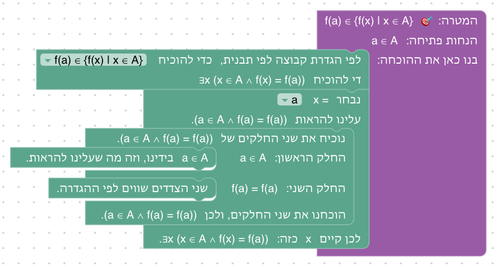
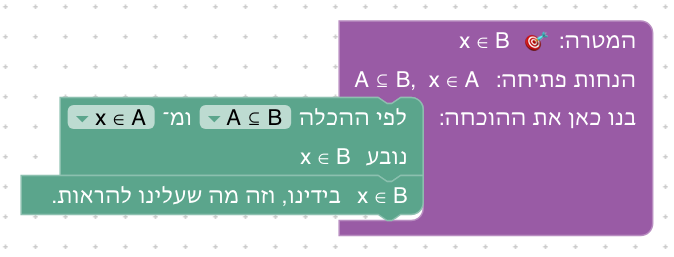
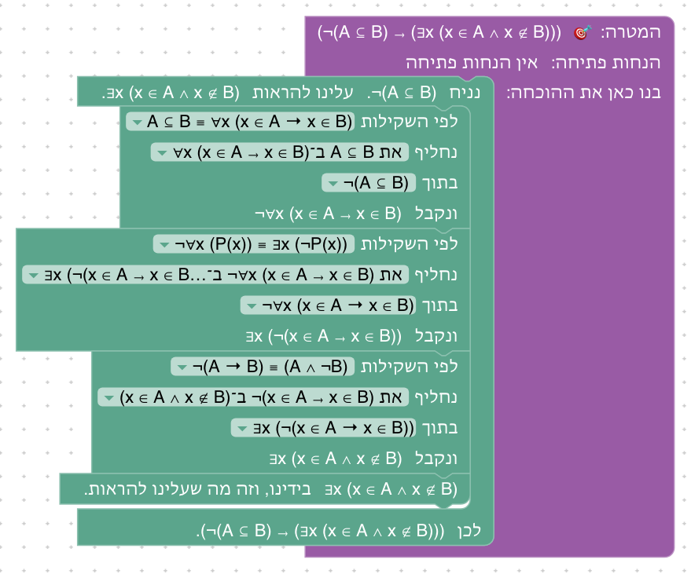
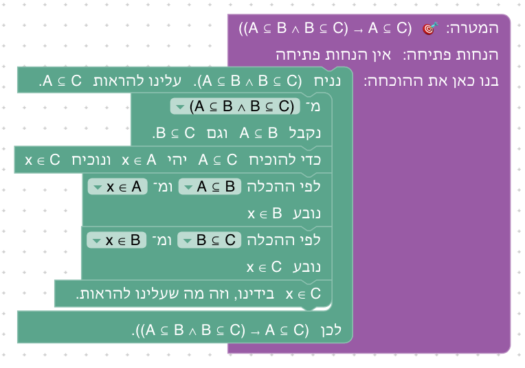

# יחידה 8 — קבוצות והכלה

**מטרה:** היחידה הראשונה של השיעור השני, בסדר של ההרצאה (`01-sets.md` בפרויקט המצגות): קבוצות שמוגדרות בהפרדה ובתבנית, יחס ההכלה והגדרתו, שימוש בהכלה, שלילת ההכלה, טרנזיטיביות ההכלה, שוויון כהכלה הדדית, והקבוצה הריקה. הסטודנט מוכיח הכלה בעזרת איבר כלשהו ("יהי x ∈ A", כמו בהרצאה) ומשתמש בה בעזרת איבר, ומוכיח שוויון בשתי הכלות. הפעולות על קבוצות הן יחידה 9, וקבוצות של קבוצות יחידה 10.

היחידות 8–10 עברו מהענף `main` (שם הן "יחידה 6 - קבוצות" ו"יחידה 7 - קבוצות של קבוצות") ועובדו כדי להתאים להרצאה ככל האפשר: הסדר של השקפים, הדוגמאות והתרגילים שלהם, הניסוח שלהם ("יהי x ∈ A", "מהנתון A ⊆ B נובע כי x ∈ B", "האיחוד האונרי"), וההגדרה של ההרצאה להפרש הסימטרי.

## המהלכים

כמו ביחידות הקודמות, להנחות אין שמות, ולעצמים יש. האיבר שלוקחים כדי להוכיח הכלה שומר על שם המשתנה, x, כמו בהרצאה, אלא אם x כבר בידינו, או ש־x הוא משתנה קשור בהנחה או במטרה (למשל כשבהנחה יש ¬∃x (…)); אז הוא נקרא x₀. זה אותו כלל שנותן את "יהי x₀ שרירותי" בהוכחת "לכל", ראו [design/moves.md](design/moves.md). איבר של קבוצת חזקה נקרא X.

| מהלך | כשהוא במקומו | Lean | לפני → אחרי |
|---|---|---|---|
| **הוכחת הכלה** | "כדי להוכיח A ⊆ B יהי x ∈ A ונוכיח x ∈ B" | `refine easylean_subset_intro (fun x _ => ?_)`, אחרי `first`, שמנסה קודם זוג (ליחסים) | `⊢ A ⊆ B` ⟶ איבר חדש x, `x ∈ A ⊢ x ∈ B` |
| **שימוש בהכלה** | "לפי ההכלה [A ⊆ B] ומ־[x ∈ A] נובע x ∈ B" | `have := easylean_subset_elim ‹A ⊆ B› ‹x ∈ A›` | `A ⊆ B, x ∈ A` ⟶ גם `x ∈ B` |
| **שוויון קבוצות** | "כדי להוכיח A = B נוכיח שתי הכלות"; בראש החלקים: "נוכיח A ⊆ B", "נוכיח B ⊆ A" | `apply easylean_set_eq` | `⊢ A = B` ⟶ שני חלקים |
| **לפי ההגדרה** | על טענה שבידינו: "לפי הגדרת הקבוצה הריקה, [x ∈ ∅] פירושו ⊥"; על המטרה: "... כדי להוכיח [x ∈ (A ∪ B)] די להוכיח (x ∈ A ∨ x ∈ B)" | `first \| (guard_target =ₛ x ∈ A ∪ B; apply easylean_mem_union.mpr) \| have := easylean_mem_union.mp ‹x ∈ A ∪ B›` | שייכות ⟶ מה שההגדרה אומרת |

**ההגדרות** (`SET_PRELUDE` ב־`frontend/src/generator/lean.js`, והשמות ב־`SET_OPERATIONS` ב־`frontend/src/game/formatProofGoal.js`): הקבוצה הריקה (יחידה 8), איחוד, חיתוך, הפרש והפרש סימטרי (יחידה 9), קבוצת החזקה, האיחוד האונרי והחיתוך האונרי (יחידה 10). ההפרש הסימטרי מוגדר כמו בהרצאה, `(x ∈ A ∧ x ∉ B) ∨ (x ∉ A ∧ x ∈ B)`; בענף `main` הוא מוגדר כ־`(A ∖ B) ∪ (B ∖ A)`, וכאן זו טענה שמוכיחים (9.8).

**כתיב כמו בהרצאה** (2026-10-25): שלילת שייכות מוצגת x ∉ A, ולא `¬x ∈ A` כמו ש־Lean כותב, והפרש קבוצות A ∖ B, ולא `A \ B` (`formatProofGoal`; גם הכתיבה הידנית קוראת ∖ כ־`\`, ו־Lean מבין ∉). בטקסטים של השלבים כותבים כך. A ⊈ B מוצגת ¬(A ⊆ B), וטקסט 8.5 אומר זאת.

**מגבלה ידועה:** מהלך ההגדרה לא עובד על *המטרה* `x ∈ ∅` (Lean לא מסיק את הטיפוס של `∅` ב־`guard_target`). השלבים לא צריכים אותו שם: כדי להוכיח x ∈ ∅ מגיעים לסתירה ("מסתירה נובע הכול"), כמו בתבנית של ההרצאה.

## שלבים

הפתרונות ב־`frontend/e2e/solutions.js`. ההליכות כסטודנט של יחידות 8–10 (ב־`frontend/e2e/walk.spec.js`) עוקבות אחרי הפתרון הראשון של כל שלב: גוררות כל מהלך בעכבר ובוחרות כל שדה רק מהאפשרויות שהתפריט שלו מציע.

| שלב | שקף בהרצאה | הטענה | בארגז |
|---|---|---|---|
| 8.1 | הגדרת קבוצה בתנאי; Comprehension מול Replacement (הפרדה) | a ∈ A, P(a) ⊢ a ∈ {x ∈ A \| P(x)} | לפי ההגדרה, "וגם", סיום |
| 8.2 | תבניות על קבוצה; Comprehension מול Replacement (שייכות ו"קיים") | a ∈ A ⊢ f(a) ∈ {f(x) \| x ∈ A} | לפי ההגדרה, בחירת עד, "וגם", שני הצדדים שווים, סיום |
| 8.3 | תרגיל: הוכיחו שכל קבוצה מוכלת בעצמה (אחרי "יחס ההכלה") | A ⊆ A | הוכחת הכלה, סיום |
| 8.4 | יחס ההכלה (הגדרה), ושימוש בה כמו בהוכחת הטרנזיטיביות | A ⊆ B, x ∈ A ⊢ x ∈ B | שימוש בהכלה, סיום |
| 8.5 | שלילת יחס ההכלה | ¬(A ⊆ B) → ∃x (x ∈ A ∧ x ∉ B) | נניח, החלפה לפי שקילות (הגדרת ההכלה, שלילת "לכל", שלילת גרירה), סיום |
| 8.6 | טרנזיטיביות ההכלה | (A ⊆ B ∧ B ⊆ C) → A ⊆ C | נניח, שימוש ב"וגם", הכלה, שימוש בהכלה, סיום |
| 8.7 | שוויון והכלה הדדית (הכיוון ⇐) | (A ⊆ B ∧ B ⊆ A) → A = B | נניח, שימוש ב"וגם", שוויון קבוצות, סיום |
| 8.8 | הקבוצה הריקה | ∅ ⊆ A | הכלה, לפי ההגדרה, מסתירה נובע הכול, סיום |

### 8.1 ו־8.2: קבוצה לפי הפרדה ולפי תבנית

**מה לומדים:** שתי דרכים להגדיר קבוצה כמו בשקפים "הגדרת קבוצה באמצעות תנאי" ו"Comprehension מול Replacement". הפרדה, `{x ∈ A | P(x)}`: `y ∈ {x ∈ A | P(x)} ⟺ y ∈ A ∧ P(y)`. תבנית, `{f(x) | x ∈ A}`: `y ∈ {f(x) | x ∈ A} ⟺ ∃x (x ∈ A ∧ f(x) = y)`, ושם השייכות היא טענת "קיים" שמוכיחים בעד (הטעות הנפוצה של השקף: "לכל"). **למה כך:** שני השלבים פותחים את היחידה כמו ההרצאה, לפני ההכלה, ומציגים את מהלך "לפי ההגדרה" כבר בשלב הראשון, על שייכות לקבוצה שמוגדרת בתנאי; מהלך "שני הצדדים שווים" (`rfl`) נכנס ב־8.2 לסגירת f(a) = f(a). 8.8 משתמש שוב ב"לפי ההגדרה", על הקבוצה הריקה.

**ההגדרות ב־Lean** (`SET_PRELUDE`): `Set.sep A p` ו־`Set.repl f A`, עם הלמות `easylean_mem_sep` ו־`easylean_mem_repl`. השרת לא מקבל הרחבות תחביר, ולכן הכתיבה {x ∈ A | P(x)} ו־{f(x) | x ∈ A} רק בתצוגה (`writeImages` ב־`formatProofGoal.js`). התבנית היא כתיב מקוצר להפרדה, וסיכום 8.2 אומר זאת, כמו השקף.

**פתרונות.** 8.1: "לפי הגדרת קבוצה לפי הפרדה, כדי להוכיח a ∈ {x ∈ A | P(x)} די להוכיח (a ∈ A ∧ P(a))", ושני החלקים בידינו. 8.2: לפי ההגדרה, בחירת העד a, ואז a ∈ A בידינו ו־f(a) = f(a) לפי ההגדרה.

### 8.3: כל קבוצה מוכלת בעצמה

**מה לומדים:** הגדרת ההכלה, `S ⊆ T ⟺ ∀x (x ∈ S → x ∈ T)`, ומהלך הוכחת ההכלה: "יהי x ∈ A". **למה כך:** זה התרגיל הפתור הראשון בהרצאה, והקל ביותר; הוא מקדים את 8.4 כדי שהמהלך החדש בשלב יהיה הוכחת הכלה, ההמשך הטבעי של "יהי x₀ שרירותי" (יחידה 5). הסיכום מסביר למה כאן x בלי אינדקס.

**הסדר:** 8.5 (שלילת ההכלה) לפני 8.6 (טרנזיטיביות), כמו בשקפים (הוחלף 2026-10-25). שני השלבים לא תלויים זה בזה.

### 8.5: שלילת יחס ההכלה

**למה כך:** כמו בשקף "שלילת יחס ההכלה", שורה אחר שורה: שלוש החלפות בהנחה, בבלוק ההחלפה של יחידה 6. ¬(A ⊆ B) הופכת, לפי הגדרת ההכלה, ל־¬∀x (x ∈ A → x ∈ B), לפי שלילת "לכל" ל־∃x (x ∉ A → x ∈ B), ולפי שלילת גרירה ל־∃x (x ∈ A ∧ x ∉ B), שהיא המטרה. להגדרת ההכלה נוספה שקילות משלה, `easylean_subset_def` (A ⊆ B ≡ ∀x (x ∈ A → x ∈ B)), בטבלת השקילויות של בלוק ההחלפה; מהלך ההגדרה לא פותח הכלה, כי היא לא שייכות. הוחלט (2026-10-24) עם מחבר הקורס: קודם לכן השלב נפתר בשתי הוכחות בשלילה זו בתוך זו, והיה קשה מדי לשלב רביעי; בדרך של השקף הוא קצר, ומלמד שנתון "לא לכל" הוא "קיים ... לא" (כמו שלב 6.4 ל"לא קיים").

**פתרון.** "נניח ¬(A ⊆ B).", ובתוכו "לפי השקילות A ⊆ B ≡ ∀x (x ∈ A → x ∈ B) נחליף את A ⊆ B ב־∀x (x ∈ A → x ∈ B) בתוך ¬(A ⊆ B)", "לפי השקילות ¬∀x (P(x)) ≡ ∃x (¬P(x)) נחליף את ¬∀x (x ∈ A → x ∈ B) ב־∃x (x ∉ A → x ∈ B)", "לפי השקילות ¬(A → B) ≡ (A ∧ ¬B) נחליף את x ∉ A → x ∈ B ב־(x ∈ A ∧ x ∉ B)", ו"המטרה בידינו".

### 8.7: שוויון והכלה הדדית

**למה כך:** בהרצאה הכיוון ⇐ מוכח מאקסיומת ההיקפיות: משתי ההכלות מקבלים ∀x (x ∈ A ↔ x ∈ B), ולכן A = B. בלוק השוויון הוא בדיוק הטענה הזאת, ולכן טקסט הפתיחה מספר את ההוכחה מההרצאה, ומציג את הבלוק כתבנית שנובעת ממנה: כדי להוכיח שוויון קבוצות מוכיחים שתי הכלות. כאן משתמשים בו לראשונה, על הטענה עצמה.

### שאר השלבים

   

## מה מההרצאה לא נכנס, ולמה

- **הפרדוקס של ראסל, והגדרה בתנאי בלי קבוצה נתונה:** בקבוצות של EasyLean (`Set obj`, תכונה של עצמים) אין `{x ∣ x ∉ x}`; פרדוקס הספר (7.9) הוא אותו מבנה הוכחה. הפרדה ותבנית כן נכנסו (8.1, 8.2).
- **דוגמאות מספריות ({1,2}, פתרונות משוואה, מלבנים וטרפזים), יחידון, גודל קבוצה (|A|), קבוצות המספרים:** אין בבלוקים קבוצות מפורשות, מספרים בתוך קבוצות או ספירה.
- **הכלה ממש (⊊) והתרגילים עליה (∅ ≠ {∅}, A ⊊ A, ...):** אין הגדרה ל־⊊ ולאי־שוויון קבוצות. אפשר להוסיף אותן בעתיד כהגדרה (`A ⊊ B` פירושו `A ⊆ B ∧ ¬(A = B)`).
- **יחידות הקבוצה הריקה:** מוזכרת בסיכום של 8.8 במילים; לטענה צריך קבוצות ריקות כלליות R, S.

## שאלות פתוחות

