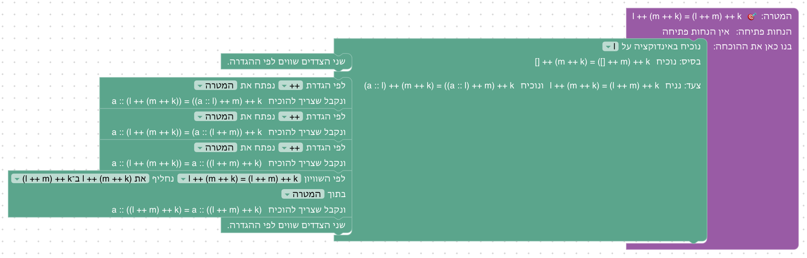
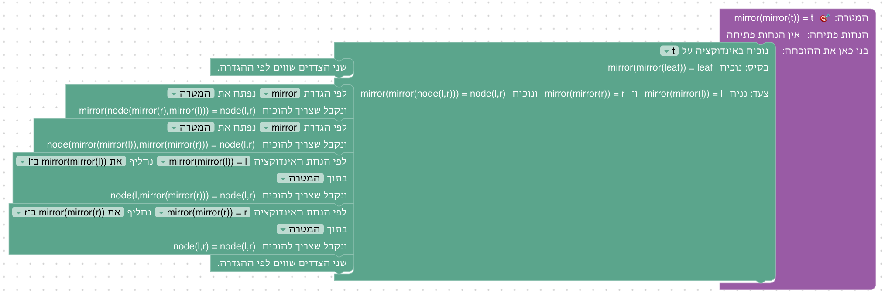
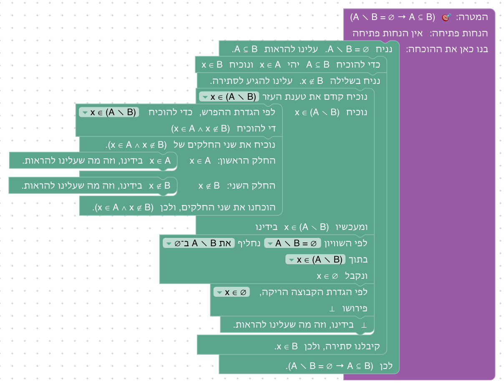
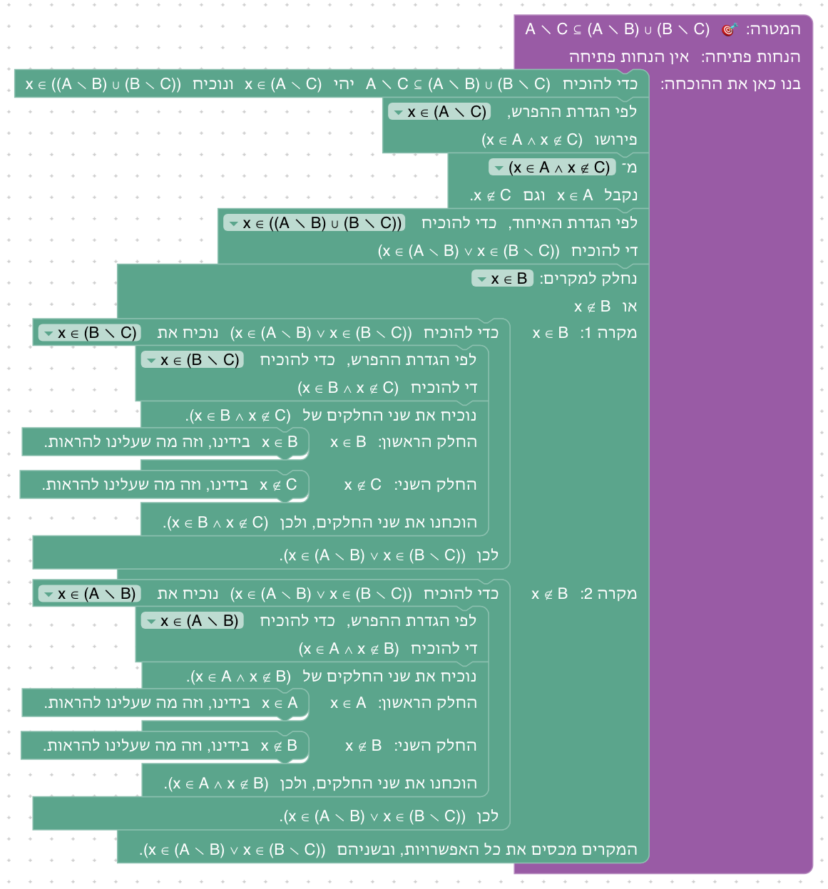
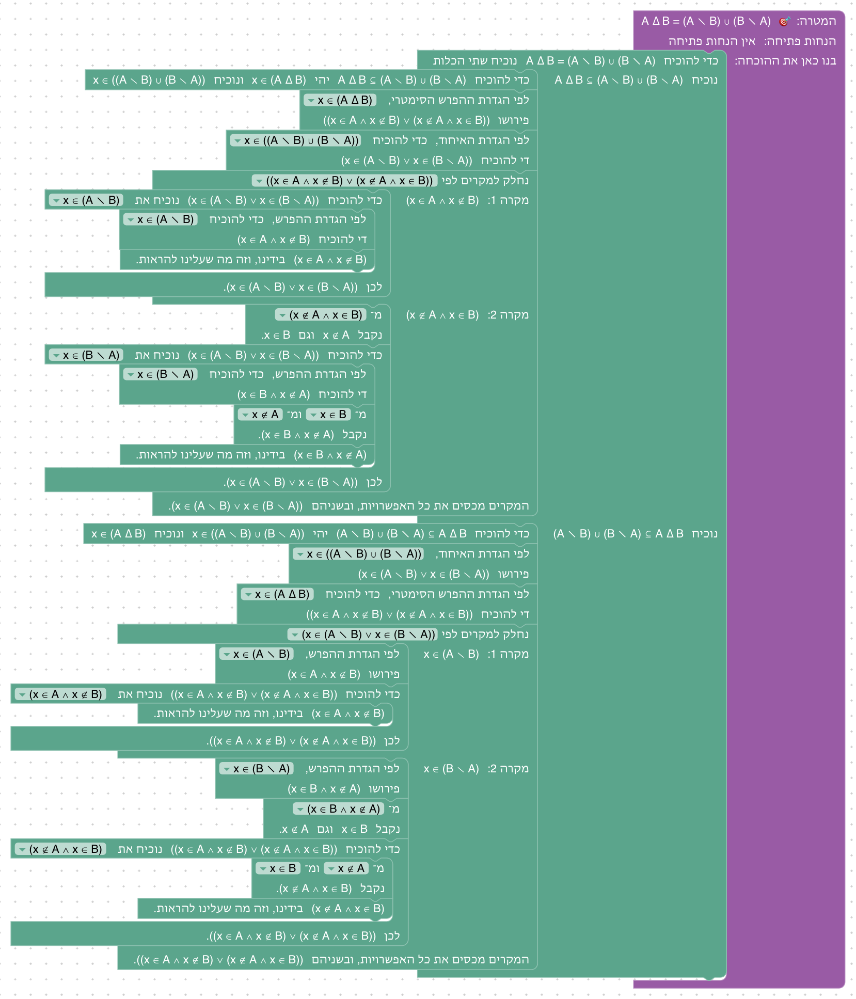
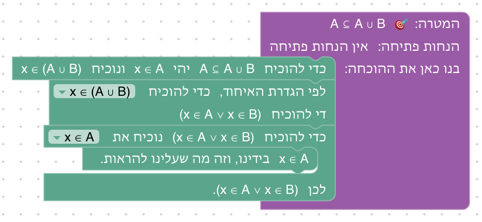
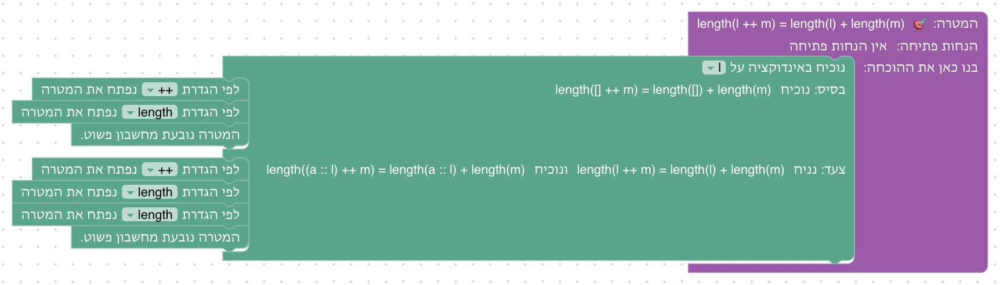
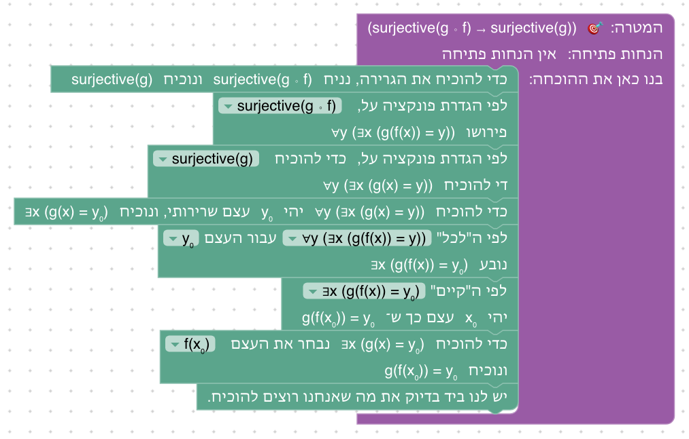
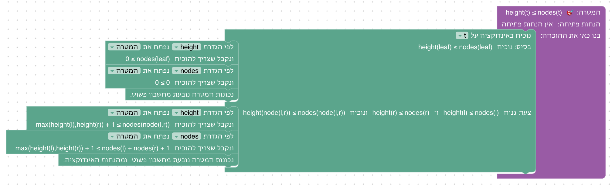
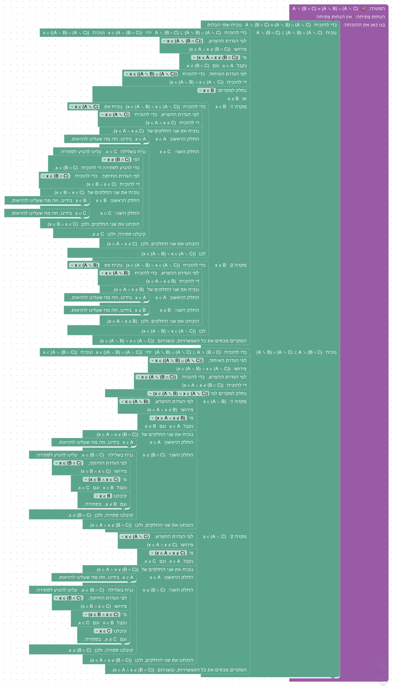

# יחידה 9 — פעולות על קבוצות

**מטרה:** הפעולות על קבוצות, אחרי ההרצאה ("פעולות על קבוצות" ו"הפרש סימטרי" ב־`01-sets.md`), בסדר שלה, עם שני שינויים: "טענות בסיסיות" באות ראשונות (השקף "תכונות של פעולות" שלפניהן רק מונה חוקים, שמוכחים בהמשך, והן הקלות יותר), וכלל דה־מורגן, שבהרצאה מוכח לפני ההפרש הסימטרי, הוא הבונוס בסוף: הגדרות האיחוד, החיתוך, ההפרש וההפרש הסימטרי; "טענות בסיסיות" (א)–(ג); חוקי החילוף והפילוג; התבנית "איך מוכיחים שקבוצה ריקה"; טבלת המצבים; ההפרש הסימטרי; וכלל דה־מורגן הראשון כבונוס. כל פעולה מוגדרת דרך שייכות, ואחרי מהלך ההגדרה (יחידה 8) נשארת נוסחה לוגית של היחידות 2–7.

## המהלכים

אין מהלכים חדשים. מהלך ההגדרה (יחידה 8) מכיר כאן ארבע הגדרות חדשות, ושלבים משתמשים גם במהלכים של יחידות 3, 4 ו־7: "אם ורק אם" (9.3), מסתירה נובע הכול (9.6), וחלוקה למקרים לפי טענה ושלילתה (9.7, 9.9).

| פעולה | הבלוק כותב | פירוש השייכות | מוצגת בשלב |
|---|---|---|---|
| `x ∈ A ∪ B` | לפי הגדרת האיחוד | `x ∈ A ∨ x ∈ B` | 9.1 |
| `x ∈ A ∩ B` | לפי הגדרת החיתוך | `x ∈ A ∧ x ∈ B` | 9.2 |
| `x ∈ A ∖ B` | לפי הגדרת ההפרש | `x ∈ A ∧ x ∉ B` | 9.6 |
| `x ∈ A ∆ B` | לפי הגדרת ההפרש הסימטרי | `(x ∈ A ∧ x ∉ B) ∨ (x ∉ A ∧ x ∈ B)`, כמו בהרצאה | 9.9 |

## שלבים

| שלב | שקף בהרצאה | הטענה | בארגז |
|---|---|---|---|
| 9.1 | טענות בסיסיות (א) | A ⊆ A ∪ B | הכלה, לפי ההגדרה, בחירת צד, סיום |
| 9.2 | טענות בסיסיות (ב) | A ∩ B ⊆ A | הכלה, לפי ההגדרה, שימוש ב"וגם", סיום |
| 9.3 | טענות בסיסיות (ג) | X ⊆ A ∩ B ↔ (X ⊆ A ∧ X ⊆ B) | "אם ורק אם", נניח, "וגם", הכלה, שימוש בהכלה, לפי ההגדרה, סיום |
| 9.4 | תכונות של פעולות: חוק החילוף | A ∩ B = B ∩ A | שוויון קבוצות, הכלה, לפי ההגדרה, "וגם", סיום |
| 9.5 | תכונות של פעולות: חוק הפילוג | A ∩ (B ∪ C) ⊆ (A ∩ B) ∪ (A ∩ C) | הכלה, לפי ההגדרה, "וגם", חלוקה למקרים לפי "או", בחירת צד, סיום |
| 9.6 | תבנית: איך מוכיחים שקבוצה ריקה (הכיוון ⇐) | (A ⊆ B) → A ∖ B = ∅ | נניח, שוויון קבוצות, הכלה, לפי ההגדרה, שימוש בהכלה, סתירה, מסתירה נובע הכול, סיום |
| 9.7 | תבנית: איך מוכיחים שקבוצה ריקה (הכיוון ⇒) | (A ∖ B = ∅) → A ⊆ B | נניח, הכלה, בשלילה, טענת עזר, החלפה לפי שוויון, לפי ההגדרה, סיום |
| 9.8 | טבלת המצבים: גם להכלה | A ∖ C ⊆ (A ∖ B) ∪ (B ∖ C) | הכלה, לפי ההגדרה, "וגם", חלוקה למקרים לפי x ∈ B או שלילתה, בחירת צד, סיום |
| 9.9 | טענה: A ∆ B = (A ∖ B) ∪ (B ∖ A) | A ∆ B = (A ∖ B) ∪ (B ∖ A) | שוויון קבוצות, הכלה, לפי ההגדרה, חלוקה למקרים, בחירת צד, "וגם", סיום |
| 9.10 | הוכחת כלל דה־מורגן (בונוס) | A ∖ (B ∩ C) = (A ∖ B) ∪ (A ∖ C) | המהלכים של שתי ההכלות, כולל חלוקה למקרים לפי x ∈ B |

### 9.3: הכלה בחיתוך

**למה כך:** טענה (ג) מההרצאה, בשני הכיוונים. בהרצאה הכיוון ⇒ נשען על (ב) ועל טרנזיטיביות ההכלה; כאן מוכיחים אותו ישירות, כי טענות שהוכחו לא נשמרות כמשפטים לשלבים הבאים. הכיוון ⇐ הוא בדיוק ההוכחה מהשקף.

### 9.6: איך מוכיחים שקבוצה ריקה

**למה כך:** התבנית של ההרצאה, "להוכיח S = ∅: מניחים x ∈ S ומגיעים לסתירה", נכתבת כאן כשוויון קבוצות: ב־S ⊆ ∅ מגיעים לסתירה, וההכלה ∅ ⊆ S היא 8.8. השלב מוכיח את הכיוון ⇐ של `A ∖ B = ∅ ⟺ A ⊆ B`; הכיוון ⇒ הוא 9.7. ההגדרה של ההפרש מוצגת כאן, כי זה השקף הראשון שמשתמש בה.

### 9.7: הפרש ריק נותן הכלה

**למה כך:** הכיוון ⇒ של `A ∖ B = ∅ ⟺ A ⊆ B`, שהתכנון של הקורס מונה בין ההוכחות של ההרצאה. ההוכחה: יהי x ∈ A; אם x ∉ B, אז x ∈ A ∖ B, אבל A ∖ B = ∅, ולכן x ∈ ∅, סתירה. שני מהלכים חדשים נכנסים כאן: *טענת עזר* (להוכיח קודם ש־x ∈ A ∖ B) ו*החלפה לפי שוויון* (להחליף את A ∖ B ב־∅). שניהם משמשים גם ביחידות 10 ו־11. **פתרון.** "נניח A ∖ B = ∅.", "יהי x ∈ A", בשלילה, טענת העזר x ∈ A ∖ B (פותחים את ההגדרה ומרכיבים את ה"וגם"), "לפי השוויון A ∖ B = ∅ נחליף A ∖ B ב־∅ בתוך x ∈ A ∖ B", "לפי הגדרת הקבוצה הריקה, x ∈ ∅ פירושו ⊥", וסיום.

### 9.8: טבלת המצבים

**למה כך:** בהרצאה בודקים את ההכלה בטבלת כל המצבים של x ∈ A, x ∈ B, x ∈ C. בהוכחה, השורות שבהן x באגף שמאל הן x ∈ A, x ∉ C, ולכן נשאר רק לחלק למקרים לפי x ∈ B: חלוקה למקרים לפי טענה ושלילתה (מיחידה 7), עם הטענה x ∈ B בתפריט (`claims`).

### 9.9: הפרש סימטרי

**למה כך:** עם ההגדרה של ההרצאה, הטענה מהשקף נשארת טענה להוכיח, כמו בהרצאה ("קיבלנו הגדרות שקולות"). במקרה השני הסדר בתוך ה"וגם" הפוך, ולכן מפרקים ומרכיבים מחדש.

### שאר השלבים

    

## מה מההרצאה לא נכנס, ולמה

- **הדוגמאות המפורשות (A = {1, 2, ∅} וכו', והתרגיל לדוגמה על הסטודנטים):** אין בבלוקים קבוצות מפורשות; התרגיל על הסטודנטים הוא דה־מורגן, שמופיע בבונוס 9.10.
- **אידמפוטנטיות, פעולות עם ∅, חוק הקיבוץ, פילוג האיחוד על החיתוך:** אפשריים באותם מהלכים; נבחרו נציגים (חילוף ופילוג) כדי שהיחידה לא תתארך.
- **A ∆ B = (A ∪ B) ∖ (A ∩ B):** מוזכרת בסיכום של 9.9; בענף `main` יש שלב על כיוון אחד שלה.
- **הוכחה בשקילויות לוגיות (שרשרת ⟺):** אין מהלך שמחליף שייכות בשייכות שקולה בתוך שוויון קבוצות; ההוכחה כאן בשתי הכלות.

