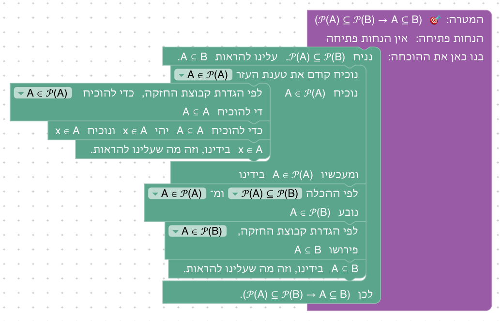
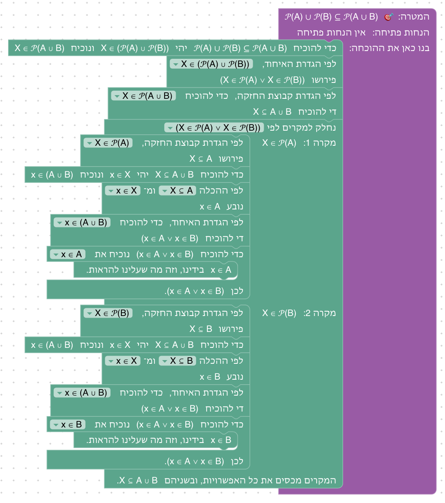
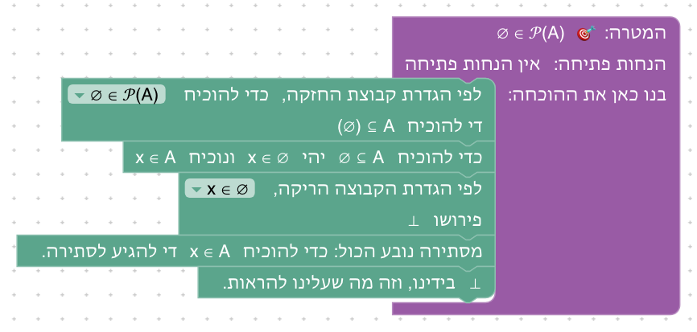
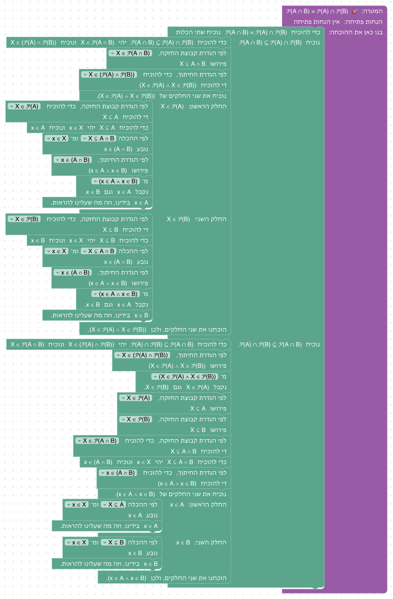
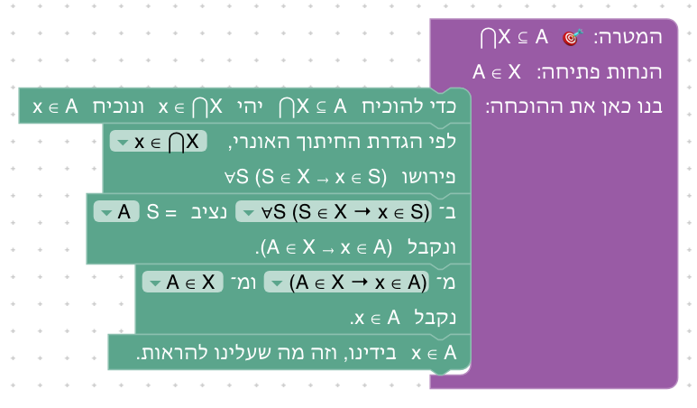
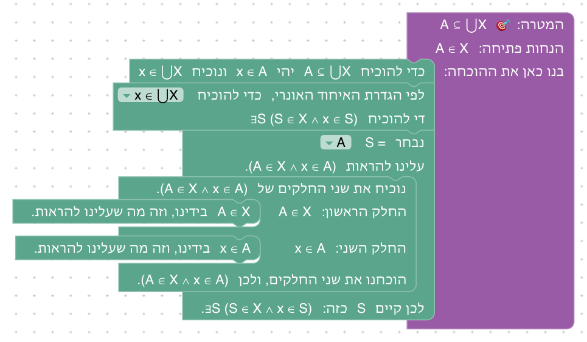

# יחידה 10 — קבוצת החזקה ופעולות אונריות

**מטרה:** קבוצות של קבוצות, בסדר של ההרצאה ("קבוצת החזקה" ו"פעולות אונריות" ב־`01-sets.md`): קבוצת החזקה והתכונה `X ∈ 𝒫(A) ⟺ X ⊆ A`, התרגיל `A ⊆ B ⟺ 𝒫(A) ⊆ 𝒫(B)`, `𝒫(A ∩ B) = 𝒫(A) ∩ 𝒫(B)`, ההכלה שכן נכונה באיחוד, והאיחוד והחיתוך האונריים: `⋂X ⊆ A ⊆ ⋃X` כש־A ∈ X, ו־`⋃𝒫(A) = A` כבונוס. ההגדרות שלהן הן טענות "לכל" ו"קיים" על קבוצות, ומשתמשים בהן במהלכים של יחידה 5.

## המהלכים

| מהלך / הגדרה | כשהוא במקומו | Lean |
|---|---|---|
| **טענת עזר** (חדש, 10.4) | "נוכיח קודם את טענת העזר [A ∈ 𝒫(A)]"; בחלק: "נוכיח A ∈ 𝒫(A)"; אחריו: "ומעכשיו A ∈ 𝒫(A) בידינו" | `have : A ∈ 𝒫 A := by …` |
| `X ∈ 𝒫(A)` | לפי הגדרת קבוצת החזקה: `X ⊆ A` | `easylean_mem_powerset` |
| `x ∈ ⋃X` | לפי הגדרת האיחוד האונרי: `∃S (S ∈ X ∧ x ∈ S)` | `easylean_mem_sUnion` |
| `x ∈ ⋂X` | לפי הגדרת החיתוך האונרי: `∀S (S ∈ X → x ∈ S)` | `easylean_mem_sInter` |

השמות "האיחוד האונרי" ו"החיתוך האונרי" הם של ההרצאה (בענף `main`: "איחוד המשפחה"), וגם האות X לקבוצה שאבריה קבוצות. איבר של קבוצת חזקה נקרא X (ואם X תפוס, X₀), וקבוצה שמתקבלת מ"קיים" נקראת S₀ ("נסמן ב־S₀ עצם כזה").

## שלבים

| שלב | שקף בהרצאה | הטענה | בארגז |
|---|---|---|---|
| 10.1 | קבוצת החזקה (הגדרה ותכונה מרכזית) | A ∈ 𝒫(A) | לפי ההגדרה, הכלה, סיום |
| 10.2 | דוגמאות לקבוצת חזקה (𝒫(∅) = {∅}) | ∅ ∈ 𝒫(A) | לפי ההגדרה, הכלה, מסתירה נובע הכול, סיום |
| 10.3 | תרגיל: A ⊆ B ⟺ 𝒫(A) ⊆ 𝒫(B), כיוון ראשון | (A ⊆ B) → 𝒫(A) ⊆ 𝒫(B) | נניח, הכלה, לפי ההגדרה, שימוש בהכלה, סיום |
| 10.4 | אותו תרגיל, כיוון שני | (𝒫(A) ⊆ 𝒫(B)) → A ⊆ B | נניח, טענת עזר, לפי ההגדרה, הכלה, שימוש בהכלה, סיום |
| 10.5 | 𝒫(A ∩ B) = 𝒫(A) ∩ 𝒫(B) | 𝒫(A ∩ B) = 𝒫(A) ∩ 𝒫(B) | שוויון קבוצות, הכלה, לפי ההגדרה, "וגם", שימוש בהכלה, סיום |
| 10.6 | האם מתקיים גם 𝒫(A ∪ B) = 𝒫(A) ∪ 𝒫(B)? (הכיוון ⊇) | 𝒫(A) ∪ 𝒫(B) ⊆ 𝒫(A ∪ B) | הכלה, לפי ההגדרה, חלוקה למקרים, שימוש בהכלה, בחירת צד, סיום |
| 10.7 | דוגמה: שימוש בתבניות (⋂X ⊆ A) | A ∈ X ⊢ ⋂X ⊆ A | הכלה, לפי ההגדרה, הצבה, הסקה קדימה או אחורה, סיום |
| 10.8 | דוגמה: שימוש בתבניות (A ⊆ ⋃X) | A ∈ X ⊢ A ⊆ ⋃X | הכלה, לפי ההגדרה, בחירת עד, "וגם", סיום |
| 10.9 | איחוד אונרי של קבוצת החזקה (בונוס) | ⋃𝒫(A) = A | שוויון קבוצות, הכלה, לפי ההגדרה, "קיים", "וגם", בחירת עד, סיום |

### 10.4: הכיוון השני, בטענת עזר

**למה כך:** בהרצאה משתמשים ביחידון {x}: הוא מוכל ב־A, ולכן ב־B. בבלוקים אין יחידונים, ולכן לוקחים תת־קבוצה אחרת של A, את A עצמה (10.1), כטענת עזר. ההוכחה שונה מזו של ההרצאה, והטקסט אומר זאת.

### 10.6: ומה עם האיחוד?

**למה כך:** בהרצאה השוויון עם האיחוד מופרך בדוגמה נגדית ({1}, {2}), ונכון רק כש־A ⊆ B או B ⊆ A. דוגמה נגדית אי אפשר לבנות בבלוקים, ולכן השלב מוכיח את ההכלה שנכונה תמיד (הכיוון ⊇ מהשקף), והטקסט מספר על ההפרכה.

### שאר השלבים

      

## מה מההרצאה לא נכנס, ולמה

- **|𝒫(A)| = 2ⁿ, הכלי האינטראקטיבי, 𝒫({1,2}):** אין ספירה וקבוצות מפורשות.
- **הכיוון "רק אם" של 𝒫(A ∪ B) = 𝒫(A) ∪ 𝒫(B):** צריך את הקבוצה {a, b}.
- **⋃ ו־⋂ של אוסף שמוגדר בתבנית, דה מורגן לאונריים, קיום ויחידות של האיחוד והחיתוך, תנאים שקולים ל־X = 𝒫(A):** אין בבלוקים קבוצה מוגדרת בתבנית על קבוצות; חלק מהן אפשריות בעתיד.
- **חלוקות (הגדרה, משפט "חלוקה המוכלת בחלוקה"):** צריך זרות, אי־ריקות וכיסוי יחד; ארוך לשלב, ועוד לא נבנה.

