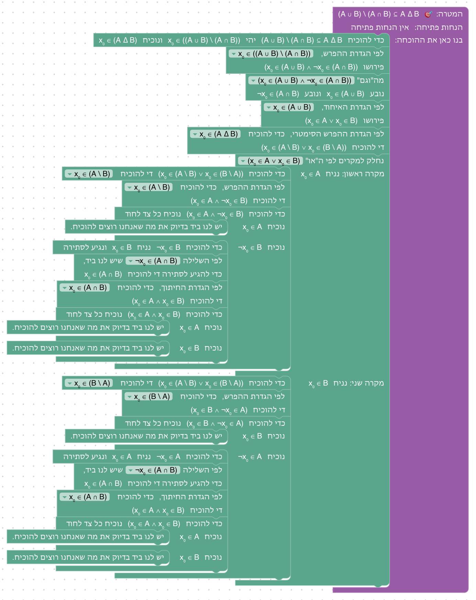
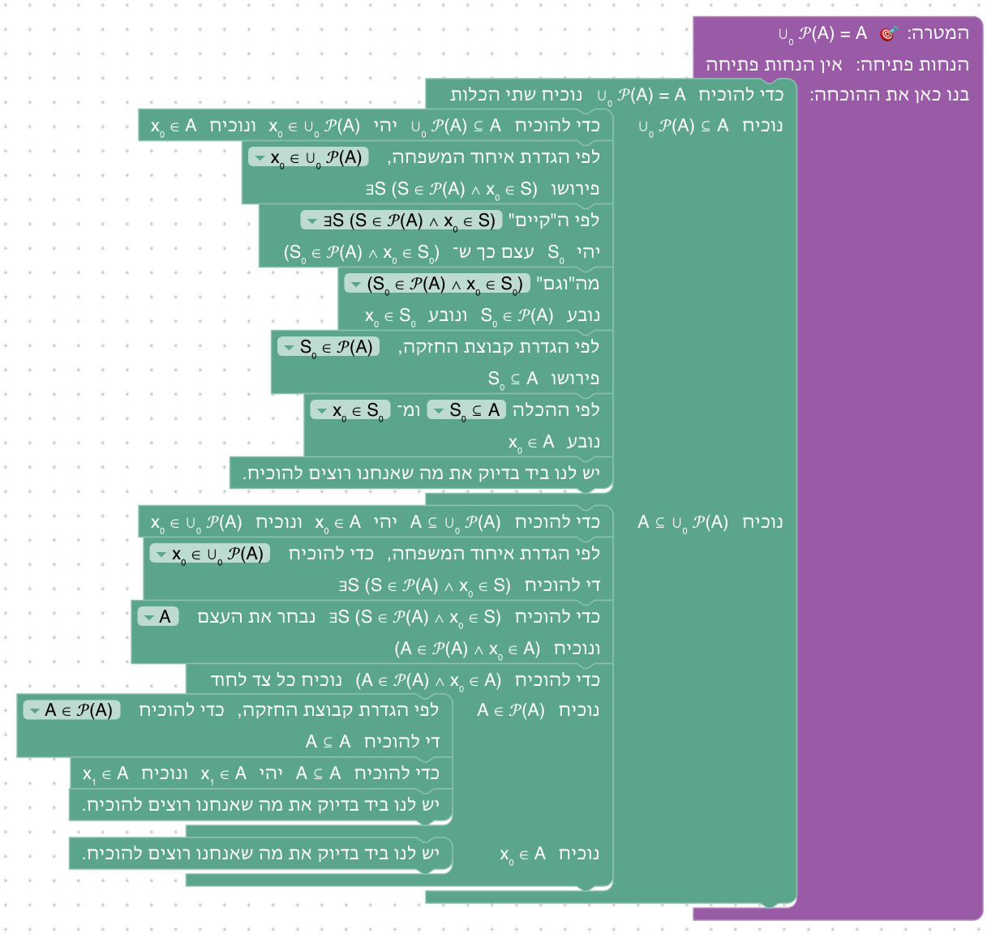
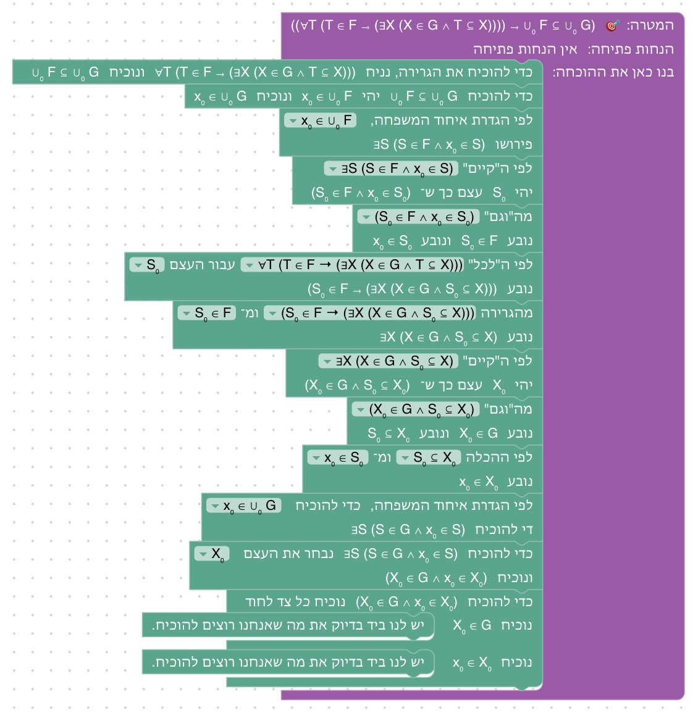
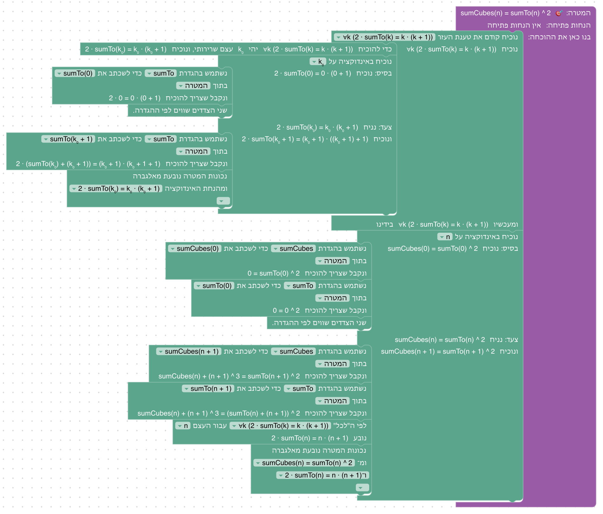
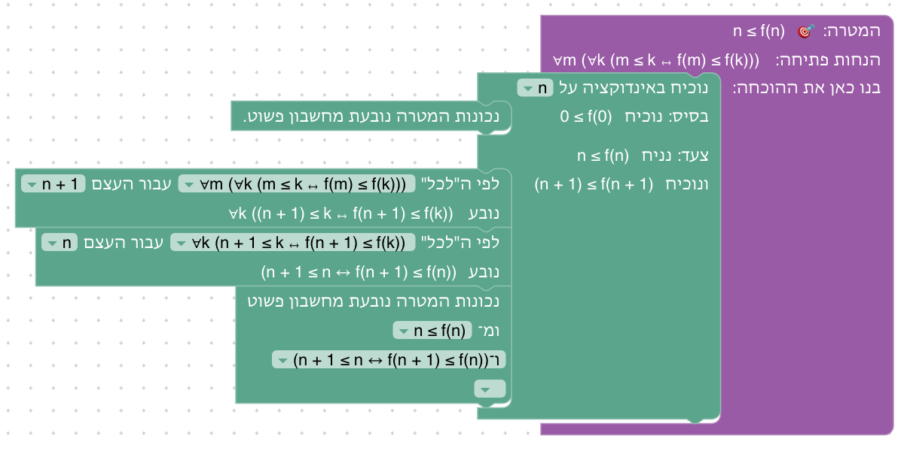
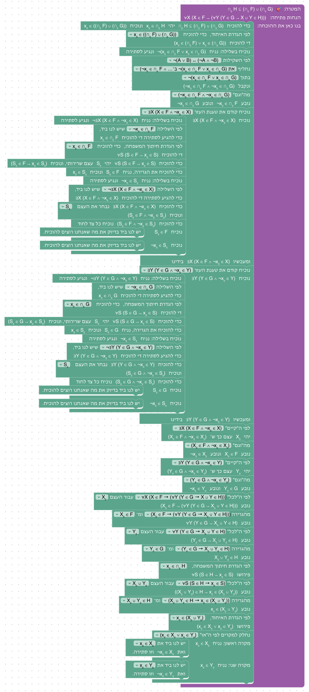

# יחידה 10 — תרגילים מסכמים

**מטרה:** לפתור תרגילים ברמה של הבחנים, המבחנים והתרגילים של הקורס "מבוא ללוגיקה ותורת הקבוצות" באוניברסיטת בן־גוריון, כפי שהם מופיעים באתרי ה־Moodle של הקורס בשנים האחרונות, עם כל מה שנלמד ביחידות 0–9. ביחידות הקודמות הארגז הציע רק את המהלכים של הפתרון, והטקסט אמר מה הרעיון. כאן, כמו במבחן, הסטודנט מקבל ארגז מלא, מחולק למגירות לפי סוג המהלך, ותרגיל; הוא צריך לזהות בעצמו איזה מהלך מתאים, איזו שקילות להחליף, איזה עצם להציב ואיזו טענת עזר להוכיח קודם. בכל שלב יש רמז אחד, שמכוון ולא פותר. היחידה עוברת על נושאי הקורס בסדר שלו: לוגיקה (10.1–10.4), קבוצות (10.5–10.10), קבוצות של קבוצות (10.11–10.14), אינדוקציה (10.15–10.16), ובונוס מתרגיל הבית של 2026 (10.17).

**למה יחידה כזאת.** מחבר הקורס ביקש יחידה מסכמת, שבה הסטודנט מקבל ארגז כלים מלא עם כל מה שלמד, מחולק למגירות, ומאותגר בתרגילים מעניינים ברמה של הבחנים והתרגילים של הקורס. התרגילים נבחרו מתוך קטלוג שנבנה מסקירה של אתרי ה־Moodle הנגישים של הקורס, ומתוך תכנון הסמסטר של הקורס (ראו "מקורות התרגילים" למטה).

## הארגז: כל המהלכים, במגירות

בכל שלבי היחידה אותו ארגז: כל המהלכים של הקורס, בשבע מגירות (`DRAWERS` ב־`frontend/src/game/unit10World.js`). לוחצים על שם של מגירה כדי לפתוח אותה. הכרטיס "ארגז מלא, במגירות" מוצג בשלב 10.1 ומסביר זאת.

| מגירה | המהלכים (כפי שנקראו ביחידות הקודמות) | בלוקים |
|---|---|---|
| כללי | זה בדיוק (יחידה 0), נניח, שימוש בגרירה אחורה, הסקה קדימה (יחידה 1), טענת עזר (יחידה 7) | `exact`, `assume`, `apply_rule`, `forward`, `claim` |
| "וגם", "או", "אם ורק אם" | שימוש ב"וגם", הוכחת "וגם", צירוף ל"וגם", הוכחת "או", חלוקה למקרים, הוכחת "אם ורק אם", שימוש ב"אם ורק אם" (יחידה 2) | `and_elim`, `and_intro`, `and_combine`, `or_intro`, `or_elim`, `iff_intro`, `iff_elim` |
| שלילה וסתירה | הוכחת שלילה, שימוש בשלילה, סתירה, מסתירה נובע הכול, הוכחה בשלילה (יחידה 3) | `not_intro`, `not_elim`, `contradiction`, `exfalso`, `by_contradiction` |
| כמתים | הוכחת "לכל", שימוש ב"לכל", הוכחת "קיים", שימוש ב"קיים" (יחידה 4) | `forall_intro`, `forall_elim`, `exists_intro`, `exists_elim` |
| שקילויות | החלפה לפי שקילות (יחידה 5) | `replace` |
| קבוצות | הוכחת הכלה, שימוש בהכלה, שוויון קבוצות, לפי ההגדרה (יחידות 6–7) | `subset_intro`, `subset_elim`, `set_eq`, `unfold` |
| שוויון ואינדוקציה | שוויון לפי ההגדרה, החלפה לפי שוויון, אינדוקציה, שכתוב לפי הגדרה, חשבון, חשבון בעזרת ההנחות, אלגברה, אלגברה בעזרת ההנחות (יחידות 8–9) | `rfl`, `rewrite`, `induction`, `unfold_function`, `calc`, `calc_hyps`, `algebra`, `algebra_hyps` |

**כל השקילויות.** בתפריט של "לפי השקילות" יש בכל שלב את כל השקילויות של יחידה 5 (`LAWS`): ¬¬A ↔ A, ¬(A ∨ B) ↔ (¬A ∧ ¬B), ¬(A ∧ B) ↔ (¬A ∨ ¬B), (A → B) ↔ (¬A ∨ B), (A → B) ↔ (¬B → ¬A), ¬(A → B) ↔ (A ∧ ¬B), ¬∃x (P(x)) ↔ ∀x (¬P(x)) ו־¬∀x (P(x)) ↔ ∃x (¬P(x)). בשלבים שלא צריך בהם שקילות, היא עדיין בתפריט.

**טענות עזר בתפריט.** בשלבים 10.6, 10.7, 10.9, 10.10, 10.12, 10.15 ו־10.17 התפריט של "נוכיח קודם את טענת העזר" מציע שלוש טענות (`level.claims`), ולא כולן נחוצות: בדרך כלל אחת או שתיים מהן הן של הפתרון, והשאר מסיחות (שאי אפשר להוכיח, או שלא עוזרות). בשאר השלבים התפריט ריק, ונשאר רק "✎ כתיבה ידנית". הכרטיס של שלב 10.1 אומר "בבלוק של טענת עזר יש כמה טענות לבחירה, ולא כולן נחוצות". הטענות של כל שלב רשומות בשורה שמתחת לכותרת שלו.

**רמז אחד.** בכל שלב יש רמז אחד בלבד (`hints`), שמכוון ולא פותר: הוא אומר מה הרעיון (איזו קבוצה להציב, לפי מה לחלק למקרים, איזו טענת עזר להוכיח), ולא אילו בלוקים לגרור. ביחידות הקודמות הרמזים פירטו את המהלכים, ולפעמים היו כמה.

**טקסט הפתיחה.** בכל שלב "**תרגיל N** (מקור):" עם ניסוח התרגיל, כמו בדף תרגילים, ולפעמים משפט אחד שמכוון למה שקשה בו. כשהתרגיל הותאם (למשל יחס שנכתב כטענה), המקור כתוב "לפי …". טקסט הסיום מוסיף לפעמים שאלה המשך שהייתה במקור ("מתי יש כאן שוויון?", "R ∪ S לא חייב להיות טרנזיטיבי").

**תצוגה.** כמה דברים חדשים בתצוגה, שהיחידה הזאת צריכה (`formatProofGoal.js`):
- f ו־sumCubes נכתבות כמופעלות, f(n) ו־sumCubes(n + 1), כמו sumTo(n) ביחידה 8 (`FUNCTION_NAMES`).
- איחוד או חיתוך של משפחה שנמצא בתוך פעולה אחרת נכתב בסוגריים: (⋂₀ F) ∪ (⋂₀ G), ולא ⋂₀ F ∪ ⋂₀ G (`writeLists`). כמו ביחידה 6, פעולה שאחרי ∈ כתובה בסוגריים: x₀ ∈ ((⋂₀ F) ∪ (⋂₀ G)), x₀ ∈ (A ∩ B). איחוד של משפחה לבדו נכתב בלי סוגריים: x₀ ∈ ⋃₀ F.
- האיבר שלוקחים כדי להוכיח הכלה הוא קבוצה, X₀, גם כשהקבוצה *המכילה* היא קבוצת חזקה (F ⊆ 𝒫(A): "יהי X₀ ∈ F"), ולא רק כשהמוכלת היא (`elementName` ב־`moves.js`).
- טקסט הפתיחה מציג **הדגשה** (`renderInline` ב־`GameWorkspace.jsx`), בשביל "**תרגיל N**".

## מקורות התרגילים

הסקירה עברה על שלושת אתרי ה־Moodle הנגישים של הקורס (51 קבצים: 19 מבחנים מ־2020 עד 2026, בחנים, תרגילי בית ודפי תרגול), ובנתה מהם קטלוג של תרגילים לפי נושא. מתוכו, ומתוך תכנון הסמסטר של הקורס, נבחרו 17 תרגילים: כאלה שאפשר להוכיח עם המהלכים של הקורס, ברמה של הבחנים והמבחנים, ובפיזור על כל הנושאים. בטבלה המקור כפי שטקסט הפתיחה כותב אותו:

| שלב | תרגיל | מקור |
|---|---|---|
| 10.1 | (P → (Q ∨ R)) ↔ ((P → Q) ∨ (P → R)) | תרגיל בית 1, שאלה 6 |
| 10.2 | (P → Q) ∨ (Q → P) | תרגול 2 |
| 10.3 | השלילה של "R אנטי־סימטרי" | לפי שאלה ממבחן 2025א, מועד ב |
| 10.4 | החיתוך של יחסים טרנזיטיביים טרנזיטיבי | לפי שאלה ממבחן 2026א, מועד ב |
| 10.5 | (A \ C) ∩ B ⊆ B \ C | תרגול 3, ותכנון הסמסטר |
| 10.6 | A \ (B \ C) = (A \ B) ∪ (A ∩ C) | תרגול 3, ותכנון הסמסטר |
| 10.7 | A ∩ B = ∅ אם ורק אם (A ∪ B) \ B = A | תרגול 3, ותכנון הסמסטר |
| 10.8 | אם A ∩ X = A לכל X, אז A = ∅ | בוחן תש"פ, ובעוד שלושה מקורות |
| 10.9 | קבוצות נחמדות | לפי בוחן תש"פ |
| 10.10 | (A ∪ B) \ (A ∩ B) ⊆ A ∆ B | תכנון הסמסטר |
| 10.11 | 𝒫(A ∩ B) = 𝒫(A) ∩ 𝒫(B) | תרגיל בית 2, ותכנון הסמסטר |
| 10.12 | F ⊆ 𝒫(A) אם ורק אם ⋃₀ F ⊆ A | תרגול 4, ותכנון הסמסטר |
| 10.13 | ⋃₀ 𝒫(A) = A | לפי שאלה ממבחן 2025ב, מועד ג |
| 10.14 | אם כל קבוצה ב־F מוכלת בקבוצה של G, אז ⋃₀ F ⊆ ⋃₀ G | בוחן 1, 2026א, שאלה 3 |
| 10.15 | 1³ + 2³ + ... + n³ = (1 + 2 + ... + n)² | תרגול 10–11 |
| 10.16 | אם m ≤ k ↔ f(m) ≤ f(k), אז n ≤ f(n) | עבודה 4, 2026א, ומבחן 2024ב, מועד ב |
| 10.17 | ⋂₀ H ⊆ (⋂₀ F) ∪ (⋂₀ G) | עבודה 1, 2026א, שאלה 4 |

**מה הוסף לקורס כדי שהתרגילים יתאימו.** שלושה דברים נוספו ליחידות הקודמות לפני היחידה, באישור מחבר הקורס: מהלך טענת העזר (בלוק `claim`, נלמד בשלב 7.3), שבלעדיו שלבים 10.6, 10.9, 10.12, 10.15 ו־10.17 לא אפשריים; השקילות ¬(A → B) ↔ (A ∧ ¬B) (שלבים 5.11–5.12), שמשמשת ב־10.1, 10.2 ו־10.3; וההפרש הסימטרי (שלב 6.10), ש־10.10 משלים.

**הוחלט: מגירות.** ארגז מלא, מחולק למגירות לפי סוג המהלך, כמו שביקש מחבר הקורס. ביחידות הקודמות הארגז הציע רק את המהלכים של הפתרון (ובדיקת `moves.test.js` מוודאת זאת); כאן הבדיקה מוותרת על התנאי הזה בשלבים עם מגירות (`level.toolboxDrawers`), ובודקת רק שכל מהלך של הפתרון נמצא בארגז. המגירות מסודרות לפי היחידות שבהן המהלכים נלמדו, כך שמי שזוכר איפה למד מהלך יודע איפה לחפש אותו.

**הוחלט: רמז אחד לכל שלב.** כמו במבחן, הרעיון של ההוכחה הוא חלק מהתרגיל. הרמז מכוון לרעיון ולא מתאר את הבלוקים.

**הוחלט: רשימת התרגילים.** 17 התרגילים שלמעלה, מהקל לקשה בתוך כל נושא, ובסדר הנושאים של הקורס.

**הוחלט: טענות עזר בתפריט, עם מסיחות.** כמו ביחידה 7, הטענות בתפריט הן של השלב, וחלקן לא נחוצות, כך שהבחירה בטענה היא חלק מהרעיון. ראו "האם התפריט מסגיר יותר מדי" בשאלות שבסוף.

**הוחלט: גם אינדוקציה.** שני תרגילים על אינדוקציה (10.15–10.16), מהתרגולים ומהעבודות של הקורס. אין כאן אינדוקציה מבנית (יחידה 9): היא לא בקורס, ולכן אין לה תרגילים במקורות.

**יחסים כטענות.** בקורס יחס הוא קבוצה של זוגות, R ⊆ A × A. ביחידה אין זוגות, ולכן בשלבים 10.3 ו־10.4 היחס כתוב כטענה על שני עצמים, R(x,y), וטקסט הפתיחה של 10.4 אומר ש־(x,y) ∈ R ∩ S פירושו R(x,y) ∧ S(x,y). זו הסיבה ש־10.3 ו־10.4 כתובים "לפי שאלה ממבחן".

## שלבים

לכל שלב: המקור, מה מתרגלים בו, איך אנחנו רוצים שסטודנטים יפתרו אותו, ושיקולים ושאלות שעוד צריך להכריע. צילומי הפתרונות נוצרים מ־`frontend/e2e/solutions.js` (ראו [יחידה 0](00-getting-started.md#שלבים)). בכל השלבים הארגז הוא הארגז המלא שלמעלה, ולכן השורה שמתחת לכותרת אומרת רק מה בידינו בהתחלה ומה בתפריט של טענות העזר. מספר הבלוקים של כל פתרון כולל כל מהלך, גם בתוך חלקים.

### שלב 10.1: גרירה של "או"

`⊢ ((P → (Q ∨ R)) ↔ ((P → Q) ∨ (P → R)))` · טענות עזר: אין

**מקור.** תרגיל בית 1, שאלה 6.

**מה לומדים.** להוכיח שקילות בשני כיוונים, ולזהות שבכיוון → אי אפשר להוכיח את ה"או" ישירות (לא ידוע איזה צד נכון), ולכן מוכיחים בשלילה, ומעבירים את השלילה פנימה בשקילויות: דה מורגן, ואחר כך השלילה של גרירה, פעמיים. השלב מציג את היחידה: הכרטיס של המגירות מופיע בו.

**פתרון.** "כדי להוכיח ((P → (Q ∨ R)) ↔ ((P → Q) ∨ (P → R))) נוכיח את שני הכיוונים". בחלק "נוכיח ((P → (Q ∨ R)) → ((P → Q) ∨ (P → R)))": "כדי להוכיח את הגרירה, נניח (P → (Q ∨ R)) ונוכיח ((P → Q) ∨ (P → R))", "נוכיח בשלילה: נניח ¬((P → Q) ∨ (P → R)) ונגיע לסתירה", "לפי השקילות ¬(A ∨ B) ↔ (¬A ∧ ¬B) נחליף את ¬((P → Q) ∨ (P → R)) ב־(¬(P → Q) ∧ ¬(P → R)) בתוך ¬((P → Q) ∨ (P → R)), ונקבל (¬(P → Q) ∧ ¬(P → R))", "מה"וגם" (¬(P → Q) ∧ ¬(P → R)) נובע ¬(P → Q) ונובע ¬(P → R)", "לפי השקילות ¬(A → B) ↔ (A ∧ ¬B) נחליף את ¬(P → Q) ב־(P ∧ ¬Q) בתוך ¬(P → Q), ונקבל (P ∧ ¬Q)", "מה"וגם" (P ∧ ¬Q) נובע P ונובע ¬Q", אותו דבר עם ¬(P → R) (נובעים P ו־¬R), "מהגרירה (P → (Q ∨ R)) ומ־P נובע (Q ∨ R)", ו"נחלק למקרים לפי ה"או" (Q ∨ R)": "מקרה ראשון: נניח Q": "יש לנו ביד את Q ואת ¬Q, וזו סתירה."; "מקרה שני: נניח R": "יש לנו ביד את R ואת ¬R, וזו סתירה." בחלק "נוכיח (((P → Q) ∨ (P → R)) → (P → (Q ∨ R)))": "כדי להוכיח את הגרירה, נניח ((P → Q) ∨ (P → R)) ונוכיח (P → (Q ∨ R))", "כדי להוכיח את הגרירה, נניח P ונוכיח (Q ∨ R)", ו"נחלק למקרים לפי ה"או" ((P → Q) ∨ (P → R))": "מקרה ראשון: נניח (P → Q)": "כדי להוכיח (Q ∨ R) די להוכיח Q", "מהגרירה (P → Q) ומ־P נובע Q", ו"יש לנו ביד בדיוק את מה שאנחנו רוצים להוכיח."; "מקרה שני: נניח (P → R)": אותו דבר, עם R. 22 בלוקים.

**שיקולים ושאלות להכרעה.**
- השלב הראשון של היחידה ארוך (22 בלוקים) ודורש שלוש החלפות לפי שקילות. האם להתחיל בשלב קצר יותר (10.2 או 10.3), כדי שהמפגש הראשון עם המגירות יהיה קל?
- הרמז מפנה ל"שקילות של שלב 5.11" במספר שלב. אם סדר השלבים ביחידה 5 ישתנה, הרמז יתיישן; אפשר לכתוב את השקילות עצמה, ¬(A → B) ↔ (A ∧ ¬B).
- בכיוון → יש דרך שנייה, בלי הוכחה בשלילה: טענת עזר Q ∨ ¬Q (או P ∨ ¬P) וחלוקה למקרים. התפריט של טענות העזר ריק, ולכן היא אפשרית רק בכתיבה ידנית.
- P נובע פעמיים (מ־(P ∧ ¬Q) ומ־(P ∧ ¬R)). זה לא מפריע, אבל מראה שהסטודנט לא צריך לפרק את השני עד הסוף; האם לציין בטקסט הסיום?

### שלב 10.2: אחת משתי הגרירות

`⊢ ((P → Q) ∨ (Q → P))` · טענות עזר: אין

**מקור.** תרגול 2.

**מה לומדים.** טענה מפתיעה שנכונה תמיד, ושוב "או" שאי אפשר להוכיח צד שלו: הוכחה בשלילה, ושרשרת של החלפות עד שבידינו P, ¬Q, Q ו־¬P.

**פתרון.** "נוכיח בשלילה: נניח ¬((P → Q) ∨ (Q → P)) ונגיע לסתירה", "לפי השקילות ¬(A ∨ B) ↔ (¬A ∧ ¬B) נחליף את ¬((P → Q) ∨ (Q → P)) ב־(¬(P → Q) ∧ ¬(Q → P)) בתוך ¬((P → Q) ∨ (Q → P)), ונקבל (¬(P → Q) ∧ ¬(Q → P))", "מה"וגם" (¬(P → Q) ∧ ¬(Q → P)) נובע ¬(P → Q) ונובע ¬(Q → P)", "לפי השקילות ¬(A → B) ↔ (A ∧ ¬B) נחליף את ¬(P → Q) ב־(P ∧ ¬Q) בתוך ¬(P → Q), ונקבל (P ∧ ¬Q)", "מה"וגם" (P ∧ ¬Q) נובע P ונובע ¬Q", "לפי השקילות ¬(A → B) ↔ (A ∧ ¬B) נחליף את ¬(Q → P) ב־(Q ∧ ¬P) בתוך ¬(Q → P), ונקבל (Q ∧ ¬P)", "מה"וגם" (Q ∧ ¬P) נובע Q ונובע ¬P", ו"יש לנו ביד את P ואת ¬P, וזו סתירה." 8 בלוקים.

**שיקולים ושאלות להכרעה.**
- המבנה כמעט זהה לכיוון → של 10.1 (בלי החלוקה למקרים). אם 10.1 יוזז, 10.2 יכול להיות השלב הראשון: הוא קצר, ומראה את אותו רעיון.
- טקסט הסיום נותן את ההוכחה בחלוקה למקרים לפי Q ("אם Q נכונה, הגרירה הראשונה נכונה; ואם לא, השנייה"). זו הוכחה עם טענת עזר Q ∨ ¬Q, שאפשרית רק בכתיבה ידנית. להוסיף את Q ∨ ¬Q לתפריט, כדי שיהיו שתי דרכים?

### שלב 10.3: יחס שאינו אנטי־סימטרי

`⊢ ((¬∀x (∀y ((R(x,y) ∧ R(y,x)) → x = y))) → (∃x (∃y ((R(x,y) ∧ R(y,x)) ∧ ¬x = y))))` · טענות עזר: אין

**מקור.** לפי שאלה ממבחן 2025א, מועד ב. היחס כתוב כטענה (ראו "יחסים כטענות" למעלה).

**מה לומדים.** למצוא את השלילה של הגדרה: מעבירים את השלילה פנימה, דרך שני ה"לכל" ואחר כך דרך הגרירה, כמו בשלב 5.12.

**פתרון.** "כדי להוכיח את הגרירה, נניח ¬∀x (∀y ((R(x,y) ∧ R(y,x)) → x = y)) ונוכיח ∃x (∃y ((R(x,y) ∧ R(y,x)) ∧ ¬x = y))", "לפי השקילות ¬∀x (P(x)) ↔ ∃x (¬P(x)) נחליף את ¬∀x (∀y (…)) ב־∃x (¬∀y (…)) בתוך ¬∀x (∀y ((R(x,y) ∧ R(y,x)) → x = y)), ונקבל ∃x (¬∀y ((R(x,y) ∧ R(y,x)) → x = y))", שוב לפי אותה שקילות, הפעם על ה"לכל" הפנימי, בתוך ∃x (¬∀y (…)), "ונקבל ∃x (∃y (¬((R(x,y) ∧ R(y,x)) → x = y)))", "לפי השקילות ¬(A → B) ↔ (A ∧ ¬B) נחליף את ¬((R(x,y) ∧ R(y,x)) → x = y) ב־((R(x,y) ∧ R(y,x)) ∧ ¬x = y) בתוך ∃x (∃y (¬(…))), ונקבל ∃x (∃y ((R(x,y) ∧ R(y,x)) ∧ ¬x = y))", ו"יש לנו ביד בדיוק את מה שאנחנו רוצים להוכיח." 5 בלוקים.

**שיקולים ושאלות להכרעה.**
- השלב קצר מאוד (5 בלוקים), וכל ההחלפות בהנחה. במבחן השאלה הייתה גם לנסח את השלילה במילים, ולתת דוגמה ליחס שאינו אנטי־סימטרי; כאן יש רק את החלק הלוגי. האם הוא מתאים ל"תרגיל מסכם", או שעדיף לצרף אליו חלק נוסף (למשל להפריך אנטי־סימטריה של יחס מסוים)?
- ההחלפה השנייה היא בתוך ה"קיים", והשלישית בתוך שני "קיים", כמו ב־5.10 ו־5.12. בשורה "נחליף" מופיעים x ו־y מחוץ לכמתים שלהם (ראו 5.12).

### שלב 10.4: חיתוך של יחסים טרנזיטיביים

`∀x (∀y (∀z ((R(x,y) ∧ R(y,z)) → R(x,z)))), ∀x (∀y (∀z ((S(x,y) ∧ S(y,z)) → S(x,z)))) ⊢ ∀x (∀y (∀z (((R(x,y) ∧ S(x,y)) ∧ (R(y,z) ∧ S(y,z))) → (R(x,z) ∧ S(x,z)))))` · טענות עזר: אין

**מקור.** לפי שאלה ממבחן 2026א, מועד ב: אם R ו־S טרנזיטיביים, גם R ∩ S טרנזיטיבי.

**מה לומדים.** להוכיח "לכל" של שלושה משתנים, ולהשתמש בהנחת "לכל" בהצבה של שלושה עצמים, ואחר כך בגרירה שהתקבלה, אחורה.

**פתרון.** "כדי להוכיח ∀x (…) יהי x₀ עצם שרירותי, ונוכיח ∀y (…)", וכך גם y₀ ו־z₀; "כדי להוכיח את הגרירה, נניח ((R(x₀,y₀) ∧ S(x₀,y₀)) ∧ (R(y₀,z₀) ∧ S(y₀,z₀))) ונוכיח (R(x₀,z₀) ∧ S(x₀,z₀))"; שלוש פעמים "מה"וגם"", עד שבידינו R(x₀,y₀), S(x₀,y₀), R(y₀,z₀) ו־S(y₀,z₀); ו"כדי להוכיח (R(x₀,z₀) ∧ S(x₀,z₀)) נוכיח כל צד לחוד". בחלק "נוכיח R(x₀,z₀)": "לפי ה"לכל" ∀x (∀y (∀z ((R(x,y) ∧ R(y,z)) → R(x,z)))) עבור העצם x₀ נובע ∀y (…)", ואחר כך עבור y₀ ועבור z₀, עד ש"נובע ((R(x₀,y₀) ∧ R(y₀,z₀)) → R(x₀,z₀))"; "לפי הגרירה ((R(x₀,y₀) ∧ R(y₀,z₀)) → R(x₀,z₀)) שיש לנו ביד, כדי להוכיח R(x₀,z₀) די להוכיח (R(x₀,y₀) ∧ R(y₀,z₀))"; "נוכיח כל צד לחוד", ובכל צד "יש לנו ביד...". בחלק "נוכיח S(x₀,z₀)": אותו דבר עם S. 22 בלוקים.

**שיקולים ושאלות להכרעה.**
- שש הצבות, שלוש לכל יחס, שכל אחת מהן היא בלוק. זה מכני, ובכתב כותבים "מהטרנזיטיביות של R עבור x₀, y₀, z₀". מהלך שמציב כמה עצמים בבת אחת יקצר את השלב בארבעה בלוקים.
- בכל צד אפשר גם קדימה: "מ־R(x₀,y₀) ומ־R(y₀,z₀) נובע (R(x₀,y₀) ∧ R(y₀,z₀))" ו"מהגרירה … נובע R(x₀,z₀)". הפתרון משתמש בגרירה אחורה.
- טקסט הסיום שואל אם R ∪ S טרנזיטיבי (לא בהכרח). זו שאלה של הפרכה בדוגמה נגדית, שהיחידה לא יכולה לבדוק (ראו בשאלות שבסוף).

### שלב 10.5: חיתוך והפרש

`⊢ (A \ C) ∩ B ⊆ B \ C` · טענות עזר: אין

**מקור.** תרגול 3, ותכנון הסמסטר.

**מה לומדים.** חזרה על השיטה של יחידה 6: לוקחים איבר, פותחים את כל ההגדרות בהנחה, ואחר כך במטרה. השלב הקל של החלק על קבוצות.

**פתרון.** "כדי להוכיח (A \ C) ∩ B ⊆ B \ C יהי x₀ ∈ ((A \ C) ∩ B) ונוכיח x₀ ∈ (B \ C)", "לפי הגדרת החיתוך, x₀ ∈ ((A \ C) ∩ B) פירושו (x₀ ∈ (A \ C) ∧ x₀ ∈ B)", "מה"וגם" … נובע x₀ ∈ (A \ C) ונובע x₀ ∈ B", "לפי הגדרת ההפרש, x₀ ∈ (A \ C) פירושו (x₀ ∈ A ∧ ¬x₀ ∈ C)", "מה"וגם" … נובע x₀ ∈ A ונובע ¬x₀ ∈ C", "לפי הגדרת ההפרש, כדי להוכיח x₀ ∈ (B \ C) די להוכיח (x₀ ∈ B ∧ ¬x₀ ∈ C)", ו"כדי להוכיח (x₀ ∈ B ∧ ¬x₀ ∈ C) נוכיח כל צד לחוד": בכל צד "יש לנו ביד...". 9 בלוקים.

**שיקולים ושאלות להכרעה.**
- x₀ ∈ A לא משמש בהוכחה. זה מכוון (ההכלה נכונה גם בלעדיו), וטקסט הסיום עונה על שאלת התרגול "מתי יש כאן שוויון?" (בדיוק כש־B \ A ⊆ C). השאלה הזאת יכולה להיות שלב משלה, שבו מוכיחים את הכיוון "אם B \ A ⊆ C אז יש שוויון".

### שלב 10.6: הפרש של הפרש

`⊢ A \ (B \ C) = (A \ B) ∪ (A ∩ C)` · טענות עזר: x₀ ∈ C ∨ ¬x₀ ∈ C, x₀ ∈ B ∨ ¬x₀ ∈ B, x₀ ∈ (A ∩ C)

**מקור.** תרגול 3, ותכנון הסמסטר.

**מה לומדים.** להוכיח "או" כשלא ידוע איזה צד נכון, בחלוקה למקרים לפי טענה שנובעת מהלוגיקה עצמה, x₀ ∈ C ∨ ¬x₀ ∈ C, שמוכיחים כטענת עזר (כמו P ∨ ¬P בשלב 3.10). והכלה הפוכה שבה השלילה ¬x₀ ∈ (B \ C) מוכחת בהוכחת שלילה.

**פתרון.** "כדי להוכיח A \ (B \ C) = (A \ B) ∪ (A ∩ C) נוכיח שתי הכלות". בחלק "נוכיח A \ (B \ C) ⊆ (A \ B) ∪ (A ∩ C)": "יהי x₀ ∈ (A \ (B \ C)) ונוכיח x₀ ∈ ((A \ B) ∪ (A ∩ C))", "לפי הגדרת ההפרש, x₀ ∈ (A \ (B \ C)) פירושו (x₀ ∈ A ∧ ¬x₀ ∈ (B \ C))", "מה"וגם" … נובע x₀ ∈ A ונובע ¬x₀ ∈ (B \ C)", "לפי הגדרת האיחוד, כדי להוכיח x₀ ∈ ((A \ B) ∪ (A ∩ C)) די להוכיח (x₀ ∈ (A \ B) ∨ x₀ ∈ (A ∩ C))", ו"נוכיח קודם את טענת העזר (x₀ ∈ C ∨ ¬x₀ ∈ C)". בחלק "נוכיח (x₀ ∈ C ∨ ¬x₀ ∈ C)", כמו בשלב 3.10: "נוכיח בשלילה: נניח ¬(x₀ ∈ C ∨ ¬x₀ ∈ C) ונגיע לסתירה", "לפי השלילה ¬(x₀ ∈ C ∨ ¬x₀ ∈ C) שיש לנו ביד, כדי להגיע לסתירה די להוכיח (x₀ ∈ C ∨ ¬x₀ ∈ C)", "די להוכיח ¬x₀ ∈ C", "כדי להוכיח ¬x₀ ∈ C נניח x₀ ∈ C ונגיע לסתירה", שוב "לפי השלילה ¬(x₀ ∈ C ∨ ¬x₀ ∈ C) …", "די להוכיח x₀ ∈ C", ו"יש לנו ביד...". "ומעכשיו (x₀ ∈ C ∨ ¬x₀ ∈ C) בידינו"; "נחלק למקרים לפי ה"או" (x₀ ∈ C ∨ ¬x₀ ∈ C)". "מקרה ראשון: נניח x₀ ∈ C": "די להוכיח x₀ ∈ (A ∩ C)", "לפי הגדרת החיתוך, כדי להוכיח x₀ ∈ (A ∩ C) די להוכיח (x₀ ∈ A ∧ x₀ ∈ C)", ו"נוכיח כל צד לחוד": בכל צד "יש לנו ביד...". "מקרה שני: נניח ¬x₀ ∈ C": "די להוכיח x₀ ∈ (A \ B)", "לפי הגדרת ההפרש, כדי להוכיח x₀ ∈ (A \ B) די להוכיח (x₀ ∈ A ∧ ¬x₀ ∈ B)", ו"נוכיח כל צד לחוד": ב־x₀ ∈ A "יש לנו ביד..."; ב־¬x₀ ∈ B "נניח x₀ ∈ B ונגיע לסתירה", "לפי השלילה ¬x₀ ∈ (B \ C) שיש לנו ביד, כדי להגיע לסתירה די להוכיח x₀ ∈ (B \ C)", "לפי הגדרת ההפרש, כדי להוכיח x₀ ∈ (B \ C) די להוכיח (x₀ ∈ B ∧ ¬x₀ ∈ C)", ו"נוכיח כל צד לחוד": בכל צד "יש לנו ביד...". בחלק "נוכיח (A \ B) ∪ (A ∩ C) ⊆ A \ (B \ C)": "יהי x₀ ∈ ((A \ B) ∪ (A ∩ C)) ונוכיח x₀ ∈ (A \ (B \ C))", "לפי הגדרת האיחוד, x₀ ∈ ((A \ B) ∪ (A ∩ C)) פירושו (x₀ ∈ (A \ B) ∨ x₀ ∈ (A ∩ C))", "לפי הגדרת ההפרש, כדי להוכיח x₀ ∈ (A \ (B \ C)) די להוכיח (x₀ ∈ A ∧ ¬x₀ ∈ (B \ C))", ו"נחלק למקרים לפי ה"או" (x₀ ∈ (A \ B) ∨ x₀ ∈ (A ∩ C))". "מקרה ראשון: נניח x₀ ∈ (A \ B)": "לפי הגדרת ההפרש, x₀ ∈ (A \ B) פירושו (x₀ ∈ A ∧ ¬x₀ ∈ B)", "מה"וגם" …", ו"נוכיח כל צד לחוד": ב־x₀ ∈ A "יש לנו ביד..."; ב־¬x₀ ∈ (B \ C) "נניח x₀ ∈ (B \ C) ונגיע לסתירה", "לפי הגדרת ההפרש, x₀ ∈ (B \ C) פירושו (x₀ ∈ B ∧ ¬x₀ ∈ C)", "מה"וגם" …", ו"יש לנו ביד את x₀ ∈ B ואת ¬x₀ ∈ B, וזו סתירה." "מקרה שני: נניח x₀ ∈ (A ∩ C)": אותו דבר, עם הגדרת החיתוך, והסתירה היא "יש לנו ביד את x₀ ∈ C ואת ¬x₀ ∈ C, וזו סתירה." 49 בלוקים.

**שיקולים ושאלות להכרעה.**
- זה הפתרון הארוך ביחידה (49 בלוקים), ארוך מהבונוס. שבעה מהם הם ההוכחה של x₀ ∈ C ∨ ¬x₀ ∈ C, שכבר הוכחה (כ־P ∨ ¬P) בשלב 3.10. מנגנון של "טענות שהוכחו", או שקילות A ∨ ¬A בתפריט, יקצרו אותו; אפשרות אחרת: לקצר את השלב להכלה הראשונה, שבה הרעיון, ולהשאיר את השנייה לטקסט הסיום.
- הטענה x₀ ∈ B ∨ ¬x₀ ∈ B אינה מסיחה אמיתית: גם חלוקה למקרים לפיה מובילה לפתרון (אם x₀ ∈ B, אז מ־¬x₀ ∈ (B \ C) נובע x₀ ∈ C, בהוכחה בשלילה). זו דרך שנייה, ארוכה יותר, שלא נבדקה. x₀ ∈ (A ∩ C) היא המסיחה: אי אפשר להוכיח אותה בלי לדעת ש־x₀ ∈ C.
- התפריט מציע את הטענה הנכונה ראשונה, והרמז והטקסט אומרים במפורש שהחלוקה תלויה ב־x₀ ∈ C. האם זה מסגיר יותר מדי? (ראו בשאלות שבסוף.)

### שלב 10.7: קבוצות זרות

`⊢ (A ∩ B = ∅ ↔ (A ∪ B) \ B = A)` · טענות עזר: x₀ ∈ (A ∩ B), x₀ ∈ (A ∪ B), x₀ ∈ ∅

**מקור.** תרגול 3, ותכנון הסמסטר.

**מה לומדים.** להשתמש בשוויון של קבוצות שבידינו בהחלפה (המהלך של יחידה 8, במגירה "שוויון ואינדוקציה"), בתוך טענת שייכות: כדי להשתמש ב־A ∩ B = ∅ צריך טענה שמופיעה בה A ∩ B, ואותה מוכיחים כטענת עזר; בכיוון השני מחליפים את A ב־(A ∪ B) \ B בתוך x₀ ∈ A.

**פתרון.** "כדי להוכיח (A ∩ B = ∅ ↔ (A ∪ B) \ B = A) נוכיח את שני הכיוונים". בכיוון →: "כדי להוכיח את הגרירה, נניח A ∩ B = ∅ ונוכיח (A ∪ B) \ B = A", ו"נוכיח שתי הכלות". בחלק "נוכיח (A ∪ B) \ B ⊆ A": "יהי x₀ ∈ ((A ∪ B) \ B) ונוכיח x₀ ∈ A", "לפי הגדרת ההפרש, … פירושו (x₀ ∈ (A ∪ B) ∧ ¬x₀ ∈ B)", "מה"וגם" …", "לפי הגדרת האיחוד, x₀ ∈ (A ∪ B) פירושו (x₀ ∈ A ∨ x₀ ∈ B)", ו"נחלק למקרים לפי ה"או" (x₀ ∈ A ∨ x₀ ∈ B)": במקרה x₀ ∈ A "יש לנו ביד..."; במקרה x₀ ∈ B "מסתירה נובע הכול, ולכן כדי להוכיח x₀ ∈ A די להגיע לסתירה", ו"יש לנו ביד את x₀ ∈ B ואת ¬x₀ ∈ B, וזו סתירה." בחלק "נוכיח A ⊆ (A ∪ B) \ B": "יהי x₀ ∈ A ונוכיח x₀ ∈ ((A ∪ B) \ B)", "לפי הגדרת ההפרש, כדי להוכיח … די להוכיח (x₀ ∈ (A ∪ B) ∧ ¬x₀ ∈ B)", ו"נוכיח כל צד לחוד". ב־x₀ ∈ (A ∪ B): "לפי הגדרת האיחוד, … די להוכיח (x₀ ∈ A ∨ x₀ ∈ B)", "די להוכיח x₀ ∈ A", ו"יש לנו ביד...". ב־¬x₀ ∈ B: "כדי להוכיח ¬x₀ ∈ B נניח x₀ ∈ B ונגיע לסתירה", "נוכיח קודם את טענת העזר x₀ ∈ (A ∩ B)" (בחלק שלה: "לפי הגדרת החיתוך, כדי להוכיח x₀ ∈ (A ∩ B) די להוכיח (x₀ ∈ A ∧ x₀ ∈ B)", ו"נוכיח כל צד לחוד", ובכל צד "יש לנו ביד..."), "ומעכשיו x₀ ∈ (A ∩ B) בידינו"; "לפי השוויון A ∩ B = ∅ נחליף את A ∩ B ב־∅ בתוך x₀ ∈ (A ∩ B), ונקבל x₀ ∈ ∅", "לפי הגדרת הקבוצה הריקה, x₀ ∈ ∅ פירושו ⊥", ו"יש לנו ביד..." (הסתירה כבר בידינו, כמו בשלב 6.11). בכיוון ←: "נניח (A ∪ B) \ B = A ונוכיח A ∩ B = ∅", ו"נוכיח שתי הכלות". בחלק "נוכיח A ∩ B ⊆ ∅": "יהי x₀ ∈ (A ∩ B) ונוכיח x₀ ∈ ∅", "לפי הגדרת החיתוך, …", "מה"וגם" … נובע x₀ ∈ A ונובע x₀ ∈ B", "לפי השוויון (A ∪ B) \ B = A נחליף את A ב־(A ∪ B) \ B בתוך x₀ ∈ A, ונקבל x₀ ∈ ((A ∪ B) \ B)", "לפי הגדרת ההפרש, … פירושו (x₀ ∈ (A ∪ B) ∧ ¬x₀ ∈ B)", "מה"וגם" …", "מסתירה נובע הכול, ולכן כדי להוכיח x₀ ∈ ∅ די להגיע לסתירה", ו"יש לנו ביד את x₀ ∈ B ואת ¬x₀ ∈ B, וזו סתירה." בחלק "נוכיח ∅ ⊆ A ∩ B": "יהי x₀ ∈ ∅ ונוכיח x₀ ∈ (A ∩ B)", "לפי הגדרת הקבוצה הריקה, x₀ ∈ ∅ פירושו ⊥", "מסתירה נובע הכול, …", ו"יש לנו ביד...". 40 בלוקים.

**שיקולים ושאלות להכרעה.**
- ארוך (40 בלוקים): שקילות של שני שוויונות, כלומר ארבע הכלות. ההכלה (A ∪ B) \ B ⊆ A לא משתמשת בהנחה בכלל, וההכלה ∅ ⊆ A ∩ B היא שלב 6.11 שוב. אפשר לקצר: להשאיר רק את ההכלות שמשתמשות בהנחה, או לאפשר שימוש ב־∅ ⊆ X שהוכח (ראו "טענות שהוכחו" בשאלות שבסוף).
- ההחלפה בכיוון ← היא בכיוון "מימין לשמאל" (את A ב־(A ∪ B) \ B), בתוך טענה שבידינו, x₀ ∈ A. זה השימוש הראשון בקורס בהחלפה לפי שוויון של קבוצות, והמהלך נמצא במגירה "שוויון ואינדוקציה", ולא במגירה "קבוצות". טקסט הפתיחה אומר "כמו ביחידה 8"; האם זה מספיק כדי למצוא אותו?
- המסיחות: x₀ ∈ (A ∪ B) ניתנת להוכחה בהכלה השנייה של →, אבל לא עוזרת לסתירה; x₀ ∈ ∅ אי אפשר להוכיח ישירות. הטענה הנכונה היא הראשונה בתפריט, והרמז אומר אותה (ראו "מה שהטקסטים אומרים" בסוף).

### שלב 10.8: חיתוך עם כל קבוצה

`⊢ ((∀X (A ∩ X = A)) → A = ∅)` · טענות עזר: אין

**מקור.** בוחן תש"פ, ובעוד שלושה מקורות (התרגיל חוזר בכמה שנים).

**מה לומדים.** הרעיון של הרבה שאלות בבחנים: הנחה של "לכל קבוצה", שמשתמשים בה בהצבה של קבוצה מתאימה, כאן ∅. ואחר כך החלפה לפי השוויון שהתקבל.

**פתרון.** "כדי להוכיח את הגרירה, נניח ∀X (A ∩ X = A) ונוכיח A = ∅", "לפי ה"לכל" ∀X (A ∩ X = A) עבור העצם ∅ נובע A ∩ ∅ = A", ו"כדי להוכיח A = ∅ נוכיח שתי הכלות". בחלק "נוכיח A ⊆ ∅": "יהי x₀ ∈ A ונוכיח x₀ ∈ ∅", "לפי השוויון A ∩ ∅ = A נחליף את A ב־A ∩ ∅ בתוך x₀ ∈ A, ונקבל x₀ ∈ (A ∩ ∅)", "לפי הגדרת החיתוך, x₀ ∈ (A ∩ ∅) פירושו (x₀ ∈ A ∧ x₀ ∈ ∅)", "מה"וגם" … נובע x₀ ∈ A ונובע x₀ ∈ ∅", ו"יש לנו ביד...". בחלק "נוכיח ∅ ⊆ A": "יהי x₀ ∈ ∅ ונוכיח x₀ ∈ A", "לפי הגדרת הקבוצה הריקה, x₀ ∈ ∅ פירושו ⊥", "מסתירה נובע הכול, ולכן כדי להוכיח x₀ ∈ A די להגיע לסתירה", ו"יש לנו ביד...". 12 בלוקים.

**שיקולים ושאלות להכרעה.**
- הוחלט: הקבוצה הריקה, ∅, מוצעת ברשימה של "עבור העצם" (ושל העד ב"קיים") בכל שלב שיש בו קבוצות, כמו הקבוצות שבידינו, כדי שלא צריך להקליד אותה.
- גם הצבה של קבוצה אחרת עובדת, למשל B \ A, או A \ A (ש־A ∩ (A \ A) = A נותן סתירה ישירה), אבל ∅ היא הפשוטה. האם לקבל כל פתרון? (Lean מקבל כל הוכחה נכונה.)
- ההכלה ∅ ⊆ A חוזרת כאן, ב־10.7 וב־10.9.

### שלב 10.9: קבוצות נחמדות

`¬E ⊆ A ⊢ ∃X ((∃x (x ∈ (X ∩ E))) ∧ A ∩ X = ∅)` · טענות עזר: ∃x (x ∈ E ∧ ¬x ∈ A), ∃x (x ∈ (A ∩ E)), A ∩ E = ∅

**מקור.** לפי בוחן תש"פ. קבוצה *נחמדה* אם יש לה איבר משותף עם E; צריך להראות שאם E ⊄ A, יש קבוצה נחמדה שזרה ל־A.

**מה לומדים.** להוכיח "קיים" כשהעד הוא קבוצה שבונים (E \ A), ולהשתמש בהנחה שהיא שלילה של הכלה: ממנה מקבלים איבר, בהוכחה בשלילה, כטענת עזר.

**פתרון.** "כדי להוכיח ∃X (…) נבחר את העצם E \ A ונוכיח ((∃x (x ∈ ((E \ A) ∩ E))) ∧ A ∩ (E \ A) = ∅)", ו"נוכיח כל צד לחוד". בחלק "נוכיח ∃x (x ∈ ((E \ A) ∩ E))": "נוכיח קודם את טענת העזר ∃x (x ∈ E ∧ ¬x ∈ A)"; בחלק שלה: "נוכיח בשלילה: נניח ¬∃x (x ∈ E ∧ ¬x ∈ A) ונגיע לסתירה", "לפי השלילה ¬E ⊆ A שיש לנו ביד, כדי להגיע לסתירה די להוכיח E ⊆ A", "יהי x₀ ∈ E ונוכיח x₀ ∈ A", "נוכיח בשלילה: נניח ¬x₀ ∈ A ונגיע לסתירה", "לפי השלילה ¬∃x (x ∈ E ∧ ¬x ∈ A) שיש לנו ביד, כדי להגיע לסתירה די להוכיח ∃x (x ∈ E ∧ ¬x ∈ A)", "נבחר את העצם x₀ ונוכיח (x₀ ∈ E ∧ ¬x₀ ∈ A)", ו"נוכיח כל צד לחוד", ובכל צד "יש לנו ביד...". אחרי "ומעכשיו ∃x (x ∈ E ∧ ¬x ∈ A) בידינו": "לפי ה"קיים" ∃x (x ∈ E ∧ ¬x ∈ A) יהי x₀ עצם כך ש־(x₀ ∈ E ∧ ¬x₀ ∈ A)", "מה"וגם" …", "נבחר את העצם x₀ ונוכיח x₀ ∈ ((E \ A) ∩ E)", "לפי הגדרת החיתוך, … די להוכיח (x₀ ∈ (E \ A) ∧ x₀ ∈ E)", ו"נוכיח כל צד לחוד": ב־x₀ ∈ (E \ A) "לפי הגדרת ההפרש, … די להוכיח (x₀ ∈ E ∧ ¬x₀ ∈ A)", "נוכיח כל צד לחוד", ובכל צד "יש לנו ביד..."; ב־x₀ ∈ E "יש לנו ביד...". בחלק "נוכיח A ∩ (E \ A) = ∅": "נוכיח שתי הכלות". בחלק "נוכיח A ∩ (E \ A) ⊆ ∅": "יהי x₀ ∈ (A ∩ (E \ A)) ונוכיח x₀ ∈ ∅", הגדרת החיתוך ו"מה"וגם"" (נובע x₀ ∈ A ונובע x₀ ∈ (E \ A)), הגדרת ההפרש ו"מה"וגם"" (נובע x₀ ∈ E ונובע ¬x₀ ∈ A), "מסתירה נובע הכול, …", ו"יש לנו ביד את x₀ ∈ A ואת ¬x₀ ∈ A, וזו סתירה." בחלק "נוכיח ∅ ⊆ A ∩ (E \ A)": כמו ב־10.8. 34 בלוקים.

**שיקולים ושאלות להכרעה.**
- את העד, E \ A, מקלידים ב"✎ כתיבה ידנית" (הרמז אומר זאת): הוא לא בין הקבוצות שבידינו. במבחן זה בדיוק הרעיון, ולכן ההקלדה במקומה; את \ אפשר להקליד במקלדת רגילה.
- ההוכחה של טענת העזר היא שתי הוכחות בשלילה זו בתוך זו, והיא החלק הקשה. במבחן כותבים "מכיוון ש־E ⊄ A, יש x ∈ E כך ש־x ∉ A" בלי הוכחה; כאן זו השלילה של "לכל" בתוך ההגדרה של ההכלה, שאין לה שקילות בתפריט, כי מהלך ההגדרה לא פותח הכלה. שקילות ¬(A ⊆ B) ↔ ∃x (x ∈ A ∧ ¬x ∈ B) תקצר את השלב מאוד; האם להוסיף אותה לקורס?
- אחרי טענת העזר, השם x₀ שוב פנוי (ה־x₀ שבתוך החלק שלה לא נשאר), ולכן גם העצם מה"קיים" נקרא x₀. נכון, אבל עלול לבלבל.
- המסיחות: ∃x (x ∈ (A ∩ E)) ו־A ∩ E = ∅ לא נובעות מההנחה.

### שלב 10.10: הפרש סימטרי

`⊢ (A ∪ B) \ (A ∩ B) ⊆ A ∆ B` · טענות עזר: x₀ ∈ B ∨ ¬x₀ ∈ B, x₀ ∈ A ∨ ¬x₀ ∈ A, x₀ ∈ (A ∩ B)

**מקור.** תכנון הסמסטר. השלב משלים את שלב 6.10: יחד הם מראים ששתי ההגדרות של ההפרש הסימטרי שוות.

**מה לומדים.** לבחור לפי איזה "או" לחלק למקרים: לפי מה שכבר בידינו, x₀ ∈ A ∨ x₀ ∈ B, ולא לפי טענת עזר. ובכל מקרה, להשתמש בשלילה ¬x₀ ∈ (A ∩ B) כדי להוכיח שלילה אחרת.

**פתרון.** "כדי להוכיח (A ∪ B) \ (A ∩ B) ⊆ A ∆ B יהי x₀ ∈ ((A ∪ B) \ (A ∩ B)) ונוכיח x₀ ∈ (A ∆ B)", "לפי הגדרת ההפרש, … פירושו (x₀ ∈ (A ∪ B) ∧ ¬x₀ ∈ (A ∩ B))", "מה"וגם" …", "לפי הגדרת האיחוד, x₀ ∈ (A ∪ B) פירושו (x₀ ∈ A ∨ x₀ ∈ B)", "לפי הגדרת ההפרש הסימטרי, כדי להוכיח x₀ ∈ (A ∆ B) די להוכיח (x₀ ∈ (A \ B) ∨ x₀ ∈ (B \ A))", ו"נחלק למקרים לפי ה"או" (x₀ ∈ A ∨ x₀ ∈ B)". "מקרה ראשון: נניח x₀ ∈ A": "די להוכיח x₀ ∈ (A \ B)", "לפי הגדרת ההפרש, … די להוכיח (x₀ ∈ A ∧ ¬x₀ ∈ B)", ו"נוכיח כל צד לחוד": ב־x₀ ∈ A "יש לנו ביד..."; ב־¬x₀ ∈ B "נניח x₀ ∈ B ונגיע לסתירה", "לפי השלילה ¬x₀ ∈ (A ∩ B) שיש לנו ביד, כדי להגיע לסתירה די להוכיח x₀ ∈ (A ∩ B)", "לפי הגדרת החיתוך, … די להוכיח (x₀ ∈ A ∧ x₀ ∈ B)", ו"נוכיח כל צד לחוד", ובכל צד "יש לנו ביד...". "מקרה שני: נניח x₀ ∈ B": אותו דבר, עם x₀ ∈ (B \ A) ו־¬x₀ ∈ A. 26 בלוקים.

**שיקולים ושאלות להכרעה.**
- הפתרון לא משתמש באף אחת משלוש הטענות שבתפריט: כולן מסיחות, או דרכים אחרות. עם x₀ ∈ A ∨ ¬x₀ ∈ A (או עם B) יש פתרון שני, שבו מחלקים למקרים לפיה ומשתמשים ב"או" שבידינו רק במקרה ¬x₀ ∈ A; הוא לא נבדק. זה השלב היחיד עם תפריט שאין בו טענה של הפתרון. מכוון (כדי ללמד שלא תמיד צריך טענת עזר), או שצריך להחליף טענה אחת בטענה של הפתרון, למשל ¬x₀ ∈ B?
- השלב 6.10 מוכיח את ההכלה השנייה. אם 6.10 יהפוך לשוויון (ראו שם), השלב הזה יהיה כפול, ויצטרך תרגיל אחר על הפרש סימטרי, למשל A ∆ B = B ∆ A או A ∆ ∅ = A.

### שלב 10.11: קבוצת החזקה של חיתוך

`⊢ 𝒫(A ∩ B) = 𝒫(A) ∩ 𝒫(B)` · טענות עזר: אין

**מקור.** תרגיל בית 2, ותכנון הסמסטר.

**מה לומדים.** לעבור בין שתי רמות: איברים של קבוצת החזקה (קבוצות, X₀) ואיברים שלהם (x₀). פותחים את ההגדרות עד שמגיעים להכלות, ואז לוקחים איבר.

**פתרון.** "כדי להוכיח 𝒫(A ∩ B) = 𝒫(A) ∩ 𝒫(B) נוכיח שתי הכלות". בחלק "נוכיח 𝒫(A ∩ B) ⊆ 𝒫(A) ∩ 𝒫(B)": "יהי X₀ ∈ 𝒫(A ∩ B) ונוכיח X₀ ∈ (𝒫(A) ∩ 𝒫(B))", "לפי הגדרת קבוצת החזקה, X₀ ∈ 𝒫(A ∩ B) פירושו X₀ ⊆ A ∩ B", "לפי הגדרת החיתוך, כדי להוכיח X₀ ∈ (𝒫(A) ∩ 𝒫(B)) די להוכיח (X₀ ∈ 𝒫(A) ∧ X₀ ∈ 𝒫(B))", ו"נוכיח כל צד לחוד". בחלק "נוכיח X₀ ∈ 𝒫(A)": "לפי הגדרת קבוצת החזקה, כדי להוכיח X₀ ∈ 𝒫(A) די להוכיח X₀ ⊆ A", "יהי x₀ ∈ X₀ ונוכיח x₀ ∈ A", "לפי ההכלה X₀ ⊆ A ∩ B ומ־x₀ ∈ X₀ נובע x₀ ∈ (A ∩ B)", "לפי הגדרת החיתוך, x₀ ∈ (A ∩ B) פירושו (x₀ ∈ A ∧ x₀ ∈ B)", "מה"וגם" …", ו"יש לנו ביד...". החלק "נוכיח X₀ ∈ 𝒫(B)" זהה, עם B. בחלק "נוכיח 𝒫(A) ∩ 𝒫(B) ⊆ 𝒫(A ∩ B)": "יהי X₀ ∈ (𝒫(A) ∩ 𝒫(B)) ונוכיח X₀ ∈ 𝒫(A ∩ B)", הגדרת החיתוך ו"מה"וגם"" (נובע X₀ ∈ 𝒫(A) ונובע X₀ ∈ 𝒫(B)), הגדרת קבוצת החזקה על כל אחת מהן (X₀ ⊆ A, X₀ ⊆ B), "לפי הגדרת קבוצת החזקה, כדי להוכיח X₀ ∈ 𝒫(A ∩ B) די להוכיח X₀ ⊆ A ∩ B", "יהי x₀ ∈ X₀ ונוכיח x₀ ∈ (A ∩ B)", "לפי הגדרת החיתוך, … די להוכיח (x₀ ∈ A ∧ x₀ ∈ B)", ו"נוכיח כל צד לחוד": "לפי ההכלה X₀ ⊆ A ומ־x₀ ∈ X₀ נובע x₀ ∈ A" ו"יש לנו ביד...", וכך גם עם B. 30 בלוקים.

**שיקולים ושאלות להכרעה.**
- שתי ההכלות כמעט סימטריות, והחלקים של A ושל B זהים. ארוך (30 בלוקים) אבל בלי רעיון קשה; האם להשאיר הכלה אחת, ולהשאיר את השנייה, או את 𝒫(A ∪ B) ⊇ 𝒫(A) ∪ 𝒫(B) של טקסט הסיום, לשלב אחר?

### שלב 10.12: משפחה של תתי־קבוצות

`⊢ (F ⊆ 𝒫(A) ↔ ⋃₀ F ⊆ A)` · טענות עזר: x₀ ∈ ⋃₀ F, X₀ ∈ 𝒫(A), A ∈ F

**מקור.** תרגול 4, ותכנון הסמסטר.

**מה לומדים.** הוכחה שעוברת בין שלוש רמות: איברים, קבוצות ומשפחות. "קיים" מההגדרה של איחוד המשפחה בכיוון אחד, ועד לאותו "קיים" בכיוון השני; וטענת עזר שמכינה את מה ששימוש בהכלה צריך.

**פתרון.** "כדי להוכיח (F ⊆ 𝒫(A) ↔ ⋃₀ F ⊆ A) נוכיח את שני הכיוונים". בחלק "נוכיח (F ⊆ 𝒫(A) → ⋃₀ F ⊆ A)": "כדי להוכיח את הגרירה, נניח F ⊆ 𝒫(A) ונוכיח ⋃₀ F ⊆ A", "כדי להוכיח ⋃₀ F ⊆ A יהי x₀ ∈ ⋃₀ F ונוכיח x₀ ∈ A", "לפי הגדרת איחוד המשפחה, x₀ ∈ ⋃₀ F פירושו ∃S (S ∈ F ∧ x₀ ∈ S)", "לפי ה"קיים" ∃S (S ∈ F ∧ x₀ ∈ S) יהי S₀ עצם כך ש־(S₀ ∈ F ∧ x₀ ∈ S₀)", "מה"וגם" (S₀ ∈ F ∧ x₀ ∈ S₀) נובע S₀ ∈ F ונובע x₀ ∈ S₀", "לפי ההכלה F ⊆ 𝒫(A) ומ־S₀ ∈ F נובע S₀ ∈ 𝒫(A)", "לפי הגדרת קבוצת החזקה, S₀ ∈ 𝒫(A) פירושו S₀ ⊆ A", "לפי ההכלה S₀ ⊆ A ומ־x₀ ∈ S₀ נובע x₀ ∈ A", ו"יש לנו ביד...". בחלק "נוכיח (⋃₀ F ⊆ A → F ⊆ 𝒫(A))": "כדי להוכיח את הגרירה, נניח ⋃₀ F ⊆ A ונוכיח F ⊆ 𝒫(A)", "כדי להוכיח F ⊆ 𝒫(A) יהי X₀ ∈ F ונוכיח X₀ ∈ 𝒫(A)", "לפי הגדרת קבוצת החזקה, כדי להוכיח X₀ ∈ 𝒫(A) די להוכיח X₀ ⊆ A", "כדי להוכיח X₀ ⊆ A יהי x₀ ∈ X₀ ונוכיח x₀ ∈ A", "נוכיח קודם את טענת העזר x₀ ∈ ⋃₀ F"; בחלק "נוכיח x₀ ∈ ⋃₀ F": "לפי הגדרת איחוד המשפחה, כדי להוכיח x₀ ∈ ⋃₀ F די להוכיח ∃S (S ∈ F ∧ x₀ ∈ S)", "נבחר את העצם X₀ ונוכיח (X₀ ∈ F ∧ x₀ ∈ X₀)", ו"נוכיח כל צד לחוד", ובכל צד "יש לנו ביד..."; "ומעכשיו x₀ ∈ ⋃₀ F בידינו"; "לפי ההכלה ⋃₀ F ⊆ A ומ־x₀ ∈ ⋃₀ F נובע x₀ ∈ A", ו"יש לנו ביד...". 22 בלוקים.

**שיקולים ושאלות להכרעה.**
- טענת העזר כאן היא דרך לכתוב "קדימה" את מה שבכתב עושים אחורה ("לפי ⋃₀ F ⊆ A, כדי להוכיח x₀ ∈ A די להוכיח x₀ ∈ ⋃₀ F"). מהלך שמשתמש בהכלה אחורה (ראו 6.2) היה מייתר את טענת העזר, ומתאים יותר להוכחה כתובה. להוסיף אותו?
- בהכלה F ⊆ 𝒫(A) האיבר נקרא X₀, כי הקבוצה המכילה היא קבוצת חזקה (שינוי ב־`elementName` שנעשה בשביל השלב הזה). בכיוון → האיבר של ⋃₀ F נקרא x₀, והקבוצה מה"קיים" S₀.
- המסיחות: X₀ ∈ 𝒫(A) היא המטרה עצמה בשלב שבו היא אפשרית (הוכחה שלה כטענת עזר היא אותה הוכחה), ו־A ∈ F לא נובעת מדבר.

### שלב 10.13: האיחוד של קבוצת החזקה

`⊢ ⋃₀ 𝒫(A) = A` · טענות עזר: אין

**מקור.** לפי שאלה ממבחן 2025ב, מועד ג.

**מה לומדים.** לבחור עד שהוא קבוצה: כדי להראות ש־x₀ ∈ A נמצא באיחוד של 𝒫(A), צריך קבוצה ב־𝒫(A) שמכילה אותו, ו־A עצמה היא כזאת.

**פתרון.** "כדי להוכיח ⋃₀ 𝒫(A) = A נוכיח שתי הכלות". בחלק "נוכיח ⋃₀ 𝒫(A) ⊆ A": "יהי x₀ ∈ ⋃₀ 𝒫(A) ונוכיח x₀ ∈ A", "לפי הגדרת איחוד המשפחה, x₀ ∈ ⋃₀ 𝒫(A) פירושו ∃S (S ∈ 𝒫(A) ∧ x₀ ∈ S)", "לפי ה"קיים" … יהי S₀ עצם כך ש־(S₀ ∈ 𝒫(A) ∧ x₀ ∈ S₀)", "מה"וגם" …", "לפי הגדרת קבוצת החזקה, S₀ ∈ 𝒫(A) פירושו S₀ ⊆ A", "לפי ההכלה S₀ ⊆ A ומ־x₀ ∈ S₀ נובע x₀ ∈ A", ו"יש לנו ביד...". בחלק "נוכיח A ⊆ ⋃₀ 𝒫(A)": "יהי x₀ ∈ A ונוכיח x₀ ∈ ⋃₀ 𝒫(A)", "לפי הגדרת איחוד המשפחה, כדי להוכיח x₀ ∈ ⋃₀ 𝒫(A) די להוכיח ∃S (S ∈ 𝒫(A) ∧ x₀ ∈ S)", "נבחר את העצם A ונוכיח (A ∈ 𝒫(A) ∧ x₀ ∈ A)", ו"נוכיח כל צד לחוד": ב־A ∈ 𝒫(A) "לפי הגדרת קבוצת החזקה, כדי להוכיח A ∈ 𝒫(A) די להוכיח A ⊆ A", "כדי להוכיח A ⊆ A יהי x₁ ∈ A ונוכיח x₁ ∈ A", ו"יש לנו ביד..."; ב־x₀ ∈ A "יש לנו ביד...". 16 בלוקים.

**שיקולים ושאלות להכרעה.**
- בתוך ההכלה A ⊆ A האיבר נקרא x₁, כי x₀ כבר בידינו. נכון, אבל זה המקום היחיד ביחידה עם x₁.
- A ∈ 𝒫(A) הוכחה כבר כטענת עזר בשלב 7.3, ו־A ⊆ A היא שלושה בלוקים. "טענות שהוכחו" היו מקצרים גם את זה.
- במבחן המקורי (לפי) השאלה כנראה הייתה רחבה יותר; כדאי לציין בטקסט מה בדיוק נלקח ממנה.

### שלב 10.14: איחוד של משפחות

`⊢ ((∀T (T ∈ F → (∃X (X ∈ G ∧ T ⊆ X)))) → ⋃₀ F ⊆ ⋃₀ G)` · טענות עזר: אין

**מקור.** בוחן 1, 2026א, שאלה 3.

**מה לומדים.** שני "קיים" שמשתמשים בהם, זה אחר זה: הראשון מההגדרה של x₀ ∈ ⋃₀ F נותן קבוצה S₀, והשני מההנחה, אחרי הצבה של S₀ בה, נותן קבוצה X₀ של G. ואחר כך "קיים" שמוכיחים, עם X₀ כעד.

**פתרון.** "כדי להוכיח את הגרירה, נניח ∀T (T ∈ F → (∃X (X ∈ G ∧ T ⊆ X))) ונוכיח ⋃₀ F ⊆ ⋃₀ G", "יהי x₀ ∈ ⋃₀ F ונוכיח x₀ ∈ ⋃₀ G", "לפי הגדרת איחוד המשפחה, x₀ ∈ ⋃₀ F פירושו ∃S (S ∈ F ∧ x₀ ∈ S)", "לפי ה"קיים" … יהי S₀ עצם כך ש־(S₀ ∈ F ∧ x₀ ∈ S₀)", "מה"וגם" …", "לפי ה"לכל" ∀T (…) עבור העצם S₀ נובע (S₀ ∈ F → (∃X (X ∈ G ∧ S₀ ⊆ X)))", "מהגרירה … ומ־S₀ ∈ F נובע ∃X (X ∈ G ∧ S₀ ⊆ X)", "לפי ה"קיים" ∃X (X ∈ G ∧ S₀ ⊆ X) יהי X₀ עצם כך ש־(X₀ ∈ G ∧ S₀ ⊆ X₀)", "מה"וגם" …", "לפי ההכלה S₀ ⊆ X₀ ומ־x₀ ∈ S₀ נובע x₀ ∈ X₀", "לפי הגדרת איחוד המשפחה, כדי להוכיח x₀ ∈ ⋃₀ G די להוכיח ∃S (S ∈ G ∧ x₀ ∈ S)", "נבחר את העצם X₀ ונוכיח (X₀ ∈ G ∧ x₀ ∈ X₀)", ו"נוכיח כל צד לחוד", ובכל צד "יש לנו ביד...". 15 בלוקים.

**שיקולים ושאלות להכרעה.**
- שאלה מהבוחן של השנה, כמעט כמו שהיא, וקצרה (15 בלוקים). המבנה ("קיים" שנותן עצם, ו"לכל" שמציבים בו את העצם) הוא בדיוק מה שהקורס רוצה לתרגל. אולי כדאי להקדים אותה ל־10.12, כי היא פשוטה יותר.

### שלב 10.15: סכום החזקות השלישיות

`⊢ sumCubes(n) = sumTo(n) ^ 2` · מספרים: n · טענות עזר: ∀k (2 · sumTo(k) = k · (k + 1)), ∀k (sumTo(k) ≤ sumCubes(k)), 2 · sumTo(n) = n · (n + 1)

**מקור.** תרגול 10–11: 1³ + 2³ + ... + n³ = (1 + 2 + ... + n)². פונקציה חדשה, sumCubes (כרטיס: sumCubes(0) = 0, ו־sumCubes(n + 1) = sumCubes(n) + (n + 1)³), ו־sumTo מיחידה 8.

**מה לומדים.** אינדוקציה שהצעד שלה צריך נוסחה אחרת, שהוכחה באינדוקציה משלה: את הנוסחה של שלב 8.9 מוכיחים כטענת עזר, *לכל* k, ומציבים בה n בצעד. ולפתוח הגדרה בחלק אחד שבוחרים (`unfoldPart`).

**פתרון.** "נוכיח קודם את טענת העזר ∀k (2 · sumTo(k) = k · (k + 1))"; בחלק שלה: "כדי להוכיח ∀k (…) יהי k₀ עצם שרירותי, ונוכיח 2 · sumTo(k₀) = k₀ · (k₀ + 1)", ו"נוכיח באינדוקציה על k₀": בבסיס "נשתמש בהגדרת sumTo כדי לשכתב את sumTo(0) בתוך המטרה, ונקבל שצריך להוכיח 2 · 0 = 0 · (0 + 1)" ו"שני הצדדים שווים לפי ההגדרה."; בצעד "נשתמש בהגדרת sumTo כדי לשכתב את sumTo(k₀ + 1) בתוך המטרה, …" ו"נכונות המטרה נובעת מאלגברה ומהנחת האינדוקציה 2 · sumTo(k₀) = k₀ · (k₀ + 1)". "ומעכשיו ∀k (2 · sumTo(k) = k · (k + 1)) בידינו". אחר כך "נוכיח באינדוקציה על n". בחלק "בסיס: נוכיח sumCubes(0) = sumTo(0) ^ 2": "נשתמש בהגדרת sumCubes כדי לשכתב את sumCubes(0) בתוך המטרה, ונקבל שצריך להוכיח 0 = sumTo(0) ^ 2", "נשתמש בהגדרת sumTo כדי לשכתב את sumTo(0) בתוך המטרה, ונקבל שצריך להוכיח 0 = 0 ^ 2", ו"שני הצדדים שווים לפי ההגדרה." בחלק "צעד: נניח sumCubes(n) = sumTo(n) ^ 2 ונוכיח sumCubes(n + 1) = sumTo(n + 1) ^ 2": "נשתמש בהגדרת sumCubes כדי לשכתב את sumCubes(n + 1) בתוך המטרה, ונקבל שצריך להוכיח sumCubes(n) + (n + 1) ^ 3 = sumTo(n + 1) ^ 2", "נשתמש בהגדרת sumTo כדי לשכתב את sumTo(n + 1) בתוך המטרה, ונקבל שצריך להוכיח sumCubes(n) + (n + 1) ^ 3 = (sumTo(n) + (n + 1)) ^ 2", "לפי ה"לכל" ∀k (2 · sumTo(k) = k · (k + 1)) עבור העצם n נובע 2 · sumTo(n) = n · (n + 1)", ו"נכונות המטרה נובעת מאלגברה ומ־sumCubes(n) = sumTo(n) ^ 2 ו־2 · sumTo(n) = n · (n + 1)". 15 בלוקים.

**שיקולים ושאלות להכרעה.**
- הנוסחה של 8.9 מוכחת כאן שוב (6 בלוקים). זה המקרה הברור ביותר ל"טענות שהוכחו": בכתב כותבים "לפי הנוסחה שהוכחנו בתרגול".
- טענת העזר 2 · sumTo(n) = n · (n + 1), בלי "לכל", נראית כדרך שנייה, אבל כנראה לא עובדת: אחרי שהיא בידינו, האינדוקציה על n תכליל אותה (היא תלויה ב־n), והנחת האינדוקציה תהיה גרירה. לא נבדק. אם זה נכון, זו מסיחה טובה, שמלמדת למה טענת העזר צריכה "לכל"; אבל ההסבר שהסטודנט יקבל כשהוא נתקע צריך לבדיקה. ∀k (sumTo(k) ≤ sumCubes(k)) נכונה אבל לא עוזרת.
- בצעד בוחרים את החלק שפותחים (sumCubes(n + 1) ולא sumCubes(n), ו־sumTo(n + 1) ולא sumTo(n)), כי בשתי הפונקציות יש שני מופעים. ביחידה 8 המהלך פתח לבד.
- האלגברה בעזרת ההנחות כותבת "ומ־" ולא "ומהנחת האינדוקציה", כי אחת ההנחות שנבחרו היא לא הנחת אינדוקציה. נכון, אבל ההוכחה לא אומרת ש־sumCubes(n) = sumTo(n) ^ 2 היא הנחת האינדוקציה.

### שלב 10.16: פונקציה ששומרת על הסדר

`∀m (∀k (m ≤ k ↔ f(m) ≤ f(k))) ⊢ n ≤ f(n)` · מספרים: n · טענות עזר: אין

**מקור.** עבודה 4, 2026א, ומבחן 2024ב, מועד ב: f פונקציה מהטבעיים לטבעיים, כך ש־m ≤ k אם ורק אם f(m) ≤ f(k).

**מה לומדים.** אינדוקציה שבה הצעד משתמש בהנחה של התרגיל, ולא רק בהנחת האינדוקציה: מציבים בה n + 1 ו־n, ומה שמתקבל, "אם ורק אם", הוא הנחה של החשבון. הרעיון (f(n + 1) > f(n), כי אחרת n + 1 ≤ n) קשה, אבל ההוכחה קצרה.

**פתרון.** "נוכיח באינדוקציה על n". בחלק "בסיס: נוכיח 0 ≤ f(0)": "נכונות המטרה נובעת מחשבון פשוט." בחלק "צעד: נניח n ≤ f(n) ונוכיח (n + 1) ≤ f(n + 1)": "לפי ה"לכל" ∀m (∀k (m ≤ k ↔ f(m) ≤ f(k))) עבור העצם n + 1 נובע ∀k (n + 1 ≤ k ↔ f(n + 1) ≤ f(k))", "לפי ה"לכל" ∀k (n + 1 ≤ k ↔ f(n + 1) ≤ f(k)) עבור העצם n נובע (n + 1 ≤ n ↔ f(n + 1) ≤ f(n))", ו"נכונות המטרה נובעת מחשבון פשוט ומ־n ≤ f(n) ו־(n + 1 ≤ n ↔ f(n + 1) ≤ f(n))". 5 בלוקים.

**שיקולים ושאלות להכרעה.**
- את n + 1 בהצבה הראשונה צריך להקליד ב"✎ כתיבה ידנית" (כך עושה גם הבדיקה, `typeIn`): הוא לא בין העצמים שבידינו. זה חלק מהרעיון, אבל זו הפעם הראשונה בקורס שמציבים ביטוי מוקלד.
- החשבון סוגר את הצעד בעזרת "אם ורק אם" (omega מבין ↔ בין אי־שוויונות). בכתב מסיקים קודם ¬(f(n + 1) ≤ f(n)), כלומר f(n) < f(n + 1), ואז f(n + 1) ≥ f(n) + 1 ≥ n + 1. האם להשאיר את כל זה לחשבון, או לחייב את הצעד האמצעי (למשל בטענת עזר f(n) < f(n + 1))?
- בכותרת של הצעד המטרה כתובה "(n + 1) ≤ f(n + 1)", עם סוגריים, ואילו בשאר המקומות "n + 1 ≤ k". התצוגה של ההצבה של n + 1 ב־n ≤ f(n) מוסיפה סוגריים שלא צריך.
- 5 בלוקים בלבד, אבל אחד השלבים הקשים ביחידה. הרמז אומר כמעט את כל ההוכחה ("הציבו בהנחה על f את n + 1 ואת n"); האם זה עדיין רמז "שמכוון ולא פותר"?

### שלב 10.17: שלב בונוס: חיתוך של משפחות

`∀X (X ∈ F → (∀Y (Y ∈ G → X ∪ Y ∈ H))) ⊢ ⋂₀ H ⊆ (⋂₀ F) ∪ (⋂₀ G)` · טענות עזר: ∃X (X ∈ F ∧ ¬x₀ ∈ X), ∃Y (Y ∈ G ∧ ¬x₀ ∈ Y), x₀ ∈ ⋂₀ F

**מקור.** עבודה 1, 2026א, שאלה 4.

**מה לומדים.** הכול יחד: הוכחה בשלילה של "או", דה מורגן, השלילה של חיתוך משפחה (קיימת קבוצה במשפחה שהאיבר לא בה) כשתי טענות עזר, הצבה של שתי הקבוצות שהתקבלו בהנחה על H, ושימוש ב"לכל" של חיתוך המשפחה עם הקבוצה X₀ ∪ Y₀.

**פתרון.** "כדי להוכיח ⋂₀ H ⊆ (⋂₀ F) ∪ (⋂₀ G) יהי x₀ ∈ ⋂₀ H ונוכיח x₀ ∈ ((⋂₀ F) ∪ (⋂₀ G))", "לפי הגדרת האיחוד, כדי להוכיח … די להוכיח (x₀ ∈ ⋂₀ F ∨ x₀ ∈ ⋂₀ G)", "נוכיח בשלילה: נניח ¬(x₀ ∈ ⋂₀ F ∨ x₀ ∈ ⋂₀ G) ונגיע לסתירה", "לפי השקילות ¬(A ∨ B) ↔ (¬A ∧ ¬B) נחליף … ונקבל (¬x₀ ∈ ⋂₀ F ∧ ¬x₀ ∈ ⋂₀ G)", ו"מה"וגם" … נובע ¬x₀ ∈ ⋂₀ F ונובע ¬x₀ ∈ ⋂₀ G". "נוכיח קודם את טענת העזר ∃X (X ∈ F ∧ ¬x₀ ∈ X)"; בחלק שלה: "נוכיח בשלילה: נניח ¬∃X (X ∈ F ∧ ¬x₀ ∈ X) ונגיע לסתירה", "לפי השלילה ¬x₀ ∈ ⋂₀ F שיש לנו ביד, כדי להגיע לסתירה די להוכיח x₀ ∈ ⋂₀ F", "לפי הגדרת חיתוך המשפחה, כדי להוכיח x₀ ∈ ⋂₀ F די להוכיח ∀S (S ∈ F → x₀ ∈ S)", "יהי S₀ עצם שרירותי, ונוכיח (S₀ ∈ F → x₀ ∈ S₀)", "כדי להוכיח את הגרירה, נניח S₀ ∈ F ונוכיח x₀ ∈ S₀", "נוכיח בשלילה: נניח ¬x₀ ∈ S₀ ונגיע לסתירה", "לפי השלילה ¬∃X (X ∈ F ∧ ¬x₀ ∈ X) שיש לנו ביד, כדי להגיע לסתירה די להוכיח ∃X (X ∈ F ∧ ¬x₀ ∈ X)", "נבחר את העצם S₀ ונוכיח (S₀ ∈ F ∧ ¬x₀ ∈ S₀)", ו"נוכיח כל צד לחוד", ובכל צד "יש לנו ביד...". טענת העזר ∃Y (Y ∈ G ∧ ¬x₀ ∈ Y) מוכחת אותו דבר, עם G. אחריהן: "לפי ה"קיים" ∃X (X ∈ F ∧ ¬x₀ ∈ X) יהי X₀ עצם כך ש־(X₀ ∈ F ∧ ¬x₀ ∈ X₀)" ו"מה"וגם" …"; "לפי ה"קיים" ∃Y (…) יהי Y₀ עצם כך ש־(Y₀ ∈ G ∧ ¬x₀ ∈ Y₀)" ו"מה"וגם" …"; "לפי ה"לכל" ∀X (…) עבור העצם X₀ נובע (X₀ ∈ F → (∀Y (Y ∈ G → X₀ ∪ Y ∈ H)))", "מהגרירה … ומ־X₀ ∈ F נובע ∀Y (Y ∈ G → X₀ ∪ Y ∈ H)", "לפי ה"לכל" … עבור העצם Y₀ נובע (Y₀ ∈ G → X₀ ∪ Y₀ ∈ H)", "מהגרירה … ומ־Y₀ ∈ G נובע X₀ ∪ Y₀ ∈ H"; "לפי הגדרת חיתוך המשפחה, x₀ ∈ ⋂₀ H פירושו ∀S (S ∈ H → x₀ ∈ S)", "לפי ה"לכל" ∀S (S ∈ H → x₀ ∈ S) עבור העצם X₀ ∪ Y₀ נובע (X₀ ∪ Y₀ ∈ H → x₀ ∈ (X₀ ∪ Y₀))", "מהגרירה … ומ־X₀ ∪ Y₀ ∈ H נובע x₀ ∈ (X₀ ∪ Y₀)", "לפי הגדרת האיחוד, x₀ ∈ (X₀ ∪ Y₀) פירושו (x₀ ∈ X₀ ∨ x₀ ∈ Y₀)", ו"נחלק למקרים לפי ה"או" (x₀ ∈ X₀ ∨ x₀ ∈ Y₀)": "יש לנו ביד את x₀ ∈ X₀ ואת ¬x₀ ∈ X₀, וזו סתירה.", ובמקרה השני אותו דבר עם Y₀. 44 בלוקים.

**שיקולים ושאלות להכרעה.**
- ארוך (44 בלוקים), ו־18 מהם הם שתי טענות העזר, שההוכחות שלהן זהות. כמו ב־10.9, שקילות ¬(x ∈ ⋂₀ F) ↔ ∃S (S ∈ F ∧ ¬x ∈ S), או "טענות שהוכחו" (טענה אחת על משפחה כלשהי, ששתי ההצבות שלה הן שתי טענות העזר), יקצרו אותו מאוד.
- את X₀ ∪ Y₀ בהצבה ב"לכל" של ⋂₀ H צריך כנראה להקליד (לבדוק אם הרשימה מציעה רק קבוצות שבידינו).
- במקור, ההנחה כנראה כתובה {X ∪ Y | X ∈ F, Y ∈ G} ⊆ H, בכתיב של בנייה של קבוצה, שאין ביחידה. כאן היא "לכל X ב־F ולכל Y ב־G, X ∪ Y ∈ H" (ראו "כתיב של בנייה" בשאלות שבסוף).
- המסיחה x₀ ∈ ⋂₀ F היא בדיוק מה ששלילתו בידינו. מי שבוחר בה צריך להוכיח אותה, ונתקע; זו מסיחה טובה.
- טקסט הסיום אומר "סיימתם את יחידה 10, ואת הקורס!". אם תתווסף יחידה אחריה, צריך לשנות.

## שאלות שנוגעות ליחידה כולה

- **(א) האם התפריט של טענות העזר מסגיר יותר מדי?** בשלבים 10.6, 10.7, 10.12 ו־10.17 הטענה של הפתרון היא הראשונה בתפריט, והרמז (ולפעמים גם טקסט הפתיחה) אומר אותה במפורש. במבחן הסטודנט צריך להמציא את טענת העזר בעצמו. אפשרויות: לערבב את הסדר בתפריט; להוציא את הטענה מהרמז; או לא לתת תפריט ביחידה הזאת, ולקבל רק טענות מוקלדות (כמו במבחן). האחרונה דורשת מקלדת סימנים (ראו (ג)), והסבר טוב כשהטענה המוקלדת לא נכתבה נכון.
- **(ב) טענות שהוכחו.** כמה דברים מוכחים שוב ושוב: ∅ ⊆ X (10.7, 10.8, 10.9), x ∈ C ∨ ¬x ∈ C (10.6), הנוסחה של 8.9 (10.15), השלילה של הכלה או של חיתוך משפחה (10.9, 10.17). בכתב מצטטים אותם. מנגנון שמאפשר להשתמש בטענה משלב קודם, או שקילויות נוספות בתפריט (¬(A ⊆ B) ↔ ∃x (x ∈ A ∧ ¬x ∈ B), ¬(x ∈ ⋂₀ F) ↔ ∃S (S ∈ F ∧ ¬x ∈ S)), יקצרו את השלבים הארוכים (10.6, 10.7, 10.9, 10.17) בשליש עד חצי.
- **(ג) מקלדת סימנים.** ביחידה הזאת מקלידים יותר מבכל יחידה קודמת: עדים (E \ A ב־10.9), הצבות (n + 1 ב־10.16, X₀ ∪ Y₀ ב־10.17), ואולי טענות עזר. ב"✎ כתיבה ידנית" אין דרך נוחה להקליד ∈ ⊆ ∩ ∪ \ ∅ ∀ ∃ ¬. מקלדת סימנים קטנה ליד אזור העבודה נחוצה כאן יותר מבכל מקום.
- **(ד) שלבים ארוכים.** 10.6 (49 בלוקים), 10.17 (44), 10.7 (40), 10.9 (34) ו־10.11 (30) ארוכים מכל שלב ביחידות הקודמות (6.12 היה 37). חלק מהאורך הוא ההגדרות שנפתחות אחת אחת (ראו שאלת "האם לחייב את מהלך ההגדרה" ביחידה 6): ביחידה מסכמת אפשר לאפשר לדלג עליהן. אפשרות אחרת: לקצר שוויונות להכלה אחת, כשההכלה השנייה בלי רעיון.
- **(ה) סדר השלבים.** הסדר הוא לפי נושאי הקורס, ובתוך כל נושא מהקל לקשה, אבל השלב הראשון (10.1) הוא מהארוכים בלוגיקה, ו־10.14 קל מ־10.12. לשקול להתחיל ב־10.2 או ב־10.3, ולהחליף את 10.12 ו־10.14.
- **(ו) המקורות.** המקורות כתובים פעם "תרגיל בית" (10.1, 10.11) ופעם "עבודה" (10.16, 10.17), לפי שמות הקבצים באתרי הקורס; אם זה אותו דבר בקורס, לאחד.
- **(ז) נושאים נוספים מהמבחנים שעוד לא מתאימים.** הקטלוג כולל נושאים חשובים שהיחידה לא מכסה, כי הקורס הזה עוד לא יודע לבטא אותם:
  - *יחסים כקבוצות של זוגות:* R ⊆ A × A, הרכבה, יחס הפוך, יחסי שקילות ומחלקות שקילות. דורש זוגות סדורים ומכפלה קרטזית (כאן יחסים הם טענות, ראו 10.3–10.4).
  - *פונקציות:* חד־חד־ערכיות, על, הרכבה, תמונה ותמונה הפוכה (f[A ∩ B] ⊆ f[A] ∩ f[B]). 10.16 נוגע בפונקציה רק דרך המספרים.
  - *עוצמות:* קבוצות בנות מנייה, האלכסון של קנטור, קנטור–שרדר–ברנשטיין. דורש פונקציות, וקשה לבנות בבלוקים.
  - *אינדוקציה שלמה (חזקה):* הנחת אינדוקציה לכל k < n, למשל בתרגילים על פירוק לגורמים או על סדרות שמוגדרות בשני האיברים הקודמים. דורש בלוק אינדוקציה נוסף.
  - *הפרכה בדוגמה נגדית:* "הוכיחו או הפריכו" הוא סוג השאלה הנפוץ ביותר במבחנים (למשל R ∪ S טרנזיטיבי? 𝒫(A ∪ B) = 𝒫(A) ∪ 𝒫(B)?). כאן אפשר רק להוכיח; הפרכה דורשת לבנות קבוצות קונקרטיות ולהוכיח עליהן, ואולי מהלך של בחירת דוגמה.
  - *כתיב של בנייה:* {x ∈ A | P(x)} ו־{X ∪ Y | X ∈ F, Y ∈ G} (10.17). אפשר להגדיר שייכות אליהם כמו לכל פעולה, במהלך ההגדרה.
- **(ח) הוחלט:** מגירות; רמז אחד לכל שלב; רשימת 17 התרגילים; מהלך טענת עזר לפני היחידה (שלב 7.3); השלילה של גרירה (5.11–5.12) וההפרש הסימטרי (6.10); ותרגילים על אינדוקציה (ראו בתחילת המסמך).

