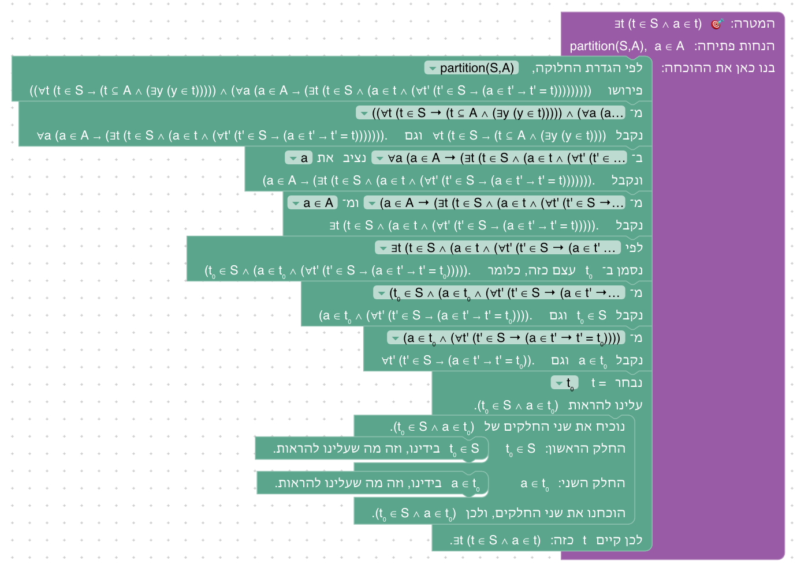
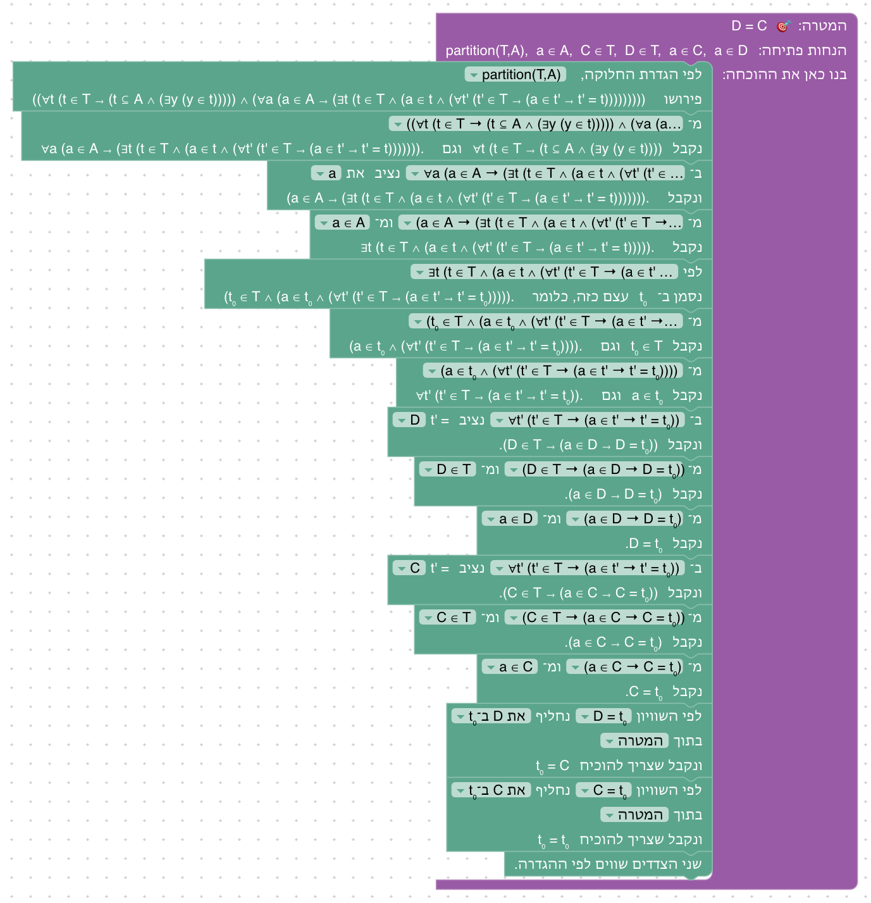
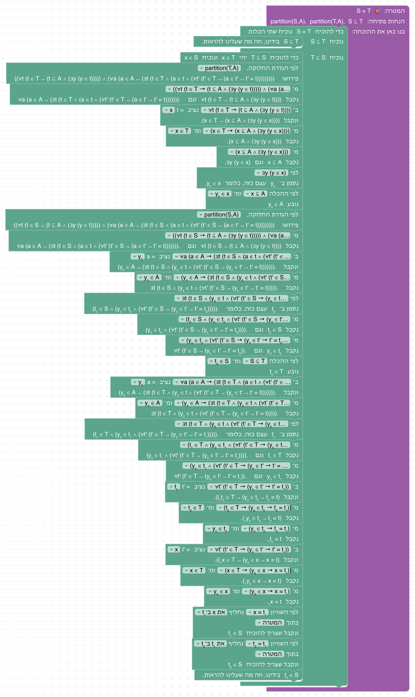

# יחידה 11 — חלוקות

<div dir="rtl">

**מטרה:** היחידה האחרונה של השיעור השני, לפי השקפים "חלוקה של קבוצה", "הגדרה שקולה של חלוקה" ו"משפט: חלוקה המוכלת בחלוקה שווה לה" ב־`01-sets.md`, ולפי תכנון הסמסטר ("יש להגדיר חלוקה כמו שהיא מופיעה ברשימות של הקורס ... יש להוכיח בהרצאה ששתי חלוקות של A שוות כאשר אחת מוכלת בשנייה"). היחידה משתמשת בהגדרה של חלוקה, בשני חלקיה (מחלקות לא ריקות, וכל איבר במחלקה אחת בדיוק), ומוכיחה את המשפט.

## ההגדרה

S חלוקה של A אם `S ⊆ 𝒫(A) ∖ {∅}` וגם `∀a ∈ A ∃!t ∈ S (a ∈ t)`. ב־Lean (`partition` ב־`SET_PRELUDE`, `frontend/src/generator/lean.js`) היא כתובה במפורש:

```
(∀ t, t ∈ S → t ⊆ A ∧ ∃ y, y ∈ t) ∧ ∀ a, a ∈ A → ∃ t, t ∈ S ∧ a ∈ t ∧ ∀ t', t' ∈ S → a ∈ t' → t' = t
```

מחלקה לא ריקה היא מחלקה שיש בה איבר, כי בבלוקים אין את היחידון {∅}; "קיים אחד בדיוק" הוא קיום (`∃ t`) ויחידות (`∀ t'`), כמו ב־`∃!` בשקף. מהלך "לפי ההגדרה" פותח אותה כמו כל הגדרה (`unfoldMembership` ב־`formatProofGoal.js`, עם שני ארגומנטים: המשפחה והקבוצה שהיא מחלקת), ושמה המוצג `partition(S, A)`.

## המהלכים

אין מהלכים חדשים. היחידה משתמשת בטענת עזר ובהחלפה לפי שוויון (9.7), ב"שני הצדדים שווים" (8.2), במהלכי הכמתים של יחידה 5 ובמהלכי ההכלה של יחידה 8. שמות האיברים הם של המערכת: מחלקה שלוקחים להוכחת הכלה נקראת x, איבר שנתון מ"קיים" נקרא y₀, ומחלקה שנתונה מ"קיים" נקראת t₀ (ואחרת, של חלוקה אחרת, t₁).

## שלבים

| שלב | שקף בהרצאה | הטענה | בארגז |
|---|---|---|---|
| 11.1 | חלוקה של קבוצה (הגדרה) | partition(S, A), a ∈ A ⊢ ∃t (t ∈ S ∧ a ∈ t) | לפי ההגדרה, "וגם", הצבה, הסקה קדימה, "קיים", סיום |
| 11.2 | יחידות המחלקה (בהגדרה, ובמשפט) | partition(T, A), a ∈ C, a ∈ D ⊢ D = C | לפי ההגדרה, "וגם", הצבה, הסקה קדימה, "קיים", החלפה לפי שוויון, שני הצדדים שווים |
| 11.3 | משפט: חלוקה המוכלת בחלוקה שווה לה | partition(S, A), partition(T, A), S ⊆ T ⊢ S = T | שוויון קבוצות, הכלה, לפי ההגדרה, "וגם", הצבה, הסקה קדימה, "קיים", שימוש בהכלה, החלפה לפי שוויון, סיום |

### 11.1: כל איבר שייך למחלקה

**למה כך:** התרגול הראשון בהגדרה: פותחים אותה, לוקחים את החלק של "לכל a ∈ A", מציבים, ובוחרים את המחלקה שנקבעת ב"קיים". זה החלק הראשון של "אחד בדיוק".



### 11.2: שתי מחלקות עם איבר משותף

**למה כך:** החלק השני של "אחד בדיוק", היחידות: אם a שייך לשתי מחלקות של אותה חלוקה, הן שוות. בהרצאה זה מופיע בתוך ההוכחה של המשפט ("מיחידות המחלקה של a בחלוקה T: s = t"); כאן מפרידים אותו לשלב משלו, כדי שבשלב 11.3 המהלך יהיה מוכר. מחליפים את D ואת C ב־t₀ לפי השוויונות, ו"שני הצדדים שווים" סוגר את `t₀ = t₀`.



### 11.3: חלוקה המוכלת בחלוקה שווה לה

**למה כך:** המשפט שהתכנון מחייב להוכיח בהרצאה. ההוכחה היא ההוכחה של השקף, שלב אחר שלב: נתון S ⊆ T, ונותר להוכיח T ⊆ S; מחלקה x ∈ T לא ריקה, ולכן יש בה איבר y₀ ∈ A; S חלוקה של A, ולכן יש מחלקה t₀ ∈ S עם y₀ ∈ t₀, ומ־S ⊆ T גם t₀ ∈ T; ומיחידות המחלקה של y₀ **בחלוקה T** (t₁), t₀ = t₁ וגם x = t₁, ולכן x = t₀ ∈ S. הסיכום מזכיר, כמו השקף, למה נחוץ התנאי "לא ריקה".



## מה מההרצאה לא נכנס, ולמה

- **ההגדרה השקולה של חלוקה (`⋃S = A` ו־`∀x, y ∈ S (x ∩ y = ∅ ∨ x = y)`) והוכחת השקילות:** צריך איחוד אונרי של S, והחיתוך הריק; השקף הזה ארוך, והמשפט של 11.3 לא תלוי בו. אפשר להוסיף בעתיד.
- **דוגמאות לחלוקות והדוגמאות הנגדיות שלהן ({{1,2},{2,3}} וכו'):** אין בבלוקים קבוצות מפורשות.
- **ההערה על התנאי "לא ריקה":** מוזכרת בסיכום של 11.3, בלי הוכחה בבלוקים (צריכה את היחידון {1}).

</div>
